**HỆ THỐNG THUYẾT MINH TỰ ĐỘNG ĐA NGÔN NGỮ**

> **Đặc Tả Use Case Chi Tiết (Focused Use Cases)**

# Mục Lục 

[Mục Lục [2](#mục-lục)](#mục-lục)

[1. Sơ Đồ Use Case Tổng Quát
[3](#sơ-đồ-use-case-tổng-quát)](#sơ-đồ-use-case-tổng-quát)

[2. Danh Sách Tác Nhân (Actors)
[3](#danh-sách-tác-nhân-actors)](#danh-sách-tác-nhân-actors)

[3. Đặc Tả Chi Tiết Các Use Case
[5](#đặc-tả-chi-tiết-các-use-case)](#đặc-tả-chi-tiết-các-use-case)

[3.1 USC01 --- Đăng Nhập [6](#usc01-đăng-nhập)](#usc01-đăng-nhập)

[3.2 USC02 --- Quét Mã QR [8](#usc02-quét-mã-qr)](#usc02-quét-mã-qr)

[3.3 USC03 --- Nghe Thuyết Minh
[11](#usc03-nghe-thuyết-minh)](#usc03-nghe-thuyết-minh)

[3.4 USC04 --- Chuyển Đổi Ngôn Ngữ
[14](#usc04-chuyển-đổi-ngôn-ngữ)](#usc04-chuyển-đổi-ngôn-ngữ)

[3.5 USC05 --- Lưu Sự Vật Yêu Thích
[16](#usc05-lưu-sự-vật-yêu-thích)](#usc05-lưu-sự-vật-yêu-thích)

[3.6 USC6 --- Xem Hồ Sơ Bảo Tàng
[18](#usc6-xem-hồ-sơ-bảo-tàng)](#usc6-xem-hồ-sơ-bảo-tàng)

[3.7 USC07 --- Xem Phụ Đề [20](#usc07-xem-phụ-đề)](#usc07-xem-phụ-đề)

[3.8 USC08 --- Tìm Kiếm [23](#usc08-tìm-kiếm)](#usc08-tìm-kiếm)

[3.9 USC09 --- Quản Lý Sự Vật
[26](#usc09-quản-lý-sự-vật)](#usc09-quản-lý-sự-vật)

[3.10 USC10 --- Chỉnh Sửa Mã QR
[29](#usc10-chỉnh-sửa-mã-qr)](#usc10-chỉnh-sửa-mã-qr)

[3.11 USC11 --- Quản Lý Tệp Âm Thanh
[33](#usc11-quản-lý-tệp-âm-thanh)](#usc11-quản-lý-tệp-âm-thanh)

[3.12 USC12 --- Xem Thống Kê Lượt Nghe
[36](#usc12-xem-thống-kê-lượt-nghe)](#usc12-xem-thống-kê-lượt-nghe)

[3.13 USC13 --- Quản Lý Sơ Đồ
[39](#usc13-quản-lý-sơ-đồ)](#usc13-quản-lý-sơ-đồ)

[3.14 USC14 --- Phát Luồng Dữ Liệu Âm Thanh
[43](#usc14-phát-luồng-dữ-liệu-âm-thanh)](#usc14-phát-luồng-dữ-liệu-âm-thanh)

[3.15 USC15 --- Lưu Trữ Tệp Âm Thanh
[46](#usc15-lưu-trữ-tệp-âm-thanh)](#usc15-lưu-trữ-tệp-âm-thanh)

# Sơ Đồ Use Case Tổng Quát 

Sơ đồ dưới đây mô tả tổng quan các use case của Hệ thống Thuyết minh tự
động đa ngôn ngữ, cùng các tác nhân (actor) tham gia và các quan hệ
include/extend/generalization giữa các use case.

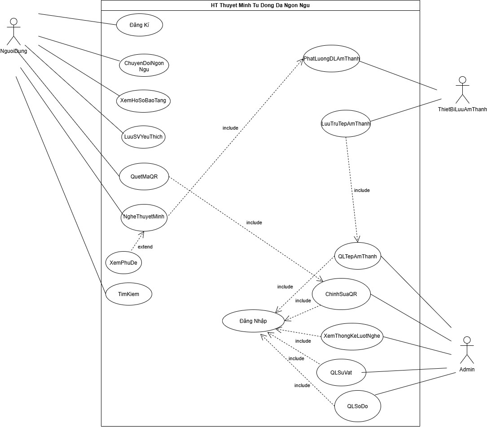{width="6.5in" height="5.705in"}

# Danh Sách Tác Nhân (Actors) 

+-----------------+----------------------------------------------------+
| **Tác nhân**    | > **Mô tả**                                        |
+=================+====================================================+
| **Người (Khách  | > Người dùng phổ thông chưa đăng nhập vào tài      |
| vãng**          | > khoản cá nhân.                                   |
|                 |                                                    |
| **lai)**        |                                                    |
+-----------------+----------------------------------------------------+
| **Người Dùng    | > Thừa kế từ tác nhân Người, có tài khoản để lưu   |
| (Đã đăng        | > trữ thông tin cá nhân và sử dụng các tính năng   |
| ký/đăng nhập)** | > nâng cao.                                        |
+-----------------+----------------------------------------------------+
| **Admin (Quản   | > Người quản lý hệ thống dữ liệu hiện vật, sơ đồ,  |
| trị viên)**     | > mã QR, tệp âm thanh và thống kê.                 |
+-----------------+----------------------------------------------------+
| **Tác nhân**    | > **Mô tả**                                        |
+-----------------+----------------------------------------------------+
| **Thiết Bị Lưu  | > Hệ thống phần cứng/dịch vụ lưu trữ và truyền     |
| Âm**            | > phát dòng dữ liệu âm thanh thuyết minh           |
|                 | > (Streaming Server).                              |
| **Thanh (Audio  |                                                    |
| Storage Device  |                                                    |
| / Server)**     |                                                    |
+-----------------+----------------------------------------------------+

# Đặc Tả Chi Tiết Các Use Case 

Phần dưới đây trình bày đặc tả chi tiết (Focused Use Case) cho từng use
case của hệ thống, theo mẫu: Tác nhân, Mức độ hoàn thiện, Mô tả tóm tắt,
Điều kiện tiên quyết, Dòng sự kiện chính, Luồng thay thế (Alternative),
Luồng ngoại lệ (Exception), Điều kiện kết thúc và Sự kiện kích hoạt, kèm
sơ đồ use case và sơ đồ hoạt động minh họa.

## USC01 --- Đăng Nhập 

***Sơ đồ Use Case --- USC01***

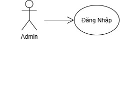{width="4.216666666666667in"
height="2.0866666666666664in"}

+--------------------------------------------------------------------------------------+
| > **USC01: Đăng Nhập Hệ Thống**                                                      |
+==========================+=============================+=============================+
| > **Tác nhân (Actor):**  | Admin                                                     |
+--------------------------+-----------------------------------------------------------+
| > **Mức độ hoàn thiện:** | Focused                                                   |
+--------------------------+-----------------------------------------------------------+
| > **Mô tả tóm tắt:**     | Xác thực danh tính của Quản trị viên để phân quyền truy   |
|                          | cập các chức năng tương ứng trong hệ thống                |
+--------------------------+-----------------------------------------------------------+
| > **Điều kiện tiên       | > ● Tác nhân Admin                                        |
| > quyết:**               |                                                           |
+--------------------------+-----------------------------+-----------------------------+
| > **Dòng sự kiện         | > **Hành động của Actor**   | > **Phản hồi của Hệ thống** |
| > chính:**               |                             |                             |
|                          +-----------------------------+-----------------------------+
|                          | > 1\. Admin chọn chức năng  |                             |
|                          | > \"Đăng Nhập\".            |                             |
|                          +-----------------------------+-----------------------------+
|                          |                             | > 2\. Hệ thống hiển thị     |
|                          |                             | > biểu mẫu đăng nhập (Tên   |
|                          |                             | > đăng nhập/Email và Mật    |
|                          |                             | > khẩu).                    |
|                          +-----------------------------+-----------------------------+
|                          | > 3\. Admin nhập thông tin  |                             |
|                          | > đăng nhập và nhấn \"Đăng  |                             |
|                          | > nhập\".                   |                             |
|                          +-----------------------------+-----------------------------+
|                          |                             | > 4\. Hệ thống thực hiện    |
|                          |                             | > xác thực đăng nhập (E1).  |
|                          +-----------------------------+-----------------------------+
|                          |                             | > 5\. Hệ thống khởi động    |
|                          |                             | > phiên làm việc            |
|                          |                             | > (Session/Token) cho       |
|                          |                             | > Admin.                    |
|                          +-----------------------------+-----------------------------+
|                          |                             | > 6\. Hệ thống hiển thị     |
|                          |                             | > Dashboard quản trị. Use   |
|                          |                             | > Case kết thúc thành công. |
+--------------------------+-----------------------------+-----------------------------+
| > **Luồng thay thế       | > ● Không có.                                             |
| > (Alternative):**       |                                                           |
+--------------------------+-----------------------------------------------------------+
| > **Luồng ngoại lệ       | > ● E1 - Sai mật khẩu: Hệ thống thông báo \"Tên đăng nhập |
| > (Exception):**         | > hoặc mật khẩu không chính xác\" và cho phép nhập lại    |
|                          | > (tự động khóa tạm thời nếu nhập sai quá 5 lần).         |
+--------------------------+-----------------------------------------------------------+
| **Điều kiện kết thúc:**  | - **Thành công:** Phiên làm việc (Session/Token) được     |
|                          |   khởi tạo thành công với quyền hạn tương ứng (Admin truy |
|                          |   cập Dashboard Quản trị; Người dùng truy cập Trang cá    |
|                          |   nhân).                                                  |
|                          |                                                           |
|                          | - **Thất bại:** Hệ thống từ chối quyền truy cập, hiển thị |
|                          |   thông báo lỗi (E1) và không tạo phiên làm việc.         |
+--------------------------+-----------------------------------------------------------+
| **Sự kiện kích hoạt      | > Admin chọn chức năng \"Đăng Nhập\".                     |
| (Trigger):**             |                                                           |
+--------------------------+-----------------------------------------------------------+

***Sơ đồ hoạt động (Activity Diagram) --- USC01***

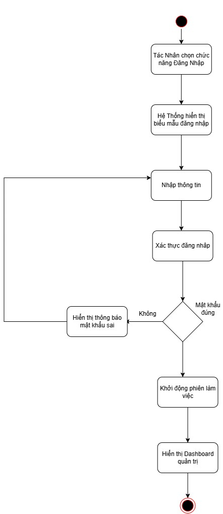{width="3.0383333333333336in"
height="6.991666666666666in"}

## USC02 --- Quét Mã QR 

***Sơ đồ Use Case --- USC03***

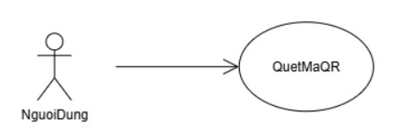{width="3.6666666666666665in"
height="1.3in"}

+--------------------------------------------------------------------------------------+
| > **UC02: Quét Mã QR**                                                               |
+==========================+=============================+=============================+
| > **Tác nhân (Actor):**  | Người Dùng (hoặc Khách tham quan)                         |
+--------------------------+-----------------------------------------------------------+
| > **Mức độ hoàn thiện:** | Focused                                                   |
+--------------------------+-----------------------------------------------------------+
| > **Mô tả tóm tắt:**     | Người dùng sử dụng camera thiết bị di động quét mã QR gắn |
|                          | tại vị trí hiện vật/khu vực trưng bày để hệ thống tự động |
|                          | nhận diện và mở nội dung thuyết minh tương ứng. Người     |
|                          | dùng chỉ cần quét mã QR một lần, sau đó hệ thống tự động  |
|                          | tracking (theo dõi vị trí) và tự động mở thuyết minh khi  |
|                          | người dùng đến gần các hiện vật tiếp theo, không cần quét |
|                          | lại.                                                      |
+--------------------------+-----------------------------------------------------------+
| > **Điều kiện tiên       | - Thiết bị di động của người dùng có tích hợp Camera và   |
| > quyết:**               |   phần cứng hoạt động bình thường.                        |
|                          |                                                           |
|                          | - Ứng dụng đã được cấp quyền truy cập Camera.             |
|                          |                                                           |
|                          | - Ứng dụng được cấp quyền định vị/kết nối cần thiết để    |
|                          |   thực hiện tracking vị trí.                              |
+--------------------------+-----------------------------+-----------------------------+
| > **Dòng sự kiện         | > **Hành động của Actor**   | > **Phản hồi của Hệ thống** |
| > chính:**               |                             |                             |
|                          +-----------------------------+-----------------------------+
|                          | > 1\. Người dùng chọn tính  |                             |
|                          | > năng \"Quét Mã QR\".      |                             |
|                          +-----------------------------+-----------------------------+
|                          |                             | > 2\. Hệ thống kích hoạt    |
|                          |                             | > camera và hiển thị khung  |
|                          |                             | > quét mã QR (E2).          |
|                          +-----------------------------+-----------------------------+
|                          | > 3\. Người dùng hướng      |                             |
|                          | > camera về phía mã QR gắn  |                             |
|                          | > trên hiện vật (quét 1     |                             |
|                          | > lần).                     |                             |
|                          +-----------------------------+-----------------------------+
|                          |                             | > 4\. Hệ thống nhận diện và |
|                          |                             | > giải mã chuỗi định danh   |
|                          |                             | > QR (E1).                  |
|                          +-----------------------------+-----------------------------+
|                          |                             | > 5\. Hệ thống truy vấn     |
|                          |                             | > thông tin hiện vật từ     |
|                          |                             | > CSDL theo ID vừa giải mã. |
+--------------------------+-----------------------------+-----------------------------+
|                          |                             | > 6\. Hệ thống ghi nhận vị  |
|                          |                             | > trí hiện vật vừa quét làm |
|                          |                             | > điểm xuất phát và bật chế |
|                          |                             | > độ tự động tracking.      |
|                          +-----------------------------+-----------------------------+
|                          |                             | > 7\. Hệ thống tự động      |
|                          |                             | > chuyển đến màn hình chi   |
|                          |                             | > tiết hiện vật và kích     |
|                          |                             | > hoạt chức năng liên quan  |
|                          |                             | > (Đọc nội dung, Xem hình   |
|                          |                             | > ảnh hoặc phát Use Case    |
|                          |                             | > {Nghe Thuyết Minh}).      |
|                          +-----------------------------+-----------------------------+
|                          | > 8\. Người dùng di chuyển  |                             |
|                          | > tham quan, không cần quét |                             |
|                          | > lại mã QR. (A1, A2)       |                             |
|                          +-----------------------------+-----------------------------+
|                          |                             | > 9\. Hệ thống tự động      |
|                          |                             | > tracking vị trí người     |
|                          |                             | > dùng (E3).                |
|                          +-----------------------------+-----------------------------+
|                          |                             | > 10\. Khi người dùng đến   |
|                          |                             | > gần hiện vật khác, hệ     |
|                          |                             | > thống tự động nhận diện   |
|                          |                             | > hiện vật đó, truy vấn dữ  |
|                          |                             | > liệu và tự động mở nội    |
|                          |                             | > dung thuyết minh tương    |
|                          |                             | > ứng.                      |
|                          +-----------------------------+-----------------------------+
|                          | > 11\. Người dùng tiếp tục  |                             |
|                          | > tham quan.                |                             |
|                          +-----------------------------+-----------------------------+
|                          |                             | > 12\. Hệ thống lặp lại     |
|                          |                             | > bước 9--10 cho đến khi    |
|                          |                             | > người dùng dừng theo dõi  |
|                          |                             | > hoặc thoát ứng dụng. Use  |
|                          |                             | > Case kết thúc.            |
+--------------------------+-----------------------------+-----------------------------+
| > **Luồng thay thế       | - A1 -- Người dùng tắt tracking: Người dùng chọn \"Dừng   |
| > (Alternative):**       |   theo dõi\" trong quá trình tham quan. Hệ thống dừng     |
|                          |   tracking và Use Case kết thúc.                          |
|                          |                                                           |
|                          | - A2 -- Quét thủ công hiện vật khác: Người dùng chủ động  |
|                          |   quét mã QR của một hiện vật bất kỳ. Hệ thống xử lý như  |
|                          |   bước 3--7 và cập nhật lại vị trí xuất phát cho          |
|                          |   tracking.                                               |
+--------------------------+-----------------------------------------------------------+
| > **Luồng ngoại lệ       | - E1 -- Không thể quét/mã QR mờ hoặc hỏng: Hệ thống hiển  |
| > (Exception):**         |   thị thông báo \"Không nhận dạng được mã QR\" và gợi ý   |
|                          |   điều chỉnh khoảng cách, ánh sáng. Đồng thời hiển thị    |
|                          |   nút \"Tìm kiếm hiện vật\" để người dùng chuyển sang     |
|                          |   chức năng Tìm kiếm (có thể nhập trực tiếp mã số hiện    |
|                          |   vật).                                                   |
|                          |                                                           |
|                          | - E2 -- Chưa cấp quyền Camera hoặc thiết bị không có      |
|                          |   camera: Hệ thống thông báo cần quyền truy cập Camera để |
|                          |   quét mã, hướng dẫn cấp quyền trong phần cài đặt của     |
|                          |   thiết bị và hiển thị nút \"Tìm kiếm hiện vật\".         |
|                          |                                                           |
|                          | - E3 -- Mất tín hiệu hoặc không có quyền định vị khi      |
|                          |   tracking: Hệ thống thông báo \"Không thể theo dõi vị    |
|                          |   trí\", dừng tracking tự động và đề nghị người dùng quét |
|                          |   mã QR thủ công hoặc dùng chức năng Tìm kiếm.            |
+--------------------------+-----------------------------------------------------------+
| > **Điều kiện kết        | - Thành công: Hệ thống giải mã thành công QR ID, truy vấn |
| > thúc:**                |   dữ liệu hiện vật, chuyển hướng người dùng đến màn hình  |
|                          |   chi tiết hiện vật và bật tracking tự động cho các hiện  |
|                          |   vật tiếp theo.                                          |
|                          |                                                           |
|                          | - Thất bại: Màn hình quét giữ nguyên hoặc hiển thị thông  |
|                          |   báo lỗi mã QR không hợp lệ/mờ hỏng/chưa cấp quyền       |
|                          |   Camera (E1, E2) hoặc mất tracking (E3), kèm gợi ý       |
|                          |   chuyển sang chức năng Tìm kiếm.                         |
+--------------------------+-----------------------------------------------------------+
| > **Sự kiện kích hoạt    | Người dùng chọn biểu tượng \"Quét QR\" trên giao diện.    |
| > (Trigger):**           |                                                           |
+--------------------------+-----------------------------------------------------------+

***Sơ đồ hoạt động (Activity Diagram) --- USC02***

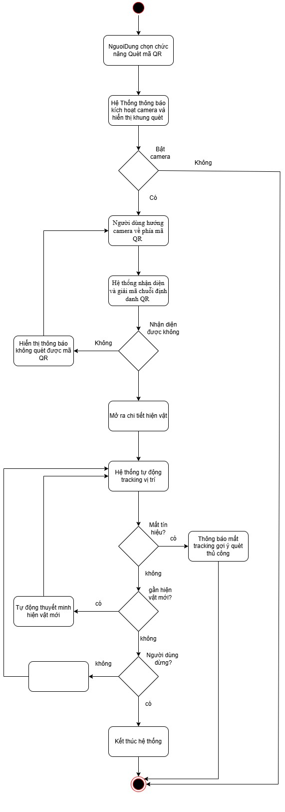{width="2.8366666666666664in"
height="8.05in"}

## USC03 --- Nghe Thuyết Minh 

***Sơ đồ Use Case --- USC04***

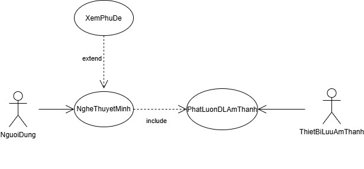{width="5.198333333333333in"
height="2.425in"}

+--------------------------------------------------------------------------------------+
| > **USC04: Nghe Thuyết Minh Tự Động**                                                |
+==========================+=============================+=============================+
| > **Tác nhân (Actor):**  | > Người Dùng, Thiết Bị Lưu Âm Thanh                       |
+--------------------------+-----------------------------------------------------------+
| > **Mức độ hoàn thiện:** | > Focused                                                 |
+--------------------------+-----------------------------------------------------------+
| > **Mô tả tóm tắt:**     | > Phát bản thu âm thuyết minh về hiện vật/sự vật theo     |
|                          | > ngôn ngữ hiện tại của người dùng. Tự động gọi {Phát     |
|                          | > Luồng Dữ Liệu Âm Thanh} («include») từ thiết bị lưu trữ |
|                          | > và có thể mở rộng hiển thị phụ đề với {Xem Phụ Đề}      |
|                          | > («extend»).                                             |
+--------------------------+-----------------------------------------------------------+
| > **Điều kiện tiên       | > Đã xác định được hiện vật cần thuyết minh (thông qua    |
| > quyết:**               | > Quét mã QR hoặc Tìm kiếm/Xem danh sách).                |
+--------------------------+-----------------------------+-----------------------------+
| > **Dòng sự kiện         | > **Hành động của Actor**   | **Phản hồi của Hệ thống**   |
| > chính:**               |                             |                             |
|                          +-----------------------------+-----------------------------+
|                          | > 1\. Người dùng đăng nhập  |                             |
|                          +-----------------------------+-----------------------------+
|                          |                             | 2\. Hệ thống hiển thị lời   |
|                          |                             | chào mừng đăng nhập cùng    |
|                          |                             | với những chức năng chính   |
|                          |                             | cho người dùng lựa chọn     |
|                          +-----------------------------+-----------------------------+
|                          | > 3\. Người dùng chọn nghe  |                             |
|                          | > thuyết minh của hiện vật  |                             |
|                          | > (hoặc tự động kích hoạt   |                             |
|                          | > sau khi quét QR).         |                             |
|                          +-----------------------------+-----------------------------+
|                          |                             | 4\. Hệ thống xác định ngôn  |
|                          |                             | ngữ người dùng đang chọn và |
|                          |                             | mã ID của tệp âm thanh      |
|                          |                             | tương ứng.                  |
|                          +-----------------------------+-----------------------------+
|                          |                             | 5\. Hệ thống thực hiện      |
|                          |                             | {Phát Luồng Dữ Liệu Âm      |
|                          |                             | Thanh}: gửi yêu cầu lấy tệp |
|                          |                             | tin/dòng dữ liệu âm thanh   |
|                          |                             | đến Thiết Bị Lưu Âm Thanh.  |
+--------------------------+-----------------------------+-----------------------------+
|                          |                             | > 6\. Thiết Bị Lưu Âm Thanh |
|                          |                             | > truyền luồng dữ liệu      |
|                          |                             | > (audio stream) về ứng     |
|                          |                             | > dụng. E1                  |
|                          +-----------------------------+-----------------------------+
|                          |                             | > 7\. Hệ thống khởi tạo     |
|                          |                             | > trình phát âm thanh và    |
|                          |                             | > bắt đầu phát (Play). Hiển |
|                          |                             | > thị các nút điều khiển:   |
|                          |                             | > Pause, Stop, Seek, Tốc độ |
|                          |                             | > phát.                     |
|                          +-----------------------------+-----------------------------+
|                          | > 8\. Người dùng lắng nghe  |                             |
|                          | > thuyết minh và tương tác  |                             |
|                          | > thanh điều khiển phát khi |                             |
|                          | > cần. (A1, A2)             |                             |
|                          +-----------------------------+-----------------------------+
|                          |                             | > 9\. Âm thanh kết thúc. Hệ |
|                          |                             | > thống cập nhật số lượt    |
|                          |                             | > nghe (lưu log thống kê)   |
|                          |                             | > và dừng trình phát. Kết   |
|                          |                             | > thúc Use Case.            |
+--------------------------+-----------------------------+-----------------------------+
| > **Luồng thay thế       | - A1 - Người dùng bật phụ đề (Extension Point Xem Phụ     |
| > (Alternative):**       |   Đề): Người dùng bấm nút \"Bật Phụ Đề\" trên trình phát. |
|                          |   Hệ thống kích hoạt use case Xem Phụ Đề, tải và hiển thị |
|                          |   văn bản đồng bộ theo mốc thời gian của bài nói.         |
|                          |                                                           |
|                          | - A2 - Đổi ngôn ngữ giữa chừng: Người dùng chọn thay đổi  |
|                          |   ngôn ngữ khác (Use case Chuyển Đổi Ngôn Ngữ). Hệ thống  |
|                          |   lưu vị trí phát hiện tại, nạp tệp âm thanh ngôn ngữ mới |
|                          |   từ Thiết Bị Lưu Âm Thanh và phát tiếp.                  |
+--------------------------+-----------------------------------------------------------+
| > **Luồng ngoại lệ       | > ● E1 - Lỗi kết nối thiết bị âm thanh/mạng: Hệ thống     |
| > (Exception):**         | > không nhận được luồng dữ liệu âm thanh. Hệ thống thông  |
|                          | > báo \"Không tải được âm thanh thuyết minh, vui lòng     |
|                          | > kiểm tra kết nối\" và gợi ý người dùng đọc bản thuyết   |
|                          | > minh bằng văn bản (DocND).                              |
+--------------------------+-----------------------------------------------------------+
| > **Điều kiện kết        | Âm thanh thuyết minh được phát liên tục, trơn tru cho     |
| > thúc:**                | người dùng.                                               |
+--------------------------+-----------------------------------------------------------+
| > **Sự kiện kích hoạt    | Extension Point: Xem Phụ Đề (khi người dùng kích hoạt bật |
| > (Trigger):**           | phụ đề văn bản tương ứng với audio).                      |
+--------------------------+-----------------------------------------------------------+

***Sơ đồ hoạt động (Activity Diagram) --- UC04***

> 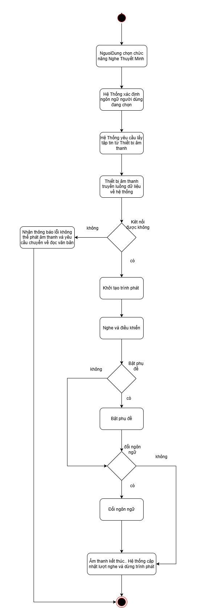{width="3.5166666666666666in"
> height="9.58in"}

## USC04 --- Chuyển Đổi Ngôn Ngữ 

***Sơ đồ Use Case --- USC05***

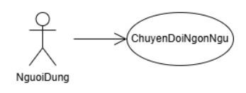{width="2.8916666666666666in"
height="1.1in"}

+--------------------------------------------------------------------------------------+
| > **USC04: Chuyển Đổi Ngôn Ngữ**                                                     |
+==========================+=============================+=============================+
| > **Tác nhân (Actor):**  | Người Dùng (hoặc Khách vãng lai)                          |
+--------------------------+-----------------------------------------------------------+
| > **Mức độ hoàn thiện:** | Focused                                                   |
+--------------------------+-----------------------------------------------------------+
| > **Mô tả tóm tắt:**     | Thay đổi ngôn ngữ hiển thị giao diện và ngôn ngữ các nội  |
|                          | dung thuyết minh (Tiếng Việt, Tiếng Anh, Tiếng Pháp,      |
|                          | Tiếng Trung, v.v.).                                       |
+--------------------------+-----------------------------------------------------------+
| > **Điều kiện tiên       | Không có.                                                 |
| > quyết:**               |                                                           |
+--------------------------+-----------------------------+-----------------------------+
| > **Dòng sự kiện         | > **Hành động của Actor**   | > **Phản hồi của Hệ thống** |
| > chính:**               |                             |                             |
|                          +-----------------------------+-----------------------------+
|                          | > 1\. Người dùng chọn tính  |                             |
|                          | > năng \"Chuyển Đổi Ngôn    |                             |
|                          | > Ngữ\".                    |                             |
|                          +-----------------------------+-----------------------------+
|                          |                             | > 2\. Hệ thống hiển thị     |
|                          |                             | > danh sách các ngôn ngữ    |
|                          |                             | > được hỗ trợ.              |
|                          +-----------------------------+-----------------------------+
|                          | > 3\. Người dùng chọn một   |                             |
|                          | > ngôn ngữ mong muốn        |                             |
|                          +-----------------------------+-----------------------------+
|                          |                             | > 4\. Hệ thống ghi nhận     |
|                          |                             | > thiết lập ngôn ngữ mới    |
|                          |                             | > vào cấu hình phiên.       |
|                          +-----------------------------+-----------------------------+
|                          |                             | > 5\. Hệ thống tải lại tài  |
|                          |                             | > nguyên giao diện, nội     |
|                          |                             | > dung bài viết và các liên |
|                          |                             | > kết âm thanh tương ứng    |
|                          |                             | > với ngôn ngữ đã chọn.     |
|                          +-----------------------------+-----------------------------+
|                          |                             | > 6\. Giao diện hiển thị    |
|                          |                             | > bằng ngôn ngữ mới. Use    |
|                          |                             | > case kết thúc.            |
+--------------------------+-----------------------------+-----------------------------+
| **Luồng thay thế         | > Không có.                                               |
| (Alternative):**         |                                                           |
+--------------------------+-----------------------------------------------------------+
| **Luồng ngoại lệ         | > Không có.                                               |
| (Exception):**           |                                                           |
+--------------------------+-----------------------------------------------------------+
| **Điều kiện kết thúc:**  | > Toàn bộ giao diện và dữ liệu nội dung hiển thị sang     |
|                          | > ngôn ngữ mới được chọn.                                 |
+--------------------------+-----------------------------------------------------------+
| **Sự kiện kích hoạt      | > Người dùng chọn biểu tượng ngôn ngữ/quốc kỳ trên màn    |
| (Trigger):**             | > hình.                                                   |
+--------------------------+-----------------------------------------------------------+

***Sơ đồ hoạt động (Activity Diagram) --- USC04***

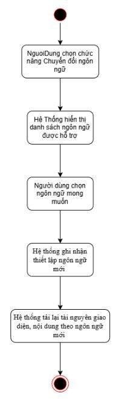{width="1.6416666666666666in"
height="5.475in"}

## USC05 --- Lưu Sự Vật Yêu Thích 

***Sơ đồ Use Case --- USC05***

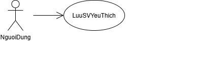{width="5.513333333333334in"
height="1.5581944444444444in"}

+--------------------------------------------------------------------------------------+
| > **USC05: Lưu Sự Vật Yêu Thích (LuuSVYeuThich)**                                    |
+==========================+=============================+=============================+
| > **Tác nhân (Actor):**  | Người Dùng                                                |
+--------------------------+-----------------------------------------------------------+
| > **Mức độ hoàn thiện:** | Focused                                                   |
+--------------------------+-----------------------------------------------------------+
| > **Mô tả tóm tắt:**     | Cho phép người dùng đánh dấu/lưu lại các hiện vật, sự vật |
|                          | ấn tượng vào danh mục \"Yêu thích\" để xem lại sau.       |
+--------------------------+-----------------------------------------------------------+
| > **Điều kiện tiên       | Người dùng đang ở màn hình chi tiết hiện vật              |
| > quyết:**               |                                                           |
+--------------------------+-----------------------------+-----------------------------+
| > **Dòng sự kiện         | > **Hành động của Actor**   | > **Phản hồi của Hệ thống** |
| > chính:**               |                             |                             |
|                          +-----------------------------+-----------------------------+
|                          | > 1\. Người dùng đăng nhập  |                             |
|                          +-----------------------------+-----------------------------+
|                          |                             | > 2\. Hệ thống hiển thị lời |
|                          |                             | > chào mừng đăng nhập cùng  |
|                          |                             | > với những chức năng chính |
|                          |                             | > cho người dùng lựa chọn   |
|                          +-----------------------------+-----------------------------+
|                          | > 3\. Người dùng bấm nút    |                             |
|                          | > \"Lưu Yêu Thích\" tại     |                             |
|                          | > trang hiện vật.           |                             |
|                          +-----------------------------+-----------------------------+
|                          |                             | > 4\. Hệ thống kiểm tra     |
|                          |                             | > trạng thái lưu: nếu chưa  |
|                          |                             | > lưu thì thêm hiện vật vào |
|                          |                             | > danh mục yêu thích trong  |
|                          |                             | > CSDL; nếu đã lưu thì hiển |
|                          |                             | > thị tùy chọn xóa khỏi     |
|                          |                             | > danh sách (A1).           |
|                          +-----------------------------+-----------------------------+
|                          |                             | > 5\. Hệ thống cập nhật     |
|                          |                             | > biểu tượng trạng thái (đã |
|                          |                             | > lưu) và thông báo \"Đã    |
|                          |                             | > lưu vào danh sách yêu     |
|                          |                             | > thích\".                  |
+--------------------------+-----------------------------+-----------------------------+
| > **Luồng thay thế       | > ● A1 - Hủy lưu yêu thích: Người dùng bấm lần nữa để bỏ  |
| > (Alternative):**       | > chọn. Hệ thống xóa hiện vật khỏi bảng danh sách yêu     |
|                          | > thích của người dùng.                                   |
+--------------------------+-----------------------------------------------------------+
| > **Luồng ngoại lệ       | Không có.                                                 |
| > (Exception):**         |                                                           |
+--------------------------+-----------------------------------------------------------+
| > **Điều kiện kết        | Hiện vật được thêm vào danh sách yêu thích của tài khoản  |
| > thúc:**                | người dùng.                                               |
+--------------------------+-----------------------------------------------------------+
| > **Sự kiện kích hoạt    | Người dùng nhấn vào nút \"Thêm vào Yêu thích\" (biểu      |
| > (Trigger):**           | tượng trái tim/ngôi sao).                                 |
+--------------------------+-----------------------------------------------------------+

***Sơ đồ hoạt động (Activity Diagram) --- USC05***

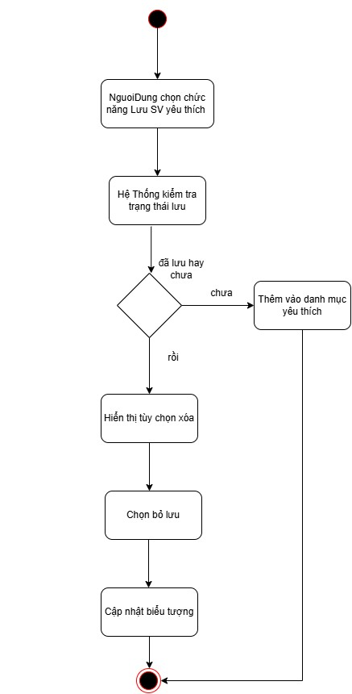{width="3.7733333333333334in"
height="7.425in"}

## USC6 --- Xem Hồ Sơ Bảo Tàng 

***Sơ đồ Use Case --- USC6***

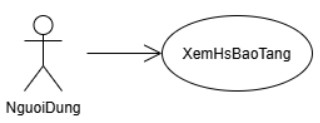{width="2.6666666666666665in"
height="1.025in"}

+--------------------------------------------------------------------------------------+
| > **USC14: Xem Hồ Sơ Bảo Tàng (XemHoSoBaoTang)**                                     |
+==========================+=============================+=============================+
| > **Tác nhân (Actor):**  | Người Dùng                                                |
+--------------------------+-----------------------------------------------------------+
| > **Mức độ hoàn thiện:** | Focused                                                   |
+--------------------------+-----------------------------------------------------------+
| > **Mô tả tóm tắt:**     | Cho phép người dùng xem thông tin tổng quan về bảo tàng:  |
|                          | giới thiệu, lịch sử hình thành, giờ mở cửa, địa chỉ,      |
|                          | thông tin liên hệ và sơ đồ các khu trưng bày.             |
+--------------------------+-----------------------------------------------------------+
| > **Điều kiện tiên       | Người dùng đã mở ứng dụng hoặc truy cập trang web của hệ  |
| > quyết:**               | thống.                                                    |
+--------------------------+-----------------------------+-----------------------------+
| > **Dòng sự kiện         | > **Hành động của Actor**   | > **Phản hồi của Hệ thống** |
| > chính:**               |                             |                             |
|                          +-----------------------------+-----------------------------+
|                          | > 1\. Người dùng chọn \"Hồ  |                             |
|                          | > sơ bảo tàng\" trên giao   |                             |
|                          | > diện chính.               |                             |
|                          +-----------------------------+-----------------------------+
|                          |                             | > 2\. Hệ thống xác định     |
|                          |                             | > ngôn ngữ đang chọn và     |
|                          |                             | > truy vấn hồ sơ bảo tàng   |
|                          |                             | > trong CSDL (E1).          |
|                          +-----------------------------+-----------------------------+
|                          |                             | > 3\. Hệ thống hiển thị     |
|                          |                             | > thông tin giới thiệu,     |
|                          |                             | > lịch sử, giờ mở cửa, địa  |
|                          |                             | > chỉ và thông tin liên hệ  |
|                          |                             | > của bảo tàng.             |
|                          +-----------------------------+-----------------------------+
|                          | > 4\. Người dùng xem thông  |                             |
|                          | > tin và có thể chọn xem sơ |                             |
|                          | > đồ khu trưng bày (A1).    |                             |
|                          +-----------------------------+-----------------------------+
|                          | > 5\. Người dùng thoát khỏi |                             |
|                          | > màn hình hồ sơ. Use case  |                             |
|                          | > kết thúc.                 |                             |
+--------------------------+-----------------------------+-----------------------------+
| > **Luồng thay thế       | > ● A1 - Xem sơ đồ khu trưng bày: Tại bước 4, người dùng  |
| > (Alternative):**       | > chọn \"Sơ đồ khu trưng bày\". Hệ thống hiển thị sơ đồ   |
|                          | > do Admin quản lý ở {Quản Lý Sơ Đồ}; người dùng có thể   |
|                          | > phóng to/thu nhỏ rồi quay lại bước 4.                   |
+--------------------------+-----------------------------------------------------------+
| > **Luồng ngoại lệ       | > ● E1 - Lỗi tải hồ sơ bảo tàng: Hệ thống thông báo       |
| > (Exception):**         | > \"Không tải được thông tin bảo tàng, vui lòng thử lại\" |
|                          | > và cho phép tải lại.                                    |
+--------------------------+-----------------------------------------------------------+
| > **Điều kiện kết        | Thông tin hồ sơ bảo tàng được hiển thị đầy đủ theo ngôn   |
| > thúc:**                | ngữ người dùng đang chọn.                                 |
+--------------------------+-----------------------------------------------------------+
| > **Sự kiện kích hoạt    | Người dùng chọn \"Hồ sơ bảo tàng\" trên giao diện chính.  |
| > (Trigger):**           |                                                           |
+--------------------------+-----------------------------------------------------------+

***Sơ đồ hoạt động (Activity Diagram) --- USC6***

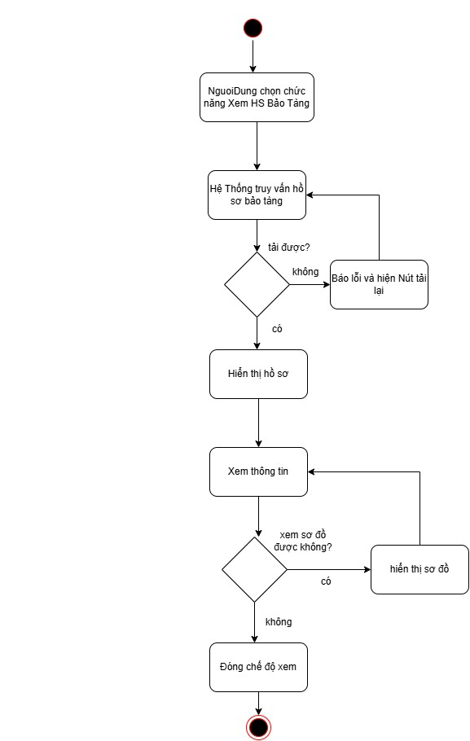{width="4.988333333333333in"
height="7.87in"}

## USC07 --- Xem Phụ Đề 

***Sơ đồ Use Case --- USC07***

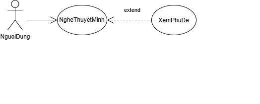{width="5.091666666666667in"
height="2.0416666666666665in"}

+--------------------------------------------------------------------------------------+
| > **USC18: Xem Phụ Đề (XemPhuDe)**                                                   |
+==========================+=============================+=============================+
| > **Tác nhân (Actor):**  | Người Dùng                                                |
+--------------------------+-----------------------------------------------------------+
| > **Mức độ hoàn thiện:** | Focused                                                   |
+--------------------------+-----------------------------------------------------------+
| > **Mô tả tóm tắt:**     | Hiển thị phụ đề dạng văn bản đồng bộ với âm thanh thuyết  |
|                          | minh đang phát. Là use case mở rộng («extend») của {Nghe  |
|                          | Thuyết Minh} tại điểm mở rộng \"Xem Phụ Đề\" (UC04 - A1). |
+--------------------------+-----------------------------------------------------------+
| > **Điều kiện tiên       | Người dùng đang nghe thuyết minh (use case {Nghe Thuyết   |
| > quyết:**               | Minh} đang thực hiện).                                    |
+--------------------------+-----------------------------+-----------------------------+
| > **Dòng sự kiện         | > **Hành động của Actor**   | > **Phản hồi của Hệ thống** |
| > chính:**               |                             |                             |
|                          +-----------------------------+-----------------------------+
|                          | > 1\. Người dùng nhấn nút   |                             |
|                          | > \"Bật phụ đề\" trên trình |                             |
|                          | > phát.                     |                             |
|                          +-----------------------------+-----------------------------+
|                          |                             | > 2\. Hệ thống xác định     |
|                          |                             | > ngôn ngữ đang chọn và     |
|                          |                             | > truy vấn tệp phụ đề tương |
|                          |                             | > ứng với tệp âm thanh đang |
|                          |                             | > phát (E1).                |
|                          +-----------------------------+-----------------------------+
|                          |                             | > 3\. Hệ thống hiển thị phụ |
|                          |                             | > đề đồng bộ theo mốc thời  |
|                          |                             | > gian của bài thuyết minh. |
|                          +-----------------------------+-----------------------------+
|                          |                             | > 4\. Hệ thống tiếp tục cập |
|                          |                             | > nhật phụ đề khi âm thanh  |
|                          |                             | > phát, tạm dừng hoặc tua   |
|                          |                             | > (A1).                     |
|                          +-----------------------------+-----------------------------+
|                          | > 5\. Người dùng nhấn \"Tắt |                             |
|                          | > phụ đề\" hoặc bài thuyết  |                             |
|                          | > minh kết thúc.            |                             |
+--------------------------+-----------------------------+-----------------------------+
|                          |                             | > 6\. Hệ thống ẩn phụ đề và |
|                          |                             | > trả điều khiển về {Nghe   |
|                          |                             | > Thuyết Minh}. Use case    |
|                          |                             | > kết thúc.                 |
+--------------------------+-----------------------------+-----------------------------+
| > **Luồng thay thế       | > ● A1 - Đổi ngôn ngữ giữa chừng: Tại bước 4, người dùng  |
| > (Alternative):**       | > chọn                                                    |
|                          | >                                                         |
|                          | > {Chuyển Đổi Ngôn Ngữ}. Hệ thống tải phụ đề theo ngôn    |
|                          | > ngữ mới, đồng bộ theo vị trí phát hiện tại và tiếp tục  |
|                          | > hiển thị.                                               |
+--------------------------+-----------------------------------------------------------+
| > **Luồng ngoại lệ       | > ● E1 - Chưa có phụ đề cho ngôn ngữ đã chọn: Hệ thống    |
| > (Exception):**         | > thông báo \"Chưa có phụ đề cho ngôn ngữ này\" và tiếp   |
|                          | > tục phát âm thanh bình thường, không hiển thị phụ đề.   |
+--------------------------+-----------------------------------------------------------+
| > **Điều kiện kết        | Phụ đề được hiển thị đồng bộ với âm thanh cho đến khi     |
| > thúc:**                | người dùng tắt phụ đề hoặc thuyết minh kết thúc.          |
+--------------------------+-----------------------------------------------------------+
| > **Sự kiện kích hoạt    | Người dùng nhấn \"Bật phụ đề\" trên trình phát (Extension |
| > (Trigger):**           | Point của {Nghe Thuyết Minh}).                            |
+--------------------------+-----------------------------------------------------------+

***Sơ đồ hoạt động (Activity Diagram) --- USC07***

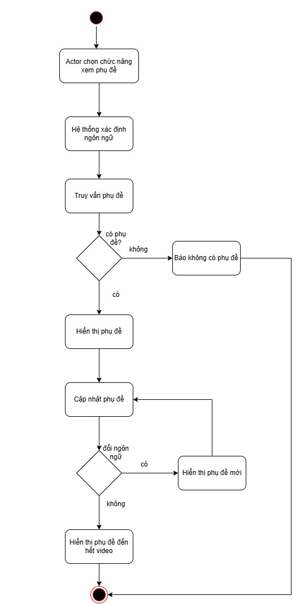{width="3.6783333333333332in"
height="7.501111111111111in"}

## USC08 --- Tìm Kiếm 

***Sơ đồ Use Case --- USC08***

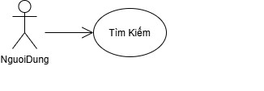{width="3.18in" height="1.105in"}

+--------------------------------------------------------------------------------------+
| > **USC15: Tìm Kiếm (TimKiem)**                                                      |
+==========================+=============================+=============================+
| > **Tác nhân (Actor):**  | > Người Dùng                                              |
+--------------------------+-----------------------------------------------------------+
| > **Mức độ hoàn thiện:** | > Focused                                                 |
+--------------------------+-----------------------------------------------------------+
| > **Mô tả tóm tắt:**     | > Cho phép người dùng tìm hiện vật theo tên, mã số hoặc   |
|                          | > từ khóa trong mô tả. Đây cũng là phương án thay thế khi |
|                          | > không quét được mã QR ({Quét Mã QR} - E1, E2).          |
+--------------------------+-----------------------------------------------------------+
| > **Điều kiện tiên       | > Người dùng đã mở ứng dụng hoặc truy cập trang web của   |
| > quyết:**               | > hệ thống.                                               |
+--------------------------+-----------------------------+-----------------------------+
| > **Dòng sự kiện         | > **Hành động của Actor**   | **Phản hồi của Hệ thống**   |
| > chính:**               |                             |                             |
|                          +-----------------------------+-----------------------------+
|                          | > 1\. Người dùng chọn chức  |                             |
|                          | > năng \"Tìm kiếm\".        |                             |
|                          +-----------------------------+-----------------------------+
|                          |                             | 2\. Hệ thống hiển thị ô     |
|                          |                             | nhập từ khóa/mã số hiện     |
|                          |                             | vật.                        |
|                          +-----------------------------+-----------------------------+
|                          | > 3\. Người dùng nhập từ    |                             |
|                          | > khóa hoặc mã số hiện vật  |                             |
|                          | > và nhấn \"Tìm\" (A1, E1). |                             |
|                          +-----------------------------+-----------------------------+
|                          |                             | 4\. Hệ thống tìm kiếm trong |
|                          |                             | CSDL theo tên, mã số và mô  |
|                          |                             | tả hiện vật ở ngôn ngữ đang |
|                          |                             | chọn (E2).                  |
|                          +-----------------------------+-----------------------------+
|                          |                             | 5\. Hệ thống hiển thị danh  |
|                          |                             | sách kết quả phù hợp.       |
|                          +-----------------------------+-----------------------------+
|                          | > 6\. Người dùng chọn một   |                             |
|                          | > hiện vật trong danh sách. |                             |
|                          +-----------------------------+-----------------------------+
|                          |                             | 7\. Hệ thống chuyển đến màn |
|                          |                             | hình chi tiết hiện vật, từ  |
|                          |                             | đó người dùng có thể đọc    |
|                          |                             | nội dung, xem hình ảnh hoặc |
|                          |                             | nghe thuyết minh. Use case  |
|                          |                             | kết thúc.                   |
+--------------------------+-----------------------------+-----------------------------+
| > **Luồng thay thế       | > ● Không có                                              |
| > (Alternative):**       |                                                           |
+--------------------------+-----------------------------------------------------------+
| > **Luồng ngoại lệ       | > ● E1 - Từ khóa rỗng: Hệ thống yêu cầu người dùng nhập   |
| > (Exception):**         | > từ khóa trước khi tìm kiếm.                             |
+--------------------------+-----------------------------------------------------------+
|                          | > ● E2 - Không có kết quả: Hệ thống thông báo \"Không tìm |
|                          | > thấy hiện vật phù hợp\" và gợi ý kiểm tra lại từ khóa   |
|                          | > hoặc dùng chức năng Quét mã QR.                         |
+--------------------------+-----------------------------------------------------------+
| **Điều kiện kết thúc:**  | > Người dùng tìm được hiện vật cần xem và được chuyển đến |
|                          | > màn hình chi tiết hiện vật; hoặc nhận thông báo không   |
|                          | > có kết quả phù hợp.                                     |
+--------------------------+-----------------------------------------------------------+
| **Sự kiện kích hoạt      | > Người dùng chọn biểu tượng/ô \"Tìm kiếm\" trên giao     |
| (Trigger):**             | > diện.                                                   |
+--------------------------+-----------------------------------------------------------+

***Sơ đồ hoạt động (Activity Diagram) --- USC15***

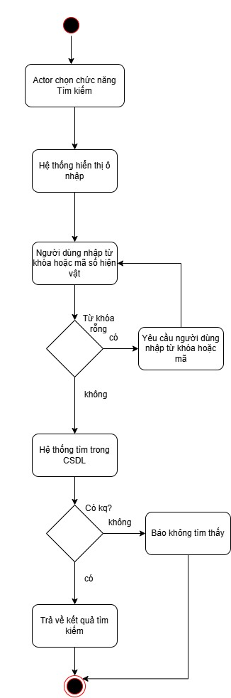{width="2.638333333333333in"
height="7.9525in"}

## USC09 --- Quản Lý Sự Vật 

***Sơ đồ Use Case --- USC09***

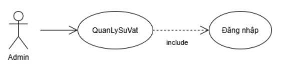{width="4.67in"
height="1.1666666666666667in"}

+--------------------------------------------------------------------------------+
| **USC07: Quản Lý Sự Vật (QLSuVat)**                                            |
+========================+===========================+===========================+
| **Tác nhân (Actor):**  | > Admin                                               |
+------------------------+-------------------------------------------------------+
| **Mức độ hoàn thiện:** | > Focused                                             |
+------------------------+-------------------------------------------------------+
| **Mô tả tóm tắt:**     | > Cho phép Admin quản lý thông tin các sự vật trong   |
|                        | > hệ thống, gồm thêm mới, chỉnh sửa và xóa sự vật.    |
+------------------------+-------------------------------------------------------+
| **Điều kiện tiên       | > Admin đã đăng nhập thành công vào hệ thống (nếu     |
| quyết:**               | > chưa đăng nhập, include {Đăng Nhập}).               |
+------------------------+-------------------------------------------------------+
| **Sự kiện kích hoạt    | > Admin chọn menu \"Quản Lý Sự Vật\".                 |
| (Trigger):**           |                                                       |
+------------------------+---------------------------+---------------------------+
| **Dòng sự kiện         | > **Hành động của Actor** | > **Phản hồi của Hệ       |
| chính:**               |                           | > thống**                 |
|                        +---------------------------+---------------------------+
|                        | > 1\. Admin đăng nhập     |                           |
|                        +---------------------------+---------------------------+
|                        |                           | > 2\. Hệ thống hiển thị   |
|                        |                           | > lời chào mừng đăng nhập |
|                        |                           | > cùng với những chức     |
|                        |                           | > năng chính cho Admin    |
|                        |                           | > lựa chọn                |
|                        +---------------------------+---------------------------+
|                        | > 3\. Admin chọn menu     |                           |
|                        | > \"Quản Lý Sự Vật\".     |                           |
|                        +---------------------------+---------------------------+
|                        |                           | > 4\. Hệ thống hiển thị   |
|                        |                           | > danh sách các sự vật    |
|                        |                           | > hiện có kèm bộ lọc, tìm |
|                        |                           | > kiếm và các nút \"Thêm  |
|                        |                           | > mới\", \"Sửa\",         |
|                        |                           | > \"Xóa\".                |
+------------------------+---------------------------+---------------------------+
|                        | > 5\. Admin chọn một thao |                           |
|                        | > tác quản lý (A1, A2,    |                           |
|                        | > A3).                    |                           |
|                        +---------------------------+---------------------------+
|                        | > 6\. Admin thoát khỏi    |                           |
|                        | > màn hình quản lý. Use   |                           |
|                        | > case kết thúc.          |                           |
+------------------------+---------------------------+---------------------------+
| **Luồng thay thế       | - **A1 -- Thêm mới sự vật:** Ở bước 3, Admin chọn     |
| (Alternative):**       |   \"Thêm mới\". Hệ thống hiển thị biểu mẫu trống gồm: |
|                        |   Tên, Mã số, Khu vực/Sơ đồ, Nội dung mô tả đa ngôn   |
|                        |   ngữ, Hình ảnh đính kèm. Admin điền thông tin và     |
|                        |   nhấn \"Lưu\" (A4). Hệ thống kiểm tra tính hợp lệ    |
|                        |   của dữ liệu (E1, E2), lưu vào CSDL (E3), thông báo  |
|                        |   \"Lưu thông tin sự vật thành công\" và làm mới danh |
|                        |   sách. Use case quay lại bước 3.                     |
|                        |                                                       |
|                        | - **A2 -- Sửa sự vật:** Ở bước 3, Admin chọn một sự   |
|                        |   vật trong danh sách và nhấn \"Sửa\". Hệ thống hiển  |
|                        |   thị biểu mẫu đã điền sẵn thông tin hiện tại. Các    |
|                        |   bước tiếp theo thực hiện như A1.                    |
|                        |                                                       |
|                        | - **A3 -- Xóa sự vật:** Ở bước 3, Admin chọn một sự   |
|                        |   vật và nhấn \"Xóa\". Hệ thống hiển thị hộp thoại    |
|                        |   xác nhận. Khi Admin đồng ý, hệ thống xóa sự vật     |
|                        |   khỏi CSDL, thông báo thành công, làm mới danh sách  |
|                        |   và quay lại bước 3.                                 |
|                        |                                                       |
|                        | - **A4 -- Hủy thao tác:** Khi đang ở biểu mẫu của A1  |
|                        |   hoặc A2,                                            |
|                        |                                                       |
|                        | > Admin nhấn \"Hủy\". Hệ thống đóng biểu mẫu mà không |
|                        | > lưu thay đổi và quay lại danh sách (bước 3).        |
+------------------------+-------------------------------------------------------+
| **Luồng ngoại lệ       | - **E1 -- Thiếu trường bắt buộc:** Admin bỏ trống tên |
| (Exception):**         |   sự vật hoặc chưa chọn khu vực. Hệ thống cảnh báo đỏ |
|                        |   tại các trường thiếu và yêu cầu điền bổ sung trước  |
|                        |   khi lưu (quay lại bước điền biểu mẫu).              |
|                        |                                                       |
|                        | - **E2 -- Trùng mã số:** Mã số vừa nhập đã tồn tại.   |
|                        |   Hệ thống thông báo \"Mã số đã tồn tại\" và yêu cầu  |
|                        |   nhập mã khác (quay lại bước điền biểu mẫu).         |
|                        |                                                       |
|                        | - **E3 -- Lưu thất bại:** CSDL lỗi hoặc hình ảnh sai  |
|                        |   định dạng/quá dung lượng. Hệ thống thông báo lỗi và |
|                        |   giữ nguyên dữ liệu đã nhập để Admin thử lại (quay   |
|                        |   lại bước điền biểu mẫu).                            |
+------------------------+-------------------------------------------------------+
| **Điều kiện kết        | > Thông tin sự vật được thêm, cập nhật hoặc xóa trong |
| thúc:**                | > CSDL và danh sách hiển thị đúng thay đổi. Nếu Admin |
|                        | > hủy thao tác thì dữ liệu giữ nguyên.                |
+------------------------+-------------------------------------------------------+

***Sơ đồ hoạt động (Activity Diagram) --- USC09***

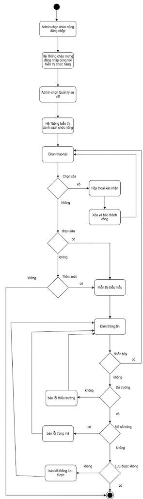{width="3.26in" height="9.0in"}

## USC10 --- Chỉnh Sửa Mã QR 

***Sơ đồ Use Case --- USC10***

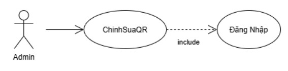{width="4.725in"
height="1.1666666666666667in"}

+--------------------------------------------------------------------------------+
| **USC10: Chỉnh Sửa Mã QR (ChinhSuaQR)**                                        |
+========================+===========================+===========================+
| **Tác nhân (Actor):**  | > Admin                                               |
+------------------------+-------------------------------------------------------+
| **Mức độ hoàn thiện:** | > Focused                                             |
+------------------------+-------------------------------------------------------+
| **Mô tả tóm tắt:**     | > Cho phép Admin tạo mới mã QR cho sự vật mới, cập    |
|                        | > nhật liên kết URL/nội dung trỏ tới của mã QR, hoặc  |
|                        | > xuất/in lại mã QR để gắn tại bảo tàng.              |
+------------------------+-------------------------------------------------------+
| **Điều kiện tiên       | > Admin đã đăng nhập hệ thống (nếu chưa đăng nhập,    |
| quyết:**               | > include {Đăng Nhập}). Sự vật cần gắn mã QR đã tồn   |
|                        | > tại trong hệ thống.                                 |
+------------------------+-------------------------------------------------------+
| **Sự kiện kích hoạt    | > Admin chọn mục \"Quản Lý / Chỉnh Sửa Mã QR\".       |
| (Trigger):**           |                                                       |
+------------------------+---------------------------+---------------------------+
| **Dòng sự kiện         | > **Hành động của Actor** | > **Phản hồi của Hệ       |
| chính:**               |                           | > thống**                 |
|                        +---------------------------+---------------------------+
|                        | > 1\. Admin đăng nhập     |                           |
|                        +---------------------------+---------------------------+
|                        |                           | > 2\. Hệ thống hiển thị   |
|                        |                           | > lời chào mừng đăng nhập |
|                        |                           | > cùng với những chức     |
|                        |                           | > năng chính cho Admin    |
|                        |                           | > lựa chọn                |
|                        +---------------------------+---------------------------+
|                        | > 3\. Admin chọn mục      |                           |
|                        | > \"Chỉnh Sửa Mã QR\".    |                           |
|                        +---------------------------+---------------------------+
|                        |                           | > 4\. Hệ thống hiển thị   |
|                        |                           | > danh mục mã QR đã cấp   |
|                        |                           | > cho các sự vật/khu vực. |
|                        +---------------------------+---------------------------+
|                        | > 5\. Admin chọn sự vật   |                           |
|                        | > cần cập nhật mã QR (A1, |                           |
|                        | > A3).                    |                           |
|                        +---------------------------+---------------------------+
|                        |                           | > 6\. Hệ thống hiển thị   |
|                        |                           | > thông số mã QR: sự vật  |
|                        |                           | > liên kết, liên kết dữ   |
|                        |                           | > liệu (URL/nội dung),    |
|                        |                           | > kích thước,             |
+------------------------+---------------------------+---------------------------+

+------------------+---------------------------+---------------------------+
|                  |                           | > định dạng và ảnh mã QR  |
|                  |                           | > hiện tại.               |
|                  +---------------------------+---------------------------+
|                  | > 7\. Admin chỉnh sửa     |                           |
|                  | > liên kết dữ liệu (A2).  |                           |
|                  +---------------------------+---------------------------+
|                  |                           | > 8\. Hệ thống kiểm tra   |
|                  |                           | > tính hợp lệ của liên    |
|                  |                           | > kết (E1), mã hóa dữ     |
|                  |                           | > liệu mới thành mã đồ    |
|                  |                           | > họa QR và hiển thị bản  |
|                  |                           | > xem trước.              |
|                  +---------------------------+---------------------------+
|                  | > 9\. Admin nhấn \"Lưu\". |                           |
|                  +---------------------------+---------------------------+
|                  |                           | > 10\. Hệ thống lưu thay  |
|                  |                           | > đổi vào                 |
|                  |                           | >                         |
|                  |                           | > CSDL (E2) và thông báo  |
|                  |                           | > \"Lưu mã QR thành       |
|                  |                           | > công\".                 |
|                  +---------------------------+---------------------------+
|                  | > 11\. Admin chọn định    |                           |
|                  | > dạng tệp                |                           |
|                  | >                         |                           |
|                  | > (PNG/SVG/PDF) và nhấn   |                           |
|                  | > \"Tải về\" để in ấn.    |                           |
|                  +---------------------------+---------------------------+
|                  |                           | > 12\. Hệ thống tạo và    |
|                  |                           | > cho phép tải tệp hình   |
|                  |                           | > ảnh mã QR theo định     |
|                  |                           | > dạng đã chọn (E2).      |
+==================+===========================+===========================+
| **Luồng thay thế | - **A1 -- Tạo mã QR mới:** Ở bước 3, Admin chọn \"Tạo |
| (Alternative):** |   mã QR mới\" và chọn một sự vật chưa có mã QR. Hệ    |
|                  |   thống hiển thị biểu mẫu thông số mã QR trống (liên  |
|                  |   kết dữ liệu, kích thước, định dạng). Use case tiếp  |
|                  |   tục từ bước 5.                                      |
|                  |                                                       |
|                  | - **A2 -- Sửa lại mã (Regenerate):** Ở bước 5, Admin  |
|                  |   chọn \"Sinh lại mã\" thay vì chỉnh sửa liên kết. Hệ |
|                  |   thống tạo lại mã đồ họa QR từ liên kết hiện tại và  |
|                  |   hiển thị bản xem trước. Use case tiếp tục từ bước   |
|                  |   7.                                                  |
|                  |                                                       |
|                  | - **A3 -- Xóa mã QR:** Ở bước 3, Admin chọn một sự    |
|                  |   vật đã có mã QR và nhấn \"Xóa mã QR\". Hệ thống     |
|                  |   hiển thị hộp thoại xác nhận. Khi Admin đồng ý, hệ   |
|                  |   thống xóa mã QR khỏi CSDL (E2), thông báo \"Xóa mã  |
|                  |   QR thành công\", làm mới danh mục mã QR và kết thúc |
|                  |   use case.                                           |
+------------------+-------------------------------------------------------+
| **Luồng ngoại lệ | - **E1 -- Liên kết không hợp lệ:** Ở bước 6, liên kết |
| (Exception):**   |   dữ liệu bị bỏ trống hoặc sai định dạng URL. Hệ      |
|                  |   thống cảnh báo đỏ tại trường liên kết và yêu cầu    |
|                  |   nhập lại (quay lại bước 5).                         |
|                  |                                                       |
|                  | - **E2 -- Lưu hoặc tạo tệp thất bại:** Ở bước 8 hoặc  |
|                  |   bước 10, CSDL lỗi hoặc hệ thống không tạo được tệp  |
|                  |   hình ảnh. Hệ thống thông báo lỗi và giữ nguyên dữ   |
|                  |   liệu đã nhập để Admin thử lại.                      |
+------------------+-------------------------------------------------------+
| **Điều kiện kết  | > Mã QR được tạo/cập nhật chính xác với sự vật trong  |
| thúc:**          | > hệ thống. Tệp hình ảnh mã QR được tải về nếu Admin  |
|                  | > chọn tải.                                           |
+------------------+-------------------------------------------------------+

***Sơ đồ hoạt động (Activity Diagram) --- USC10***

> 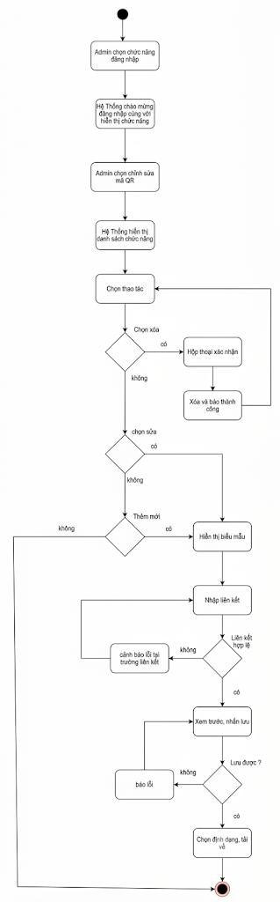{width="2.8033333333333332in"
> height="9.0in"}

## USC11 --- Quản Lý Tệp Âm Thanh 

***Sơ đồ Use Case --- USC11***

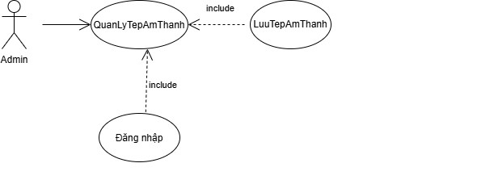{width="4.298333333333333in"
height="1.5in"}

+--------------------------------------------------------------------------------+
| **USC11: Quản Lý Tệp Âm Thanh (QLTepAmThanh)**                                 |
+========================+===========================+===========================+
| **Tác nhân (Actor):**  | > Admin, Thiết Bị Lưu Âm Thanh                        |
+------------------------+-------------------------------------------------------+
| **Mức độ hoàn thiện:** | > Focused                                             |
+------------------------+-------------------------------------------------------+
| **Mô tả tóm tắt:**     | > Admin tải lên, thay thế hoặc xóa các file audio     |
|                        | > thuyết minh và gán nhãn ngôn ngữ cho từng file. Bao |
|                        | > gồm {Lưu Trữ Tệp Âm Thanh} («include») tương tác    |
|                        | > trực tiếp với Thiết Bị Lưu Âm Thanh.                |
+------------------------+-------------------------------------------------------+
| **Điều kiện tiên       | > Admin đã đăng nhập (nếu chưa đăng nhập, include     |
| quyết:**               | > {Đăng Nhập}). Hiện vật cần gắn thuyết minh đã tồn   |
|                        | > tại trong hệ thống.                                 |
+------------------------+-------------------------------------------------------+
| **Sự kiện kích hoạt    | > Admin chọn \"Quản Lý Tệp Âm Thanh\".                |
| (Trigger):**           |                                                       |
+------------------------+---------------------------+---------------------------+
| **Dòng sự kiện         | > **Hành động của Actor** | > **Phản hồi của Hệ       |
| chính:**               |                           | > thống**                 |
|                        +---------------------------+---------------------------+
|                        | > 1\. Admin đăng nhập     |                           |
|                        +---------------------------+---------------------------+
|                        |                           | > 2\. Hệ thống hiển thị   |
|                        |                           | > lời chào mừng đăng nhập |
|                        |                           | > cùng với những chức     |
|                        |                           | > năng chính cho Admin    |
|                        |                           | > lựa chọn                |
|                        +---------------------------+---------------------------+
|                        | > 3\. Admin chọn \"Quản   |                           |
|                        | > Lý Tệp Âm Thanh\".      |                           |
|                        +---------------------------+---------------------------+
|                        |                           | > 4\. Hệ thống hiển thị   |
|                        |                           | > danh sách các file      |
|                        |                           | > thuyết minh theo từng   |
|                        |                           | > hiện vật và ngôn ngữ.   |
|                        +---------------------------+---------------------------+
|                        | > 5\. Admin chọn một thao |                           |
|                        | > tác quản lý tệp âm      |                           |
|                        | > thanh (A1, A2, A3).     |                           |
+------------------------+---------------------------+---------------------------+
|                        | > 6\. Admin thoát khỏi    |                           |
|                        | > màn hình quản lý. Use   |                           |
|                        | > case kết thúc.          |                           |
+------------------------+                           |                           |
|                        |                           |                           |
+------------------------+---------------------------+---------------------------+
| **Luồng thay thế       | - **A1 -- Tải lên tệp mới:** Ở bước 3, Admin chọn     |
| (Alternative):**       |   hiện vật và nhấn \"Tải lên tệp âm thanh mới\". Hệ   |
|                        |   thống hiển thị hộp thoại chọn file và chọn ngôn ngữ |
|                        |   thuyết minh. Admin chọn ngôn ngữ, chọn file audio   |
|                        |   (MP3, WAV, AAC) từ máy tính và bấm \"Tải lên\". Hệ  |
|                        |   thống kiểm tra dung lượng, định dạng file (E1), rồi |
|                        |   thực hiện {Lưu Trữ Tệp Âm Thanh}: gửi tệp sang      |
|                        |   Thiết Bị Lưu Âm Thanh. Thiết Bị Lưu Âm Thanh tiếp   |
|                        |   nhận, lưu file và trả về đường dẫn (URL/ID lưu trữ) |
|                        |   (E2). Hệ thống cập nhật đường dẫn vào hồ sơ hiện    |
|                        |   vật và thông báo \"Tải lên thành công\". Use case   |
|                        |   quay lại bước 3.                                    |
|                        |                                                       |
|                        | - **A2 -- Thay thế tệp:** Ở bước 3, Admin chọn một    |
|                        |   tệp âm thanh đã có của hiện vật/ngôn ngữ và nhấn    |
|                        |   \"Thay thế\". Admin chọn file audio mới từ máy tính |
|                        |   và bấm \"Tải lên\". Các bước tiếp theo thực hiện    |
|                        |   như A1; hệ thống cập nhật đường dẫn mới vào hồ sơ   |
|                        |   hiện vật và xóa tệp cũ khỏi thiết bị lưu trữ.       |
|                        |                                                       |
|                        | - **A3 -- Xóa tệp:** Ở bước 3, Admin chọn một tệp âm  |
|                        |   thanh đã có và nhấn \"Xóa\". Hệ thống hiển thị hộp  |
|                        |   thoại xác nhận. Khi Admin đồng ý, hệ thống yêu cầu  |
|                        |   Thiết Bị Lưu Âm Thanh xóa tệp (E2), cập nhật hồ sơ  |
|                        |   hiện vật, thông báo \"Xóa tệp thành công\" và quay  |
|                        |   lại bước 3.                                         |
+------------------------+-------------------------------------------------------+
| **Luồng ngoại lệ       | - **E1 -- Sai định dạng hoặc vượt quá dung lượng:**   |
| (Exception):**         |   Khi Admin tải lên (A1, A2), file không phải âm      |
|                        |   thanh hợp lệ (MP3, WAV, AAC) hoặc kích thước quá    |
|                        |   lớn (\>50MB). Hệ thống từ chối tải lên và thông báo |
|                        |   lỗi.                                                |
|                        |                                                       |
|                        | - **E2 -- Thiết Bị Lưu Âm Thanh không phản hồi hoặc   |
|                        |   lưu/xóa thất bại:** Khi lưu hoặc xóa tệp (A1, A2,   |
|                        |   A3), thiết bị lưu trữ không phản hồi hoặc báo lỗi.  |
|                        |   Hệ thống thông báo lỗi và không cập nhật hồ sơ hiện |
|                        |   vật.                                                |
+------------------------+-------------------------------------------------------+
| **Điều kiện kết        | > Tệp âm thanh được lưu trữ an toàn trên thiết bị lưu |
| thúc:**                | > trữ và liên kết đúng với hiện vật tương ứng; hoặc   |
|                        | > được thay thế/xóa khỏi thiết bị lưu trữ và hồ sơ    |
|                        | > hiện vật nếu Admin chọn thay thế/xóa.               |
+------------------------+-------------------------------------------------------+

***Sơ đồ hoạt động (Activity Diagram) --- USC11***

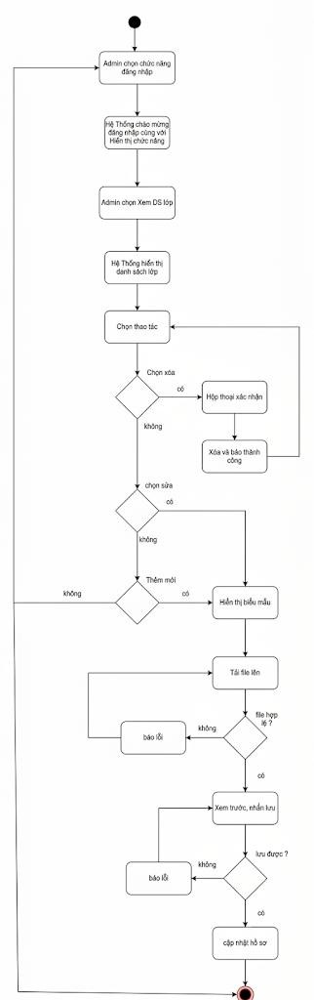{width="2.83in" height="9.0in"}

## USC12 --- Xem Thống Kê Lượt Nghe 

***Sơ đồ Use Case --- USC12***

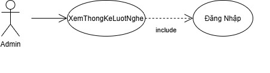{width="3.863334426946632in"
height="1.045in"}

+--------------------------------------------------------------------------------+
| **USC10: Xem Thống Kê Lượt Nghe (XemThongKeLuotNghe)**                         |
+========================+===========================+===========================+
| **Tác nhân (Actor):**  | > Admin                                               |
+------------------------+-------------------------------------------------------+
| **Mức độ hoàn thiện:** | > Focused                                             |
+------------------------+-------------------------------------------------------+
| **Mô tả tóm tắt:**     | > Cung cấp báo cáo, biểu đồ về số lượt khách nghe     |
|                        | > thuyết minh theo từng sự vật, theo ngôn ngữ, theo   |
|                        | > khung giờ hoặc theo ngày/tháng/năm để đánh giá mức  |
|                        | > độ quan tâm của du khách.                           |
+------------------------+-------------------------------------------------------+
| **Điều kiện tiên       | > Admin đã đăng nhập hệ thống (nếu chưa đăng nhập,    |
| quyết:**               | > include {Đăng Nhập}).                               |
+------------------------+-------------------------------------------------------+
| **Sự kiện kích hoạt    | > Admin chọn menu \"Thống Kê Lượt Nghe\".             |
| (Trigger):**           |                                                       |
+------------------------+---------------------------+---------------------------+
| **Dòng sự kiện         | > **Hành động của Actor** | > **Phản hồi của Hệ       |
| chính:**               |                           | > thống**                 |
|                        +---------------------------+---------------------------+
|                        | > 1\. Admin đăng nhập     |                           |
|                        +---------------------------+---------------------------+
|                        |                           | > 2\. Hệ thống hiển thị   |
|                        |                           | > lời chào mừng đăng nhập |
|                        |                           | > cùng với những chức     |
|                        |                           | > năng chính cho Admin    |
|                        |                           | > lựa chọn                |
|                        +---------------------------+---------------------------+
|                        | > 3\. Admin chọn menu     |                           |
|                        | > \"Thống Kê Lượt Nghe\". |                           |
|                        +---------------------------+---------------------------+
|                        |                           | > 4\. Hệ thống hiển thị   |
|                        |                           | > bộ lọc tiêu chí báo     |
|                        |                           | > cáo: Khoảng thời gian,  |
|                        |                           | >                         |
|                        |                           | > Đơn vị thống kê         |
|                        |                           | >                         |
|                        |                           | > (giờ/ngày/tháng/năm),   |
|                        |                           | > Khu vực trưng bày, Sự   |
|                        |                           | > vật cụ thể, Ngôn ngữ.   |
|                        +---------------------------+---------------------------+
|                        | > 5\. Admin thiết lập các |                           |
|                        | > tiêu chí lọc và bấm     |                           |
|                        | > \"Xem Thống Kê\".       |                           |
+------------------------+---------------------------+---------------------------+
|                        |                           | > 6\. Hệ thống kiểm tra   |
|                        |                           | > tiêu chí lọc (E1), truy |
|                        |                           | > vấn CSDL và tổng hợp dữ |
|                        |                           | > liệu lượt nghe (E2).    |
|                        +---------------------------+---------------------------+
|                        |                           | > 7\. Hệ thống hiển thị   |
|                        |                           | > biểu đồ trực quan (biểu |
|                        |                           | > đồ cột/đường) cùng bảng |
|                        |                           | > tổng hợp số liệu chi    |
|                        |                           | > tiết, gồm: top sự vật   |
|                        |                           | > được nghe nhiều nhất,   |
|                        |                           | > ngôn ngữ phổ biến nhất  |
|                        |                           | > và tổng số lượt nghe    |
|                        |                           | > theo từng mốc thời      |
|                        |                           | > gian.                   |
|                        +---------------------------+---------------------------+
|                        | > 8\. Admin xem báo cáo   |                           |
|                        | > và có thể chọn \"Xuất   |                           |
|                        | > báo cáo\" (A1). Use     |                           |
|                        | > case kết thúc.          |                           |
+------------------------+---------------------------+---------------------------+
| **Luồng thay thế       | > ● **A1 -- Xuất báo cáo:** Ở bước 6, Admin bấm       |
| (Alternative):**       | > \"Xuất báo cáo\" và chọn định dạng Excel hoặc PDF.  |
|                        | > Hệ thống đóng gói dữ liệu báo cáo (E3) và tải về    |
|                        | > máy theo định dạng đã chọn. Use case kết thúc.      |
+------------------------+-------------------------------------------------------+
| **Luồng ngoại lệ       | - **E1 -- Tiêu chí lọc không hợp lệ:** Ở bước 4, tiêu |
| (Exception):**         |   chí lọc không hợp lệ (ví dụ ngày bắt đầu sau ngày   |
|                        |   kết thúc hoặc chưa chọn khoảng thời gian). Hệ thống |
|                        |   cảnh báo tại tiêu chí sai và yêu cầu chọn lại (quay |
|                        |   lại bước 3).                                        |
|                        |                                                       |
|                        | - **E2 -- Không có dữ liệu:** Ở bước 4, không có lượt |
|                        |   nghe nào phù hợp với tiêu chí đã chọn. Hệ thống     |
|                        |   thông báo \"Không có dữ liệu thống kê phù hợp\" và  |
|                        |   yêu cầu Admin đổi tiêu chí lọc (quay lại bước 3).   |
|                        |                                                       |
|                        | - **E3 -- Xuất tệp thất bại:** Ở A1, hệ thống không   |
|                        |   tạo được tệp báo cáo. Hệ thống thông báo lỗi để     |
|                        |   Admin thử xuất lại hoặc chọn định dạng khác.        |
+------------------------+-------------------------------------------------------+
| **Điều kiện kết        | > Báo cáo thống kê được hiển thị trực quan theo tiêu  |
| thúc:**                | > chí đã chọn; nếu Admin chọn xuất thì tệp báo cáo    |
|                        | > được tải về máy.                                    |
+------------------------+-------------------------------------------------------+

***Sơ đồ hoạt động (Activity Diagram) --- USC10***

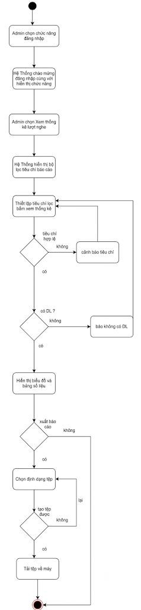{width="2.091666666666667in"
height="9.0in"}

## USC13 --- Quản Lý Sơ Đồ 

***Sơ đồ Use Case --- USC11***

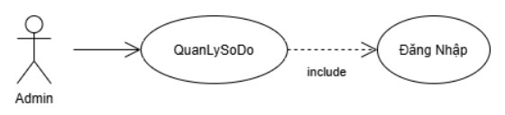{width="4.666666666666667in"
height="1.0666666666666667in"}

+--------------------------------------------------------------------------------+
| **USC11: Quản Lý Sơ Đồ (QLSoDo)**                                              |
+========================+===========================+===========================+
| **Tác nhân (Actor):**  | > Admin                                               |
+------------------------+-------------------------------------------------------+
| **Mức độ hoàn thiện:** | > Focused                                             |
+------------------------+-------------------------------------------------------+
| **Mô tả tóm tắt:**     | > Quản lý bản đồ/sơ đồ các tầng, phòng trưng bày của  |
|                        | > bảo tàng, gồm thêm mới, chỉnh sửa và xóa sơ đồ; gán |
|                        | > vị trí tọa độ của các sự vật lên sơ đồ để phục vụ   |
|                        | > hiển thị định vị cho khách tham quan.               |
+------------------------+-------------------------------------------------------+
| **Điều kiện tiên       | > Admin đã đăng nhập hệ thống (nếu chưa đăng nhập,    |
| quyết:**               | > include {Đăng Nhập}). Các sự vật cần gán vị trí đã  |
|                        | > tồn tại trong hệ thống.                             |
+------------------------+-------------------------------------------------------+
| **Sự kiện kích hoạt    | > Admin chọn menu \"Quản Lý Sơ Đồ\".                  |
| (Trigger):**           |                                                       |
+------------------------+---------------------------+---------------------------+
| **Dòng sự kiện         | > **Hành động của Actor** | > **Phản hồi của Hệ       |
| chính:**               |                           | > thống**                 |
|                        +---------------------------+---------------------------+
|                        | > 1\. Admin đăng nhập     |                           |
|                        +---------------------------+---------------------------+
|                        |                           | > 2\. Hệ thống hiển thị   |
|                        |                           | > lời chào mừng đăng nhập |
|                        |                           | > cùng với những chức     |
|                        |                           | > năng chính cho Admin    |
|                        |                           | > lựa chọn                |
|                        +---------------------------+---------------------------+
|                        | > 3\. Admin chọn menu     |                           |
|                        | > \"Quản Lý Sơ Đồ\".      |                           |
|                        +---------------------------+---------------------------+
|                        |                           | > 4\. Hệ thống hiển thị   |
|                        |                           | > danh sách các tầng/khu  |
|                        |                           | > vực trưng bày và sơ đồ  |
|                        |                           | > mặt bằng tương ứng.     |
|                        +---------------------------+---------------------------+
|                        | > 5\. Admin chọn một thao |                           |
|                        | > tác quản lý sơ đồ (A1,  |                           |
|                        | > A2, A3).                |                           |
|                        +---------------------------+---------------------------+
|                        | > 6\. Admin thoát khỏi    |                           |
|                        | > màn hình quản lý. Use   |                           |
|                        | > case kết thúc.          |                           |
+------------------------+---------------------------+---------------------------+
| **Luồng thay thế       | - **A1 -- Thêm sơ đồ mới:** Ở bước 3, Admin chọn      |
| (Alternative):**       |   \"Thêm sơ đồ mới\" và tải lên ảnh mặt bằng cho      |
|                        |   tầng/khu vực. Hệ thống kiểm tra định dạng và dung   |
|                        |   lượng ảnh (E1), sau đó hiển thị giao diện biên tập  |
|                        |   sơ đồ tương tác. Các bước tiếp theo thực hiện như   |
|                        |   A2.                                                 |
|                        |                                                       |
|                        | - **A2 -- Chỉnh sửa sơ đồ:** Ở bước 3, Admin chọn một |
|                        |   khu vực và nhấn \"Chỉnh sửa\". Hệ thống hiển thị    |
|                        |   giao diện biên tập sơ đồ tương tác. Admin kéo thả   |
|                        |   các điểm ghim sự vật vào đúng vị trí thực tế trên   |
|                        |   sơ đồ. Hệ thống ghi nhận tạm tọa độ (X, Y) của từng |
|                        |   sự vật. Admin nhấn \"Lưu Sơ Đồ\". Hệ thống lưu cấu  |
|                        |   hình tọa độ vào CSDL (E2) và thông báo cập nhật     |
|                        |   thành công. Use case quay lại bước 3.               |
|                        |                                                       |
|                        | - **A3 -- Xóa sơ đồ:** Ở bước 3, Admin chọn một sơ đồ |
|                        |   và nhấn \"Xóa\". Hệ thống hiển thị hộp thoại xác    |
|                        |   nhận. Khi Admin đồng ý, hệ thống xóa sơ đồ cùng tọa |
|                        |   độ các sự vật đã gán khỏi CSDL (E2), thông báo      |
|                        |   thành công, làm mới danh sách và quay lại bước      |
|                        |                                                       |
|                        | > 3\.                                                 |
+------------------------+-------------------------------------------------------+
| **Luồng ngoại lệ       | - **E1 -- Ảnh mặt bằng không hợp lệ:** Ở A1, ảnh sai  |
| (Exception):**         |   định dạng hoặc vượt quá dung lượng cho phép. Hệ     |
|                        |   thống từ chối tải lên, thông báo lỗi và yêu cầu     |
|                        |   chọn lại ảnh.                                       |
|                        |                                                       |
|                        | - **E2 -- Lưu thất bại:** Khi lưu hoặc xóa sơ đồ (A1, |
|                        |   A2, A3), CSDL lỗi. Hệ thống thông báo lỗi và giữ    |
|                        |   nguyên dữ liệu đang chỉnh sửa để Admin thử lại.     |
+------------------------+-------------------------------------------------------+
| **Điều kiện kết        | > Sơ đồ và tọa độ các sự vật được lưu vào CSDL và     |
| thúc:**                | > hiển thị đúng cho khách tham quan; hoặc sơ đồ được  |
|                        | > xóa khỏi hệ thống nếu Admin chọn xóa.               |
+------------------------+-------------------------------------------------------+

***Sơ đồ hoạt động (Activity Diagram) --- USC11***

> 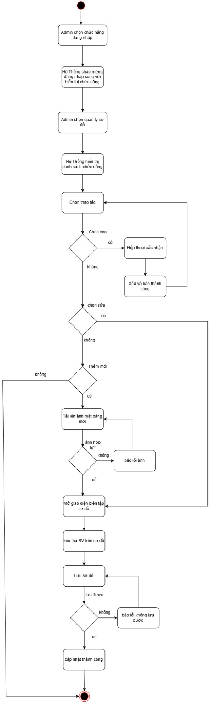{width="2.716666666666667in"
> height="9.0in"}

## USC14 --- Phát Luồng Dữ Liệu Âm Thanh 

***Sơ đồ Use Case --- USC19***

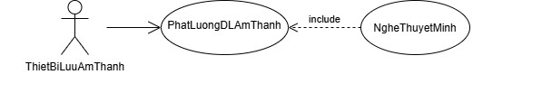{width="6.008333333333334in"
height="1.0333333333333334in"}

+----------------------------------------------------------------------------------+
| **USC19: Phát Luồng Dữ Liệu Âm Thanh (PhatLuongDLAmThanh)**                      |
+========================+============================+============================+
| **Tác nhân (Actor):**  | > Thiết Bị Lưu Âm Thanh                                 |
+------------------------+---------------------------------------------------------+
| **Mức độ hoàn thiện:** | > Focused                                               |
+------------------------+---------------------------------------------------------+
| **Mô tả tóm tắt:**     | > Truyền luồng dữ liệu âm thanh thuyết minh từ Thiết Bị |
|                        | > Lưu Âm Thanh về ứng dụng của người dùng theo thời     |
|                        | > gian thực. Là use case con bắt buộc của {Nghe Thuyết  |
|                        | > Minh} («include»).                                    |
+------------------------+---------------------------------------------------------+
| **Điều kiện tiên       | > Hệ thống đã xác định được ID tệp âm thanh và ngôn ngữ |
| quyết:**               | > tương ứng với hiện vật (UC04, bước 4).                |
+------------------------+----------------------------+----------------------------+
| **Dòng sự kiện         | > **Hành động của Actor**  | > **Phản hồi của Hệ        |
| chính:**               |                            | > thống**                  |
|                        +----------------------------+----------------------------+
|                        |                            | > 1\. Use case {Nghe       |
|                        |                            | > Thuyết Minh} gửi yêu cầu |
|                        |                            | > lấy luồng âm thanh (ID   |
|                        |                            | > tệp, ngôn ngữ) đến Thiết |
|                        |                            | > Bị Lưu Âm Thanh.         |
|                        +----------------------------+----------------------------+
|                        | > 2\. Thiết Bị Lưu Âm      |                            |
|                        | > Thanh tiếp nhận và kiểm  |                            |
|                        | > tra tính hợp lệ của yêu  |                            |
|                        | > cầu.                     |                            |
|                        +----------------------------+----------------------------+
|                        | > 3\. Thiết Bị Lưu Âm      |                            |
|                        | > Thanh tìm tệp âm thanh   |                            |
|                        | > theo ID và ngôn ngữ      |                            |
|                        | > (E1).                    |                            |
|                        +----------------------------+----------------------------+
|                        | > 4\. Thiết Bị Lưu Âm      |                            |
|                        | > Thanh mở luồng và truyền |                            |
|                        | > dữ liệu âm thanh theo    |                            |
|                        | > từng đoạn (streaming) về |                            |
|                        | > ứng dụng (E2).           |                            |
|                        +----------------------------+----------------------------+
|                        |                            | > 5\. Ứng dụng nhận dữ     |
|                        |                            | > liệu, lưu đệm (buffer)   |
|                        |                            | > và bắt đầu phát (A1).    |
|                        +----------------------------+----------------------------+
|                        | > 6\. Khi phát hết tệp     |                            |
|                        | > hoặc người dùng dừng     |                            |
|                        | > phát, Thiết Bị Lưu Âm    |                            |
|                        | >                          |                            |
|                        | > Thanh đóng luồng.        |                            |
+------------------------+----------------------------+----------------------------+
|                        |                            | > 7\. Hệ thống trả điều    |
|                        |                            | > khiển về                 |
|                        |                            | >                          |
|                        |                            | > {Nghe Thuyết Minh}. Use  |
|                        |                            | > case kết thúc.           |
+------------------------+----------------------------+----------------------------+
| **Luồng thay thế       | > ● **A1 - Tua (Seek) hoặc đổi ngôn ngữ:** Khi người    |
| (Alternative):**       | > dùng tua đến vị trí khác hoặc đổi ngôn ngữ (UC04 -    |
|                        | > A2), {Nghe Thuyết Minh} gửi yêu cầu mới. Thiết Bị Lưu |
|                        | > Âm Thanh truyền luồng từ vị trí/tệp mới.              |
+------------------------+---------------------------------------------------------+
| **Luồng ngoại lệ       | - **E1 - Không tìm thấy tệp âm thanh:** Thiết Bị Lưu Âm |
| (Exception):**         |   Thanh trả mã lỗi; {Nghe Thuyết Minh} thông báo cho    |
|                        |   người dùng và gợi ý đọc bản văn bản ({Đọc Nội Dung}). |
|                        |                                                         |
|                        | - **E2 - Mất kết nối hoặc ngắt luồng giữa chừng:** Hệ   |
|                        |   thống tự động thử kết nối lại. Nếu vẫn thất bại,      |
|                        |   thông báo "Không tải được âm thanh thuyết minh, vui   |
|                        |   lòng kiểm tra kết nối" (UC04 - E1).                   |
+------------------------+---------------------------------------------------------+
| **Điều kiện kết        | > Dữ liệu âm thanh được truyền liên tục về ứng dụng;    |
| thúc:**                | > luồng được đóng đúng cách khi kết thúc.               |
+------------------------+---------------------------------------------------------+
| **Sự kiện kích hoạt    | > Use case {Nghe Thuyết Minh} thực hiện bước 5 (quan hệ |
| (Trigger):**           | > «include»).                                           |
+------------------------+---------------------------------------------------------+

***Sơ đồ hoạt động (Activity Diagram) --- USC19***

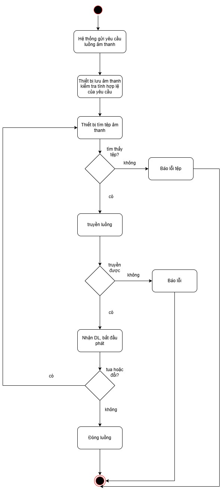{width="3.73in"
height="8.191666666666666in"}

## USC15 --- Lưu Trữ Tệp Âm Thanh 

***Sơ đồ Use Case --- USC20***

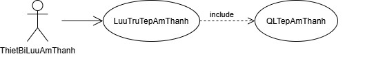{width="5.308333333333334in"
height="1.1461253280839896in"}

+----------------------------------------------------------------------------------+
| **UC20: Lưu Trữ Tệp Âm Thanh (LuuTruTepAmThanh)**                                |
+========================+============================+============================+
| **Tác nhân (Actor):**  | > Thiết Bị Lưu Âm Thanh                                 |
+------------------------+---------------------------------------------------------+
| **Mức độ hoàn thiện:** | > Focused                                               |
+------------------------+---------------------------------------------------------+
| **Mô tả tóm tắt:**     | > Lưu trữ tệp âm thanh thuyết minh (kèm thông tin hiện  |
|                        | > vật, ngôn ngữ) lên Thiết Bị Lưu Âm Thanh để phục vụ   |
|                        | > việc phát luồng. Use case này gọi use case {Quản Lý   |
|                        | > Tệp Âm Thanh} («include») để nhận tệp và thông tin do |
|                        | > Admin cung cấp.                                       |
+------------------------+---------------------------------------------------------+
| **Điều kiện tiên       | > Thiết Bị Lưu Âm Thanh sẵn sàng kết nối; tệp âm thanh  |
| quyết:**               | > và thông tin kèm theo đã được Admin cung cấp qua      |
|                        | > {Quản Lý Tệp Âm Thanh}.                               |
+------------------------+----------------------------+----------------------------+
| **Dòng sự kiện         | > **Hành động của Actor**  | > **Phản hồi của Hệ        |
| chính:**               |                            | > thống**                  |
|                        +----------------------------+----------------------------+
|                        |                            | > 1\. Hệ thống gọi use     |
|                        |                            | > case {Quản Lý Tệp Âm     |
|                        |                            | > Thanh} («include») để    |
|                        |                            | > nhận tệp âm thanh thuyết |
|                        |                            | > minh và thông tin kèm    |
|                        |                            | > theo (hiện vật, ngôn     |
|                        |                            | > ngữ) do Admin cung cấp.  |
|                        +----------------------------+----------------------------+
|                        |                            | > 2\. Hệ thống kiểm tra    |
|                        |                            | > tệp: đúng định dạng âm   |
|                        |                            | > thanh và trong dung      |
|                        |                            | > lượng cho phép (E1).     |
|                        +----------------------------+----------------------------+
|                        |                            | > 3\. Hệ thống kiểm tra đã |
|                        |                            | > có tệp cùng hiện vật và  |
|                        |                            | > ngôn ngữ chưa (A1), tạo  |
|                        |                            | > ID tệp và gửi yêu cầu    |
|                        |                            | > lưu kèm dữ liệu đến      |
|                        |                            | > Thiết Bị Lưu Âm Thanh.   |
|                        +----------------------------+----------------------------+
|                        | > 4\. Thiết Bị Lưu Âm      |                            |
|                        | > Thanh tiếp nhận yêu cầu  |                            |
|                        | > và kiểm tra dung lượng   |                            |
|                        | > trống (E2).              |                            |
+------------------------+----------------------------+----------------------------+
|                        | > 5\. Thiết Bị Lưu Âm      |                            |
|                        | > Thanh ghi tệp lên bộ nhớ |                            |
|                        | > và kiểm tra tính toàn    |                            |
|                        | > vẹn của tệp (E3).        |                            |
|                        +----------------------------+----------------------------+
|                        | > 6\. Thiết Bị Lưu Âm      |                            |
|                        | > Thanh trả kết quả lưu    |                            |
|                        | > thành công kèm ID và     |                            |
|                        | > đường dẫn tệp.           |                            |
|                        +----------------------------+----------------------------+
|                        |                            | > 7\. Hệ thống cập nhật    |
|                        |                            | > thông tin tệp (ID, hiện  |
|                        |                            | > vật, ngôn ngữ, đường     |
|                        |                            | > dẫn) vào CSDL và thông   |
|                        |                            | > báo "Lưu tệp âm thanh    |
|                        |                            | > thành công".             |
|                        |                            | >                          |
|                        |                            | > Use case kết thúc.       |
+------------------------+----------------------------+----------------------------+
| **Luồng thay thế       | > ● **A1 - Thay thế tệp đã có:** Tại bước 3, nếu đã tồn |
| (Alternative):**       | > tại tệp cùng hiện vật và ngôn ngữ, hệ thống thông báo |
|                        | > tệp đã có và gửi tệp mới đến Thiết Bị Lưu Âm Thanh.   |
|                        | > Tệp cũ chỉ bị thay thế sau khi tệp mới được lưu xong. |
|                        | > Dòng sự kiện tiếp tục từ bước 4.                      |
+------------------------+---------------------------------------------------------+
| **Luồng ngoại lệ       | - **E1 - Tệp không hợp lệ:** Tệp sai định dạng âm thanh |
| (Exception):**         |   hoặc vượt dung lượng cho phép. Hệ thống thông báo lỗi |
|                        |   và không lưu tệp.                                     |
|                        |                                                         |
|                        | - **E2 - Thiết bị không đủ dung lượng:** Thiết Bị Lưu   |
|                        |   Âm Thanh trả mã lỗi; hệ thống thông báo "Không đủ     |
|                        |   dung lượng lưu trữ" và không lưu tệp.                 |
|                        |                                                         |
|                        | - **E3 - Ghi tệp thất bại hoặc mất kết nối:** Hệ thống  |
|                        |   tự động thử lại. Nếu vẫn thất bại, hệ thống xóa phần  |
|                        |   tệp ghi dở và thông báo "Lưu tệp thất bại, vui lòng   |
|                        |   thử lại".                                             |
+------------------------+---------------------------------------------------------+
| **Điều kiện kết        | > Tệp âm thanh được lưu đầy đủ trên Thiết Bị Lưu Âm     |
| thúc:**                | > Thanh và thông tin tệp được cập nhật trong CSDL; nếu  |
|                        | > thất bại thì không giữ lại tệp ghi dở.                |
+------------------------+---------------------------------------------------------+
| **Sự kiện kích hoạt    | > Hệ thống cần lưu một tệp âm thanh thuyết minh mới     |
| (Trigger):**           | > hoặc tệp được cập nhật (khi Admin thêm hoặc thay      |
|                        | > tệp).                                                 |
+------------------------+---------------------------------------------------------+

***Sơ đồ hoạt động (Activity Diagram) --- UC20***

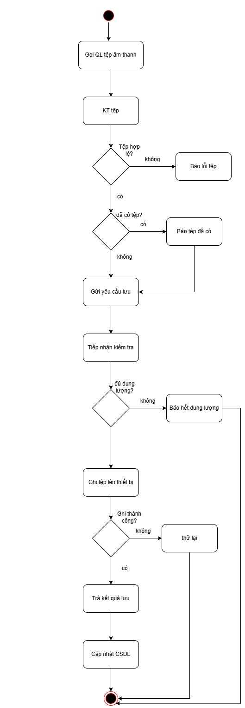{width="2.8933333333333335in"
height="8.333333333333334in"}

4.  Component Diagram

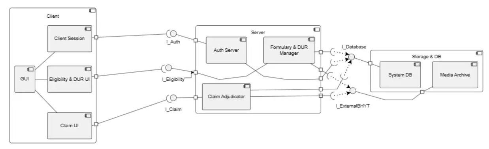{width="6.905001093613298in"
height="2.1066666666666665in"}

5.  Deployment Diagram

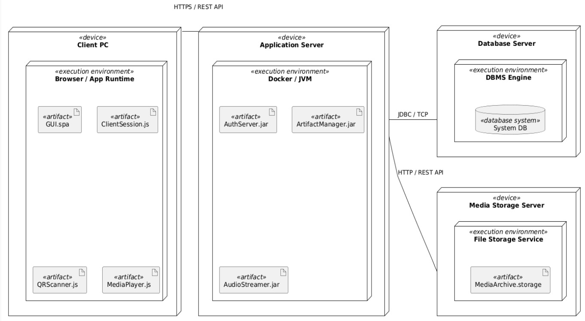{width="6.5in" height="3.58in"}
