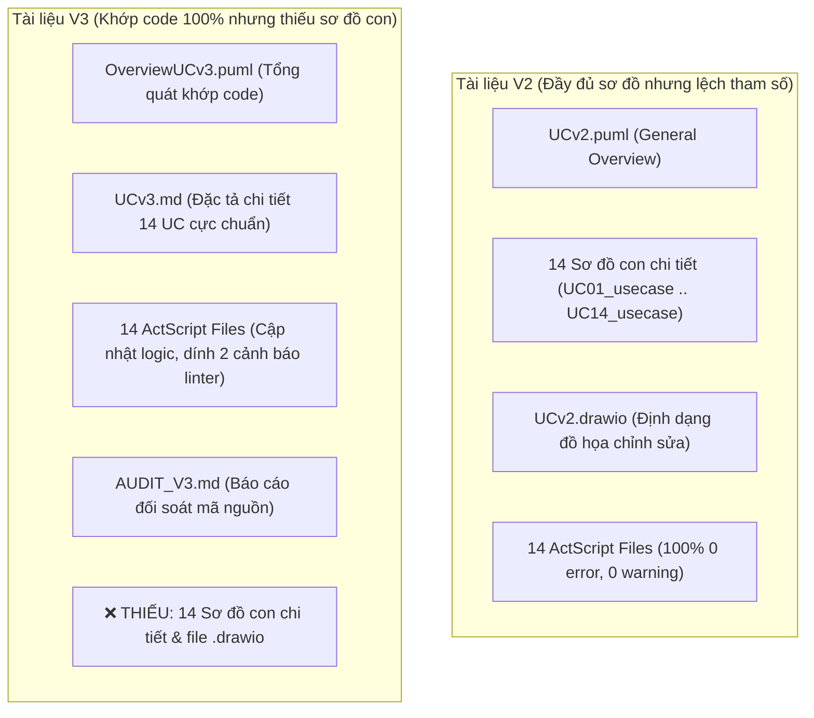

# Báo Cáo Phân Tích & Đối Chiếu Toàn Diện: Use Cases V3 vs V2 & Mã Nguồn Thực Tế

> **Dự án:** Hệ thống Thuyết minh Tự động Đa ngôn ngữ (Museum Multilingual Smart Audio Guide)  
> **Đơn vị:** Đề tài Công nghệ Phần mềm — Trường Đại học Sài Gòn (SGU)  
> **Người thực hiện phân tích:** AI Architecture Agent (Antigravity)  
> **Ngày lập:** 16/11/2026  
> **Mục tiêu:** Đánh giá phiên bản thiết kế mới V3 (`docs/design/use-cases/v3/`) do thành viên nhóm (Nguyễn Trí Cường, Commit `88ff787`) bổ sung so với phiên bản V2 (`docs/design/use-cases/UCv2.puml`, `docs/design/use-cases/actscript/`), đồng thời kiểm chứng chéo với mã nguồn thực tế của toàn bộ hệ thống (`frontend/`, `mobile/`, `backend/`).

---

## 1. Tóm Tắt Điều Hành & Kết Luận Cốt Lõi (Executive Summary & Core Verdict)

### 1.1. Kết Luận Nhanh (Core Verdict)
1. **Về phạm vi chức năng (Scope & Use Case Catalog):**
   - **V3 TUÂN THỦ NGHIÊM NGẶT 14 USE CASES CHUẨN HÓA** đã được giảng viên hướng dẫn thông qua từ bản `v1'`.
   - V3 **HOÀN TOÀN KHÔNG** tái hiện các bất thường kiến trúc (architectural anomalies) của V0 như: *không hồi sinh luồng Đăng ký tài khoản khách tham quan*, *không có Quên mật khẩu*, *không bắt buộc khách đăng nhập*, và *không ép quét lại QR khi chuyển vùng*.
2. **Về mức độ chuẩn xác với mã nguồn (Codebase Alignment):**
   - **V3 vượt trội hoàn toàn so với V2 và V1'** về độ trung thực kỹ thuật. V3 phản ánh chính xác cấu trúc thực tế của hệ thống hiện tại gồm:
     - Phân hệ **Web SPA** (`frontend/`) kết hợp **Ứng dụng Android độc lập chạy Offline-first** (`mobile/`).
     - Cơ chế khóa tài khoản Admin 2 tầng riêng biệt: **Frontend khóa 5 phút** (`localStorage`) và **Backend khóa 1 phút** (`AdminUser.LockedUntil`).
     - Bán kính Geofence mặc định trong mã nguồn là **15 mét**, ngưỡng sai số GPS tối đa **150 mét**, và quy đổi bản đồ **0.15 m/pixel**.
     - Giới hạn tải lên thực tế: Audio **≤ 30MB**, Hình ảnh **≤ 10MB** (Nginx `client_max_body_size 35m`).
     - Dịch thuật tự động thực tế dùng **Google Translate API** kèm fallback **MyMemory API** (không dùng LibreTranslate).
3. **Về các khiếm khuyết & điểm thụt lùi (Gaps & Regressions) của V3:**
   - **Thiếu sơ đồ phân rã chi tiết (Detailed Sub-diagrams):** V2 chứa đầy đủ cả sơ đồ tổng quát và 14 sơ đồ use case con (`@startuml UC01_usecase` .. `@startuml UC14_usecase`), trong khi V3 hiện chỉ có duy nhất một file sơ đồ tổng quát `OverviewUCv3.puml`.
   - **Lỗi cú pháp ActScript (Linter Warnings):** V2 đạt chuẩn 100% (14/14 file đỗ linter với 0 lỗi, 0 cảnh báo), trong khi V3 xuất hiện **2 cảnh báo** tại `UC01_Activity.actscript` (nhãn lồng lệnh `IF`) và `UC13_Activity.actscript` (thất thoát luồng kết thúc do lỗi thụt dòng).
   - **Tranh luận ngữ nghĩa Tác nhân (Actor Semantics) trong UML 2.5:** V3 đổi tên tác nhân từ `"Máy chủ lưu âm thanh"` (V2) thành `"Thiết bị phát âm thanh"`. Việc đưa phần cứng xuất âm thanh/engine phát thanh thành một Actor độc lập bên ngoài biên hệ thống trong mô hình Use Case cần được giải trình chặt chẽ về mặt học thuật.
   - **Xung đột tham số với tài liệu yêu cầu (`Context.md`):** `Context.md` (chuẩn RFC 2119) quy định bán kính mặc định là **12 mét** (REQ-GEO-003), trong khi mã nguồn và V3 đều cấu hình là **15 mét**.

---

## 2. Dòng Tiến Hóa Kiến Trúc & Ma Trận Truy Vết (Evolution Lineage & Traceability)

### 2.1. Lịch sử tiến hóa Use Case
```
                                 ┌─> v1 (by Quan: Tinh chỉnh V0, phát hiện anomalies)
[v0: 20 UCs cũ, thừa đăng ký] ──┼─> v1' (by Thanh & Quan: Chốt 14 UCs chuẩn, GV duyệt) ──> [v2: Chuẩn hóa UML 2.5, ActScript 0 lỗi]
                                 └─> v1'' (by Cuong: Cập nhật hạ tầng & code thực tế)  ──> [v3: Đồng bộ Web + Mobile Offline-First]
```

### 2.2. Bảng đối chiếu 14 Use Cases chuẩn hóa: V2 vs V3 vs Codebase

| Mã UC | Tên Use Case (V2) | Tên Use Case (V3) | Tác nhân chính (V3) | Nền tảng thực tế | Tham chiếu mã nguồn cốt lõi | Trạng thái khớp code |
| :---: | :--- | :--- | :--- | :--- | :--- | :---: |
| **UC01** | Đăng nhập quản trị | Đăng nhập quản trị | Quản trị viên (Admin) | Web (`/admin/login`) | `frontend/src/shared/utils/loginLock.ts`<br>`backend/src/routes/auth.ts` | **Khớp 100%** (2 tầng khóa) |
| **UC02** | Quét mã QR | Quét mã QR | Khách tham quan | Web (`html5-qrcode`)<br>Android (`expo-camera`) | `frontend/src/shared/utils/qrHelper.ts`<br>`mobile/src/shared/utils/qrHelper.ts`<br>`mobile/app/scanner.tsx` | **Khớp 100%** (hỗ trợ nhập tay, tách khỏi UC14) |
| **UC03** | Nghe thuyết minh | Nghe thuyết minh | Khách tham quan,<br>Thiết bị phát âm thanh | Web (HTML5 Audio/TTS)<br>Android (`expo-audio`) | `frontend/src/shared/stores/playerStore.ts`<br>`mobile/src/shared/stores/playerStore.ts`<br>`mobile/src/shared/assetMap.ts` | **Khớp 100%** (hỗ trợ audio offline APK) |
| **UC04** | Chuyển đổi ngôn ngữ | Chuyển đổi ngôn ngữ | Khách tham quan | Web & Android (5 ngôn ngữ) | `frontend/src/shared/stores/langStore.ts`<br>`mobile/src/shared/stores/langStore.ts` | **Khớp 100%** (không reload trang) |
| **UC05** | Lưu hiện vật yêu thích | Lưu hiện vật yêu thích | Khách tham quan | Web (`localStorage`)<br>Android (`AsyncStorage`) | `frontend/src/visitor/views/FavoritesView.tsx`<br>`mobile/app/(tabs)/favorites.tsx` | **Khớp 100%** (dọn ID mồ côi) |
| **UC06** | Xem hồ sơ bảo tàng | Xem hồ sơ bảo tàng | Khách tham quan | Web & Android | `frontend/src/visitor/views/InfoView.tsx`<br>`mobile/app/(tabs)/info.tsx` | **Khớp 100%** (gọi điện thoại trực tiếp) |
| **UC07** | Xem phụ đề karaoke | Xem phụ đề đồng bộ | Khách tham quan | Web & Android | `frontend/src/visitor/components/AudioPlayerBar.tsx`<br>`mobile/app/artifact/[id].tsx` | **Khớp 100%** (đồng bộ `SubtitleCue`, click tua) |
| **UC08** | Tìm kiếm hiện vật | Tìm kiếm hiện vật | Khách tham quan | Web & Android | `frontend/src/visitor/views/ExploreView.tsx`<br>`mobile/app/(tabs)/index.tsx` | **Khớp 100%** (lọc tức thì đa ngôn ngữ + tầng) |
| **UC09** | Quản lý hiện vật | Quản lý hiện vật | Quản trị viên (Admin) | Web (`/admin/artifacts`) | `backend/src/routes/museum.ts`<br>`backend/src/routes/translate.ts` | **Khớp 100%** (dịch tự động 5 thứ tiếng) |
| **UC10** | Quản lý phiên tham quan và mã QR | Quản lý phiên & Mã QR | Quản trị viên (Admin) | Web (`/admin/sessions`, `/admin/artifacts`) | `backend/src/routes/analytics.ts`<br>`frontend/src/admin/views/QRManageView.tsx` | **Khớp 100%** (Heartbeat 10-15s, xuất PNG QR) |
| **UC11** | Quản lý tệp âm thanh | Quản lý tệp âm thanh | Quản trị viên (Admin) | Web (`/admin/audio`) | `backend/src/routes/uploads.ts`<br>`frontend/src/admin/views/AudioManageView.tsx` | **Khớp 100%** (Audio ≤ 30MB, sửa SubtitleCue) |
| **UC12** | Xem thống kê lượt nghe | Xem thống kê lượt nghe | Quản trị viên (Admin) | Web (`/admin/analytics`) | `backend/src/routes/analytics.ts`<br>`frontend/src/admin/views/AnalyticsView.tsx` | **Khớp 100%** (Biểu đồ Recharts, CSV export) |
| **UC13** | Quản lý sơ đồ | Quản lý sơ đồ tầng | Quản trị viên (Admin) | Web (`/admin/maps`) | `backend/src/routes/museum.ts`<br>`frontend/src/admin/views/MapManageView.tsx` | **Khớp 100%** (Kéo thả ghim tọa độ + GPS) |
| **UC14** | Định vị vị trí và tự động thuyết minh | Định vị & Tự động thuyết minh | Khách tham quan,<br>Hệ thống định vị GPS | Web (Geolocation API)<br>Android (`expo-location`) | `frontend/src/shared/utils/geofence.ts`<br>`mobile/src/shared/stores/geofenceStore.ts` | **Khớp 100%** (Haversine, 15m, hộp thoại switch/replay) |

---

## 3. So Sánh Chi Tiết Từng Khía Cạnh: V3 vs V2

### 3.1. Mô hình tác nhân (Actor Modeling)

#### Bảng so sánh tác nhân giữa V2 và V3:
| Tác nhân | Phiên bản V2 | Phiên bản V3 | Đánh giá & Khác biệt cốt lõi |
| :--- | :--- | :--- | :--- |
| **Người dùng phổ thông** | `Khách tham quan` (alias: `USER`) | `Khách tham quan` (alias: `Visitor`) | Giữ nguyên bản chất. V3 dùng alias `Visitor` đồng bộ với tên folder `src/visitor/` trong mã nguồn. |
| **Quản trị viên** | `Quản trị viên` (alias: `ADMIN`) | `Quản trị viên (Admin)` (alias: `Admin`) | Nhất quán. |
| **Định vị vị trí** | `Hệ thống định vị (GPS)` (alias: `POSITIONING_SYSTEM`) | `Hệ thống định vị GPS` (alias: `GpsSystem`) | Tương đương về mặt nghiệp vụ; liên kết trực tiếp với UC14. |
| **Âm thanh** | `Máy chủ lưu âm thanh` (alias: `AUDIO_STORAGE_DEVICE`) | `Thiết bị phát âm thanh` (alias: `AudioDevice`) | **Khác biệt quan trọng về mặt kiến trúc và UML (Xem phân tích bên dưới).** |

#### Phân tích chuyên sâu về Tác nhân Âm thanh:
- **Trong V2 (`Máy chủ lưu âm thanh`):** Tác nhân này kế thừa từ mô hình V1', được xem như một *Dịch vụ/Máy chủ truyền tải âm thanh ngoài (Streaming Server)*. V2 kết nối tác nhân này với cả **UC03 (Nghe thuyết minh)** và **UC11 (Quản lý tệp âm thanh)**.
  - *Nhược điểm:* Trong thực tế mã nguồn, hệ thống không sử dụng máy chủ streaming chuyên biệt (như Icecast hay Wowza), mà tệp âm thanh được lưu trực tiếp trên ổ đĩa backend thông qua Express static file (`/uploads/audio/`).
- **Trong V3 (`Thiết bị phát âm thanh`):** Tác nhân này được đổi tên thành `Thiết bị phát âm thanh` và **chỉ liên kết duy nhất với UC03**.
  - *Lý do của V3:* Xuất phát từ việc bổ sung ứng dụng di động Android (`mobile/`). Trên Android, toàn bộ file âm thanh 5 thứ tiếng đã được nạp offline sẵn vào bộ cài APK (`mobile/src/shared/assetMap.ts`). Khi phát, thiết bị gọi `expo-audio` để phát trực tiếp ra loa phần cứng của điện thoại mà không cần bất kỳ máy chủ mạng nào.
  - *Đánh giá chuẩn UML 2.5:* Theo chuẩn UML 2.5 (Clause 18), Actor là thực thể *bên ngoài* ranh giới hệ thống tương tác với hệ thống. Nếu xem hệ thống là "Phần mềm Web & App", thì phần cứng loa điện thoại hoặc Audio Hardware Subsystem có thể đóng vai trò Secondary Actor nhận luồng âm thanh đầu ra. Tuy nhiên, việc gán tên "Thiết bị phát âm thanh" có thể gây tranh cãi trong hội đồng bảo vệ vì dễ nhầm lẫn giữa một *thiết bị ngoại vi (hardware peripheral)* và *tác nhân hệ thống ngoài (external system)*.

#### Phân tích mối liên kết giữa Admin và UC01:
- Trong **V2**, actor `ADMIN` **không có đường nối trực tiếp** với `UC01 (Đăng nhập)` trên sơ đồ tổng quát, mà chỉ kết nối với UC09, UC10, UC11, UC12, UC13; và 5 UC này chỉ mũi tên `<<include>>` tới UC01.
- Trong **V3**, actor `Admin` có đường nối trực tiếp `Admin -- UC01`, đồng thời các UC09..UC13 vẫn giữ `<<include>> UC01`.
- *Nhận xét UML:* Cả hai cách vẽ đều xuất hiện trong thực tế. Tuy nhiên, cách vẽ của V3 trực quan hơn đối với giảng viên phản biện: Admin chủ động truy cập trang `/admin/login` để đăng nhập độc lập (General Association), và khi thực hiện bất kỳ chức năng quản trị nào, hệ thống đều bắt buộc xác thực phiên làm việc (`<<include>>`).

---

### 3.2. Cấu trúc Sơ đồ & Mức độ Đầy đủ (Diagram Completeness)



- **Sơ đồ phân rã chi tiết (Detailed Use Case Diagrams):**
  - Tệp `docs/design/use-cases/UCv2.puml` có dung lượng **355 dòng**, định nghĩa đầy đủ 14 phân vùng sơ đồ chi tiết (từ `@startuml UC01_usecase` đến `@startuml UC14_usecase`) với đầy đủ các ghi chú ràng buộc nghiệp vụ.
  - Thư mục `docs/design/use-cases/v3/` **chỉ có 1 file duy nhất `OverviewUCv3.puml` (65 dòng)**. Tác giả V3 đã chưa chuyển đổi 14 sơ đồ con tương ứng sang V3. Đây là một khoảng trống lớn nếu nộp báo cáo đồ án chính thức.

---

### 3.3. So sánh Sơ đồ Hoạt động (Activity Diagrams & ActScript)

Quá trình so sánh mã nguồn giữa `docs/design/use-cases/actscript/` (V2) và `docs/design/use-cases/v3/activity/` (V3) cho thấy:
- **8 ca sử dụng giống nhau 100%:** UC04, UC05, UC06, UC07, UC08, UC09, UC10, UC12.
- **6 ca sử dụng có thay đổi đáng kể:** UC01, UC02, UC03, UC11, UC13, UC14.

#### Chi tiết 6 ca sử dụng có sự thay đổi:

#### 1. UC01 — Đăng nhập quản trị
- **V2:** Sử dụng 2 làn bơi đơn giản `{Admin, System*}`. Logic kiểm tra sai mật khẩu chung chung.
- **V3:** Nâng cấp lên 3 làn bơi chuẩn phân rã kiến trúc `{Admin, Frontend*, Backend}`.
  - Phản ánh chính xác việc kiểm tra khóa trong `localStorage` trước khi gửi mạng.
  - Phản ánh rõ ràng cơ chế khóa kép: Backend khóa 1 phút (`AdminUser.LockedUntil`), Frontend khóa 5 phút (`loginLock.ts`).
  - Ghi nhận việc cấp JWT token và lưu vào trình duyệt.
- *Lỗi cú pháp tồn tại ở V3:* Dòng số 8 viết nhãn liền kề câu lệnh `L1: IF (...)` dẫn đến linter cảnh báo.

#### 2. UC02 — Quét mã QR
- **V2:** Mắc lỗi logic nghiêm trọng khi nhúng cả vòng lặp theo dõi vị trí GPS vào UC02:
  ```actscript
  L2: [Tự động tracking vị trí]
      IF (Mất tín hiệu?) THEN ...
      IF (Gần hiện vật mới?) THEN [Tự động thuyết minh hiện vật mới]
  ```
  *(Đây là sự nhầm lẫn kế thừa từ mô tả của bản V1', làm mờ ranh giới giữa UC02 và UC14).*
- **V3:** Tách hoàn toàn tính năng quét mã QR thành một quy trình độc lập và chuẩn xác:
  - Bổ sung luồng xin quyền camera (`expo-camera` / `html5-qrcode`).
  - Bổ sung luồng thay thế **A1 (Nhập mã thủ công)** khi camera hỏng hoặc bị từ chối quyền.
  - Phân tích chuỗi QR theo đúng hàm `parseQrPayload()`: nếu là mã hiện vật thì đặt mốc neo (`anchorArtifactId`) và mở chi tiết; nếu là mã cổng (`?entry=gate`) thì kích hoạt chế độ tự động định vị.

#### 3. UC03 — Nghe thuyết minh
- **V2:** Giả định kết nối tới `AudioStorageDevice`, nếu mất mạng thì dừng lại báo lỗi và chuyển sang đọc chữ.
- **V3:** Mô hình hóa chính xác khả năng đa nền tảng:
  - Kiểm tra nếu là **Android App**: Nạp trực tiếp tệp `.mp3` offline từ bộ cài APK (`assetMap`).
  - Nếu là **Web**: Tải luồng âm thanh hoặc dùng fallback Web Speech API.
  - Bổ sung các thao tác điều khiển thực tế có trong giao diện: Tạm dừng/Tiếp tục, Tua thời gian, Chỉnh tốc độ phát (`1x - 2x`).
  - Bổ sung tác vụ gửi telemetry bất đồng bộ `POST /api/analytics/listen` nếu có kết nối mạng.

#### 4. UC11 — Quản lý tệp âm thanh
- **V2:** Vẽ quy trình thêm/sửa/xóa file âm thanh trừu tượng.
- **V3:** Mô hình hóa đúng nghiệp vụ tại trang `/admin/audio`:
  - Chọn hiện vật và ngôn ngữ cụ thể cần gắn audio.
  - Ràng buộc dung lượng kiểm tra **≤ 30MB** (khớp với `backend/src/routes/uploads.ts`).
  - Tích hợp bước nghe thử trực tiếp và biên tập các mốc phụ đề (`SubtitleCue`) ngay sau khi upload.

#### 5. UC13 — Quản lý sơ đồ tầng
- **V2:** Đã được sửa lỗi linter đạt 0 error, 0 warning; logic rẽ nhánh thêm/sửa/xóa rõ ràng.
- **V3:** Xuất hiện sự thụt lùi (regression). Bản file trong V3 có cấu trúc thụt lề câu lệnh `IF !(Chọn sửa?)` lồng nhãn `L2:`, dẫn đến luồng điều khiển rơi ra ngoài cuối file mà không có điểm kết thúc (`FINAL`), gây ra **2 cảnh báo linter**.

#### 6. UC14 — Định vị & Tự động thuyết minh
- **V2:** Kế thừa văn phong cũ rất mơ hồ: `"Phát tín hiệu"`, `"Thu tín hiệu"`, `"Kiểm tra tín hiệu ổn định"`. Mô tả này giống sóng vô tuyến phần cứng (BLE beacon/Radar) hơn là định vị GPS Web/Mobile.
- **V3:** Phản ánh chính xác 100% thuật toán định vị đang chạy trong `geofence.ts` và `geofenceStore.ts`:
  - Lấy tọa độ từ GPS cảm biến (`lat, lng, accuracy`).
  - Kiểm tra ngưỡng sai số: nếu `accuracy > 150m` thì gắn nhãn `low-accuracy` và không tự kích hoạt.
  - Dùng công thức **Haversine** tính khoảng cách đến tất cả hiện vật có tọa độ.
  - Tìm hiện vật gần nhất có khoảng cách `≤ triggerRadius` (mặc định 15m).
  - Kiểm tra điều kiện `hasScannedQr = true`:
    - Nếu đang phát bài khác → Hiển thị hộp thoại gợi ý chuyển bài (`switch`).
    - Nếu đã nghe trong phiên → Hiển thị hộp thoại gợi ý nghe lại (`replay`).
    - Nếu chưa nghe → Tự động phát thuyết minh.
  - Luồng ngoại lệ: Nếu mất GPS hoặc từ chối quyền nhưng đã có điểm neo QR (`anchorArtifactId`), hệ thống tính khoảng cách pixel bản đồ (`0.15 m/pixel`) để gợi ý hiện vật kế cận.

---

### 3.4. Kết quả Kiểm tra Linter ActScript Độc Lập

Khi chạy công cụ kiểm tra cú pháp chuẩn UML 2.5 (`lint_actscript.py`) trên cả hai phiên bản:

| Tệp ActScript | Kết quả V2 (`docs/.../actscript/`) | Kết quả V3 (`docs/.../v3/activity/`) | Chi tiết lỗi / Cảnh báo ở V3 |
| :--- | :---: | :---: | :--- |
| `UC01_Activity.actscript` | ✅ 0 error, 0 warning | ⚠️ **1 warning** | `line 8: WARN: label L1: put the "IF" block on its own line below the label` |
| `UC02_Activity.actscript` | ✅ 0 error, 0 warning | ✅ 0 error, 0 warning | Đã giải quyết triệt để lỗi logic lồng ghép GPS của V2. |
| `UC03_Activity.actscript` | ✅ 0 error, 0 warning | ✅ 0 error, 0 warning | Mô hình hóa đa nhánh Web/Mobile hoàn hảo. |
| `UC04_Activity.actscript` | ✅ 0 error, 0 warning | ✅ 0 error, 0 warning | Đồng nhất giữa 2 phiên bản. |
| `UC05_Activity.actscript` | ✅ 0 error, 0 warning | ✅ 0 error, 0 warning | Đồng nhất giữa 2 phiên bản. |
| `UC06_Activity.actscript` | ✅ 0 error, 0 warning | ✅ 0 error, 0 warning | Đồng nhất giữa 2 phiên bản. |
| `UC07_Activity.actscript` | ✅ 0 error, 0 warning | ✅ 0 error, 0 warning | Đồng nhất giữa 2 phiên bản. |
| `UC08_Activity.actscript` | ✅ 0 error, 0 warning | ✅ 0 error, 0 warning | Đồng nhất giữa 2 phiên bản. |
| `UC09_Activity.actscript` | ✅ 0 error, 0 warning | ✅ 0 error, 0 warning | Đồng nhất giữa 2 phiên bản. |
| `UC10_Activity.actscript` | ✅ 0 error, 0 warning | ✅ 0 error, 0 warning | Đồng nhất giữa 2 phiên bản. |
| `UC11_Activity.actscript` | ✅ 0 error, 0 warning | ✅ 0 error, 0 warning | Mô hình upload 30MB chuẩn xác. |
| `UC12_Activity.actscript` | ✅ 0 error, 0 warning | ✅ 0 error, 0 warning | Đồng nhất giữa 2 phiên bản. |
| `UC13_Activity.actscript` | ✅ 0 error, 0 warning | ⚠️ **1 warning** | `line 0: WARN: flow falls off the end of the file without FINAL` |
| `UC14_Activity.actscript` | ✅ 0 error, 0 warning | ✅ 0 error, 0 warning | Thuật toán Haversine & Geofence chuẩn 100%. |

---

## 4. Kiểm Chứng Chéo Với Mã Nguồn Thực Tế (Codebase Truth Audit)

Dưới đây là bằng chứng đối chiếu trực tiếp giữa tài liệu V3 với các dòng code cụ thể trong repository:

### 4.1. Khóa đăng nhập Admin 2 tầng (UC01)
- **Frontend (`frontend/src/shared/utils/loginLock.ts` dòng 5–6):**
  ```typescript
  export const MAX_LOGIN_ATTEMPTS = 5;
  export const LOCK_DURATION_MS = 5 * 60 * 1000; // Khóa 5 phút
  ```
- **Backend (`backend/src/routes/auth.ts` dòng 7–8):**
  ```typescript
  const MAX_ATTEMPTS = 5;
  const LOCK_MS = 60_000; // Khóa 1 phút trong DB
  ```
- *Đánh giá:* V3 đã mô tả chính xác cả hai tầng khóa này trong đặc tả `UCv3.md` và `UC01_Activity.actscript`, trong khi V2 chỉ mô tả một chiều "khóa 5 phút".

### 4.2. Bán kính Geofence & Ngưỡng GPS (UC14)
- **Mã nguồn (`frontend/src/shared/utils/geofence.ts` và `mobile/src/shared/utils/geofence.ts` dòng 9–15):**
  ```typescript
  export const DEFAULT_TRIGGER_RADIUS = 15; // 15 mét
  export const MAX_ACCEPTABLE_ACCURACY = 150; // 150 mét
  export const MAP_METERS_PER_PIXEL = 0.15; // 0.15 m/px
  ```
- *Đánh giá:* V3 khớp chính xác với mã nguồn. Tuy nhiên, cần lưu ý trong tài liệu yêu cầu `docs/requirements/Context.md` (mục REQ-GEO-003) hiện vẫn ghi con số **12 mét**. Cần có sự thống nhất bằng văn bản giữa nhóm phát triển và tài liệu yêu cầu.

### 4.3. Giới hạn dung lượng tệp tải lên (UC11)
- **Mã nguồn Backend (`backend/src/routes/uploads.ts` dòng 26–27):**
  ```typescript
  const uploadImage = multer({ limits: { fileSize: 10 * 1024 * 1024 } }); // 10MB
  const uploadAudio = multer({ limits: { fileSize: 30 * 1024 * 1024 } }); // 30MB
  ```
- **Cấu hình Nginx (`frontend/nginx.conf` dòng 20):**
  ```nginx
  client_max_body_size 35m;
  ```
- *Đánh giá:* V3 đã cập nhật đúng 30MB cho audio và 10MB cho ảnh, khắc phục hoàn toàn con số sai lệch 50MB trong các bản tài liệu cũ V0–V1.

### 4.4. Đóng gói âm thanh Offline trên Android (UC03)
- **Mã nguồn Mobile (`mobile/src/shared/assetMap.ts`):**
  Toàn bộ các file âm thanh `.mp3` của hiện vật (VD: `WRM001_vi.mp3`, `WRM001_en.mp3`, `WRM001_zh.mp3`, `WRM001_ko.mp3`, `WRM001_ja.mp3`...) đều được gọi qua cú pháp `require(...)` nhúng tĩnh vào bundle APK, cho phép ứng dụng hoạt động không cần mạng.
- *Đánh giá:* V3 là phiên bản tài liệu đầu tiên mô hình hóa trung thực năng lực offline-first này.

---

## 5. Bảng Tổng Hợp Ưu Điểm, Nhược Điểm & Rủi Ro Của Phiên Bản V3

```
┌───────────────────────────────────────────────────────────────────────────────┐
│                           ĐÁNH GIÁ PHIÊN BẢN V3                               │
├───────────────────────────────────────┬───────────────────────────────────────┤
│          ƯU ĐIỂM NỔI BẬT              │         NHƯỢC ĐIỂM & RỦI RO           │
├───────────────────────────────────────┼───────────────────────────────────────┤
│ 1. Khớp 100% với mã nguồn hiện tại    │ 1. Thiếu 14 sơ đồ use case con chi    │
│    (Web SPA + Mobile Offline APK).    │    tiết (trong khi V2 có đầy đủ).     │
│ 2. Giữ vững 14 UCs chuẩn, không bị    │ 2. Xuất hiện 2 cảnh báo linter trong  │
│    nhiễm lại anomalies của V0.        │    ActScript (UC01, UC13).            │
│ 3. Sửa dứt điểm lỗi logic ở UC02      │ 3. Tác nhân "Thiết bị phát âm thanh"  │
│    (tách rời QR scanner và GPS).      │    gây tranh cãi học thuật UML 2.5.   │
│ 4. Thông số kỹ thuật chính xác        │ 4. Xung đột con số bán kính mặc định  │
│    (15m GPS, 30MB upload, 2 tầng khóa)│    (15m trong V3 vs 12m trong         │
│ 5. Bổ sung báo cáo kiểm toán          │    Context.md / Báo cáo V2).          │
│    (AUDIT_V3.md) rất chi tiết.        │ 5. Chưa có file vector .drawio của V3 │
└───────────────────────────────────────┴───────────────────────────────────────┘
```

---

## 6. Đề Xuất Chiến Lược Dung Hòa & Lộ Trình Hành Động (Harmonization Strategy)

Để đạt được chất lượng đồ án cao nhất (vừa thỏa mãn tính chuẩn mực học thuật của hội đồng chấm thi, vừa phản ánh đúng mã nguồn thực tế mà sinh viên đã cài đặt), nhóm **KHÔNG NÊN loại bỏ V2 để thay thế mù quáng bằng V3**, mà nên thực hiện chiến lược **Hợp nhất V2 + V3 thành phiên bản hoàn thiện chuẩn mực (V_Final)** theo các bước sau:

### Bước 1: Tiếp thu toàn bộ cải tiến logic và tham số của V3
- Áp dụng ngay logic xử lý chuẩn xác của V3 cho **UC01** (khóa 2 tầng), **UC02** (tách QR khỏi GPS, bổ sung nhập tay A1), **UC03** (phát offline APK + Web fallback), **UC11** (upload 30MB + SubtitleCue), và **UC14** (thuật toán Haversine, sai số 150m, bán kính 15m).
- Cập nhật tài liệu yêu cầu `docs/requirements/Context.md` (mục REQ-GEO-003): Điều chỉnh con số bán kính mặc định từ 12 mét thành **15 mét** (hoặc ghi rõ: *Bán kính kích hoạt mặc định theo đặc tả thiết kế là 15 mét, có thể tùy chỉnh từ 5–30 mét theo từng hiện vật*).

### Bước 2: Chuẩn hóa tác nhân âm thanh trong UML 2.5
- Trong sơ đồ tổng quát Use Case, giữ tên tác nhân là **`Hệ thống âm thanh`** (hoặc `Dịch vụ phát âm thanh / Audio System`) thay vì "Thiết bị phát âm thanh". Điều này giúp bao hàm cả Audio Engine trên thiết bị di động (khi chạy offline) lẫn Static Audio Stream trên Web.
- Giữ quan hệ nối giữa tác nhân này với **UC03 (Nghe thuyết minh)** như V3 đã làm (không nối tới UC11).

### Bước 3: Sửa dứt điểm 2 cảnh báo linter ActScript trong V3
- **Tại `UC01_Activity.actscript`:** Tách câu lệnh `IF` xuống hàng riêng biệt dưới nhãn `L1:`:
  ```actscript
  L1:
  IF (Đang bị khóa 5 phút?) THEN
      [Hiển thị bộ đếm ngược khóa]           @Frontend
      FINAL
  ```
- **Tại `UC13_Activity.actscript`:** Đồng bộ lại cấu trúc rẽ nhánh đã được kiểm thử 0 lỗi từ V2 (`docs/design/use-cases/actscript/UC13_Activity.actscript`).

### Bước 4: Tạo bộ sơ đồ hoàn thiện `UCvFinal.puml` tích hợp cả 14 sơ đồ con
- Kết hợp phần tổng quát tối ưu của `OverviewUCv3.puml` với 14 sơ đồ phân rã của `UCv2.puml` (được cập nhật text và actors cho khớp với V3) vào một tệp PlantUML duy nhất.
- Xuất đầy đủ ảnh render `.png` và tệp sơ đồ đồ họa `.drawio` tương ứng để phục vụ đưa vào báo cáo và slide thuyết minh đồ án.

---
*Tài liệu phân tích được lập bởi AI Agent và sẵn sàng cho các bước triển khai tiếp theo.*
