**HỆ THỐNG THUYẾT MINH TỰ ĐỘNG ĐA NGÔN NGỮ**

**Đặc Tả Use Case Chi Tiết (Focused Use Cases)**

# Mục Lục

- 1. Sơ Đồ Use Case Tổng Quát
- 2. Danh Sách Tác Nhân (Actors)
- 3. Đặc Tả Chi Tiết Các Use Case
  - 3.1 USC01 — Đăng Nhập
  - 3.2 USC02 — Quét Mã QR
  - 3.3 USC03 — Nghe Thuyết Minh
  - 3.4 USC04 — Chuyển Đổi Ngôn Ngữ
  - 3.5 USC05 — Lưu Sự Vật Yêu Thích
  - 3.6 USC06 — Xem Hồ Sơ Bảo Tàng
  - 3.7 USC07 — Xem Phụ Đề
  - 3.8 USC08 — Tìm Kiếm
  - 3.9 USC09 — Quản Lý Sự Vật
  - 3.10 USC10 — Quản Lý Phiên Tham Quan & Mã QR
  - 3.11 USC11 — Quản Lý Tệp Âm Thanh
  - 3.12 USC12 — Xem Thống Kê Lượt Nghe
  - 3.13 USC13 — Quản Lý Sơ Đồ
  - 3.14 USC14 — Định Vị Vị Trí & Tự Động Thuyết Minh
- 4. Sơ Đồ Thành Phần (Component Diagram)
- 5. Sơ Đồ Triển Khai (Deployment Diagram)
- 6. ERD

# 1. Sơ Đồ Use Case Tổng Quát

Sơ đồ dưới đây mô tả tổng quan các use case của Hệ thống Thuyết minh tự động đa ngôn ngữ, cùng các tác nhân (actor) tham gia và các quan hệ include/extend/generalization giữa các use case.

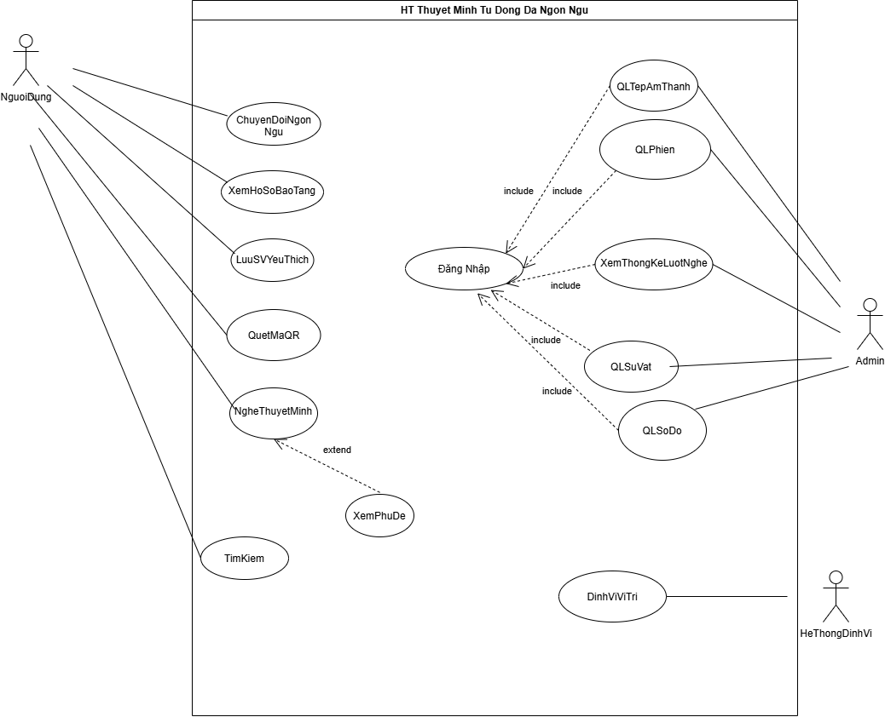

# 2. Danh Sách Tác Nhân (Actors)

| **Tác nhân** | **Mô tả** |
|---|---|
| **Người (Khách vãng lai)** | Người dùng phổ thông truy cập vào web bằng link hoặc quét QR |
| **Admin (Quản trị viên)** | Người quản lý hệ thống dữ liệu hiện vật, sơ đồ, mã QR, tệp âm thanh và thống kê. |
| **Thiết Bị Lưu Âm Thanh (Audio Storage Device / Server)** | Hệ thống phần cứng/dịch vụ lưu trữ và truyền phát dòng dữ liệu âm thanh thuyết minh (Streaming Server). |

# 3. Đặc Tả Chi Tiết Các Use Case

Phần dưới đây trình bày đặc tả chi tiết (Focused Use Case) cho từng use case của hệ thống, theo mẫu: Tác nhân, Mức độ hoàn thiện, Mô tả tóm tắt, Điều kiện tiên quyết, Dòng sự kiện chính, Luồng thay thế (Alternative), Luồng ngoại lệ (Exception), Điều kiện kết thúc và Sự kiện kích hoạt, kèm sơ đồ use case và sơ đồ hoạt động minh họa.

## 3.1 USC01 — Đăng Nhập

***Sơ đồ Use Case — USC01***

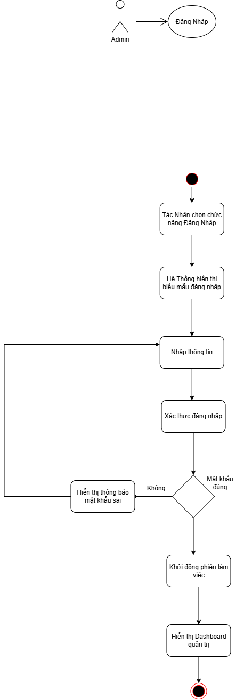

**Tác nhân (Actor):** Admin

**Mức độ hoàn thiện:** Focused

**Mô tả tóm tắt:** Xác thực danh tính của Quản trị viên để phân quyền truy cập các chức năng tương ứng trong hệ thống.

**Điều kiện tiên quyết:**

- Tác nhân Admin

**Dòng sự kiện chính:**

| Hành động của Actor | Phản hồi của Hệ thống |
|---|---|
| 1. Admin chọn chức năng "Đăng Nhập". |  |
|  | 2. Hệ thống hiển thị biểu mẫu đăng nhập (Tên đăng nhập/Email và Mật khẩu). |
| 3. Admin nhập thông tin đăng nhập và nhấn "Đăng nhập". |  |
|  | 4. Hệ thống thực hiện xác thực đăng nhập (E1). |
|  | 5. Hệ thống khởi động phiên làm việc (Session/Token) cho Admin. |
|  | 6. Hệ thống hiển thị Dashboard quản trị. Use Case kết thúc thành công. |

**Luồng thay thế (Alternative):** Không có.

**Luồng ngoại lệ (Exception):**

- E1 - Sai mật khẩu: Hệ thống thông báo "Tên đăng nhập hoặc mật khẩu không chính xác" và cho phép nhập lại (tự động khóa tạm thời 5 phút nếu nhập sai quá 5 lần liên tiếp).

**Điều kiện kết thúc:**

- Thành công: Phiên làm việc (Session/Token) được khởi tạo thành công với quyền hạn tương ứng (Admin truy cập Dashboard Quản trị hệ thống; khách tham quan sử dụng trực tiếp không cần tài khoản).
- Thất bại: Hệ thống từ chối quyền truy cập, hiển thị thông báo lỗi (E1) và không tạo phiên làm việc.

**Sự kiện kích hoạt (Trigger):** Admin chọn chức năng "Đăng Nhập".

***Sơ đồ hoạt động (Activity Diagram) — USC01***

## 3.2 USC02 — Quét Mã QR

***Sơ đồ Use Case — USC02***

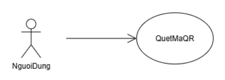

**Tác nhân (Actor):** Người Dùng (hoặc Khách tham quan)

**Mức độ hoàn thiện:** Focused

**Mô tả tóm tắt:** Người dùng sử dụng camera thiết bị di động quét mã QR gắn tại vị trí hiện vật/khu vực trưng bày để hệ thống tự động nhận diện và mở nội dung thuyết minh tương ứng. Người dùng chỉ cần quét mã QR một lần, sau đó hệ thống tự động tracking (theo dõi vị trí) và tự động mở thuyết minh khi người dùng đến gần các hiện vật tiếp theo, không cần quét lại.

**Điều kiện tiên quyết:**

- Thiết bị di động của người dùng có tích hợp Camera và phần cứng hoạt động bình thường.
- Ứng dụng đã được cấp quyền truy cập Camera.
- Ứng dụng được cấp quyền định vị/kết nối cần thiết để thực hiện tracking vị trí.

**Dòng sự kiện chính:**

| Hành động của Actor | Phản hồi của Hệ thống |
|---|---|
| 1. Người dùng chọn tính năng "Quét Mã QR". |  |
|  | 2. Hệ thống kích hoạt camera và hiển thị khung quét mã QR (E2). |
| 3. Người dùng hướng camera về phía mã QR gắn trên hiện vật (quét 1 lần). |  |
|  | 4. Hệ thống nhận diện và giải mã chuỗi định danh QR (E1). |
|  | 5. Hệ thống truy vấn thông tin hiện vật từ CSDL theo ID vừa giải mã. |
|  | 6. Hệ thống ghi nhận vị trí hiện vật vừa quét làm điểm xuất phát và bật chế độ tự động tracking. |
|  | 7. Hệ thống tự động chuyển đến màn hình chi tiết hiện vật và kích hoạt chức năng liên quan (Đọc nội dung, Xem hình ảnh hoặc phát Use Case {Nghe Thuyết Minh}). |
| 8. Người dùng di chuyển tham quan, không cần quét lại mã QR. (A1, A2) |  |
|  | 9. Hệ thống tự động tracking vị trí người dùng (E3). |
|  | 10. Khi người dùng đến gần hiện vật khác, hệ thống tự động nhận diện hiện vật đó, truy vấn dữ liệu và tự động mở nội dung thuyết minh tương ứng. |
| 11. Người dùng tiếp tục tham quan. |  |
|  | 12. Hệ thống lặp lại bước 9–10 cho đến khi người dùng dừng theo dõi hoặc thoát ứng dụng. Use Case kết thúc. |

**Luồng thay thế (Alternative):**

- A1 – Người dùng tắt tracking: Người dùng chọn "Dừng theo dõi" trong quá trình tham quan. Hệ thống dừng tracking và Use Case kết thúc.
- A2 – Quét thủ công hiện vật khác: Người dùng chủ động quét mã QR của một hiện vật bất kỳ. Hệ thống xử lý như bước 3–7 và cập nhật lại vị trí xuất phát cho tracking.

**Luồng ngoại lệ (Exception):**

- E1 – Không thể quét/mã QR mờ hoặc hỏng: Hệ thống hiển thị thông báo "Không nhận dạng được mã QR" và gợi ý điều chỉnh khoảng cách, ánh sáng. Đồng thời hiển thị nút "Tìm kiếm hiện vật" để người dùng chuyển sang chức năng Tìm kiếm (có thể nhập trực tiếp mã số hiện vật).
- E2 – Chưa cấp quyền Camera hoặc thiết bị không có camera: Hệ thống thông báo cần quyền truy cập Camera để quét mã, hướng dẫn cấp quyền trong phần cài đặt của thiết bị và hiển thị nút "Tìm kiếm hiện vật".
- E3 – Mất tín hiệu hoặc không có quyền định vị khi tracking: Hệ thống thông báo "Không thể theo dõi vị trí", dừng tracking tự động và đề nghị người dùng quét mã QR thủ công hoặc dùng chức năng Tìm kiếm.

**Điều kiện kết thúc:**

- Thành công: Hệ thống giải mã thành công QR ID, truy vấn dữ liệu hiện vật, chuyển hướng người dùng đến màn hình chi tiết hiện vật và bật tracking tự động cho các hiện vật tiếp theo.
- Thất bại: Màn hình quét giữ nguyên hoặc hiển thị thông báo lỗi mã QR không hợp lệ/mờ hỏng/chưa cấp quyền Camera (E1, E2) hoặc mất tracking (E3), kèm gợi ý chuyển sang chức năng Tìm kiếm.

**Sự kiện kích hoạt (Trigger):** Người dùng chọn biểu tượng "Quét QR" trên giao diện.

***Sơ đồ hoạt động (Activity Diagram) — USC02***

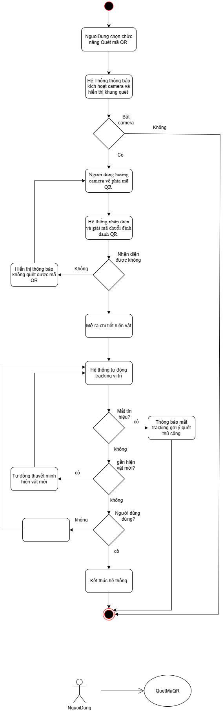

## 3.3 USC03 — Nghe Thuyết Minh

***Sơ đồ Use Case — USC03***

**Tác nhân (Actor):** Người Dùng, Thiết Bị Lưu Âm Thanh

**Mức độ hoàn thiện:** Focused

**Mô tả tóm tắt:** Phát bản thu âm thuyết minh về hiện vật/sự vật theo ngôn ngữ hiện tại của người dùng. Tự động gọi {Phát Luồng Dữ Liệu Âm Thanh} («include») từ thiết bị lưu trữ và có thể mở rộng hiển thị phụ đề với {Xem Phụ Đề} («extend»).

**Điều kiện tiên quyết:** Đã xác định được hiện vật cần thuyết minh (thông qua Quét mã QR hoặc Tìm kiếm/Xem danh sách).

**Dòng sự kiện chính:**

| Hành động của Actor | Phản hồi của Hệ thống |
|---|---|
| 1. Người dùng đăng nhập |  |
|  | 2. Hệ thống hiển thị lời chào mừng đăng nhập cùng với những chức năng chính cho người dùng lựa chọn |
| 3. Người dùng chọn nghe thuyết minh của hiện vật (hoặc tự động kích hoạt sau khi quét QR). |  |
|  | 4. Hệ thống xác định ngôn ngữ người dùng đang chọn và mã ID của tệp âm thanh tương ứng. |
|  | 5. Hệ thống thực hiện {Phát Luồng Dữ Liệu Âm Thanh}: gửi yêu cầu lấy tệp tin/dòng dữ liệu âm thanh đến Thiết Bị Lưu Âm Thanh. |
|  | 6. Thiết Bị Lưu Âm Thanh truyền luồng dữ liệu (audio stream) về ứng dụng. E1 |
|  | 7. Hệ thống khởi tạo trình phát âm thanh và bắt đầu phát (Play). Hiển thị các nút điều khiển: Pause, Stop, Seek, Tốc độ phát. |
| 8. Người dùng lắng nghe thuyết minh và tương tác thanh điều khiển phát khi cần. (A1, A2) |  |
|  | 9. Âm thanh kết thúc. Hệ thống cập nhật số lượt nghe (lưu log thống kê) và dừng trình phát. Kết thúc Use Case. |

**Luồng thay thế (Alternative):**

- A1 - Người dùng bật phụ đề (Extension Point Xem Phụ Đề): Người dùng bấm nút "Bật Phụ Đề" trên trình phát. Hệ thống kích hoạt use case Xem Phụ Đề, tải và hiển thị văn bản đồng bộ theo mốc thời gian của bài nói.
- A2 - Đổi ngôn ngữ giữa chừng: Người dùng chọn thay đổi ngôn ngữ khác (Use case Chuyển Đổi Ngôn Ngữ). Hệ thống lưu vị trí phát hiện tại, nạp tệp âm thanh ngôn ngữ mới từ Thiết Bị Lưu Âm Thanh và phát tiếp.

**Luồng ngoại lệ (Exception):**

- E1 - Lỗi kết nối thiết bị âm thanh/mạng: Hệ thống không nhận được luồng dữ liệu âm thanh. Hệ thống thông báo "Không tải được âm thanh thuyết minh, vui lòng kiểm tra kết nối" và gợi ý người dùng đọc bản thuyết minh bằng văn bản (DocND).

**Điều kiện kết thúc:** Âm thanh thuyết minh được phát liên tục, trơn tru cho người dùng.

**Sự kiện kích hoạt (Trigger):** Extension Point: Xem Phụ Đề (khi người dùng kích hoạt bật phụ đề văn bản tương ứng với audio).

***Sơ đồ hoạt động (Activity Diagram) — UC03***

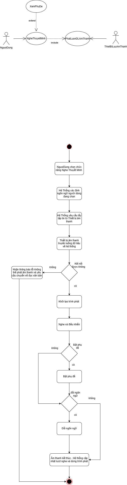

## 3.4 USC04 — Chuyển Đổi Ngôn Ngữ

***Sơ đồ Use Case — USC05***

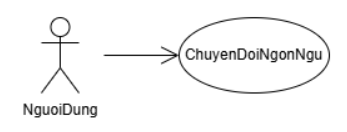

**Tác nhân (Actor):** Người Dùng (hoặc Khách vãng lai)

**Mức độ hoàn thiện:** Focused

**Mô tả tóm tắt:** Thay đổi ngôn ngữ hiển thị giao diện và ngôn ngữ các nội dung thuyết minh (Tiếng Việt, Tiếng Anh, Tiếng Pháp, Tiếng Trung, v.v.).

**Điều kiện tiên quyết:** Không có.

**Dòng sự kiện chính:**

| Hành động của Actor | Phản hồi của Hệ thống |
|---|---|
| 1. Người dùng chọn tính năng "Chuyển Đổi Ngôn Ngữ". |  |
|  | 2. Hệ thống hiển thị danh sách các ngôn ngữ được hỗ trợ. |
| 3. Người dùng chọn một ngôn ngữ mong muốn |  |
|  | 4. Hệ thống ghi nhận thiết lập ngôn ngữ mới vào cấu hình phiên. |
|  | 5. Hệ thống tải lại tài nguyên giao diện, nội dung bài viết và các liên kết âm thanh tương ứng với ngôn ngữ đã chọn. |
|  | 6. Giao diện hiển thị bằng ngôn ngữ mới. Use case kết thúc. |

**Luồng thay thế (Alternative):** Không có.

**Luồng ngoại lệ (Exception):** Không có.

**Điều kiện kết thúc:** Toàn bộ giao diện và dữ liệu nội dung hiển thị sang ngôn ngữ mới được chọn.

**Sự kiện kích hoạt (Trigger):** Người dùng chọn biểu tượng ngôn ngữ/quốc kỳ trên màn hình.

***Sơ đồ hoạt động (Activity Diagram) — USC04***

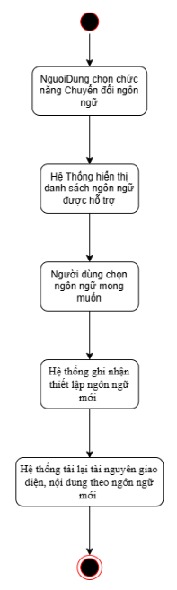

## 3.5 USC05 — Lưu Sự Vật Yêu Thích

***Sơ đồ Use Case — USC05***

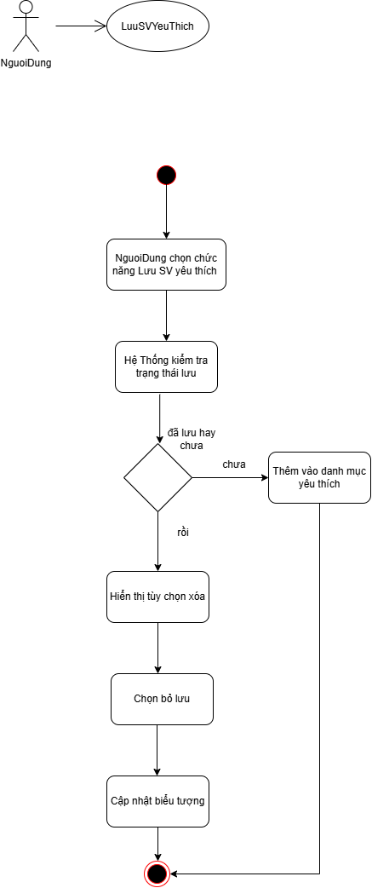

**Tác nhân (Actor):** Người Dùng

**Mức độ hoàn thiện:** Focused

**Mô tả tóm tắt:** Cho phép người dùng đánh dấu/lưu lại các hiện vật, sự vật ấn tượng vào danh mục "Yêu thích" để xem lại sau.

**Điều kiện tiên quyết:** Người dùng đang ở màn hình chi tiết hiện vật.

**Dòng sự kiện chính:**

| Hành động của Actor | Phản hồi của Hệ thống |
|---|---|
| 1. Người dùng bấm nút "Lưu Yêu Thích" tại trang hiện vật. |  |
|  | 2. Hệ thống kiểm tra trạng thái lưu: nếu chưa lưu thì thêm hiện vật vào danh mục yêu thích trong CSDL; nếu đã lưu thì hiển thị tùy chọn xóa khỏi danh sách (A1). |
|  | 3. Hệ thống cập nhật biểu tượng trạng thái (đã lưu) và thông báo "Đã lưu vào danh sách yêu thích". |

**Luồng thay thế (Alternative):**

- A1 - Hủy lưu yêu thích: Người dùng bấm lần nữa để bỏ chọn. Hệ thống xóa hiện vật khỏi bảng danh sách yêu thích của người dùng.

**Luồng ngoại lệ (Exception):** Không có.

**Điều kiện kết thúc:** Hiện vật được thêm vào danh sách yêu thích của tài khoản người dùng.

**Sự kiện kích hoạt (Trigger):** Người dùng nhấn vào nút "Thêm vào Yêu thích" (biểu tượng trái tim/ngôi sao).

***Sơ đồ hoạt động (Activity Diagram) — USC05***

## 3.6 USC06 — Xem Hồ Sơ Bảo Tàng

***Sơ đồ Use Case — USC06***

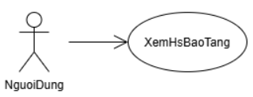

**Tác nhân (Actor):** Người Dùng

**Mức độ hoàn thiện:** Focused

**Mô tả tóm tắt:** Cho phép người dùng xem thông tin tổng quan về bảo tàng: giới thiệu, lịch sử hình thành, giờ mở cửa, địa chỉ, thông tin liên hệ và sơ đồ các khu trưng bày.

**Điều kiện tiên quyết:** Người dùng đã mở ứng dụng hoặc truy cập trang web của hệ thống.

**Dòng sự kiện chính:**

| Hành động của Actor | Phản hồi của Hệ thống |
|---|---|
| 1. Người dùng chọn "Hồ sơ bảo tàng" trên giao diện chính. |  |
|  | 2. Hệ thống xác định ngôn ngữ đang chọn và truy vấn hồ sơ bảo tàng trong CSDL (E1). |
|  | 3. Hệ thống hiển thị thông tin giới thiệu, lịch sử, giờ mở cửa, địa chỉ và thông tin liên hệ của bảo tàng. |
| 4. Người dùng xem thông tin và có thể chọn xem sơ đồ khu trưng bày (A1). |  |
| 5. Người dùng thoát khỏi màn hình hồ sơ. Use case kết thúc. |  |

**Luồng thay thế (Alternative):**

- A1 - Xem sơ đồ khu trưng bày: Tại bước 4, người dùng chọn "Sơ đồ khu trưng bày". Hệ thống hiển thị sơ đồ do Admin quản lý ở {Quản Lý Sơ Đồ}; người dùng có thể phóng to/thu nhỏ rồi quay lại bước 4.

**Luồng ngoại lệ (Exception):**

- E1 - Lỗi tải hồ sơ bảo tàng: Hệ thống thông báo "Không tải được thông tin bảo tàng, vui lòng thử lại" và cho phép tải lại.

**Điều kiện kết thúc:** Thông tin hồ sơ bảo tàng được hiển thị đầy đủ theo ngôn ngữ người dùng đang chọn.

**Sự kiện kích hoạt (Trigger):** Người dùng chọn "Hồ sơ bảo tàng" trên giao diện chính.

***Sơ đồ hoạt động (Activity Diagram) — USC06***

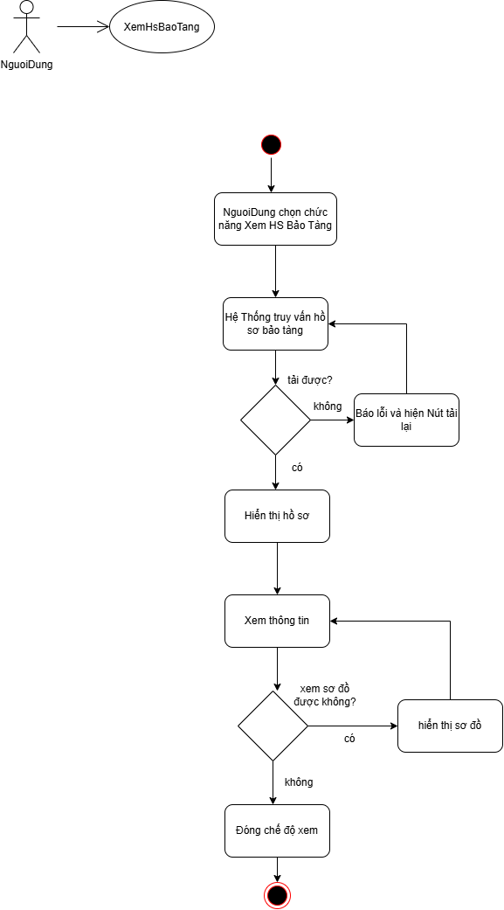

## 3.7 USC07 — Xem Phụ Đề

***Sơ đồ Use Case — USC07***

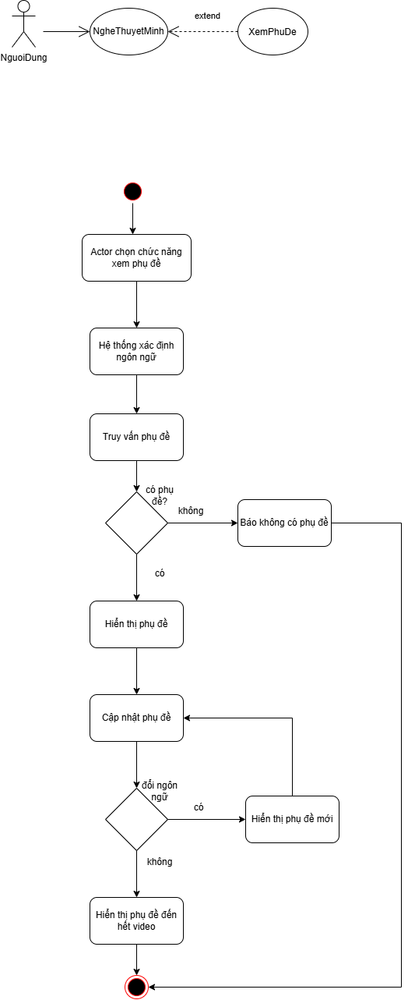

**Tác nhân (Actor):** Người Dùng

**Mức độ hoàn thiện:** Focused

**Mô tả tóm tắt:** Hiển thị phụ đề dạng văn bản đồng bộ với âm thanh thuyết minh đang phát. Là use case mở rộng («extend») của {Nghe Thuyết Minh} tại điểm mở rộng "Xem Phụ Đề" (UC04 - A1).

**Điều kiện tiên quyết:** Người dùng đang nghe thuyết minh (use case {Nghe Thuyết Minh} đang thực hiện).

**Dòng sự kiện chính:**

| Hành động của Actor | Phản hồi của Hệ thống |
|---|---|
| 1. Người dùng nhấn nút "Bật phụ đề" trên trình phát. |  |
|  | 2. Hệ thống xác định ngôn ngữ đang chọn và truy vấn tệp phụ đề tương ứng với tệp âm thanh đang phát (E1). |
|  | 3. Hệ thống hiển thị phụ đề đồng bộ theo mốc thời gian của bài thuyết minh. |
|  | 4. Hệ thống tiếp tục cập nhật phụ đề khi âm thanh phát, tạm dừng hoặc tua (A1). |
| 5. Người dùng nhấn "Tắt phụ đề" hoặc bài thuyết minh kết thúc. |  |
|  | 6. Hệ thống ẩn phụ đề và trả điều khiển về {Nghe Thuyết Minh}. Use case kết thúc. |

**Luồng thay thế (Alternative):**

- A1 - Đổi ngôn ngữ giữa chừng: Tại bước 4, người dùng chọn {Chuyển Đổi Ngôn Ngữ}. Hệ thống tải phụ đề theo ngôn ngữ mới, đồng bộ theo vị trí phát hiện tại và tiếp tục hiển thị.

**Luồng ngoại lệ (Exception):**

- E1 - Chưa có phụ đề cho ngôn ngữ đã chọn: Hệ thống thông báo "Chưa có phụ đề cho ngôn ngữ này" và tiếp tục phát âm thanh bình thường, không hiển thị phụ đề.

**Điều kiện kết thúc:** Phụ đề được hiển thị đồng bộ với âm thanh cho đến khi người dùng tắt phụ đề hoặc thuyết minh kết thúc.

**Sự kiện kích hoạt (Trigger):** Người dùng nhấn "Bật phụ đề" trên trình phát (Extension Point của {Nghe Thuyết Minh}).

***Sơ đồ hoạt động (Activity Diagram) — USC07***

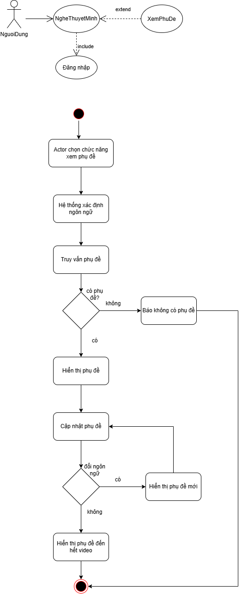

## 3.8 USC08 — Tìm Kiếm

***Sơ đồ Use Case — USC08***

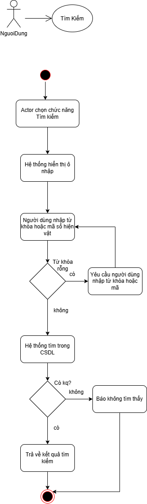

**Tác nhân (Actor):** Người Dùng

**Mức độ hoàn thiện:** Focused

**Mô tả tóm tắt:** Cho phép người dùng tìm hiện vật theo tên, mã số hoặc từ khóa trong mô tả. Đây cũng là phương án thay thế khi không quét được mã QR ({Quét Mã QR} - E1, E2).

**Điều kiện tiên quyết:** Người dùng đã mở ứng dụng hoặc truy cập trang web của hệ thống.

**Dòng sự kiện chính:**

| Hành động của Actor | Phản hồi của Hệ thống |
|---|---|
| 1. Người dùng chọn chức năng "Tìm kiếm". |  |
|  | 2. Hệ thống hiển thị ô nhập từ khóa/mã số hiện vật. |
| 3. Người dùng nhập từ khóa hoặc mã số hiện vật và nhấn "Tìm" (A1, E1). |  |
|  | 4. Hệ thống tìm kiếm trong CSDL theo tên, mã số và mô tả hiện vật ở ngôn ngữ đang chọn (E2). |
|  | 5. Hệ thống hiển thị danh sách kết quả phù hợp. |
| 6. Người dùng chọn một hiện vật trong danh sách. |  |
|  | 7. Hệ thống chuyển đến màn hình chi tiết hiện vật, từ đó người dùng có thể đọc nội dung, xem hình ảnh hoặc nghe thuyết minh. Use case kết thúc. |

**Luồng thay thế (Alternative):** Không có.

**Luồng ngoại lệ (Exception):**

- E1 - Từ khóa rỗng: Hệ thống yêu cầu người dùng nhập từ khóa trước khi tìm kiếm.
- E2 - Không có kết quả: Hệ thống thông báo "Không tìm thấy hiện vật phù hợp" và gợi ý kiểm tra lại từ khóa hoặc dùng chức năng Quét mã QR.

**Điều kiện kết thúc:** Người dùng tìm được hiện vật cần xem và được chuyển đến màn hình chi tiết hiện vật; hoặc nhận thông báo không có kết quả phù hợp.

**Sự kiện kích hoạt (Trigger):** Người dùng chọn biểu tượng/ô "Tìm kiếm" trên giao diện.

***Sơ đồ hoạt động (Activity Diagram) — USC08***

## 3.9 USC09 — Quản Lý Sự Vật

***Sơ đồ Use Case — USC09***

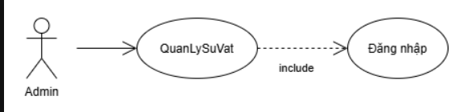

**Tác nhân (Actor):** Admin

**Mức độ hoàn thiện:** Focused

**Mô tả tóm tắt:** Cho phép Admin quản lý thông tin các sự vật trong hệ thống, gồm thêm mới, chỉnh sửa và xóa sự vật.

**Điều kiện tiên quyết:** Admin đã đăng nhập thành công vào hệ thống (nếu chưa đăng nhập, include {Đăng Nhập}).

**Sự kiện kích hoạt (Trigger):** Admin chọn menu "Quản Lý Sự Vật".

**Dòng sự kiện chính:**

| Hành động của Actor | Phản hồi của Hệ thống |
|---|---|
| 1. Admin đăng nhập |  |
|  | 2. Hệ thống hiển thị lời chào mừng đăng nhập cùng với những chức năng chính cho Admin lựa chọn |
| 3. Admin chọn menu "Quản Lý Sự Vật". |  |
|  | 4. Hệ thống hiển thị danh sách các sự vật hiện có kèm bộ lọc, tìm kiếm và các nút "Thêm mới", "Sửa", "Xóa". |
| 5. Admin chọn một thao tác quản lý (A1, A2, A3). |  |
| 6. Admin thoát khỏi màn hình quản lý. Use case kết thúc. |  |

**Luồng thay thế (Alternative):**

- A1 – Thêm mới sự vật: Ở bước 3, Admin chọn "Thêm mới". Hệ thống hiển thị biểu mẫu trống gồm: Tên, Mã số, Khu vực/Sơ đồ, Nội dung mô tả đa ngôn ngữ, Hình ảnh đính kèm. Admin điền thông tin và nhấn "Lưu" (A4). Hệ thống kiểm tra tính hợp lệ của dữ liệu (E1, E2), lưu vào CSDL (E3), thông báo "Lưu thông tin sự vật thành công" và làm mới danh sách. Use case quay lại bước 3.
- A2 – Sửa sự vật: Ở bước 3, Admin chọn một sự vật trong danh sách và nhấn "Sửa". Hệ thống hiển thị biểu mẫu đã điền sẵn thông tin hiện tại. Các bước tiếp theo thực hiện như A1.
- A3 – Xóa sự vật: Ở bước 3, Admin chọn một sự vật và nhấn "Xóa". Hệ thống hiển thị hộp thoại xác nhận. Khi Admin đồng ý, hệ thống xóa sự vật khỏi CSDL, thông báo thành công, làm mới danh sách và quay lại bước 3.
- A4 – Hủy thao tác: Khi đang ở biểu mẫu của A1 hoặc A2, Admin nhấn "Hủy". Hệ thống đóng biểu mẫu mà không lưu thay đổi và quay lại danh sách (bước 3).

**Luồng ngoại lệ (Exception):**

- E1 – Thiếu trường bắt buộc: Admin bỏ trống tên sự vật hoặc chưa chọn khu vực. Hệ thống cảnh báo đỏ tại các trường thiếu và yêu cầu điền bổ sung trước khi lưu (quay lại bước điền biểu mẫu).
- E2 – Trùng mã số: Mã số vừa nhập đã tồn tại. Hệ thống thông báo "Mã số đã tồn tại" và yêu cầu nhập mã khác (quay lại bước điền biểu mẫu).
- E3 – Lưu thất bại: CSDL lỗi hoặc hình ảnh sai định dạng/quá dung lượng. Hệ thống thông báo lỗi và giữ nguyên dữ liệu đã nhập để Admin thử lại (quay lại bước điền biểu mẫu).

**Điều kiện kết thúc:** Thông tin sự vật được thêm, cập nhật hoặc xóa trong CSDL và danh sách hiển thị đúng thay đổi. Nếu Admin hủy thao tác thì dữ liệu giữ nguyên.

***Sơ đồ hoạt động (Activity Diagram) — USC09***

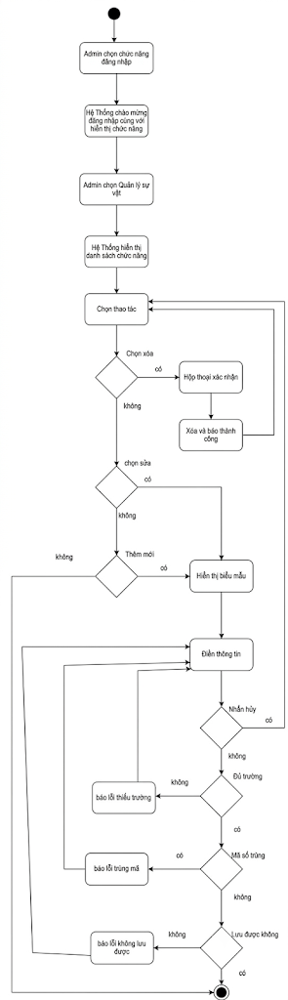

## 3.10 USC10 — Quản Lý Phiên Tham Quan & Mã QR

***Sơ đồ Use Case — USC10***

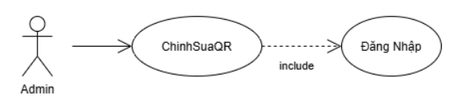

**Tác nhân (Actor):** Admin

**Mức độ hoàn thiện:** Focused

**Mô tả tóm tắt:** Cho phép Admin tạo mới, chỉnh sửa, xóa và theo dõi các phiên tham quan (ca mở cửa, đoàn tham quan chuyên biệt), đồng thời cấu hình và xuất mã QR tương ứng cho cổng đón tiếp và từng hiện vật. Mỗi phiên có mã riêng, khung thời gian, ghi chú và số liệu số khách, số lượt nghe, giúp hệ thống thống kê lượt nghe chính xác theo từng ca và từng đoàn (USC12).

**Điều kiện tiên quyết:**

- Admin đã đăng nhập hệ thống (nếu chưa đăng nhập, include {Đăng Nhập}).
- Admin có quyền truy cập khu vực quản trị (/admin/sessions).

**Sự kiện kích hoạt (Trigger):** Admin chọn mục “Quản Lý Phiên” trong khu vực quản trị.

**Dòng sự kiện chính:**

| Hành động của Actor | Phản hồi của Hệ thống |
| --- | --- |
| 1. Admin đăng nhập. |  |
|  | 2. Hệ thống hiển thị lời chào mừng đăng nhập cùng với những chức năng chính cho Admin lựa chọn. |
| 3. Admin chọn mục “Quản Lý Phiên”. |  |
|  | 4. Hệ thống hiển thị danh sách các phiên tham quan dạng thẻ, mỗi thẻ gồm: mã phiên (SES-xx), trạng thái (Đang mở / Sắp diễn ra), tên ca, ngày và khung giờ, ghi chú, số khách và số lượt nghe (E3). |
| 5. Admin chọn thao tác (A1, A2, A3). |  |
|  | 6. Hệ thống kiểm tra tính hợp lệ của dữ liệu nhập (E1). |
| 7. Admin nhấn “Lưu” (A4) |  |
|  | 8. Hệ thống tự sinh mã phiên (SES-xx), xác định trạng thái theo thời gian, lưu vào CSDL (E2) và thông báo “Tạo phiên thành công”. |
|  | 9. Hệ thống cập nhật danh sách phiên và hiển thị thẻ phiên mới. Use case kết thúc. |

**Luồng thay thế (Alternative):**

- A1 – Chỉnh sửa phiên: Ở bước 5, Admin nhấn biểu tượng chỉnh sửa trên thẻ phiên. Hệ thống hiển thị biểu mẫu điền sẵn thông tin hiện tại. Admin sửa tên ca, thời gian hoặc ghi chú rồi nhấn “Lưu”; hệ thống kiểm tra (E1), lưu thay đổi (E2) và cập nhật thẻ phiên. Số khách và số lượt nghe đã ghi nhận được giữ nguyên.
- A2 – Xóa phiên: Ở bước 5, Admin nhấn biểu tượng xóa trên thẻ phiên. Hệ thống hiển thị hộp thoại xác nhận (kèm cảnh báo nếu phiên đang mở hoặc đã có lượt nghe). Admin xác nhận, hệ thống xóa phiên khỏi CSDL (E2) và cập nhật danh sách. Nếu Admin chọn “Hủy”, hệ thống đóng hộp thoại và giữ nguyên phiên.
- A3 – Thêm mới phiên: Ở bước 5, Admin nhấn “Tạo Phiên Mới”. Hệ thống hiển thị biểu mẫu thêm phiên mới (các trường để trống). Admin nhập tên ca, ngày, giờ bắt đầu, giờ kết thúc, ghi chú và nhấn “Lưu” (A4). Hệ thống kiểm tra tính hợp lệ của dữ liệu (E1), tự sinh mã phiên (SES-xx), xác định trạng thái theo thời gian, lưu vào CSDL (E2), cập nhật danh sách, hiển thị thẻ phiên mới và thông báo “Tạo phiên thành công”. Use case kết thúc.
- A4 – Cập nhật trạng thái tự động: Khi đến giờ bắt đầu, hệ thống tự chuyển phiên từ “Sắp diễn ra” sang “Đang mở”; khi quá giờ kết thúc, hệ thống chuyển phiên sang trạng thái kết thúc. Admin không cần thao tác thủ công.
- A5 – Hủy thao tác: Tại bước 7, Admin nhấn “Hủy”. Hệ thống đóng biểu mẫu, không lưu dữ liệu và quay lại danh sách phiên.

**Luồng ngoại lệ (Exception):**

- E1 – Dữ liệu không hợp lệ: Dữ liệu thiếu hoặc không hợp lệ (bỏ trống tên ca, thiếu ngày giờ, giờ kết thúc không sau giờ bắt đầu). Hệ thống đánh dấu trường lỗi, thông báo cụ thể và giữ nguyên biểu mẫu để Admin sửa.
- E2 – Lỗi lưu hoặc xóa dữ liệu: Hệ thống thông báo “Không thể lưu thay đổi, vui lòng thử lại” và giữ nguyên dữ liệu cũ.
- E3 – Không tải được danh sách phiên: Hệ thống thông báo “Không tải được danh sách phiên” và cho phép Admin tải lại trang.

**Điều kiện kết thúc:**

- Thành công: Phiên được tạo, cập nhật hoặc xóa thành công; danh sách phiên hiển thị đúng dữ liệu mới.
- Thất bại: Dữ liệu không thay đổi, hệ thống hiển thị thông báo lỗi tương ứng (E1, E2, E3).

***Sơ đồ hoạt động (Activity Diagram) — USC10***

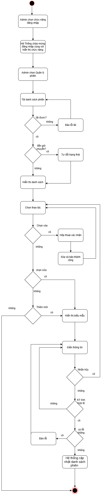

## 3.11 USC11 — Quản Lý Tệp Âm Thanh

***Sơ đồ Use Case — USC11***

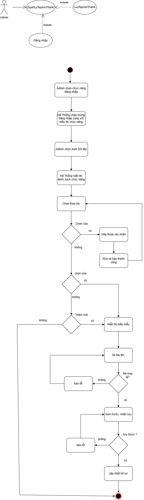

**Tác nhân (Actor):** Admin, Thiết Bị Lưu Âm Thanh

**Mức độ hoàn thiện:** Focused

**Mô tả tóm tắt:** Admin tải lên, thay thế hoặc xóa các file audio thuyết minh và gán nhãn ngôn ngữ cho từng file. Bao gồm {Lưu Trữ Tệp Âm Thanh} («include») tương tác trực tiếp với Thiết Bị Lưu Âm Thanh.

**Điều kiện tiên quyết:** Admin đã đăng nhập (nếu chưa đăng nhập, include {Đăng Nhập}). Hiện vật cần gắn thuyết minh đã tồn tại trong hệ thống.

**Sự kiện kích hoạt (Trigger):** Admin chọn "Quản Lý Tệp Âm Thanh".

**Dòng sự kiện chính:**

| Hành động của Actor | Phản hồi của Hệ thống |
|---|---|
| 1. Admin đăng nhập |  |
|  | 2. Hệ thống hiển thị lời chào mừng đăng nhập cùng với những chức năng chính cho Admin lựa chọn |
| 3. Admin chọn "Quản Lý Tệp Âm Thanh". |  |
|  | 4. Hệ thống hiển thị danh sách các file thuyết minh theo từng hiện vật và ngôn ngữ. |
| 5. Admin chọn một thao tác quản lý tệp âm thanh (A1, A2, A3). |  |
| 6. Admin thoát khỏi màn hình quản lý. Use case kết thúc. |  |

**Luồng thay thế (Alternative):**

- A1 – Tải lên tệp mới: Ở bước 3, Admin chọn hiện vật và nhấn "Tải lên tệp âm thanh mới". Hệ thống hiển thị hộp thoại chọn file và chọn ngôn ngữ thuyết minh. Admin chọn ngôn ngữ, chọn file audio (MP3, WAV, AAC) từ máy tính và bấm "Tải lên". Hệ thống kiểm tra dung lượng, định dạng file (E1), rồi thực hiện {Lưu Trữ Tệp Âm Thanh}: gửi tệp sang Thiết Bị Lưu Âm Thanh. Thiết Bị Lưu Âm Thanh tiếp nhận, lưu file và trả về đường dẫn (URL/ID lưu trữ) (E2). Hệ thống cập nhật đường dẫn vào hồ sơ hiện vật và thông báo "Tải lên thành công". Use case quay lại bước 3.
- A2 – Thay thế tệp: Ở bước 3, Admin chọn một tệp âm thanh đã có của hiện vật/ngôn ngữ và nhấn "Thay thế". Admin chọn file audio mới từ máy tính và bấm "Tải lên". Các bước tiếp theo thực hiện như A1; hệ thống cập nhật đường dẫn mới vào hồ sơ hiện vật và xóa tệp cũ khỏi thiết bị lưu trữ.
- A3 – Xóa tệp: Ở bước 3, Admin chọn một tệp âm thanh đã có và nhấn "Xóa". Hệ thống hiển thị hộp thoại xác nhận. Khi Admin đồng ý, hệ thống yêu cầu Thiết Bị Lưu Âm Thanh xóa tệp (E2), cập nhật hồ sơ hiện vật, thông báo "Xóa tệp thành công" và quay lại bước 3.

**Luồng ngoại lệ (Exception):**

- E1 – Sai định dạng hoặc vượt quá dung lượng: Khi Admin tải lên (A1, A2), file không phải âm thanh hợp lệ (MP3, WAV, AAC) hoặc kích thước quá lớn (>50MB). Hệ thống từ chối tải lên và thông báo lỗi.
- E2 – Thiết Bị Lưu Âm Thanh không phản hồi hoặc lưu/xóa thất bại: Khi lưu hoặc xóa tệp (A1, A2, A3), thiết bị lưu trữ không phản hồi hoặc báo lỗi. Hệ thống thông báo lỗi và không cập nhật hồ sơ hiện vật.

**Điều kiện kết thúc:** Tệp âm thanh được lưu trữ an toàn trên thiết bị lưu trữ và liên kết đúng với hiện vật tương ứng; hoặc được thay thế/xóa khỏi thiết bị lưu trữ và hồ sơ hiện vật nếu Admin chọn thay thế/xóa.

***Sơ đồ hoạt động (Activity Diagram) — USC11***

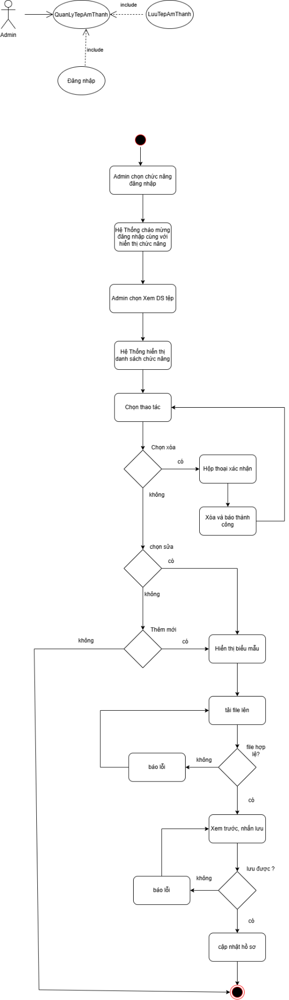

## 3.12 USC12 — Xem Thống Kê Lượt Nghe

***Sơ đồ Use Case — USC12***

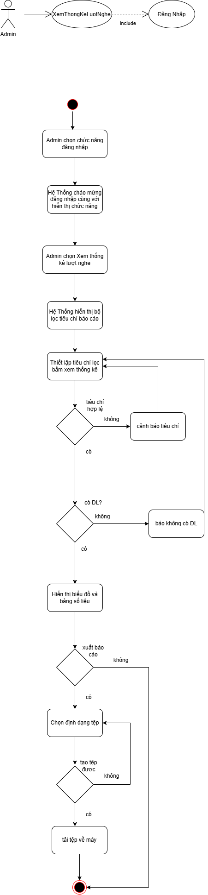

**Tác nhân (Actor):** Admin

**Mức độ hoàn thiện:** Focused

**Mô tả tóm tắt:** Cung cấp báo cáo, biểu đồ về số lượt khách nghe thuyết minh theo từng sự vật, theo ngôn ngữ, theo khung giờ hoặc theo ngày/tháng/năm để đánh giá mức độ quan tâm của du khách.

**Điều kiện tiên quyết:** Admin đã đăng nhập hệ thống (nếu chưa đăng nhập, include {Đăng Nhập}).

**Sự kiện kích hoạt (Trigger):** Admin chọn menu "Thống Kê Lượt Nghe".

**Dòng sự kiện chính:**

| Hành động của Actor | Phản hồi của Hệ thống |
|---|---|
| 1. Admin đăng nhập |  |
|  | 2. Hệ thống hiển thị lời chào mừng đăng nhập cùng với những chức năng chính cho Admin lựa chọn |
| 3. Admin chọn menu "Thống Kê Lượt Nghe". |  |
|  | 4. Hệ thống hiển thị bộ lọc tiêu chí báo cáo: Khoảng thời gian, Đơn vị thống kê (giờ/ngày/tháng/năm), Khu vực trưng bày, Sự vật cụ thể, Ngôn ngữ. |
| 5. Admin thiết lập các tiêu chí lọc và bấm "Xem Thống Kê". |  |
|  | 6. Hệ thống kiểm tra tiêu chí lọc (E1), truy vấn CSDL và tổng hợp dữ liệu lượt nghe (E2). |
|  | 7. Hệ thống hiển thị biểu đồ trực quan (biểu đồ cột/đường) cùng bảng tổng hợp số liệu chi tiết, gồm: top sự vật được nghe nhiều nhất, ngôn ngữ phổ biến nhất và tổng số lượt nghe theo từng mốc thời gian. |
| 8. Admin xem báo cáo và có thể chọn "Xuất báo cáo" (A1). Use case kết thúc. |  |

**Luồng thay thế (Alternative):**

- A1 – Xuất báo cáo: Ở bước 6, Admin bấm "Xuất báo cáo" và chọn định dạng Excel hoặc PDF. Hệ thống đóng gói dữ liệu báo cáo (E3) và tải về máy theo định dạng đã chọn. Use case kết thúc.

**Luồng ngoại lệ (Exception):**

- E1 – Tiêu chí lọc không hợp lệ: Ở bước 4, tiêu chí lọc không hợp lệ (ví dụ ngày bắt đầu sau ngày kết thúc hoặc chưa chọn khoảng thời gian). Hệ thống cảnh báo tại tiêu chí sai và yêu cầu chọn lại (quay lại bước 3).
- E2 – Không có dữ liệu: Ở bước 4, không có lượt nghe nào phù hợp với tiêu chí đã chọn. Hệ thống thông báo "Không có dữ liệu thống kê phù hợp" và yêu cầu Admin đổi tiêu chí lọc (quay lại bước 3).
- E3 – Xuất tệp thất bại: Ở A1, hệ thống không tạo được tệp báo cáo. Hệ thống thông báo lỗi để Admin thử xuất lại hoặc chọn định dạng khác.

**Điều kiện kết thúc:** Báo cáo thống kê được hiển thị trực quan theo tiêu chí đã chọn; nếu Admin chọn xuất thì tệp báo cáo được tải về máy.

***Sơ đồ hoạt động (Activity Diagram) — USC10***

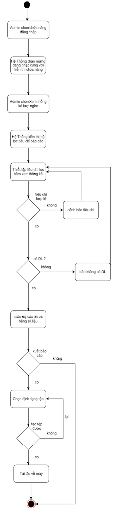

## 3.13 USC13 — Quản Lý Sơ Đồ

***Sơ đồ Use Case — USC13***

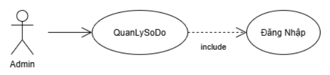

**Tác nhân (Actor):** Admin

**Mức độ hoàn thiện:** Focused

**Mô tả tóm tắt:** Quản lý bản đồ/sơ đồ các tầng, phòng trưng bày của bảo tàng, gồm thêm mới, chỉnh sửa và xóa sơ đồ; gán vị trí tọa độ của các sự vật lên sơ đồ để phục vụ hiển thị định vị cho khách tham quan.

**Điều kiện tiên quyết:** Admin đã đăng nhập hệ thống (nếu chưa đăng nhập, include {Đăng Nhập}). Các sự vật cần gán vị trí đã tồn tại trong hệ thống.

**Sự kiện kích hoạt (Trigger):** Admin chọn menu "Quản Lý Sơ Đồ".

**Dòng sự kiện chính:**

| Hành động của Actor | Phản hồi của Hệ thống |
|---|---|
| 1. Admin đăng nhập |  |
|  | 2. Hệ thống hiển thị lời chào mừng đăng nhập cùng với những chức năng chính cho Admin lựa chọn |
| 3. Admin chọn menu "Quản Lý Sơ Đồ". |  |
|  | 4. Hệ thống hiển thị danh sách các tầng/khu vực trưng bày và sơ đồ mặt bằng tương ứng. |
| 5. Admin chọn một thao tác quản lý sơ đồ (A1, A2, A3). |  |
| 6. Admin thoát khỏi màn hình quản lý. Use case kết thúc. |  |

**Luồng thay thế (Alternative):**

- A1 – Thêm sơ đồ mới: Ở bước 3, Admin chọn "Thêm sơ đồ mới" và tải lên ảnh mặt bằng cho tầng/khu vực. Hệ thống kiểm tra định dạng và dung lượng ảnh (E1), sau đó hiển thị giao diện biên tập sơ đồ tương tác. Các bước tiếp theo thực hiện như A2.
- A2 – Chỉnh sửa sơ đồ: Ở bước 3, Admin chọn một khu vực và nhấn "Chỉnh sửa". Hệ thống hiển thị giao diện biên tập sơ đồ tương tác. Admin kéo thả các điểm ghim sự vật vào đúng vị trí thực tế trên sơ đồ. Hệ thống ghi nhận tạm tọa độ (X, Y) của từng sự vật. Admin nhấn "Lưu Sơ Đồ". Hệ thống lưu cấu hình tọa độ vào CSDL (E2) và thông báo cập nhật thành công. Use case quay lại bước 3.
- A3 – Xóa sơ đồ: Ở bước 3, Admin chọn một sơ đồ và nhấn "Xóa". Hệ thống hiển thị hộp thoại xác nhận. Khi Admin đồng ý, hệ thống xóa sơ đồ cùng tọa độ các sự vật đã gán khỏi CSDL (E2), thông báo thành công, làm mới danh sách và quay lại bước 3.

**Luồng ngoại lệ (Exception):**

- E1 – Ảnh mặt bằng không hợp lệ: Ở A1, ảnh sai định dạng hoặc vượt quá dung lượng cho phép. Hệ thống từ chối tải lên, thông báo lỗi và yêu cầu chọn lại ảnh.
- E2 – Lưu thất bại: Khi lưu hoặc xóa sơ đồ (A1, A2, A3), CSDL lỗi. Hệ thống thông báo lỗi và giữ nguyên dữ liệu đang chỉnh sửa để Admin thử lại.

**Điều kiện kết thúc:** Sơ đồ và tọa độ các sự vật được lưu vào CSDL và hiển thị đúng cho khách tham quan; hoặc sơ đồ được xóa khỏi hệ thống nếu Admin chọn xóa.

***Sơ đồ hoạt động (Activity Diagram) — USC13***

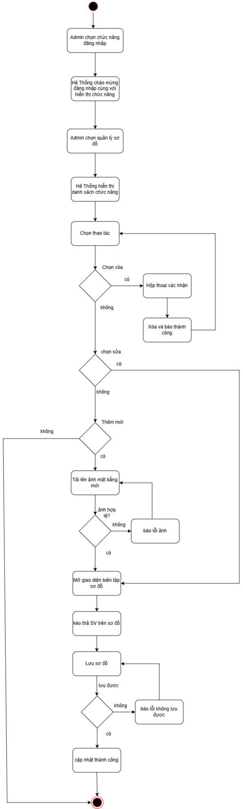

## 3.14 USC14 — Định Vị Vị Trí & Tự Động Thuyết Minh

***Sơ đồ Use Case — USC14***

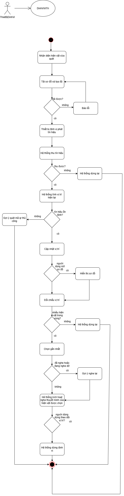

**Tác nhân (Actor):** Người Dùng (hoặc Khách tham quan)

**Mức độ hoàn thiện:** Focused

**Mô tả tóm tắt:** Xác định và cập nhật liên tục vị trí của người dùng trong khu trưng bày thông qua cơ chế lai: quét mã QR tại cổng hoặc hiện vật làm mốc neo xuất phát (anchorArtifactId) và tự động kích hoạt GPS theo dõi độ chính xác cao. Hệ thống đối chiếu tọa độ với bán kính kích hoạt của các hiện vật (mặc định 12m), hiển thị pin "Bạn đang ở đây" trên sơ đồ tầng, và tự động đề xuất/kích hoạt thuyết minh tương ứng khi đến gần mà không cần quét lại.

**Điều kiện tiên quyết:**

- Người dùng đã quét thành công ít nhất một mã QR (có điểm xuất phát).
- Ứng dụng được cấp quyền định vị/kết nối cần thiết (vị trí, Bluetooth hoặc Wi-Fi tùy phương án triển khai).
- CSDL đã có sơ đồ khu vực và tọa độ của các hiện vật.

**Sự kiện kích hoạt (Trigger):** Hệ thống bật chế độ tự động tracking sau khi quét mã QR thành công (USC02, bước 6).

**Dòng sự kiện chính:**

| Hành động của Actor | Phản hồi của Hệ thống |
| --- | --- |
|  | 1. Hệ thống tiếp nhận vị trí hiện vật vừa quét mã QR (USC02, bước 6) làm điểm xuất phát và khởi tạo phiên định vị. |
|  | 2. Hệ thống tải sơ đồ khu vực trưng bày, tọa độ và bán kính kích hoạt của từng hiện vật từ CSDL (E3). |
| 3. Thiết bị phát tín hiệu định kì |  |
|  | 4. Hệ thống thu tín hiệu định vị định kỳ từ thiết bị (E1). |
|  | 5. Hệ thống tính vị trí hiện tại của người dùng, hiệu chỉnh theo điểm xuất phát và đánh giá độ tin cậy của kết quả (E2). |
|  | 6. Hệ thống cập nhật vị trí người dùng lên sơ đồ (A1). |
|  | 7. Hệ thống đối chiếu vị trí với vùng kích hoạt của các hiện vật và xác định hiện vật gần nhất trong bán kính (A2). |
|  | 8. Nếu hiện vật gần nhất khác hiện vật đang thuyết minh và chưa nghe trong phiên này (A3), hệ thống tự động mở màn hình chi tiết và kích hoạt {Nghe Thuyết Minh}. |
| 9. Tiếp tục phát tín hiệu ở chu kì tiếp theo |  |
|  | 10. Hệ thống lặp lại bước 4–9 cho đến khi người dùng dừng theo dõi hoặc thoát ứng dụng (A4). Use case kết thúc. |

**Luồng thay thế (Alternative):**

- A1 – Xem vị trí trên sơ đồ: Người dùng mở sơ đồ khu trưng bày, hệ thống hiển thị vị trí hiện tại cùng các hiện vật xung quanh; người dùng có thể chọn một hiện vật để xem hoặc nghe thủ công.
- A2 – Nhiều hiện vật trong vùng kích hoạt: Khi có nhiều hiện vật cùng nằm trong bán kính, hệ thống chọn hiện vật gần nhất; các hiện vật còn lại được gợi ý trong danh sách “Gần bạn”.
- A3 – Hiện vật đã nghe hoặc đang nghe dở: Nếu hiện vật đã được nghe trong phiên hiện tại, hệ thống không tự phát lại mà chỉ hiển thị gợi ý “Nghe lại”. Nếu người dùng đang nghe dở một thuyết minh khác, hệ thống không ngắt mà hỏi người dùng có muốn chuyển sang hiện vật mới.
- A4 – Dừng theo dõi: Người dùng chọn “Dừng theo dõi” hoặc thoát ứng dụng. Hệ thống dừng định vị và use case kết thúc.

**Luồng ngoại lệ (Exception):**

- E1 – Mất tín hiệu hoặc không có quyền định vị: Hệ thống thông báo “Không thể theo dõi vị trí”, dừng tracking tự động và đề nghị người dùng quét mã QR thủ công hoặc dùng chức năng Tìm Kiếm (USC02 – E3).
- E2 – Sai số vị trí lớn hoặc tín hiệu không ổn định: Hệ thống không tự kích hoạt thuyết minh để tránh phát nhầm hiện vật, hiển thị gợi ý “Vị trí chưa chính xác, hãy quét mã QR gần nhất để hiệu chỉnh”.
- E3 – Không tải được sơ đồ hoặc tọa độ hiện vật: Hệ thống thông báo “Không tải được dữ liệu khu trưng bày”, dừng tracking và đề nghị người dùng quét mã QR thủ công hoặc dùng chức năng Tìm Kiếm.

**Điều kiện kết thúc:**

- Thành công: Vị trí người dùng được cập nhật liên tục và hệ thống tự kích hoạt đúng thuyết minh của hiện vật người dùng đến gần.
- Thất bại: Tracking bị dừng do mất tín hiệu, thiếu quyền hoặc thiếu dữ liệu (E1, E3); người dùng được hướng dẫn quét QR thủ công hoặc dùng Tìm Kiếm.

***Sơ đồ hoạt động (Activity Diagram) — USC14***

# 4. Sơ Đồ Thành Phần (Component Diagram)

Sơ đồ thành phần mô tả cấu trúc hệ thống theo kiến trúc SPA Front-end hiện đại và các dịch vụ ngoại vi:

1. Phân hệ Khách Tham Quan (Visitor App): Gồm VisitorLayout (Router QR & GPS), TrackingPanel (theo dõi vị trí & đề xuất chuyển/nghe lại), AudioPlayer & Subtitles (phát audio & phụ đề karaoke từng giây), FloorMapView (bản đồ tương tác đa tầng & halo vị trí "Bạn đang ở đây"), ExploreView (tìm kiếm theo tên, mã số ART-xxx, mô tả), ArtifactDetailView (nội dung chi tiết hiện vật).
2. Phân hệ Quản Trị (Admin App): Gồm AdminLoginView (bảo mật khóa tạm thời 5 phút khi nhập sai quá 5 lần liên tiếp), AdminDashboard (thống kê lượt nghe theo phiên và hiện vật), ArtifactsManageView (CRUD hiện vật, cấu hình tọa độ GPS vĩ độ/kinh độ & bán kính kích hoạt triggerRadius), SessionsManageView (quản lý phiên tham quan & xuất mã QR đón tiếp tại cổng).
3. Khối Core Modules & Shared Services: geofence.ts (tính khoảng cách Haversine & vùng kích hoạt), qrHelper.ts (giải mã QR & deep link), loginLock.ts (động cơ bảo mật lockout), các Zustand stores (geofenceStore, audioStore, favoritesStore, languageStore, sessionStore) và api.ts (mock data & lưu trữ LocalStorage bền vững).
4. Hạ tầng Lưu trữ & Dịch vụ: GitHub Pages (lưu trữ mã nguồn tĩnh HTML/JS/CSS, âm thanh MP3 và hình ảnh sơ đồ) kết hợp dịch vụ ntfy.sh phục vụ giám sát và telemetry thời gian thực.

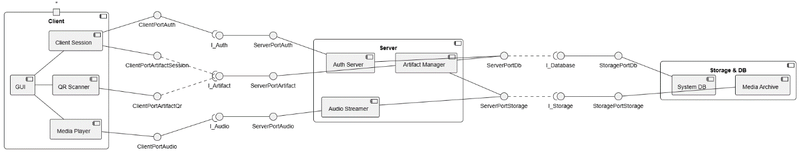

# 5. Sơ Đồ Triển Khai (Deployment Diagram)

Sơ đồ triển khai xác định môi trường thực thi và hạ tầng mạng của hệ thống:

1. Nút Thiết bị Người dùng (Client Device - Mobile / Desktop): Chạy trên trình duyệt Web hiện đại (Chrome, Safari, Edge, Firefox), tận dụng trực tiếp các Web API chuẩn mực: HTML5 Web Audio API (phát luồng âm thanh), HTML5 Geolocation API (định vị GPS độ chính xác cao), HTML5 MediaDevices / Camera API (quét mã QR trực tiếp qua camera), và Browser LocalStorage (lưu hiện vật yêu thích, token và cài đặt người dùng mà không cần cài đặt ứng dụng).
2. Nút Hạ tầng GitHub Pages (Nginx CDN HTTPS :443): Đóng gói bản dựng Vite SPA, tệp chỉ mục index.html, các tài sản âm thanh public/audio/\*.mp3 và hình ảnh sơ đồ public/images/\*.png, phân phối toàn cầu với độ trễ thấp và bảo mật SSL/TLS.
3. Nút Hạ tầng Giám Sát / Analytics (ntfy.sh HTTPS Gateway): Tiếp nhận các sự kiện thống kê, lượt nghe và phiên tham quan qua giao thức HTTPS POST.

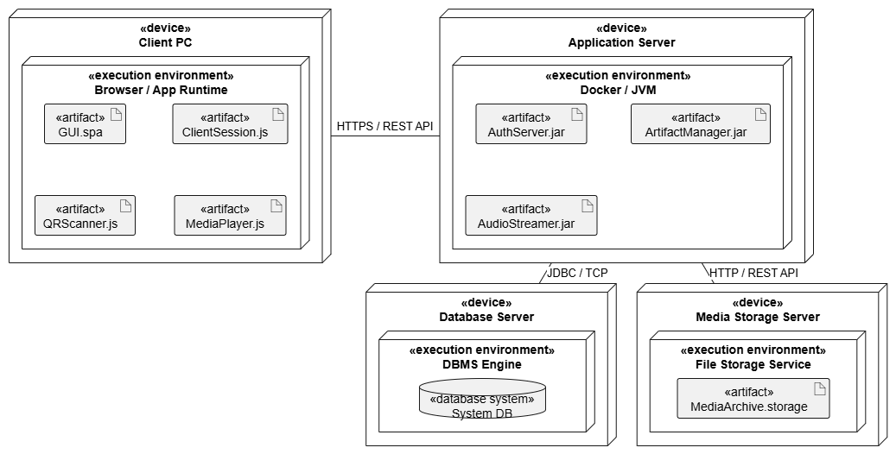

# 6. ERD

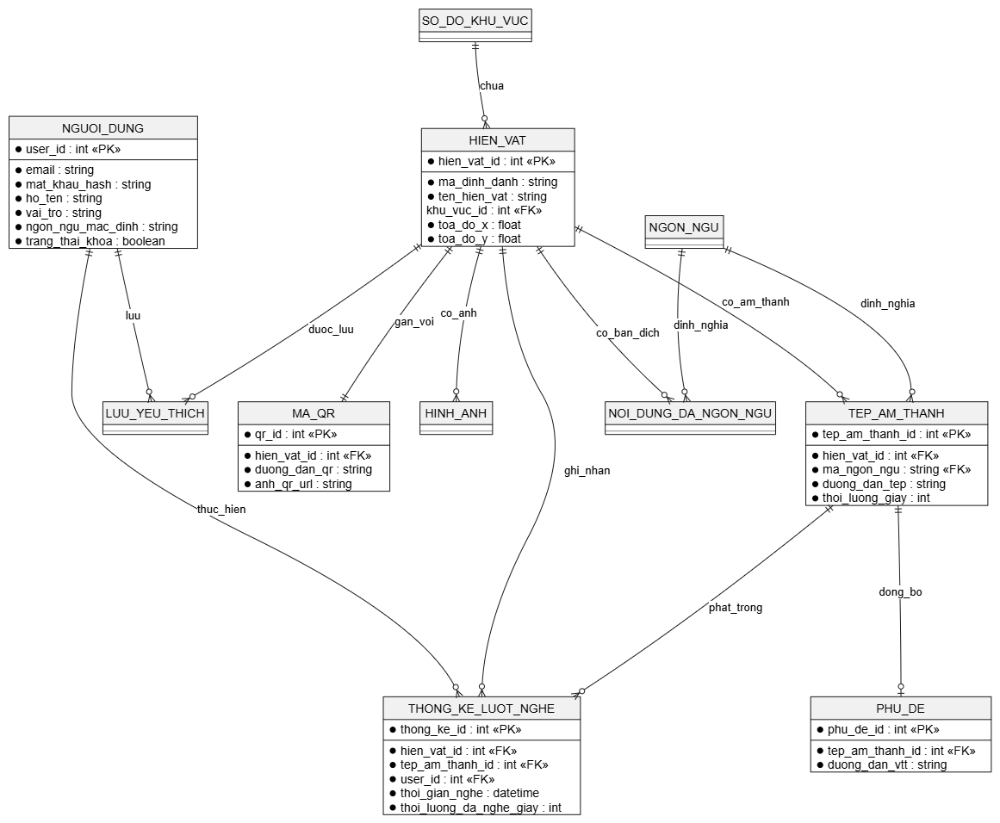
