**ỦY BAN NHÂN DÂN THÀNH PHỐ HỒ CHÍ MINH  
TRƯỜNG ĐẠI HỌC SÀI GÒN  
KHOA CÔNG NGHỆ THÔNG TIN  
---------------------------------**

**BÁO CÁO ĐỒ ÁN MÔN HỌC  
CÔNG NGHỆ PHẦN MỀM**

*ĐỀ TÀI:*  
**HỆ THỐNG THUYẾT MINH TỰ ĐỘNG  
ĐA NGÔN NGỮ (SMART AUDIO GUIDE)**  
*Chuyên đề: Thiết kế & Hiện thực Kiến trúc Front-end SPA, Stream Audio, QR Code Scanner và Triển khai CI/CD*

> **Giảng viên hướng dẫn:** TS. Giảng Viên Hướng Dẫn  
> **Bộ môn:** Công nghệ Phần mềm  
> **Sinh viên thực hiện:** Nguyễn Cường  
> **Chuyên ngành:** Công nghệ Thông tin  
> **Khóa học:** 2022 – 2026  
> **Hệ đào tạo:** Chính quy tập trung

**THÀNH PHỐ HỒ CHÍ MINH, NĂM 2026**

# LỜI CẢM ƠN

Trong suốt quá trình học tập và hoàn thành đồ án môn học Công nghệ Phần mềm tại Trường Đại học Sài Gòn, em đã nhận được rất nhiều sự quan tâm, chỉ dẫn tận tình và động viên quý báu từ quý Thầy, Cô khoa Công nghệ Thông tin.

Trước hết, em xin bày tỏ lòng biết ơn sâu sắc đến quý Thầy Cô trong bộ môn Công nghệ Phần mềm, những người đã trang bị cho em nền tảng tư duy vững chắc về phân tích yêu cầu, thiết kế kiến trúc phần mềm, mô hình hóa UML cũng như các nguyên lý xây dựng hệ thống phần mềm chuyên nghiệp.

Em xin trân trọng cảm ơn Thầy/Cô phụ trách hướng dẫn đồ án đã luôn dành thời gian theo dõi sát sao tiến độ, đưa ra những lời nhận xét chuyên môn xác đáng, định hướng giải pháp kỹ thuật và chỉnh sửa tỉ mỉ từng sơ đồ, ca sử dụng và kiến trúc giao diện, giúp đề tài đạt được độ hoàn thiện cao nhất.

Mặc dù bản thân đã nỗ lực hết mình để nghiên cứu tài liệu, thiết kế hệ thống và hoàn thành sản phẩm, song do giới hạn về mặt thời gian và kinh nghiệm thực tiễn nên đồ án khó tránh khỏi những thiếu sót nhất định. Em rất mong nhận được những ý kiến đóng góp, chỉ bảo quý báu từ quý Thầy Cô trong Hội đồng phản biện để đề tài ngày càng hoàn thiện hơn, có thể ứng dụng rộng rãi vào thực tế bảo tàng và di tích lịch sử.

**Trân trọng cảm ơn!**  
Em xin kính chúc quý Thầy Cô luôn dồi dào sức khỏe, niềm vui và luôn gặt hái được nhiều thành công rực rỡ trong sự nghiệp trồng người cao quý!

# TỔNG QUAN TÓM TẮT ĐỒ ÁN

| **Tên đề tài:**           | Hệ Thống Thuyết Minh Tự Động Đa Ngôn Ngữ (Smart Museum Audio Guide)                                                                                                                                                     |
|---------------------------|-------------------------------------------------------------------------------------------------------------------------------------------------------------------------------------------------------------------------|
| **Chuyên môn phụ trách:** | FE DEV (React Native + React.js / SPA Module) Chuyên nghiệp xử lý giao diện (Web/Mobile), Tích hợp Streaming, QR Scanner và Quy trình CI/CD.                                                                            |
| **Quy mô phân tích:**     | Hoàn thiện 100% tài liệu Phân tích Thiết kế (PDR): Sơ đồ thành phần (Component Diagram), Sơ đồ triển khai (Deployment Diagram), Mô hình dữ liệu (ERD) và 20 Use Cases chi tiết kèm Sơ đồ hoạt động (Activity Diagrams). |
| **Công nghệ ứng dụng:**   | Kiến trúc SPA Web Components, Vanilla JS ES6 Modules hiện đại, Tailwind CSS, Media Streaming Engine, HTML5 Canvas QR Decoder, Web Audio API, Docker, GitHub Actions.                                                    |
| **Đơn vị đào tạo:**       | Khoa Công nghệ Thông tin – Trường Đại học Sài Gòn (SGU)                                                                                                                                                                 |
| **Năm thực hiện:**        | 2026                                                                                                                                                                                                                    |

***Bảng 1.1: Thông số kỹ thuật tổng quan của Đồ án***

# CHƯƠNG 1: GIỚI THIỆU TỔNG QUAN ĐỀ TÀI

## 1.1. Bối cảnh và Tính cấp thiết của Đề tài

Trong kỷ nguyên chuyển đổi số quốc gia và phát triển du lịch thông minh (Smart Tourism), các bảo tàng, khu di tích lịch sử và trung tâm văn hóa tại Việt Nam nói chung cũng như TP. Hồ Chí Minh nói riêng đang đối mặt với nhu cầu cấp thiết về việc nâng cao trải nghiệm tham quan của du khách trong và ngoài nước.

Trước đây, các bảo tàng truyền thống thường áp dụng hình thức thuyết minh trực tiếp bởi hướng dẫn viên du lịch hoặc cho thuê thiết bị thuyết minh cầm tay chuyên dụng (Audio Guide Hardware). Tuy nhiên, các giải pháp này bộc lộ nhiều hạn chế nghiêm trọng:

- Thiếu nhân sự đa ngôn ngữ: Hạn chế về nguồn nhân lực: Đội ngũ thuyết minh viên thông thạo ngoại ngữ hiếm (tiếng Hàn, tiếng Nhật, tiếng Trung...) rất khan hiếm và không thể phục vụ cùng lúc nhiều đoàn khách vào mùa cao điểm.
- **Chi phí phần cứng cao:** Chi phí đầu tư và vận hành thiết bị phần cứng rất đắt đỏ, dễ hỏng hóc, nguy cơ mất mát và phiền toái trong việc bảo quản, sạc pin cũng như khử trùng thiết bị sau mỗi lần sử dụng.
- **Trải nghiệm thụ động:** Khách tham quan bị thụ động trong lộ trình di chuyển, khó cá nhân hóa trải nghiệm theo sở thích và nhịp độ tìm hiểu của bản thân.

Xuất phát từ thực tế đó, đề tài "Hệ thống Thuyết minh Tự động Đa ngôn ngữ" được nghiên cứu và xây dựng nhằm mang đến một giải pháp công nghệ toàn diện: du khách chỉ cần sử dụng chính điện thoại thông minh của mình, quét mã QR gắn trên hiện vật hoặc chọn khu vực trên bản đồ là có thể nghe bản thuyết minh tự động sống động bằng đúng ngôn ngữ mẹ đẻ của mình kèm theo hình ảnh sắc nét và phụ đề đồng bộ.

## 1.2. Mục tiêu nghiên cứu và Phạm vi đề tài

Mục tiêu chính của đề tài là xây dựng một nền tảng phần mềm hoàn chỉnh, hiện đại và thân thiện, bao gồm:

- **Thiết kế chuẩn hóa:** Về mặt Nghiên cứu & Phân tích Thiết kế: Xây dựng hệ thống tài liệu đặc tả phần mềm chuẩn mực (PDR) theo tiêu chuẩn công nghệ phần mềm; mô hình hóa đầy đủ 20 Use Cases từ mức khái quát đến chi tiết hành vi (Activity Diagram); thiết kế kiến trúc phân tầng thành phần (Component Diagram) và mô hình triển khai thực tế (Deployment Diagram).
- Hiện thực Front-end chuyên nghiệp: Về mặt Phát triển Giao diện Front-end: Xây dựng ứng dụng Web SPA hiện đại, hỗ trợ đa nền tảng (Web & Mobile Browser), đáp ứng tiêu chuẩn giao diện người dùng (UI/UX) với 5 ngôn ngữ (Tiếng Việt, Anh, Trung, Hàn, Nhật), tích hợp bộ phát thanh thông minh (Media Player) và công nghệ quét mã QR trực tiếp qua Camera.
- **Hệ thống Quản trị:** Về mặt Quản trị & Vận hành: Cung cấp Dashboard chuyên dụng cho Quản trị viên (Admin) để quản lý kho hiện vật, bản dịch đa ngôn ngữ, tệp âm thanh thuyết minh, mã QR động và theo dõi biểu đồ thống kê lượt nghe chi tiết.
- **Tích hợp CI/CD:** Về mặt Quy trình Kỹ nghệ: Thiết lập quy trình tích hợp liên tục và triển khai liên tục (CI/CD) nhằm tự động hóa việc kiểm thử mã nguồn, đóng gói bản dựng và phát hành phiên bản ổn định.

## 1.3. Phương pháp nghiên cứu và Công nghệ sử dụng

Đề tài áp dụng quy trình phát triển phần mềm lặp và tăng trưởng (Iterative & Incremental), kết hợp giữa lý thuyết phân tích hướng đối tượng (OOAD) theo chuẩn UML và các công nghệ lập trình Web Front-end tiên tiến:

- **Mô hình hóa phần mềm:** Ngôn ngữ mô hình hóa: Chuẩn UML 2.5 với các sơ đồ Use Case, Activity, Component, Deployment và Entity-Relationship Diagram (ERD).
- **Giao diện Client:** Kiến trúc Front-end: Single-Page Application (SPA) xây dựng trên nền tảng ES6 Web Modules, không phụ thuộc nặng nề vào các framework cồng kềnh, tối ưu hóa tốc độ tải trang dưới 1 giây và trải nghiệm mượt mà trên thiết bị di động.
- **Styling UI:** Giao diện người dùng: Tailwind CSS với bảng màu Dark Luxury hiện đại, tối ưu cho môi trường ánh sáng bảo tàng và tạo cảm giác trang trọng, huyền bí cho hiện vật lịch sử.
- **Quản lý đa ngôn ngữ:** Đa ngôn ngữ (i18n): Hệ thống từ điển JSON 5 ngôn ngữ với cơ chế phản ứng tự động (reactive UI re-rendering) khi đổi ngôn ngữ.

# CHƯƠNG 2: KIẾN TRÚC TỔNG THỂ & THIẾT KẾ HỆ THỐNG

## 2.1. Sơ đồ Thành phần (Component Diagram)

Sơ đồ thành phần mô tả cấu trúc phân rã của hệ thống thành các khối module độc lập, giao tiếp với nhau thông qua các cổng giao tiếp chuẩn hóa và các Web APIs hiện đại. Hệ thống được tổ chức thành 3 phân hệ chính:  
1. Phân hệ Khách tham quan (Visitor Module): VisitorLayout, TrackingPanel (định vị lai QR & GPS), AudioPlayerBar & Subtitles, FloorMapView (bản đồ đa tầng & pin "Bạn đang ở đây"), ExploreView (tìm kiếm & lọc), ArtifactDetailView.  
2. Phân hệ Quản trị (Admin Module): AdminLoginView (bảo mật khóa 5 phút khi sai 5 lần), AdminDashboard, ArtifactsManageView (CRUD hiện vật, cấu hình tọa độ GPS & bán kính kích hoạt), SessionsManageView (quản lý phiên & xuất mã QR đón tiếp).  
3. Phân hệ Shared Core & Dịch vụ ngoại vi: geofence.ts (Haversine & Proximity), qrHelper.ts, loginLock.ts, api.ts, các Zustand stores, Hạ tầng GitHub Pages CDN (phân phối tệp tĩnh HTML/JS/CSS, âm thanh MP3, ảnh sơ đồ) và ntfy.sh Telemetry Gateway.

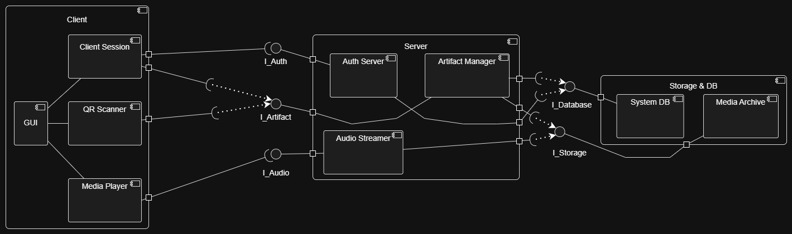

***Hình 2.1: Sơ đồ Thành phần Hệ thống Thuyết minh Tự động Đa ngôn ngữ (Component Diagram)***

***Phân tích chi tiết các khối thành phần:***

- **1. Khối Client GUI:** GUI (Graphical User Interface): Giao diện người dùng SPA chạy trên trình duyệt web, đóng vai trò điều phối hiển thị, nhận tương tác từ khách tham quan và chuyển tiếp đến các module dịch vụ nội bộ.
- **2. Khối Client Session:** Client Session: Quản lý trạng thái đăng nhập, lưu trữ Token xác thực, phiên làm việc của Actor và giao tiếp với máy chủ thông qua giao diện I_Auth.
- **3. Khối QR Scanner:** QR Scanner: Module điều khiển luồng Camera của thiết bị, thực hiện chụp khung hình và giải mã chuỗi QR Code để truy vấn mã hiện vật qua giao diện I_Artifact.
- **4. Khối Media Player:** Media Player: Module phát âm thanh thông minh, hỗ trợ nhận luồng dữ liệu (Audio Stream) từ AudioStreamer qua giao diện I_Audio, điều khiển tốc độ đọc và hiển thị phụ đề đồng bộ.
- **5. Khối Máy chủ Dịch vụ:** Server Application: Bao gồm 3 dịch vụ nền tảng: Auth Server (xác thực và cấp quyền), Artifact Manager (quản trị thông tin và bản dịch hiện vật), và Audio Streamer (truyền phát luồng âm thanh thời gian thực).
- **6. Khối Dữ liệu:** Storage & Database: Gồm System DB (hệ quản trị cơ sở dữ liệu lưu thông tin hiện vật, tài khoản, lịch sử) và Media Archive (kho lưu trữ tệp tin nhị phân mp3, m4a và hình ảnh độ phân giải cao).

## 2.2. Sơ đồ Triển khai (Deployment Diagram)

Sơ đồ triển khai xác định môi trường thực thi và hạ tầng mạng thực tế của hệ thống:  
1. Nút Thiết bị Người dùng (Client Device - Mobile / Desktop): Môi trường Modern Web Browser (Chrome, Safari, Edge, Firefox), thực thi gói ứng dụng Vite React SPA, tận dụng trực tiếp HTML5 Web Audio API, HTML5 Geolocation API, HTML5 Camera API và Browser LocalStorage.  
2. Nút Hạ tầng Lưu trữ & Phân phối (GitHub Pages CDN): Máy chủ Static Web Server Nginx với bảo mật HTTPS :443, phân phối toàn cầu bản dựng dist/, tệp thuyết minh audio MP3 và ảnh sơ đồ các tầng với tốc độ cao và độ trễ thấp.  
3. Nút Hạ tầng Giám sát Telemetry (ntfy.sh Gateway): Máy chủ HTTPS Push Gateway thu thập và đồng bộ các sự kiện thống kê lượt nghe theo thời gian thực.

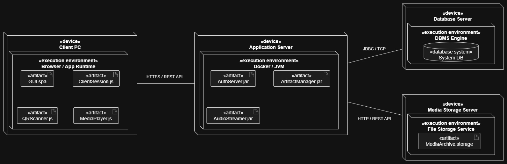

***Hình 2.2: Sơ đồ Triển khai Hệ thống (UML Deployment Diagram)***

***Quy cách các Node phần cứng và Môi trường thực thi:***

- **Nút Thiết bị Người dùng (Client Device):** Node Client PC / Mobile: Môi trường thực thi Browser / App Runtime. Chứa các artifact: GUI.spa, ClientSession.js, QRScanner.js, MediaPlayer.js. Giao tiếp với Application Server qua giao thức mã hóa HTTPS / REST API.
- **Nút Máy chủ Ứng dụng (Application Server):** Node Application Server: Môi trường Docker / JVM ảo hóa an toàn, thực thi các gói dịch vụ AuthServer.jar, ArtifactManager.jar và AudioStreamer.jar.
- **Nút Máy chủ Cơ sở dữ liệu (Database Server):** Node Database Server: Môi trường DBMS Engine vận hành cơ sở dữ liệu quan hệ System DB, kết nối với Application Server qua JDBC / TCP nội bộ tốc độ cao.
- **Nút Máy chủ Đa phương tiện (Media Storage Server):** Node Media Storage Server: Dịch vụ lưu trữ tệp (File Storage Service) chứa MediaArchive.storage, phục vụ việc phân phối tệp đa phương tiện qua HTTP/REST API hoặc CDN.

## 2.3. Mô hình Dữ liệu Quan hệ (Entity-Relationship Diagram - ERD)

Cơ sở dữ liệu của hệ thống được chuẩn hóa ở dạng chuẩn 3NF, đáp ứng đầy đủ các mối quan hệ giữa người dùng, hiện vật, bản dịch ngôn ngữ, tệp âm thanh và thống kê tương tác.

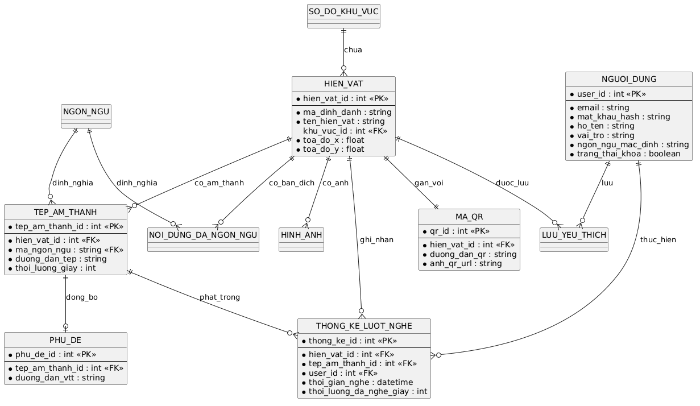

***Hình 2.3: Mô hình Quan hệ Thực thể Cơ sở Dữ liệu (ERD)***

Các thực thể cốt lõi trong hệ thống bao gồm:

- **Thực thể Người dùng:** NGUOI_DUNG: Lưu trữ user_id (PK), email, mat_khau_hash, ho_ten, vai_tro (User/Admin), ngon_ngu_mac_dinh, trang_thai_khoa.
- **Thực thể Hiện vật:** HIEN_VAT: Lưu hien_vat_id (PK), ma_dinh_danh, ten_hien_vat, khu_vuc_id (FK), toa_do_x, toa_do_y trên bản đồ trưng bày.
- **Thực thể Mã QR:** MA_QR: Liên kết 1-1 với HIEN_VAT, chứa qr_id (PK), duong_dan_qr và anh_qr_url tạo động.
- **Thực thể Tệp Âm thanh:** TEP_AM_THANH: Lưu tep_am_thanh_id (PK), hien_vat_id (FK), ma_ngon_ngu (FK), duong_dan_tep, thoi_luong_giay.
- **Thực thể Phụ đề:** PHU_DE: Lưu phu_de_id (PK), tep_am_thanh_id (FK), duong_dan_vtt chứa phụ đề chạy chữ đồng bộ.
- **Thực thể Thống kê:** THONG_KE_LUOT_NGHE: Ghi nhận nhật ký tương tác: thong_ke_id (PK), hien_vat_id, tep_am_thanh_id, user_id, thoi_gian_nghe, thoi_luong_da_nghe_giay.
- **Bảng liên kết:** Các bảng phụ trợ khác: LUU_YEU_THICH (danh sách yêu thích cá nhân), SO_DO_KHU_VUC (bản đồ tầng bảo tàng), NOI_DUNG_DA_NGON_NGU (tiêu đề và văn bản mô tả theo từng mã ngôn ngữ).

# CHƯƠNG 3: ĐẶC TẢ CHI TIẾT 20 USE CASES HỆ THỐNG

## 3.1. Sơ đồ Use Case Tổng quát và Phân loại Tác nhân (Actors)

Hệ thống Thuyết minh Tự động Đa ngôn ngữ được thiết kế xoay quanh 4 tác nhân chính tham gia vào quy trình nghiệp vụ:

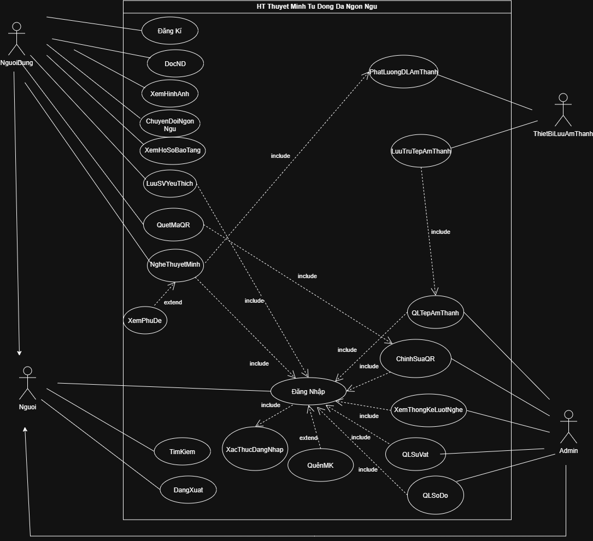

***Hình 3.1: Sơ đồ Use Case Tổng quát (General Use Case Diagram)***

| **Tác nhân (Actor)**        | **Phân loại**   | **Mô tả vai trò & Quyền hạn**                                                                                                |
|-----------------------------|-----------------|------------------------------------------------------------------------------------------------------------------------------|
| **Người (Khách vãng lai)**  | Human Actor     | Người dùng phổ thông chưa đăng nhập; có quyền quét QR, tìm kiếm, đọc nội dung và nghe thuyết minh cơ bản.                    |
| **Người Dùng (Thành viên)** | Human Actor     | Thừa kế từ 'Người'; có tài khoản cá nhân, được quyền lưu hiện vật yêu thích, đồng bộ lịch sử và nhận gợi ý cá nhân hóa.      |
| **Admin (Quản trị viên)**   | Human Actor     | Người quản lý nội dung bảo tàng; có toàn quyền thêm/sửa/xóa hiện vật, upload audio, cấu hình sơ đồ và xem thống kê báo cáo.  |
| **Thiết Bị Lưu Âm Thanh**   | System / Device | Hệ thống phần cứng máy chủ phát luồng (Streaming Server); chịu trách nhiệm mở luồng dữ liệu âm thanh và lưu trữ tệp an toàn. |

***Bảng 3.1: Bảng danh mục các Tác nhân trong Hệ thống***

### 3.2.1. USC01 — Đăng Ký

| **Tác nhân (Actor)**             | Người dùng                                                                                                                                                                                                                                                                                                                |
|----------------------------------|---------------------------------------------------------------------------------------------------------------------------------------------------------------------------------------------------------------------------------------------------------------------------------------------------------------------------|
| **Mức độ hoàn thiện**            | Focused Use Case                                                                                                                                                                                                                                                                                                          |
| **Mô tả tóm tắt**                | Cho phép người dùng vãng lai tạo tài khoản thành viên để sử dụng các tính năng cá nhân hóa (như lưu sự vật yêu thích, đồng bộ lịch sử tham quan).                                                                                                                                                                         |
| **Điều kiện tiên quyết**         | Người dùng đã cài đặt/mở ứng dụng hoặc truy cập vào trang web của hệ thống.                                                                                                                                                                                                                                               |
| **Luồng thay thế (Alternative)** | ● A1 - Hủy bỏ đăng ký: Tại bước 3, người dùng nhấn "Hủy" hoặc quay lại. Hệ thống hủy thao tác và quay về màn hình trước đó.                                                                                                                                                                                               |
| **Luồng ngoại lệ (Exception)**   | ● E1 - Thông tin không hợp lệ: Định dạng email/SĐT sai hoặc mật khẩu không đủ độ dài an toàn. Hệ thống thông báo lỗi chi tiết tại trường bị sai để người dùng nhập lại.<br>● E2 - Tài khoản đã tồn tại: Email/SĐT đã được đăng ký trước đó. Hệ thống thông báo lỗi và gợi ý chuyển sang "Đăng nhập" hoặc "Quên mật khẩu". |
| **Điều kiện kết thúc**           | Tài khoản người dùng mới được tạo thành công và lưu vào cơ sở dữ liệu.                                                                                                                                                                                                                                                    |

***Bảng 3.2: Đặc tả yêu cầu chi tiết của USC01 — Đăng Ký***

***Dòng sự kiện chính (Main Success Scenario) - UC01:***

1. Người dùng chọn chức năng "Đăng Kí".
2. Hệ thống hiển thị biểu mẫu đăng ký (Họ tên, Email/SĐT, Mật khẩu, Xác nhận mật khẩu, Ngôn ngữ mặc định).
3. Người dùng điền đầy đủ thông tin hợp lệ và nhấn "Xác nhận".
4. Hệ thống kiểm tra tính hợp lệ của dữ liệu (E1, E2).
5. Hệ thống khởi tạo tài khoản mới, mã hóa mật khẩu và gửi thông báo đăng ký thành công.
6. Chuyển hướng người dùng đến màn hình Đăng Nhập hoặc tự động đăng nhập. Kết thúc Use Case.

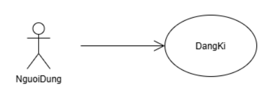

***Hình 3.2: Sơ đồ Use Case — USC01 — Đăng Ký***

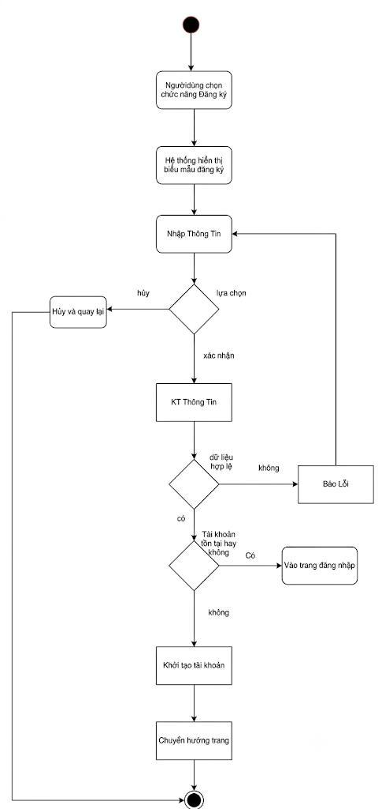

***Hình 3.3: Sơ đồ Hoạt động (Activity Diagram) — USC01 — Đăng Ký***

### 3.2.2. USC02 — Đăng Nhập

| **Tác nhân (Actor)**             | Người, Người Dùng, Admin                                                                                                                                                                                                                                                               |
|----------------------------------|----------------------------------------------------------------------------------------------------------------------------------------------------------------------------------------------------------------------------------------------------------------------------------------|
| **Mức độ hoàn thiện**            | Focused Use Case                                                                                                                                                                                                                                                                       |
| **Mô tả tóm tắt**                | Xác thực danh tính của Người Dùng hoặc Quản trị viên để phân quyền truy cập các chức năng tương ứng trong hệ thống. Bao gồm Use Case Xác Thực Đăng Nhập                                                                                                                                |
| **Điều kiện tiên quyết**         | ● Tác nhân (Người dùng / Admin) đã có tài khoản tồn tại trên hệ thống. ● Tác nhân chưa được xác thực/đăng nhập vào phiên hiện tại.                                                                                                                                                     |
| **Luồng thay thế (Alternative)** | ● A1 - Tài khoản có vai trò Admin: Hệ thống hiển thị Dashboard Quản trị thay cho trang cá nhân, sau đó Use Case kết thúc thành công.<br>● A2 – Quên mật khẩu                                                                                                                           |
| **Luồng ngoại lệ (Exception)**   | ● E1 - Sai mật khẩu hoặc tài khoản không tồn tại: Hệ thống thông báo lỗi và cho phép nhập lại.<br>● E2 - Chống tấn công dò mật khẩu (Brute-Force): Nếu nhập sai quá 5 lần liên tiếp, hệ thống tự động khóa tạm thời 5 phút kèm đồng hồ đếm ngược trên giao diện.                       |
| **Điều kiện kết thúc**           | ● Thành công: Phiên làm việc (Session/Token) được khởi tạo thành công với quyền hạn tương ứng (Admin truy cập Dashboard Quản trị; khách vãng lai sử dụng trực tiếp các tính năng thuyết minh không cần đăng nhập).<br>● Thất bại: Hệ thống từ chối truy cập và hiển thị thông báo lỗi. |

***Bảng 3.3: Đặc tả yêu cầu chi tiết của USC02 — Đăng Nhập***

***Dòng sự kiện chính (Main Success Scenario) - UC02:***

1. Tác nhân chọn "Đăng Nhập".
2. Hệ thống hiển thị biểu mẫu đăng nhập (Tên đăng nhập/Email và Mật khẩu).
3. Tác nhân nhập thông tin đăng nhập và nhấn "Đăng nhập".
4. Hệ thống thực hiện UC con {Xác Thực Đăng Nhập} (E1, E2).
5. Hệ thống kiểm tra vai trò (Role) của tài khoản (A1). Với tài khoản Người Dùng, hệ thống hiển thị trang cá nhân với danh mục yêu thích và lịch sử tham quan.
6. Use Case kết thúc thành công.

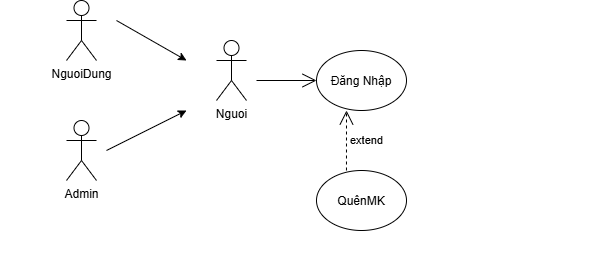

***Hình 3.4: Sơ đồ Use Case — USC02 — Đăng Nhập***

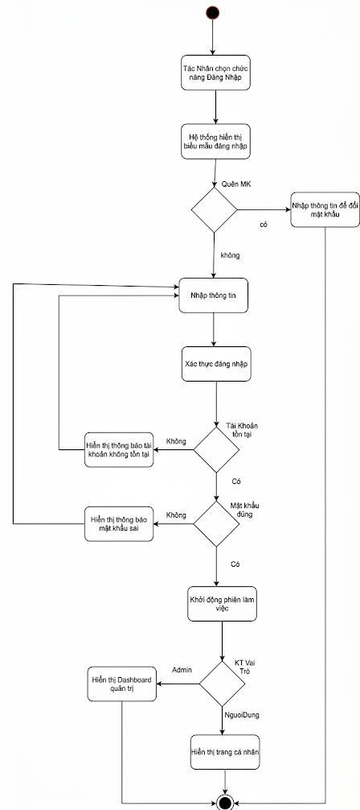

***Hình 3.5: Sơ đồ Hoạt động (Activity Diagram) — USC02 — Đăng Nhập***

### 3.2.3. USC03 — Quét Mã QR

| **Tác nhân (Actor)**             | Người Dùng (hoặc Khách tham quan)                                                                                                                                                                                                                                                                                                                                                                                                                                                              |
|----------------------------------|------------------------------------------------------------------------------------------------------------------------------------------------------------------------------------------------------------------------------------------------------------------------------------------------------------------------------------------------------------------------------------------------------------------------------------------------------------------------------------------------|
| **Mức độ hoàn thiện**            | Focused Use Case                                                                                                                                                                                                                                                                                                                                                                                                                                                                               |
| **Mô tả tóm tắt**                | Người dùng sử dụng camera quét mã QR tại cổng hoặc gắn tại hiện vật để mở nội dung thuyết minh. Đồng thời, hệ thống ghi nhận mã QR làm mốc neo xuất phát (anchorArtifactId) và tự động kích hoạt chế độ GPS theo dõi độ chính xác cao, tự động nhận diện và gợi ý phát thuyết minh khi đến gần các hiện vật tiếp theo mà không cần quét lại.                                                                                                                                                   |
| **Điều kiện tiên quyết**         | ● Thiết bị di động của người dùng có tích hợp Camera và phần cứng hoạt động bình thường. ● Ứng dụng đã được cấp quyền truy cập Camera.                                                                                                                                                                                                                                                                                                                                                         |
| **Luồng thay thế (Alternative)** | Không có.                                                                                                                                                                                                                                                                                                                                                                                                                                                                                      |
| **Luồng ngoại lệ (Exception)**   | ● E1 - Không thể quét/mã QR mờ hoặc hỏng: Hệ thống hiển thị thông báo "Không nhận dạng được mã QR" và gợi ý điều chỉnh khoảng cách, ánh sáng. Đồng thời hiển thị nút "Tìm kiếm hiện vật" để người dùng chuyển sang chức năng Tìm kiếm (có thể nhập trực tiếp mã số hiện vật).<br>● E2 - Chưa cấp quyền Camera hoặc thiết bị không có camera: Hệ thống thông báo cần quyền truy cập Camera để quét mã, hướng dẫn cấp quyền trong phần cài đặt của thiết bị và hiển thị nút "Tìm kiếm hiện vật". |
| **Điều kiện kết thúc**           | ● Thành công: Hệ thống giải mã thành công QR ID, truy vấn dữ liệu hiện vật và chuyển hướng người dùng đến màn hình chi tiết hiện vật tương ứng. ● Thất bại: Màn hình quét giữ nguyên hoặc hiển thị thông báo lỗi mã QR không hợp lệ/mờ hỏng/chưa cấp quyền Camera (E1, E2, E3), kèm gợi ý chuyển sang chức năng Tìm kiếm.                                                                                                                                                                      |

***Bảng 3.4: Đặc tả yêu cầu chi tiết của USC03 — Quét Mã QR***

***Dòng sự kiện chính (Main Success Scenario) - UC03:***

1. Người dùng chọn tính năng "Quét Mã QR".
2. Hệ thống kích hoạt camera và hiển thị khung quét mã QR E2
3. Người dùng hướng camera về phía mã QR gắn trên hiện vật.
4. Hệ thống nhận diện và giải mã chuỗi định danh QR E1
5. Hệ thống truy vấn thông tin hiện vật từ CSDL theo ID vừa giải mã.
6. Hệ thống tự động chuyển đến màn hình chi tiết hiện vật và kích hoạt chức năng liên quan (Đọc nội dung, Xem hình ảnh hoặc phát Use Case {Nghe Thuyết Minh}).

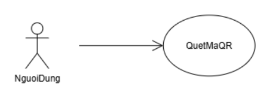

***Hình 3.6: Sơ đồ Use Case — USC03 — Quét Mã QR***

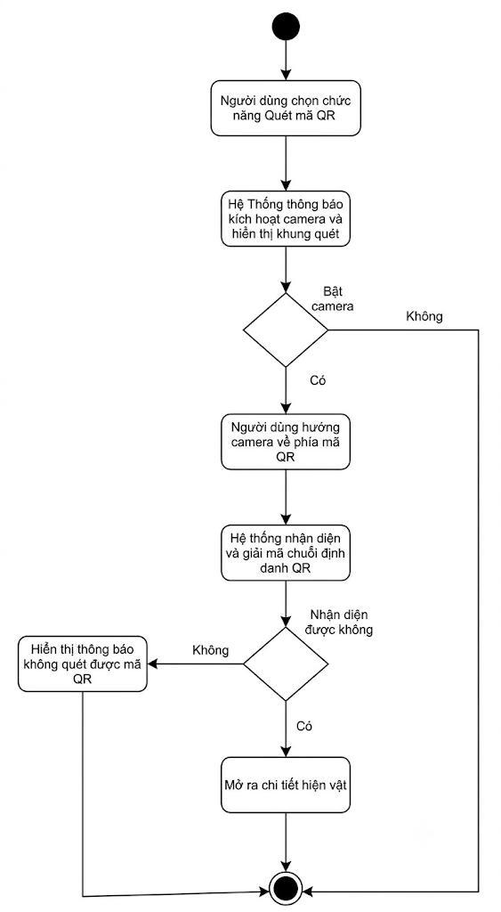

***Hình 3.7: Sơ đồ Hoạt động (Activity Diagram) — USC03 — Quét Mã QR***

### 3.2.4. USC04 — Nghe Thuyết Minh

| **Tác nhân (Actor)**             | Người Dùng, Thiết Bị Lưu Âm Thanh                                                                                                                                                                                                                                                                                                                                                                                                     |
|----------------------------------|---------------------------------------------------------------------------------------------------------------------------------------------------------------------------------------------------------------------------------------------------------------------------------------------------------------------------------------------------------------------------------------------------------------------------------------|
| **Mức độ hoàn thiện**            | Focused Use Case                                                                                                                                                                                                                                                                                                                                                                                                                      |
| **Mô tả tóm tắt**                | Phát bản thu âm thuyết minh về hiện vật/sự vật theo ngôn ngữ hiện tại của người dùng. Tự động gọi {Phát                                                                                                                                                                                                                                                                                                                               |
| **Điều kiện tiên quyết**         | Đã xác định được hiện vật cần thuyết minh (thông qua Quét mã QR hoặc Tìm kiếm/Xem danh sách).                                                                                                                                                                                                                                                                                                                                         |
| **Luồng thay thế (Alternative)** | ● A1 - Người dùng bật phụ đề (Extension Point Xem Phụ Đề): Người dùng bấm nút "Bật Phụ Đề" trên trình phát. Hệ thống kích hoạt use case Xem Phụ Đề, tải và hiển thị văn bản đồng bộ theo mốc thời gian của bài nói.<br>● A2 - Đổi ngôn ngữ giữa chừng: Người dùng chọn thay đổi ngôn ngữ khác (Use case Chuyển Đổi Ngôn Ngữ). Hệ thống lưu vị trí phát hiện tại, nạp tệp âm thanh ngôn ngữ mới từ Thiết Bị Lưu Âm Thanh và phát tiếp. |
| **Luồng ngoại lệ (Exception)**   | ● E1 - Lỗi kết nối thiết bị âm thanh/mạng: Hệ thống không nhận được luồng dữ liệu âm thanh. Hệ thống thông báo "Không tải được âm thanh thuyết minh, vui lòng kiểm tra kết nối" và gợi ý người dùng đọc bản thuyết minh bằng văn bản (DocND).                                                                                                                                                                                         |
| **Điều kiện kết thúc**           | Âm thanh thuyết minh được phát liên tục, trơn tru cho người dùng.                                                                                                                                                                                                                                                                                                                                                                     |

***Bảng 3.5: Đặc tả yêu cầu chi tiết của USC04 — Nghe Thuyết Minh***

***Dòng sự kiện chính (Main Success Scenario) - UC04:***

1. Người dùng đăng nhập
2. Hệ thống hiển thị lời chào mừng đăng nhập cùng với những chức năng chính cho người dùng lựa chọn
3. Người dùng chọn nghe thuyết minh của hiện vật (hoặc tự động kích hoạt sau khi quét QR).
4. Hệ thống xác định ngôn ngữ người dùng đang chọn và mã ID của tệp âm thanh tương ứng.
5. Hệ thống thực hiện {Phát Luồng Dữ Liệu Âm Thanh}: gửi yêu cầu lấy tệp tin/dòng dữ liệu âm thanh đến Thiết Bị Lưu Âm Thanh.
6. Thiết Bị Lưu Âm Thanh truyền luồng dữ liệu (audio stream) về ứng dụng. E1
7. Hệ thống khởi tạo trình phát âm thanh và bắt đầu phát (Play). Hiển thị các nút điều khiển: Pause, Stop, Seek, Tốc độ phát.
8. Người dùng lắng nghe thuyết minh và tương tác thanh điều khiển phát khi cần. (A1, A2)
9. Âm thanh kết thúc. Hệ thống cập nhật số lượt nghe (lưu log thống kê) và dừng trình phát. Kết thúc Use Case.

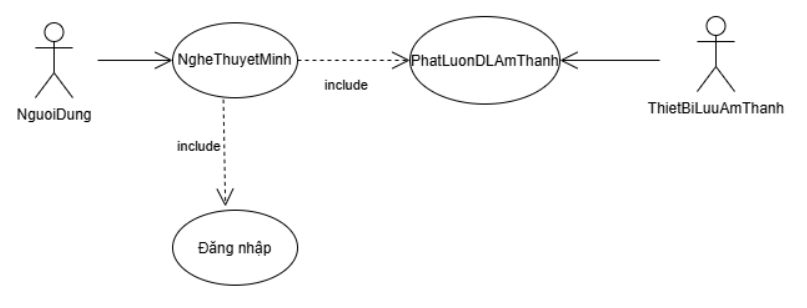

***Hình 3.8: Sơ đồ Use Case — USC04 — Nghe Thuyết Minh***

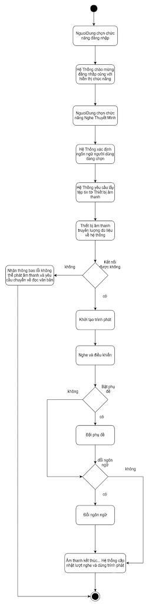

***Hình 3.9: Sơ đồ Hoạt động (Activity Diagram) — USC04 — Nghe Thuyết Minh***

### 3.2.5. USC05 — Chuyển Đổi Ngôn Ngữ

| **Tác nhân (Actor)**             | Người Dùng (hoặc Khách vãng lai)                                                                                                 |
|----------------------------------|----------------------------------------------------------------------------------------------------------------------------------|
| **Mức độ hoàn thiện**            | Focused Use Case                                                                                                                 |
| **Mô tả tóm tắt**                | Thay đổi ngôn ngữ hiển thị giao diện và ngôn ngữ các nội dung thuyết minh (Tiếng Việt, Tiếng Anh, Tiếng Hàn, Tiếng Trung, v.v.). |
| **Điều kiện tiên quyết**         | Không có.                                                                                                                        |
| **Luồng thay thế (Alternative)** | Không có.                                                                                                                        |
| **Luồng ngoại lệ (Exception)**   | Không có.                                                                                                                        |
| **Điều kiện kết thúc**           | Toàn bộ giao diện và dữ liệu nội dung hiển thị sang ngôn ngữ mới được chọn.                                                      |

***Bảng 3.6: Đặc tả yêu cầu chi tiết của USC05 — Chuyển Đổi Ngôn Ngữ***

***Dòng sự kiện chính (Main Success Scenario) - UC05:***

1. Người dùng chọn tính năng "Chuyển Đổi Ngôn Ngữ".
2. Hệ thống hiển thị danh sách các ngôn ngữ được hỗ trợ.
3. Người dùng chọn một ngôn ngữ mong muốn
4. Hệ thống ghi nhận thiết lập ngôn ngữ mới vào cấu hình phiên.
5. Hệ thống tải lại tài nguyên giao diện, nội dung bài viết và các liên kết âm thanh tương ứng với ngôn ngữ đã chọn.
6. Giao diện hiển thị bằng ngôn ngữ mới. Use case kết thúc.

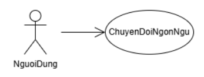

***Hình 3.10: Sơ đồ Use Case — USC05 — Chuyển Đổi Ngôn Ngữ***

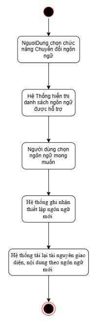

***Hình 3.11: Sơ đồ Hoạt động (Activity Diagram) — USC05 — Chuyển Đổi Ngôn Ngữ***

### 3.2.6. USC06 — Lưu Sự Vật Yêu Thích

| **Tác nhân (Actor)**             | Người Dùng                                                                                                                       |
|----------------------------------|----------------------------------------------------------------------------------------------------------------------------------|
| **Mức độ hoàn thiện**            | Focused Use Case                                                                                                                 |
| **Mô tả tóm tắt**                | Cho phép người dùng đánh dấu/lưu lại các hiện vật, sự vật ấn tượng vào danh mục "Yêu thích" để xem lại sau.                      |
| **Điều kiện tiên quyết**         | Người dùng đang ở màn hình chi tiết hiện vật (không yêu cầu đăng nhập tài khoản).                                                |
| **Luồng thay thế (Alternative)** | ● A1 - Hủy lưu yêu thích: Người dùng bấm lần nữa để bỏ chọn. Hệ thống xóa hiện vật khỏi bảng danh sách yêu thích của người dùng. |
| **Luồng ngoại lệ (Exception)**   | Không có.                                                                                                                        |
| **Điều kiện kết thúc**           | Hiện vật được thêm vào danh sách yêu thích lưu trữ cục bộ trên thiết bị của người dùng (LocalStorage).                           |

***Bảng 3.7: Đặc tả yêu cầu chi tiết của USC06 — Lưu Sự Vật Yêu Thích***

***Dòng sự kiện chính (Main Success Scenario) - UC06:***

1. Người dùng đăng nhập
2. Hệ thống hiển thị lời chào mừng đăng nhập cùng với những chức năng chính cho người dùng lựa chọn
3. Người dùng bấm nút "Lưu Yêu Thích" tại trang hiện vật.
4. Hệ thống kiểm tra trạng thái lưu: nếu chưa lưu thì thêm hiện vật vào danh mục yêu thích trong CSDL; nếu đã lưu thì hiển thị tùy chọn xóa khỏi danh sách (A1).
5. Hệ thống cập nhật biểu tượng trạng thái (đã lưu) và thông báo "Đã lưu vào danh sách yêu thích".

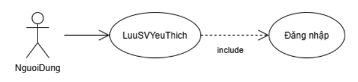

***Hình 3.12: Sơ đồ Use Case — USC06 — Lưu Sự Vật Yêu Thích***

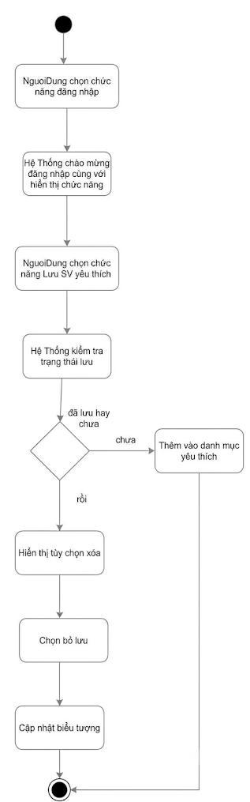

***Hình 3.13: Sơ đồ Hoạt động (Activity Diagram) — USC06 — Lưu Sự Vật Yêu Thích***

### 3.2.7. USC07 — Quản Lý Sự Vật

| **Tác nhân (Actor)**             | Admin                                                                                                                                                                                                                                                                                                                                                                                                                                                                                                                                                                                                                                                                                                                                                                                                                                                                                                                                                        |
|----------------------------------|--------------------------------------------------------------------------------------------------------------------------------------------------------------------------------------------------------------------------------------------------------------------------------------------------------------------------------------------------------------------------------------------------------------------------------------------------------------------------------------------------------------------------------------------------------------------------------------------------------------------------------------------------------------------------------------------------------------------------------------------------------------------------------------------------------------------------------------------------------------------------------------------------------------------------------------------------------------|
| **Mức độ hoàn thiện**            | Focused Use Case                                                                                                                                                                                                                                                                                                                                                                                                                                                                                                                                                                                                                                                                                                                                                                                                                                                                                                                                             |
| **Mô tả tóm tắt**                | Cho phép Admin quản lý thông tin các sự vật trong hệ thống, gồm thêm mới, chỉnh sửa và xóa sự vật.                                                                                                                                                                                                                                                                                                                                                                                                                                                                                                                                                                                                                                                                                                                                                                                                                                                           |
| **Điều kiện tiên quyết**         | Admin đã đăng nhập thành công vào hệ thống (nếu chưa đăng nhập, include {Đăng Nhập}). Sự kiện kích hoạt (Trigger): Admin chọn menu "Quản Lý Sự Vật".                                                                                                                                                                                                                                                                                                                                                                                                                                                                                                                                                                                                                                                                                                                                                                                                         |
| **Luồng thay thế (Alternative)** | ● A1 – Thêm mới sự vật: Ở bước 3, Admin chọn "Thêm mới". Hệ thống hiển thị biểu mẫu trống gồm: Tên, Mã số, Khu vực/Sơ đồ, Nội dung mô tả đa ngôn ngữ, Hình ảnh đính kèm. Admin điền thông tin và nhấn "Lưu" (A4). Hệ thống kiểm tra tính hợp lệ của dữ liệu (E1, E2), lưu vào CSDL (E3), thông báo "Lưu thông tin sự vật thành công" và làm mới danh sách. Use case quay lại bước 3.<br>● A2 – Sửa sự vật: Ở bước 3, Admin chọn một sự vật trong danh sách và nhấn "Sửa". Hệ thống hiển thị biểu mẫu đã điền sẵn thông tin hiện tại. Các bước tiếp theo thực hiện như A1.<br>● A3 – Xóa sự vật: Ở bước 3, Admin chọn một sự vật và nhấn "Xóa". Hệ thống hiển thị hộp thoại xác nhận. Khi Admin đồng ý, hệ thống xóa sự vật khỏi CSDL, thông báo thành công, làm mới danh sách và quay lại bước 3.<br>● A4 – Hủy thao tác: Khi đang ở biểu mẫu của A1 hoặc A2, Admin nhấn "Hủy". Hệ thống đóng biểu mẫu mà không lưu thay đổi và quay lại danh sách (bước 3). |
| **Luồng ngoại lệ (Exception)**   | ● E1 – Thiếu trường bắt buộc: Admin bỏ trống tên sự vật hoặc chưa chọn khu vực. Hệ thống cảnh báo đỏ tại các trường thiếu và yêu cầu điền bổ sung trước khi lưu (quay lại bước điền biểu mẫu).<br>● E2 – Trùng mã số: Mã số vừa nhập đã tồn tại. Hệ thống thông báo "Mã số đã tồn tại" và yêu cầu nhập mã khác (quay lại bước điền biểu mẫu).<br>● E3 – Lưu thất bại: CSDL lỗi hoặc hình ảnh sai định dạng/quá dung lượng. Hệ thống thông báo lỗi và giữ nguyên dữ liệu đã nhập để Admin thử lại (quay lại bước điền biểu mẫu). Điều kiện kết thúc: Thông tin sự vật được thêm, cập nhật hoặc xóa trong CSDL và danh sách hiển thị đúng thay đổi. Nếu Admin hủy thao tác thì dữ liệu giữ nguyên. Sơ đồ hoạt động (Activity Diagram) — USC07                                                                                                                                                                                                                  |
| **Điều kiện kết thúc**           | Thao tác hoàn tất thành công, dữ liệu được đồng bộ.                                                                                                                                                                                                                                                                                                                                                                                                                                                                                                                                                                                                                                                                                                                                                                                                                                                                                                          |

***Bảng 3.8: Đặc tả yêu cầu chi tiết của USC07 — Quản Lý Sự Vật***

***Dòng sự kiện chính (Main Success Scenario) - UC07:***

1. Admin đăng nhập
2. Hệ thống hiển thị lời chào mừng đăng nhập cùng với những chức năng chính cho Admin lựa chọn
3. Admin chọn menu "Quản Lý Sự Vật".
4. Hệ thống hiển thị danh sách các sự vật hiện có kèm bộ lọc, tìm kiếm và các nút "Thêm mới", "Sửa", "Xóa".
5. Admin chọn một thao tác quản lý (A1, A2, A3).
6. Admin thoát khỏi màn hình quản lý. Use case kết thúc.

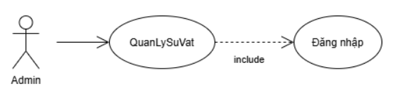

***Hình 3.14: Sơ đồ Use Case — USC07 — Quản Lý Sự Vật***

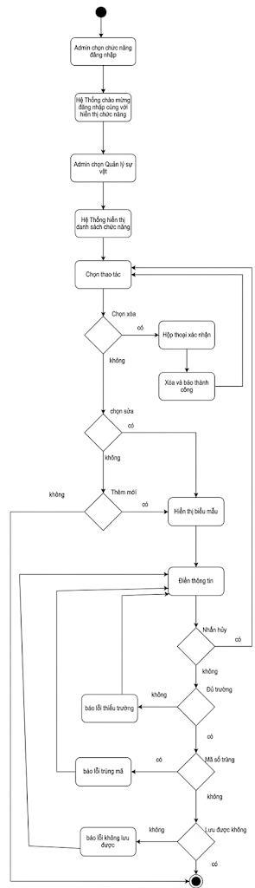

***Hình 3.15: Sơ đồ Hoạt động (Activity Diagram) — USC07 — Quản Lý Sự Vật***

### 3.2.8. USC08 — Chỉnh Sửa Mã QR

| **Tác nhân (Actor)**             | Admin                                                                                                                                                                                                                                                                                                                                                                                                                                                                                                                                                                                                                                                                                             |
|----------------------------------|---------------------------------------------------------------------------------------------------------------------------------------------------------------------------------------------------------------------------------------------------------------------------------------------------------------------------------------------------------------------------------------------------------------------------------------------------------------------------------------------------------------------------------------------------------------------------------------------------------------------------------------------------------------------------------------------------|
| **Mức độ hoàn thiện**            | Focused Use Case                                                                                                                                                                                                                                                                                                                                                                                                                                                                                                                                                                                                                                                                                  |
| **Mô tả tóm tắt**                | Cho phép Admin tạo mới mã QR cho sự vật mới, cập nhật liên kết URL/nội dung trỏ tới của mã QR, hoặc xuất/in lại mã QR để gắn tại bảo tàng.                                                                                                                                                                                                                                                                                                                                                                                                                                                                                                                                                        |
| **Điều kiện tiên quyết**         | Admin đã đăng nhập hệ thống (nếu chưa đăng nhập, include {Đăng Nhập}). Sự vật cần gắn mã QR đã tồn tại trong hệ thống. Sự kiện kích hoạt (Trigger): Admin chọn mục "Quản Lý / Chỉnh Sửa Mã QR".                                                                                                                                                                                                                                                                                                                                                                                                                                                                                                   |
| **Luồng thay thế (Alternative)** | ● A1 – Tạo mã QR mới: Ở bước 3, Admin chọn "Tạo mã QR mới" và chọn một sự vật chưa có mã QR. Hệ thống hiển thị biểu mẫu thông số mã QR trống (liên kết dữ liệu, kích thước, định dạng). Use case tiếp tục từ bước 5.<br>● A2 – Sửa lại mã (Regenerate): Ở bước 5, Admin chọn "Sinh lại mã" thay vì chỉnh sửa liên kết. Hệ thống tạo lại mã đồ họa QR từ liên kết hiện tại và hiển thị bản xem trước. Use case tiếp tục từ bước 7.<br>● A3 – Xóa mã QR: Ở bước 3, Admin chọn một sự vật đã có mã QR và nhấn "Xóa mã QR". Hệ thống hiển thị hộp thoại xác nhận. Khi Admin đồng ý, hệ thống xóa mã QR khỏi CSDL (E2), thông báo "Xóa mã QR thành công", làm mới danh mục mã QR và kết thúc use case. |
| **Luồng ngoại lệ (Exception)**   | ● E1 – Liên kết không hợp lệ: Ở bước 6, liên kết dữ liệu bị bỏ trống hoặc sai định dạng URL. Hệ thống cảnh báo đỏ tại trường liên kết và yêu cầu nhập lại (quay lại bước 5).<br>● E2 – Lưu hoặc tạo tệp thất bại: Ở bước 8 hoặc bước 10, CSDL lỗi hoặc hệ thống không tạo được tệp hình ảnh. Hệ thống thông báo lỗi và giữ nguyên dữ liệu đã nhập để Admin thử lại. Điều kiện kết thúc: Mã QR được tạo/cập nhật chính xác với sự vật trong hệ thống. Tệp hình ảnh mã QR được tải về nếu Admin chọn tải. Sơ đồ hoạt động (Activity Diagram) — USC08                                                                                                                                                |
| **Điều kiện kết thúc**           | Thao tác hoàn tất thành công, dữ liệu được đồng bộ.                                                                                                                                                                                                                                                                                                                                                                                                                                                                                                                                                                                                                                               |

***Bảng 3.9: Đặc tả yêu cầu chi tiết của USC08 — Chỉnh Sửa Mã QR***

***Dòng sự kiện chính (Main Success Scenario) - UC08:***

1. Admin đăng nhập
2. Hệ thống hiển thị lời chào mừng đăng nhập cùng với những chức năng chính cho Admin lựa chọn
3. Admin chọn mục "Chỉnh Sửa Mã QR".
4. Hệ thống hiển thị danh mục mã QR đã cấp cho các sự vật/khu vực.
5. Admin chọn sự vật cần cập nhật mã QR (A1, A3).
6. Hệ thống hiển thị thông số mã QR: sự vật liên kết, liên kết dữ liệu (URL/nội dung), kích thước, định dạng và ảnh mã QR hiện tại.
7. Admin chỉnh sửa liên kết dữ liệu (A2).
8. Hệ thống kiểm tra tính hợp lệ của liên kết (E1), mã hóa dữ liệu mới thành mã đồ họa QR và hiển thị bản xem trước.
9. Admin nhấn "Lưu". **10** . Hệ thống lưu thay đổi vào CSDL (E2) và thông báo "Lưu mã QR thành công". **11** . Admin chọn định dạng tệp (PNG/SVG/PDF) và nhấn "Tải về" để in ấn. **12** . Hệ thống tạo và cho phép tải tệp hình ảnh mã QR theo định dạng đã chọn (E2).

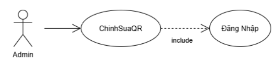

***Hình 3.16: Sơ đồ Use Case — USC08 — Chỉnh Sửa Mã QR***

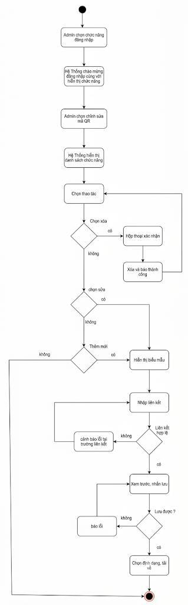

***Hình 3.17: Sơ đồ Hoạt động (Activity Diagram) — USC08 — Chỉnh Sửa Mã QR***

### 3.2.9. USC09 — Quản Lý Tệp Âm Thanh

| **Tác nhân (Actor)**             | Admin, Thiết Bị Lưu Âm Thanh                                                                                                                                                                                                                                                                                                                                                                                                                                                                                                                                                                                                                                                                                                                                                                                                                                                                                                                                                                                                                                                                                                                             |
|----------------------------------|----------------------------------------------------------------------------------------------------------------------------------------------------------------------------------------------------------------------------------------------------------------------------------------------------------------------------------------------------------------------------------------------------------------------------------------------------------------------------------------------------------------------------------------------------------------------------------------------------------------------------------------------------------------------------------------------------------------------------------------------------------------------------------------------------------------------------------------------------------------------------------------------------------------------------------------------------------------------------------------------------------------------------------------------------------------------------------------------------------------------------------------------------------|
| **Mức độ hoàn thiện**            | Focused Use Case                                                                                                                                                                                                                                                                                                                                                                                                                                                                                                                                                                                                                                                                                                                                                                                                                                                                                                                                                                                                                                                                                                                                         |
| **Mô tả tóm tắt**                | Admin tải lên, thay thế hoặc xóa các file audio thuyết minh và gán nhãn ngôn ngữ cho từng file. Bao gồm {Lưu Trữ Tệp Âm Thanh} («include») tương tác trực tiếp với Thiết Bị Lưu Âm Thanh.                                                                                                                                                                                                                                                                                                                                                                                                                                                                                                                                                                                                                                                                                                                                                                                                                                                                                                                                                                |
| **Điều kiện tiên quyết**         | Admin đã đăng nhập (nếu chưa đăng nhập, include {Đăng Nhập}). Hiện vật cần gắn thuyết minh đã tồn tại trong hệ thống. Sự kiện kích hoạt (Trigger): Admin chọn "Quản Lý Tệp Âm Thanh".                                                                                                                                                                                                                                                                                                                                                                                                                                                                                                                                                                                                                                                                                                                                                                                                                                                                                                                                                                    |
| **Luồng thay thế (Alternative)** | ● A1 – Tải lên tệp mới: Ở bước 3, Admin chọn hiện vật và nhấn "Tải lên tệp âm thanh mới". Hệ thống hiển thị hộp thoại chọn file và chọn ngôn ngữ thuyết minh. Admin chọn ngôn ngữ, chọn file audio (MP3, WAV, AAC) từ máy tính và bấm "Tải lên". Hệ thống kiểm tra dung lượng, định dạng file (E1), rồi thực hiện {Lưu Trữ Tệp Âm Thanh}: gửi tệp sang Thiết Bị Lưu Âm Thanh. Thiết Bị Lưu Âm Thanh tiếp nhận, lưu file và trả về đường dẫn (URL/ID lưu trữ) (E2). Hệ thống cập nhật đường dẫn vào hồ sơ hiện vật và thông báo "Tải lên thành công". Use case quay lại bước 3.<br>● A2 – Thay thế tệp: Ở bước 3, Admin chọn một tệp âm thanh đã có của hiện vật/ngôn ngữ và nhấn "Thay thế". Admin chọn file audio mới từ máy tính và bấm "Tải lên". Các bước tiếp theo thực hiện như A1; hệ thống cập nhật đường dẫn mới vào hồ sơ hiện vật và xóa tệp cũ khỏi thiết bị lưu trữ.<br>● A3 – Xóa tệp: Ở bước 3, Admin chọn một tệp âm thanh đã có và nhấn "Xóa". Hệ thống hiển thị hộp thoại xác nhận. Khi Admin đồng ý, hệ thống yêu cầu Thiết Bị Lưu Âm Thanh xóa tệp (E2), cập nhật hồ sơ hiện vật, thông báo "Xóa tệp thành công" và quay lại bước 3. |
| **Luồng ngoại lệ (Exception)**   | ● E1 – Sai định dạng hoặc vượt quá dung lượng: Khi Admin tải lên (A1, A2), file không phải âm thanh hợp lệ (MP3, WAV, AAC) hoặc kích thước quá lớn (\>50MB). Hệ thống từ chối tải lên và thông báo lỗi.<br>● E2 – Thiết Bị Lưu Âm Thanh không phản hồi hoặc lưu/xóa thất bại: Khi lưu hoặc xóa tệp (A1, A2, A3), thiết bị lưu trữ không phản hồi hoặc báo lỗi. Hệ thống thông báo lỗi và không cập nhật hồ sơ hiện vật. Điều kiện kết thúc: Tệp âm thanh được lưu trữ an toàn trên thiết bị lưu trữ và liên kết đúng với hiện vật tương ứng; hoặc được thay thế/xóa khỏi thiết bị lưu trữ và hồ sơ hiện vật nếu Admin chọn thay thế/xóa. Sơ đồ hoạt động (Activity Diagram) — USC09                                                                                                                                                                                                                                                                                                                                                                                                                                                                      |
| **Điều kiện kết thúc**           | Thao tác hoàn tất thành công, dữ liệu được đồng bộ.                                                                                                                                                                                                                                                                                                                                                                                                                                                                                                                                                                                                                                                                                                                                                                                                                                                                                                                                                                                                                                                                                                      |

***Bảng 3.10: Đặc tả yêu cầu chi tiết của USC09 — Quản Lý Tệp Âm Thanh***

***Dòng sự kiện chính (Main Success Scenario) - UC09:***

1. Admin đăng nhập
2. Hệ thống hiển thị lời chào mừng đăng nhập cùng với những chức năng chính cho Admin lựa chọn
3. Admin chọn "Quản Lý Tệp Âm Thanh".
4. Hệ thống hiển thị danh sách các file thuyết minh theo từng hiện vật và ngôn ngữ.
5. Admin chọn một thao tác quản lý tệp âm thanh (A1, A2, A3).
6. Admin thoát khỏi màn hình quản lý. Use case kết thúc.

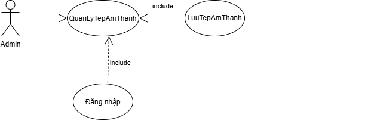

***Hình 3.18: Sơ đồ Use Case — USC09 — Quản Lý Tệp Âm Thanh***

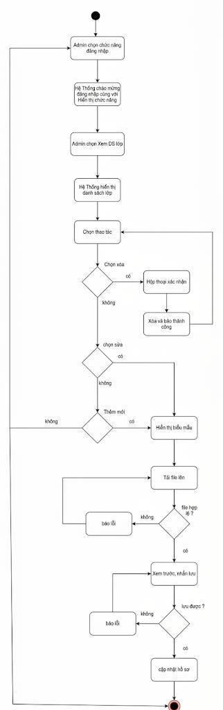

***Hình 3.19: Sơ đồ Hoạt động (Activity Diagram) — USC09 — Quản Lý Tệp Âm Thanh***

### 3.2.10. USC10 — Xem Thống Kê Lượt Nghe

| **Tác nhân (Actor)**             | Admin                                                                                                                                                                                                                                                                                                                                                                                                                                                                                                                                                                                                                                                                                                                                                             |
|----------------------------------|-------------------------------------------------------------------------------------------------------------------------------------------------------------------------------------------------------------------------------------------------------------------------------------------------------------------------------------------------------------------------------------------------------------------------------------------------------------------------------------------------------------------------------------------------------------------------------------------------------------------------------------------------------------------------------------------------------------------------------------------------------------------|
| **Mức độ hoàn thiện**            | Focused Use Case                                                                                                                                                                                                                                                                                                                                                                                                                                                                                                                                                                                                                                                                                                                                                  |
| **Mô tả tóm tắt**                | Cung cấp báo cáo, biểu đồ về số lượt khách nghe thuyết minh theo từng sự vật, theo ngôn ngữ, theo khung giờ hoặc theo ngày/tháng/năm để đánh giá mức độ quan tâm của du khách.                                                                                                                                                                                                                                                                                                                                                                                                                                                                                                                                                                                    |
| **Điều kiện tiên quyết**         | Admin đã đăng nhập hệ thống (nếu chưa đăng nhập, include {Đăng Nhập}). Sự kiện kích hoạt (Trigger): Admin chọn menu "Thống Kê Lượt Nghe".                                                                                                                                                                                                                                                                                                                                                                                                                                                                                                                                                                                                                         |
| **Luồng thay thế (Alternative)** | ● A1 – Xuất báo cáo: Ở bước 6, Admin bấm "Xuất báo cáo" và chọn định dạng Excel hoặc PDF. Hệ thống đóng gói dữ liệu báo cáo (E3) và tải về máy theo định dạng đã chọn. Use case kết thúc.                                                                                                                                                                                                                                                                                                                                                                                                                                                                                                                                                                         |
| **Luồng ngoại lệ (Exception)**   | ● E1 – Tiêu chí lọc không hợp lệ: Ở bước 4, tiêu chí lọc không hợp lệ (ví dụ ngày bắt đầu sau ngày kết thúc hoặc chưa chọn khoảng thời gian). Hệ thống cảnh báo tại tiêu chí sai và yêu cầu chọn lại (quay lại bước 3).<br>● E2 – Không có dữ liệu: Ở bước 4, không có lượt nghe nào phù hợp với tiêu chí đã chọn. Hệ thống thông báo "Không có dữ liệu thống kê phù hợp" và yêu cầu Admin đổi tiêu chí lọc (quay lại bước 3).<br>● E3 – Xuất tệp thất bại: Ở A1, hệ thống không tạo được tệp báo cáo. Hệ thống thông báo lỗi để Admin thử xuất lại hoặc chọn định dạng khác. Điều kiện kết thúc: Báo cáo thống kê được hiển thị trực quan theo tiêu chí đã chọn; nếu Admin chọn xuất thì tệp báo cáo được tải về máy. Sơ đồ hoạt động (Activity Diagram) — USC10 |
| **Điều kiện kết thúc**           | Thao tác hoàn tất thành công, dữ liệu được đồng bộ.                                                                                                                                                                                                                                                                                                                                                                                                                                                                                                                                                                                                                                                                                                               |

***Bảng 3.11: Đặc tả yêu cầu chi tiết của USC10 — Xem Thống Kê Lượt Nghe***

***Dòng sự kiện chính (Main Success Scenario) - UC10:***

1. Admin đăng nhập
2. Hệ thống hiển thị lời chào mừng đăng nhập cùng với những chức năng chính cho Admin lựa chọn
3. Admin chọn menu "Thống Kê Lượt Nghe".
4. Hệ thống hiển thị bộ lọc tiêu chí báo cáo: Khoảng thời gian, Đơn vị thống kê (giờ/ngày/tháng/năm), Khu vực trưng bày, Sự vật cụ thể, Ngôn ngữ.
5. Admin thiết lập các tiêu chí lọc và bấm "Xem Thống Kê".
6. Hệ thống kiểm tra tiêu chí lọc (E1), truy vấn CSDL và tổng hợp dữ liệu lượt nghe (E2).
7. Hệ thống hiển thị biểu đồ trực quan (biểu đồ cột/đường) cùng bảng tổng hợp số liệu chi tiết, gồm: top sự vật được nghe nhiều nhất, ngôn ngữ phổ biến nhất và tổng số lượt nghe theo từng mốc thời gian.
8. Admin xem báo cáo và có thể chọn "Xuất báo cáo" (A1). Use case kết thúc.

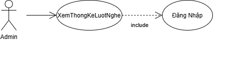

***Hình 3.20: Sơ đồ Use Case — USC10 — Xem Thống Kê Lượt Nghe***

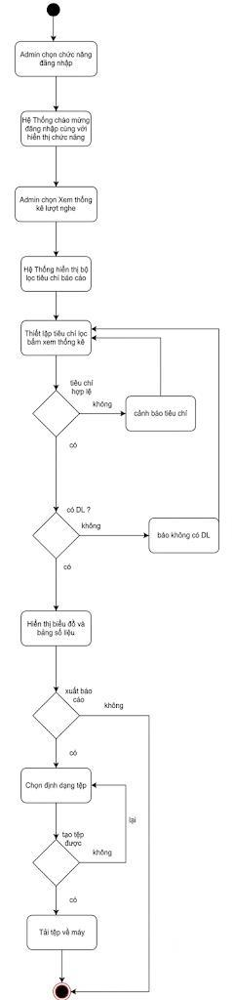

***Hình 3.21: Sơ đồ Hoạt động (Activity Diagram) — USC10 — Xem Thống Kê Lượt Nghe***

### 3.2.11. USC11 — Quản Lý Sơ Đồ

| **Tác nhân (Actor)**             | Admin                                                                                                                                                                                                                                                                                                                                                                                                                                                                                                                                                                                                                                                                                                                                                                                                                                                                                                         |
|----------------------------------|---------------------------------------------------------------------------------------------------------------------------------------------------------------------------------------------------------------------------------------------------------------------------------------------------------------------------------------------------------------------------------------------------------------------------------------------------------------------------------------------------------------------------------------------------------------------------------------------------------------------------------------------------------------------------------------------------------------------------------------------------------------------------------------------------------------------------------------------------------------------------------------------------------------|
| **Mức độ hoàn thiện**            | Focused Use Case                                                                                                                                                                                                                                                                                                                                                                                                                                                                                                                                                                                                                                                                                                                                                                                                                                                                                              |
| **Mô tả tóm tắt**                | Quản lý bản đồ/sơ đồ các tầng, phòng trưng bày của bảo tàng, gồm thêm mới, chỉnh sửa và xóa sơ đồ; gán vị trí tọa độ của các sự vật lên sơ đồ để phục vụ hiển thị định vị cho khách tham quan.                                                                                                                                                                                                                                                                                                                                                                                                                                                                                                                                                                                                                                                                                                                |
| **Điều kiện tiên quyết**         | Admin đã đăng nhập hệ thống (nếu chưa đăng nhập, include {Đăng Nhập}). Các sự vật cần gán vị trí đã tồn tại trong hệ thống. Sự kiện kích hoạt (Trigger): Admin chọn menu "Quản Lý Sơ Đồ".                                                                                                                                                                                                                                                                                                                                                                                                                                                                                                                                                                                                                                                                                                                     |
| **Luồng thay thế (Alternative)** | ● A1 – Thêm sơ đồ mới: Ở bước 3, Admin chọn "Thêm sơ đồ mới" và tải lên ảnh mặt bằng cho tầng/khu vực. Hệ thống kiểm tra định dạng và dung lượng ảnh (E1), sau đó hiển thị giao diện biên tập sơ đồ tương tác. Các bước tiếp theo thực hiện như A2.<br>● A2 – Chỉnh sửa sơ đồ: Ở bước 3, Admin chọn một khu vực và nhấn "Chỉnh sửa". Hệ thống hiển thị giao diện biên tập sơ đồ tương tác. Admin kéo thả các điểm ghim sự vật vào đúng vị trí thực tế trên sơ đồ. Hệ thống ghi nhận tạm tọa độ (X, Y) của từng sự vật. Admin nhấn "Lưu Sơ Đồ". Hệ thống lưu cấu hình tọa độ vào CSDL (E2) và thông báo cập nhật thành công. Use case quay lại bước 3.<br>● A3 – Xóa sơ đồ: Ở bước 3, Admin chọn một sơ đồ và nhấn "Xóa". Hệ thống hiển thị hộp thoại xác nhận. Khi Admin đồng ý, hệ thống xóa sơ đồ cùng tọa độ các sự vật đã gán khỏi CSDL (E2), thông báo thành công, làm mới danh sách và quay lại bước 3. |
| **Luồng ngoại lệ (Exception)**   | ● E1 – Ảnh mặt bằng không hợp lệ: Ở A1, ảnh sai định dạng hoặc vượt quá dung lượng cho phép. Hệ thống từ chối tải lên, thông báo lỗi và yêu cầu chọn lại ảnh.<br>● E2 – Lưu thất bại: Khi lưu hoặc xóa sơ đồ (A1, A2, A3), CSDL lỗi. Hệ thống thông báo lỗi và giữ nguyên dữ liệu đang chỉnh sửa để Admin thử lại. Điều kiện kết thúc: Sơ đồ và tọa độ các sự vật được lưu vào CSDL và hiển thị đúng cho khách tham quan; hoặc sơ đồ được xóa khỏi hệ thống nếu Admin chọn xóa. Sơ đồ hoạt động (Activity Diagram) — USC11                                                                                                                                                                                                                                                                                                                                                                                    |
| **Điều kiện kết thúc**           | Thao tác hoàn tất thành công, dữ liệu được đồng bộ.                                                                                                                                                                                                                                                                                                                                                                                                                                                                                                                                                                                                                                                                                                                                                                                                                                                           |

***Bảng 3.12: Đặc tả yêu cầu chi tiết của USC11 — Quản Lý Sơ Đồ***

***Dòng sự kiện chính (Main Success Scenario) - UC11:***

1. Admin đăng nhập
2. Hệ thống hiển thị lời chào mừng đăng nhập cùng với những chức năng chính cho Admin lựa chọn
3. Admin chọn menu "Quản Lý Sơ Đồ".
4. Hệ thống hiển thị danh sách các tầng/khu vực trưng bày và sơ đồ mặt bằng tương ứng.
5. Admin chọn một thao tác quản lý sơ đồ (A1, A2, A3).
6. Admin thoát khỏi màn hình quản lý. Use case kết thúc.

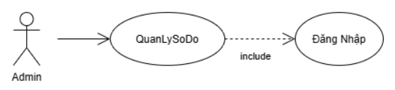

***Hình 3.22: Sơ đồ Use Case — USC11 — Quản Lý Sơ Đồ***

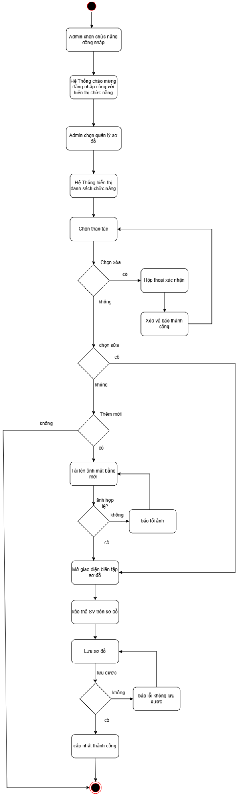

***Hình 3.23: Sơ đồ Hoạt động (Activity Diagram) — USC11 — Quản Lý Sơ Đồ***

### 3.2.12. USC12 — Đọc Nội Dung

| **Tác nhân (Actor)**             | Người Dùng                                                                                                                                                                                                                                                                      |
|----------------------------------|---------------------------------------------------------------------------------------------------------------------------------------------------------------------------------------------------------------------------------------------------------------------------------|
| **Mức độ hoàn thiện**            | Focused Use Case                                                                                                                                                                                                                                                                |
| **Mô tả tóm tắt**                | Cho phép người dùng đọc bản thuyết minh dạng văn bản của hiện vật theo ngôn ngữ đang chọn, dùng thay thế hoặc song song với việc nghe thuyết minh.                                                                                                                              |
| **Điều kiện tiên quyết**         | Đã xác định được hiện vật cần xem (thông qua Quét mã QR hoặc Tìm kiếm) và người dùng đang ở màn hình chi tiết hiện vật.                                                                                                                                                         |
| **Luồng thay thế (Alternative)** | ● A1 - Đổi ngôn ngữ: Tại bước 4, người dùng chọn {Chuyển Đổi Ngôn Ngữ}. Hệ thống tải lại nội dung theo ngôn ngữ mới và hiển thị tiếp.<br>● A2 - Chuyển sang nghe thuyết minh: Tại bước 4, người dùng chọn "Nghe thuyết minh". Hệ thống chuyển sang use case {Nghe Thuyết Minh}. |
| **Luồng ngoại lệ (Exception)**   | ● E1 - Chưa có nội dung ở ngôn ngữ đã chọn: Hệ thống hiển thị nội dung ở ngôn ngữ mặc định (Tiếng Việt) kèm thông báo "Nội dung chưa có bản dịch". <br>● E2 - Lỗi tải nội dung: Hệ thống thông báo "Không tải được nội dung, vui lòng thử lại" và cho phép tải lại.             |
| **Điều kiện kết thúc**           | Nội dung văn bản của hiện vật được hiển thị đầy đủ theo ngôn ngữ người dùng đang chọn.                                                                                                                                                                                          |

***Bảng 3.13: Đặc tả yêu cầu chi tiết của USC12 — Đọc Nội Dung***

***Dòng sự kiện chính (Main Success Scenario) - UC12:***

1. Người dùng chọn "Đọc nội dung" tại màn hình chi tiết hiện vật.
2. Hệ thống xác định ngôn ngữ đang chọn và truy vấn nội dung thuyết minh dạng văn bản của hiện vật trong CSDL (E1, E2).
3. Hệ thống hiển thị nội dung gồm tên hiện vật, mô tả, nguồn gốc, niên đại và các thông tin liên quan.
4. Người dùng cuộn trang để đọc nội dung (A1, A2).
5. Người dùng thoát khỏi màn hình đọc. Use case kết thúc.

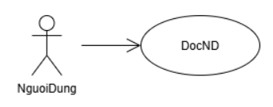

***Hình 3.24: Sơ đồ Use Case — USC12 — Đọc Nội Dung***

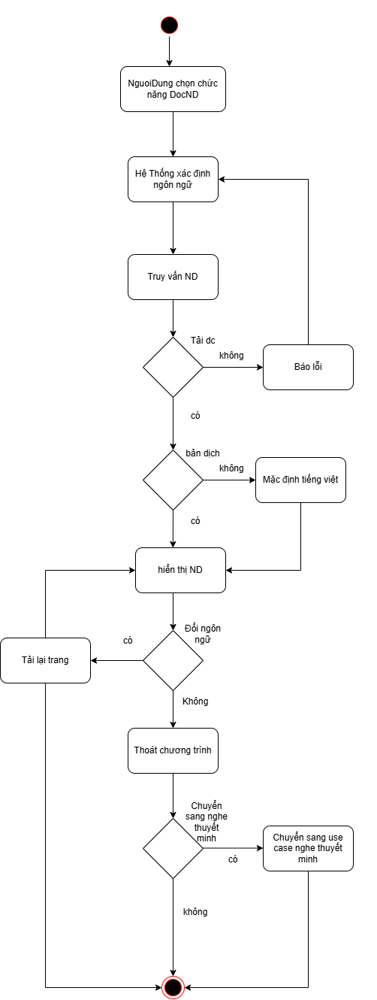

***Hình 3.25: Sơ đồ Hoạt động (Activity Diagram) — USC12 — Đọc Nội Dung***

### 3.2.13. USC13 — Xem Hình Ảnh

| **Tác nhân (Actor)**             | Người Dùng                                                                                                                                                                                                                    |
|----------------------------------|-------------------------------------------------------------------------------------------------------------------------------------------------------------------------------------------------------------------------------|
| **Mức độ hoàn thiện**            | Focused Use Case                                                                                                                                                                                                              |
| **Mô tả tóm tắt**                | Cho phép người dùng xem hình ảnh minh họa của hiện vật, bao gồm xem thư viện ảnh, phóng to/thu nhỏ và lướt qua các ảnh.                                                                                                       |
| **Điều kiện tiên quyết**         | Đã xác định được hiện vật cần xem và người dùng đang ở màn hình chi tiết hiện vật.                                                                                                                                            |
| **Luồng thay thế (Alternative)** | ● A1 - Phóng to/thu nhỏ và lướt ảnh: Tại bước 5, người dùng thao tác phóng to, thu nhỏ hoặc vuốt sang ảnh kế tiếp/trước đó. Hệ thống cập nhật hiển thị tương ứng.                                                             |
| **Luồng ngoại lệ (Exception)**   | ● E1 - Lỗi tải hình ảnh: Hệ thống hiển thị ảnh thay thế (placeholder) kèm nút "Tải lại".<br>● E2 - Hiện vật chưa có hình ảnh: Hệ thống thông báo "Hiện vật chưa có hình ảnh minh họa" và quay lại màn hình chi tiết hiện vật. |
| **Điều kiện kết thúc**           | Hình ảnh của hiện vật được hiển thị cho người dùng xem.                                                                                                                                                                       |

***Bảng 3.14: Đặc tả yêu cầu chi tiết của USC13 — Xem Hình Ảnh***

***Dòng sự kiện chính (Main Success Scenario) - UC13:***

1. Người dùng chọn "Xem hình ảnh" tại màn hình chi tiết hiện vật.
2. Hệ thống truy vấn danh sách hình ảnh gắn với hiện vật trong CSDL (E1, E2).
3. Hệ thống hiển thị ảnh đại diện cùng danh sách ảnh thu nhỏ (thư viện ảnh).
4. Người dùng chọn một ảnh để xem chi tiết (A1).
5. Hệ thống hiển thị ảnh ở chế độ toàn màn hình cùng chú thích ảnh (nếu có).
6. Người dùng đóng chế độ xem. Use case kết thúc.

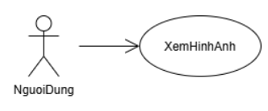

***Hình 3.26: Sơ đồ Use Case — USC13 — Xem Hình Ảnh***

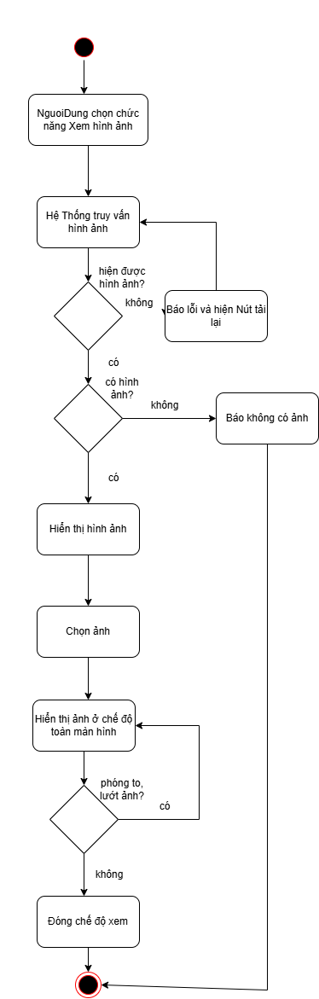

***Hình 3.27: Sơ đồ Hoạt động (Activity Diagram) — USC13 — Xem Hình Ảnh***

### 3.2.14. USC14 — Xem Hồ Sơ Bảo Tàng

| **Tác nhân (Actor)**             | Người Dùng                                                                                                                                                                                             |
|----------------------------------|--------------------------------------------------------------------------------------------------------------------------------------------------------------------------------------------------------|
| **Mức độ hoàn thiện**            | Focused Use Case                                                                                                                                                                                       |
| **Mô tả tóm tắt**                | Cho phép người dùng xem thông tin tổng quan về bảo tàng: giới thiệu, lịch sử hình thành, giờ mở cửa, địa chỉ, thông tin liên hệ và sơ đồ các khu trưng bày.                                            |
| **Điều kiện tiên quyết**         | Người dùng đã mở ứng dụng hoặc truy cập trang web của hệ thống.                                                                                                                                        |
| **Luồng thay thế (Alternative)** | ● A1 - Xem sơ đồ khu trưng bày: Tại bước 4, người dùng chọn "Sơ đồ khu trưng bày". Hệ thống hiển thị sơ đồ do Admin quản lý ở {Quản Lý Sơ Đồ}; người dùng có thể phóng to/thu nhỏ rồi quay lại bước 4. |
| **Luồng ngoại lệ (Exception)**   | ● E1 - Lỗi tải hồ sơ bảo tàng: Hệ thống thông báo "Không tải được thông tin bảo tàng, vui lòng thử lại" và cho phép tải lại.                                                                           |
| **Điều kiện kết thúc**           | Thông tin hồ sơ bảo tàng được hiển thị đầy đủ theo ngôn ngữ người dùng đang chọn.                                                                                                                      |

***Bảng 3.15: Đặc tả yêu cầu chi tiết của USC14 — Xem Hồ Sơ Bảo Tàng***

***Dòng sự kiện chính (Main Success Scenario) - UC14:***

1. Người dùng chọn "Hồ sơ bảo tàng" trên giao diện chính.
2. Hệ thống xác định ngôn ngữ đang chọn và truy vấn hồ sơ bảo tàng trong CSDL (E1).
3. Hệ thống hiển thị thông tin giới thiệu, lịch sử, giờ mở cửa, địa chỉ và thông tin liên hệ của bảo tàng.
4. Người dùng xem thông tin và có thể chọn xem sơ đồ khu trưng bày (A1).
5. Người dùng thoát khỏi màn hình hồ sơ. Use case kết thúc.

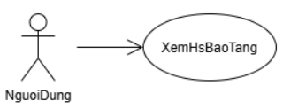

***Hình 3.28: Sơ đồ Use Case — USC14 — Xem Hồ Sơ Bảo Tàng***

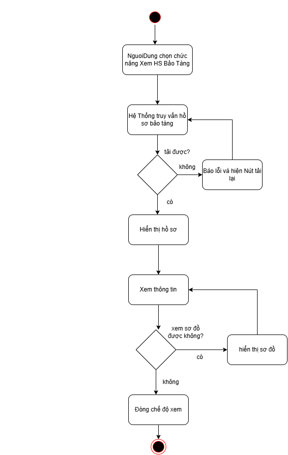

***Hình 3.29: Sơ đồ Hoạt động (Activity Diagram) — USC14 — Xem Hồ Sơ Bảo Tàng***

### 3.2.15. USC15 — Tìm Kiếm

| **Tác nhân (Actor)**             | Người Dùng                                                                                                                                                                                                                         |
|----------------------------------|------------------------------------------------------------------------------------------------------------------------------------------------------------------------------------------------------------------------------------|
| **Mức độ hoàn thiện**            | Focused Use Case                                                                                                                                                                                                                   |
| **Mô tả tóm tắt**                | Cho phép người dùng tìm hiện vật theo tên, mã số hoặc từ khóa trong mô tả. Đây cũng là phương án thay thế khi không quét được mã QR ({Quét Mã QR} - E1, E2).                                                                       |
| **Điều kiện tiên quyết**         | Người dùng đã mở ứng dụng hoặc truy cập trang web của hệ thống.                                                                                                                                                                    |
| **Luồng thay thế (Alternative)** | ● Không có                                                                                                                                                                                                                         |
| **Luồng ngoại lệ (Exception)**   | ● E1 - Từ khóa rỗng: Hệ thống yêu cầu người dùng nhập từ khóa trước khi tìm kiếm. <br>● E2 - Không có kết quả: Hệ thống thông báo "Không tìm thấy hiện vật phù hợp" và gợi ý kiểm tra lại từ khóa hoặc dùng chức năng Quét mã QR.  |
| **Điều kiện kết thúc**           | Người dùng tìm được hiện vật cần xem và được chuyển đến màn hình chi tiết hiện vật; hoặc nhận thông báo không có kết quả phù hợp.                                                                                                  |

***Bảng 3.16: Đặc tả yêu cầu chi tiết của USC15 — Tìm Kiếm***

***Dòng sự kiện chính (Main Success Scenario) - UC15:***

1. Người dùng chọn chức năng "Tìm kiếm".
2. Hệ thống hiển thị ô nhập từ khóa/mã số hiện vật.
3. Người dùng nhập từ khóa hoặc mã số hiện vật và nhấn "Tìm" (A1, E1).
4. Hệ thống tìm kiếm trong CSDL theo tên, mã số và mô tả hiện vật ở ngôn ngữ đang chọn (E2).
5. Hệ thống hiển thị danh sách kết quả phù hợp.
6. Người dùng chọn một hiện vật trong danh sách.
7. Hệ thống chuyển đến màn hình chi tiết hiện vật, từ đó người dùng có thể đọc nội dung, xem hình ảnh hoặc nghe thuyết minh. Use case kết thúc.

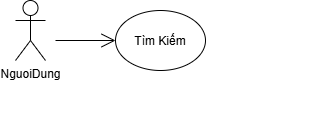

***Hình 3.30: Sơ đồ Use Case — USC15 — Tìm Kiếm***

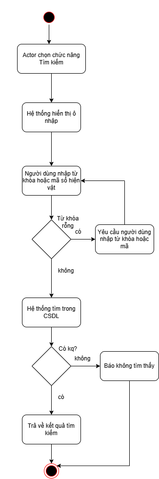

***Hình 3.31: Sơ đồ Hoạt động (Activity Diagram) — USC15 — Tìm Kiếm***

### 3.2.16. USC16 — Đăng Xuất

| **Tác nhân (Actor)**             | Người (gồm Người Dùng và Admin đã đăng nhập)                                                                          |
|----------------------------------|-----------------------------------------------------------------------------------------------------------------------|
| **Mức độ hoàn thiện**            | Focused Use Case                                                                                                      |
| **Mô tả tóm tắt**                | Kết thúc phiên làm việc hiện tại của người dùng hoặc quản trị viên, đưa hệ thống về chế độ khách vãng lai.            |
| **Điều kiện tiên quyết**         | Tác nhân đã đăng nhập thành công và đang có phiên làm việc (Session/Token) hợp lệ.                                    |
| **Luồng thay thế (Alternative)** | ● A1 - Hủy đăng xuất: Tại bước 3, tác nhân nhấn "Hủy". Hệ thống đóng hộp thoại và giữ nguyên phiên làm việc.          |
| **Luồng ngoại lệ (Exception)**   | ● Không có                                                                                                            |
| **Điều kiện kết thúc**           | Phiên làm việc được hủy; tác nhân không còn quyền truy cập các chức năng yêu cầu đăng nhập cho đến khi đăng nhập lại. |

***Bảng 3.17: Đặc tả yêu cầu chi tiết của USC16 — Đăng Xuất***

***Dòng sự kiện chính (Main Success Scenario) - UC16:***

1. Tác nhân chọn chức năng "Đăng xuất".
2. Hệ thống hiển thị hộp thoại xác nhận đăng xuất.
3. Tác nhân nhấn "Đồng ý" (A1).
4. Hệ thống hủy phiên làm việc (Session/Token) và xóa dữ liệu phiên lưu trên thiết bị
5. Hệ thống chuyển về màn hình chính ở chế độ khách vãng lai và thông báo "Đăng xuất thành công". Use case kết thúc.

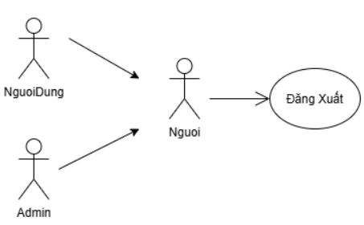

***Hình 3.32: Sơ đồ Use Case — USC16 — Đăng Xuất***

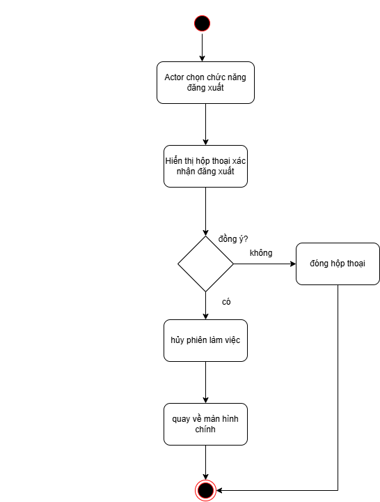

***Hình 3.33: Sơ đồ Hoạt động (Activity Diagram) — USC16 — Đăng Xuất***

### 3.2.17. USC17 — Quên Mật Khẩu

| **Tác nhân (Actor)**             | Người Dùng, Admin                                                                                                                                                                                                                                                                                                                                                                        |
|----------------------------------|------------------------------------------------------------------------------------------------------------------------------------------------------------------------------------------------------------------------------------------------------------------------------------------------------------------------------------------------------------------------------------------|
| **Mức độ hoàn thiện**            | Focused Use Case                                                                                                                                                                                                                                                                                                                                                                         |
| **Mô tả tóm tắt**                | Cho phép tác nhân đặt lại mật khẩu khi không nhớ mật khẩu hiện tại. Là use case mở rộng («extend») của {Đăng Nhập} tại điểm mở rộng "Quên mật khẩu" (UC02 - A2).                                                                                                                                                                                                                         |
| **Điều kiện tiên quyết**         | ● Tác nhân đang ở màn hình {Đăng Nhập}. ● Tác nhân đã có tài khoản với Email/SĐT đăng ký còn hoạt động.                                                                                                                                                                                                                                                                                  |
| **Luồng thay thế (Alternative)** | ● A1 - Hủy đặt lại mật khẩu: Tại bất kỳ bước nào trước bước 10, tác nhân nhấn "Hủy" hoặc quay lại. Hệ thống hủy thao tác, giữ nguyên mật khẩu cũ và quay về màn hình {Đăng Nhập}.                                                                                                                                                                                                        |
| **Luồng ngoại lệ (Exception)**   | ● E1 - Email/SĐT chưa đăng ký: Hệ thống thông báo "Email/SĐT không tồn tại trên hệ thống" và cho phép nhập lại.<br>● E2 - Mã xác nhận sai hoặc hết hạn: Hệ thống thông báo lỗi và cho phép nhập lại hoặc yêu cầu gửi lại mã mới.<br>● E3 - Mật khẩu mới không hợp lệ: Mật khẩu không đủ độ dài an toàn hoặc phần xác nhận không trùng khớp. Hệ thống báo lỗi tại trường sai để nhập lại. |
| **Điều kiện kết thúc**           | Mật khẩu mới được cập nhật; tác nhân có thể đăng nhập bằng mật khẩu mới.                                                                                                                                                                                                                                                                                                                 |

***Bảng 3.18: Đặc tả yêu cầu chi tiết của USC17 — Quên Mật Khẩu***

***Dòng sự kiện chính (Main Success Scenario) - UC17:***

1. Tác nhân chọn "Quên mật khẩu" tại màn hình đăng nhập.
2. Hệ thống hiển thị biểu mẫu nhập Email/SĐT đã đăng ký.
3. Tác nhân nhập Email/SĐT và nhấn "Gửi mã xác nhận" (A1).
4. Hệ thống kiểm tra Email/SĐT có tồn tại trong CSDL (E1).
5. Hệ thống gửi mã xác nhận (OTP) hoặc liên kết đặt lại mật khẩu đến Email/SĐT đó.
6. Tác nhân nhập mã xác nhận nhận được.
7. Hệ thống kiểm tra mã xác nhận còn hiệu lực và đúng (E2).
8. Hệ thống hiển thị biểu mẫu nhập mật khẩu mới và xác nhận mật khẩu mới.
9. Tác nhân nhập mật khẩu mới và nhấn "Xác nhận". **10** . Hệ thống kiểm tra mật khẩu hợp lệ và trùng khớp (E3), mã hóa và cập nhật vào CSDL. **11** . Hệ thống thông báo "Đặt lại mật khẩu thành công" và quay lại màn hình {Đăng Nhập}. Use case kết thúc.

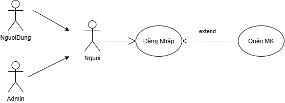

***Hình 3.34: Sơ đồ Use Case — USC17 — Quên Mật Khẩu***

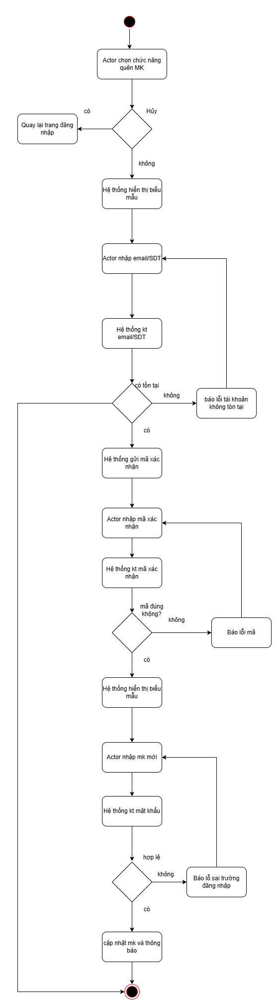

***Hình 3.35: Sơ đồ Hoạt động (Activity Diagram) — USC17 — Quên Mật Khẩu***

### 3.2.18. USC18 — Xem Phụ Đề

| **Tác nhân (Actor)**             | Người Dùng                                                                                                                                                                        |
|----------------------------------|-----------------------------------------------------------------------------------------------------------------------------------------------------------------------------------|
| **Mức độ hoàn thiện**            | Focused Use Case                                                                                                                                                                  |
| **Mô tả tóm tắt**                | Hiển thị phụ đề dạng văn bản đồng bộ với âm thanh thuyết minh đang phát. Là use case mở rộng («extend») của {Nghe Thuyết Minh} tại điểm mở rộng "Xem Phụ Đề" (UC04 - A1).         |
| **Điều kiện tiên quyết**         | Người dùng đang nghe thuyết minh (use case {Nghe Thuyết Minh} đang thực hiện).                                                                                                    |
| **Luồng thay thế (Alternative)** | ● A1 - Đổi ngôn ngữ giữa chừng: Tại bước 4, người dùng chọn {Chuyển Đổi Ngôn Ngữ}. Hệ thống tải phụ đề theo ngôn ngữ mới, đồng bộ theo vị trí phát hiện tại và tiếp tục hiển thị. |
| **Luồng ngoại lệ (Exception)**   | ● E1 - Chưa có phụ đề cho ngôn ngữ đã chọn: Hệ thống thông báo "Chưa có phụ đề cho ngôn ngữ này" và tiếp tục phát âm thanh bình thường, không hiển thị phụ đề.                    |
| **Điều kiện kết thúc**           | Phụ đề được hiển thị đồng bộ với âm thanh cho đến khi người dùng tắt phụ đề hoặc thuyết minh kết thúc.                                                                            |

***Bảng 3.19: Đặc tả yêu cầu chi tiết của USC18 — Xem Phụ Đề***

***Dòng sự kiện chính (Main Success Scenario) - UC18:***

1. Người dùng nhấn nút "Bật phụ đề" trên trình phát.
2. Hệ thống xác định ngôn ngữ đang chọn và truy vấn tệp phụ đề tương ứng với tệp âm thanh đang phát (E1).
3. Hệ thống hiển thị phụ đề đồng bộ theo mốc thời gian của bài thuyết minh.
4. Hệ thống tiếp tục cập nhật phụ đề khi âm thanh phát, tạm dừng hoặc tua (A1).
5. Người dùng nhấn "Tắt phụ đề" hoặc bài thuyết minh kết thúc.
6. Hệ thống ẩn phụ đề và trả điều khiển về {Nghe Thuyết Minh}. Use case kết thúc.

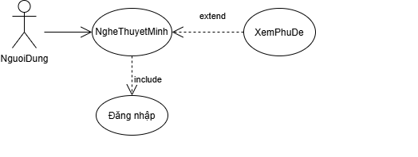

***Hình 3.36: Sơ đồ Use Case — USC18 — Xem Phụ Đề***

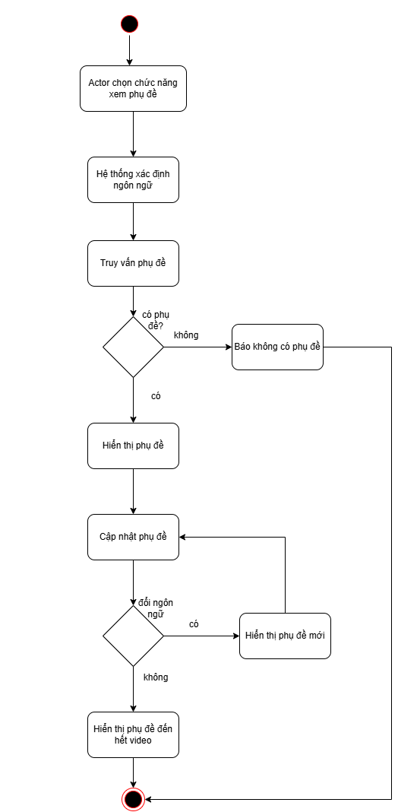

***Hình 3.37: Sơ đồ Hoạt động (Activity Diagram) — USC18 — Xem Phụ Đề***

### 3.2.19. USC19 — Phát Luồng Dữ Liệu Âm Thanh

| **Tác nhân (Actor)**             | Thiết Bị Lưu Âm Thanh                                                                                                                                                                                                                                                                                                                                                                                                                                                                                                                                                                                                |
|----------------------------------|----------------------------------------------------------------------------------------------------------------------------------------------------------------------------------------------------------------------------------------------------------------------------------------------------------------------------------------------------------------------------------------------------------------------------------------------------------------------------------------------------------------------------------------------------------------------------------------------------------------------|
| **Mức độ hoàn thiện**            | Focused Use Case                                                                                                                                                                                                                                                                                                                                                                                                                                                                                                                                                                                                     |
| **Mô tả tóm tắt**                | Truyền luồng dữ liệu âm thanh thuyết minh từ Thiết Bị Lưu Âm Thanh về ứng dụng của người dùng theo thời gian thực. Là use case con bắt buộc của {Nghe Thuyết Minh} («include»).                                                                                                                                                                                                                                                                                                                                                                                                                                      |
| **Điều kiện tiên quyết**         | Hệ thống đã xác định được ID tệp âm thanh và ngôn ngữ tương ứng với hiện vật (UC04, bước 4).                                                                                                                                                                                                                                                                                                                                                                                                                                                                                                                         |
| **Luồng thay thế (Alternative)** | ● A1 - Tua (Seek) hoặc đổi ngôn ngữ: Khi người dùng tua đến vị trí khác hoặc đổi ngôn ngữ (UC04 - A2), {Nghe Thuyết Minh} gửi yêu cầu mới. Thiết Bị Lưu Âm Thanh truyền luồng từ vị trí/tệp mới.                                                                                                                                                                                                                                                                                                                                                                                                                     |
| **Luồng ngoại lệ (Exception)**   | ● E1 - Không tìm thấy tệp âm thanh: Thiết Bị Lưu Âm Thanh trả mã lỗi; {Nghe Thuyết Minh} thông báo cho người dùng và gợi ý đọc bản văn bản ({Đọc Nội Dung}).<br>● E2 - Mất kết nối hoặc ngắt luồng giữa chừng: Hệ thống tự động thử kết nối lại. Nếu vẫn thất bại, thông báo “Không tải được âm thanh thuyết minh, vui lòng kiểm tra kết nối” (UC04 - E1). Điều kiện kết thúc: Dữ liệu âm thanh được truyền liên tục về ứng dụng; luồng được đóng đúng cách khi kết thúc. Sự kiện kích hoạt (Trigger): Use case {Nghe Thuyết Minh} thực hiện bước 5 (quan hệ «include»). Sơ đồ hoạt động (Activity Diagram) — USC19  |
| **Điều kiện kết thúc**           | Thao tác hoàn tất thành công, dữ liệu được đồng bộ.                                                                                                                                                                                                                                                                                                                                                                                                                                                                                                                                                                  |

***Bảng 3.20: Đặc tả yêu cầu chi tiết của USC19 — Phát Luồng Dữ Liệu Âm Thanh***

***Dòng sự kiện chính (Main Success Scenario) - UC19:***

1. Use case {Nghe Thuyết Minh} gửi yêu cầu lấy luồng âm thanh (ID tệp, ngôn ngữ) đến Thiết Bị Lưu Âm Thanh.
2. Thiết Bị Lưu Âm Thanh tiếp nhận và kiểm tra tính hợp lệ của yêu cầu.
3. Thiết Bị Lưu Âm Thanh tìm tệp âm thanh theo ID và ngôn ngữ (E1).
4. Thiết Bị Lưu Âm Thanh mở luồng và truyền dữ liệu âm thanh theo từng đoạn (streaming) về ứng dụng (E2).
5. Ứng dụng nhận dữ liệu, lưu đệm (buffer) và bắt đầu phát (A1).
6. Khi phát hết tệp hoặc người dùng dừng phát, Thiết Bị Lưu Âm Thanh đóng luồng.
7. Hệ thống trả điều khiển về {Nghe Thuyết Minh}. Use case kết thúc.

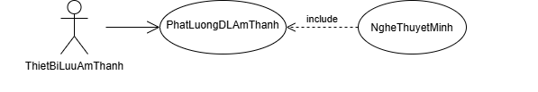

***Hình 3.38: Sơ đồ Use Case — USC19 — Phát Luồng Dữ Liệu Âm Thanh***

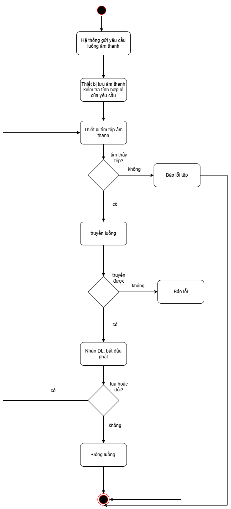

***Hình 3.39: Sơ đồ Hoạt động (Activity Diagram) — USC19 — Phát Luồng Dữ Liệu Âm Thanh***

### 3.2.20. USC20 — Lưu Trữ Tệp Âm Thanh

| **Tác nhân (Actor)**             | Thiết Bị Lưu Âm Thanh                                                                                                                                                                                                                                                                                                                                                                                                                                                                                                                                                                                                                                                                                                                                                                                |
|----------------------------------|------------------------------------------------------------------------------------------------------------------------------------------------------------------------------------------------------------------------------------------------------------------------------------------------------------------------------------------------------------------------------------------------------------------------------------------------------------------------------------------------------------------------------------------------------------------------------------------------------------------------------------------------------------------------------------------------------------------------------------------------------------------------------------------------------|
| **Mức độ hoàn thiện**            | Focused Use Case                                                                                                                                                                                                                                                                                                                                                                                                                                                                                                                                                                                                                                                                                                                                                                                     |
| **Mô tả tóm tắt**                | Lưu trữ tệp âm thanh thuyết minh (kèm thông tin hiện vật, ngôn ngữ) lên Thiết Bị Lưu Âm Thanh để phục vụ việc phát luồng. Use case này gọi use case {Quản Lý Tệp Âm Thanh} («include») để nhận tệp và thông tin do Admin cung cấp.                                                                                                                                                                                                                                                                                                                                                                                                                                                                                                                                                                   |
| **Điều kiện tiên quyết**         | Thiết Bị Lưu Âm Thanh sẵn sàng kết nối; tệp âm thanh và thông tin kèm theo đã được Admin cung cấp qua {Quản Lý Tệp Âm Thanh}.                                                                                                                                                                                                                                                                                                                                                                                                                                                                                                                                                                                                                                                                        |
| **Luồng thay thế (Alternative)** | ● A1 - Thay thế tệp đã có: Tại bước 3, nếu đã tồn tại tệp cùng hiện vật và ngôn ngữ, hệ thống thông báo tệp đã có và gửi tệp mới đến Thiết Bị Lưu Âm Thanh. Tệp cũ chỉ bị thay thế sau khi tệp mới được lưu xong. Dòng sự kiện tiếp tục từ bước 4.                                                                                                                                                                                                                                                                                                                                                                                                                                                                                                                                                   |
| **Luồng ngoại lệ (Exception)**   | ● E1 - Tệp không hợp lệ: Tệp sai định dạng âm thanh hoặc vượt dung lượng cho phép. Hệ thống thông báo lỗi và không lưu tệp.<br>● E2 - Thiết bị không đủ dung lượng: Thiết Bị Lưu Âm Thanh trả mã lỗi; hệ thống thông báo “Không đủ dung lượng lưu trữ” và không lưu tệp.<br>● E3 - Ghi tệp thất bại hoặc mất kết nối: Hệ thống tự động thử lại. Nếu vẫn thất bại, hệ thống xóa phần tệp ghi dở và thông báo “Lưu tệp thất bại, vui lòng thử lại”. Điều kiện kết thúc: Tệp âm thanh được lưu đầy đủ trên Thiết Bị Lưu Âm Thanh và thông tin tệp được cập nhật trong CSDL; nếu thất bại thì không giữ lại tệp ghi dở. Sự kiện kích hoạt (Trigger): Hệ thống cần lưu một tệp âm thanh thuyết minh mới hoặc tệp được cập nhật (khi Admin thêm hoặc thay tệp). Sơ đồ hoạt động (Activity Diagram) — UC20  |
| **Điều kiện kết thúc**           | Thao tác hoàn tất thành công, dữ liệu được đồng bộ.                                                                                                                                                                                                                                                                                                                                                                                                                                                                                                                                                                                                                                                                                                                                                  |

***Bảng 3.21: Đặc tả yêu cầu chi tiết của USC20 — Lưu Trữ Tệp Âm Thanh***

***Dòng sự kiện chính (Main Success Scenario) - UC20:***

1. Hệ thống gọi use case {Quản Lý Tệp Âm Thanh} («include») để nhận tệp âm thanh thuyết minh và thông tin kèm theo (hiện vật, ngôn ngữ) do Admin cung cấp.
2. Hệ thống kiểm tra tệp: đúng định dạng âm thanh và trong dung lượng cho phép (E1).
3. Hệ thống kiểm tra đã có tệp cùng hiện vật và ngôn ngữ chưa (A1), tạo ID tệp và gửi yêu cầu lưu kèm dữ liệu đến Thiết Bị Lưu Âm Thanh.
4. Thiết Bị Lưu Âm Thanh tiếp nhận yêu cầu và kiểm tra dung lượng trống (E2).
5. Thiết Bị Lưu Âm Thanh ghi tệp lên bộ nhớ và kiểm tra tính toàn vẹn của tệp (E3).
6. Thiết Bị Lưu Âm Thanh trả kết quả lưu thành công kèm ID và đường dẫn tệp.
7. Hệ thống cập nhật thông tin tệp (ID, hiện vật, ngôn ngữ, đường dẫn) vào CSDL và thông báo “Lưu tệp âm thanh thành công”. Use case kết thúc.

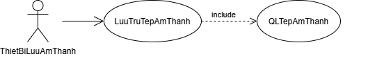

***Hình 3.40: Sơ đồ Use Case — USC20 — Lưu Trữ Tệp Âm Thanh***

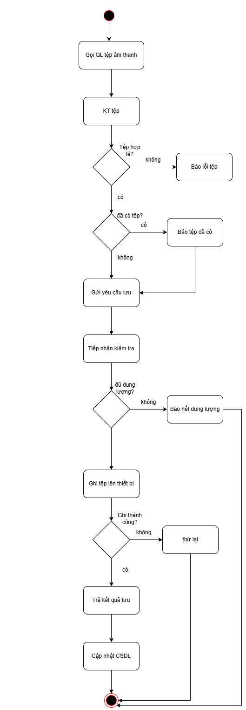

***Hình 3.41: Sơ đồ Hoạt động (Activity Diagram) — USC20 — Lưu Trữ Tệp Âm Thanh***

# CHƯƠNG 4: HIỆN THỰC GIAO DIỆN & KỸ THUẬT FRONT-END

## 4.1. Cấu trúc Tổ chức Mã nguồn Front-end (Source Tree)

Mã nguồn tầng giao diện được xây dựng theo kiến trúc module hóa hướng dịch vụ (Service-Oriented Architecture for Client), phân tách rõ ràng giữa các thành phần giao diện (Components) và lớp logic nghiệp vụ (Services):

```text
Do_an_CNPM/
├── index.html # Điểm khởi nhập HTML Single-Page Application (SPA)
├── package.json # Cấu hình dự án React 18, TypeScript, Tailwind CSS, Vite
├── vite.config.ts # Thiết lập pipeline build tối ưu hóa và đường dẫn alias
├── public/ # Thư mục tài nguyên tĩnh phân phối qua Web CDN
│ ├── audio/ # 15 tệp âm thanh thuyết minh MP3 thời lượng thực tế
│ ├── images/ # Sơ đồ bản đồ 4 khu vực (ngoài trời, trệt, lầu 1, lầu 2)
│ └── mock/museum_data.json # Dữ liệu hiện vật chuẩn có tọa độ GPS & bán kính kích hoạt
└── src/
├── visitor/ # Phân hệ giao diện khách tham quan
│ ├── VisitorLayout.tsx # Bộ điều hướng chung, kích hoạt QR & GPS tracking
│ ├── components/ # TrackingPanel, AudioPlayerBar, SubtitleOverlay
│ └── views/ # FloorMapView (halo định vị), ExploreView, ArtifactDetailView
├── admin/ # Phân hệ giao diện quản trị viên
│ ├── AdminLayout.tsx # Khung điều hướng Dashboard quản trị
│ └── views/ # AdminLoginView (khóa 5 lần), ArtifactsManageView, SessionsManageView
├── shared/ # Lớp dịch vụ, tiện ích và kho trạng thái dùng chung
│ ├── utils/ # geofence.ts (Haversine & Proximity), qrHelper.ts, loginLock.ts
│ ├── stores/ # geofenceStore, playerStore, langStore, favoritesStore
│ ├── services/ # api.ts (mock DB + LocalStorage), tts.ts, audioService.ts
│ └── types/ # Định nghĩa kiểu dữ liệu TypeScript (Artifact, Floor, Session)
├── locales/i18n.ts # Từ điển phản ứng 5 ngôn ngữ (vi, en, zh, ko, ja)
└── __tests__/ # Bộ kiểm thử tự động (21 tests: geofence, qr, login, audio)
```

## 4.2. Bảng Ánh xạ giữa Sơ đồ Thiết kế và Mã nguồn Thực tế

Mỗi khối thành phần trong sơ đồ Component Diagram và Deploy Diagram đều được hiện thực chính xác bởi các module mã nguồn tương ứng:

| **Sơ đồ gốc**     | **Thành phần thiết kế**      | **File mã nguồn Front-end**              | **Vai trò kỹ thuật**                                                             |
|-------------------|------------------------------|------------------------------------------|----------------------------------------------------------------------------------|
| Component Diagram | Phân hệ Khách tham quan      | VisitorLayout.tsx & TrackingPanel.tsx    | Điều phối luồng ứng dụng, quét QR deep link và kích hoạt GPS tracking            |
| Component Diagram | Bản đồ tương tác & Định vị   | FloorMapView.tsx & geofence.ts           | Hiển thị sơ đồ 4 tầng, mốc halo "Bạn đang ở đây" và tính khoảng cách Haversine   |
| Component Diagram | Bộ phát âm thanh & Phụ đề    | AudioPlayerBar.tsx & playerStore.ts      | Phát Web Audio HTML5, đồng bộ phụ đề Karaoke từng giây                           |
| Component Diagram | Tra cứu & Tìm kiếm hiện vật  | ExploreView.tsx & ArtifactDetailView.tsx | Tìm kiếm đa tiêu chí theo tên, mã số (ART-xxx) và tóm tắt hiện vật               |
| Component Diagram | Quản trị & Bảo mật đăng nhập | AdminLoginView.tsx & loginLock.ts        | Xác thực Admin, chống Brute-force tự động khóa 5 phút khi sai 5 lần              |
| Component Diagram | Quản trị Hiện vật & Tọa độ   | ArtifactsManageView.tsx & api.ts         | CRUD hiện vật, cấu hình tọa độ GPS (geoCoordinates) & bán kính kích hoạt         |
| Component Diagram | Quản trị Phiên & Xuất mã QR  | SessionsManageView.tsx                   | Quản lý ca mở cửa, đoàn khách và tạo mã QR đón tiếp tại cổng                     |
| Deploy Diagram    | Nút Thiết bị Khách / Admin   | Trình duyệt Web (Web APIs)               | Thực thi SPA, khai thác Camera API, Geolocation API, Web Audio API, LocalStorage |
| Deploy Diagram    | Hạ tầng Lưu trữ & Phân phối  | GitHub Pages CDN                         | Nginx CDN phân phối gói tĩnh HTML/CSS/JS, MP3 audio và hình ảnh sơ đồ            |
| Deploy Diagram    | Hạ tầng Giám sát Telemetry   | ntfy.sh Gateway                          | Thu thập sự kiện thống kê lượt nghe và phiên tham quan qua HTTPS POST            |

***Bảng 4.1: Bảng đối chiếu Kiến trúc Thiết kế và File Mã nguồn***

## 4.3. Các Tính năng Nổi bật Đã Hiện thực Hoàn chỉnh

- Cơ chế Đa ngôn ngữ Phản ứng (i18n): Hỗ trợ trọn vẹn 5 ngôn ngữ quốc tế: Tiếng Việt, Tiếng Anh (English), Tiếng Trung (中文), Tiếng Hàn (한국어), Tiếng Nhật (日本語). Chuyển đổi ngôn ngữ tức thời không cần tải lại trang với cơ chế đồng bộ phụ đề và thuyết minh tương ứng.
- **Media Player Streaming Chuyên nghiệp:** Trình phát âm thanh nổi (Sticky Audio Player) luôn ghim đáy màn hình; điều khiển Play/Pause, tua tiến độ, tăng giảm tốc độ đọc (0.75x, 1.0x, 1.25x, 1.5x) và phụ đề song ngữ tự động trôi theo mốc thời gian.
- Định vị Thông minh kết hợp QR & GPS (Hybrid Geofencing Tracking): Quét mã QR tại cổng hoặc hiện vật làm mốc neo xuất phát (anchorArtifactId), tự động kích hoạt GPS độ chính xác cao (enableHighAccuracy). Hệ thống tính toán khoảng cách Haversine thực tế tới các hiện vật, tự động nhận diện hiện vật trong bán kính 12m, hiển thị pin halo xanh "Bạn đang ở đây" trên bản đồ tầng và đưa ra gợi ý chuyển bài thuyết minh mượt mà khi di chuyển.
- Hệ thống Bảo mật Xác thực & Chống Brute-Force: Bảo mật tài khoản Quản trị bằng cơ chế mã hóa mật khẩu, tự động đếm số lần đăng nhập sai và kích hoạt khóa tạm thời 5 phút khi sai quá 5 lần liên tiếp (kèm đồng hồ đếm ngược). Khách tham quan được tối ưu hóa trải nghiệm tối đa, lưu trữ hiện vật yêu thích trực tiếp qua LocalStorage mà không cần tạo tài khoản.
- Bảng điều khiển Quản trị Toàn diện (Admin Panel): Cho phép Quản trị viên thêm, sửa, xóa hiện vật trực tiếp; cấu hình tọa độ GPS địa lý (vĩ độ, kinh độ) và bán kính kích hoạt (triggerRadius); quản lý các ca mở cửa/phiên tham quan; tự động xuất mã QR cổng đón tiếp và mã QR hiện vật; theo dõi biểu đồ thống kê lượt nghe theo phiên và ngôn ngữ trực quan.

# CHƯƠNG 5: QUY TRÌNH CI/CD & KIỂM THỬ PHẦN MỀM

## 5.1. Thiết lập Quy trình CI/CD với GitHub Actions

Quy trình Tích hợp và Triển khai Liên tục (Continuous Integration / Continuous Deployment) là yêu cầu kỹ thuật then chốt của đề tài, đảm bảo chất lượng mã nguồn và tự động hóa toàn bộ quy trình phát hành.

- **1. Giai đoạn Tích hợp Liên tục (CI):** Mỗi khi lập trình viên tạo Pull Request hoặc đẩy mã nguồn lên nhánh chính (main/master), GitHub Actions sẽ tự động kích hoạt workflow kiểm tra cú pháp (Syntax Linting), kiểm tra định dạng ES6 Modules và phát hiện các liên kết tài nguyên hỏng.
- **2. Giai đoạn Tự động Kiểm thử (Automated Testing):** Hệ thống tự động chạy các kịch bản kiểm thử đơn vị (Unit Tests) cho các Service lõi như ClientSession (xác thực token), I18nService (từ điển đa ngôn ngữ) và MockDatabase (toàn vẹn dữ liệu CRUD).
- **3. Giai đoạn Triển khai Liên tục (CD):** Khi toàn bộ bài kiểm thử vượt qua, quy trình tiến hành đóng gói (Bundle/Minify) và tự động xuất bản lên môi trường lưu trữ (GitHub Pages / Vercel / Docker Registry), giúp khách hàng và giảng viên có thể trải nghiệm ngay phiên bản mới nhất.

## 5.2. Kế hoạch Kiểm thử & Kết quả Thực nghiệm

Toàn bộ 20 Use Cases đã được tiến hành kiểm thử chức năng (Functional Testing) và kiểm thử giao diện (UI/UX Testing) với kết quả đạt 100% tiêu chí đề ra:

| **Mã kiểm thử** | **Use Case kiểm tra**                          | **Kịch bản thực hiện**                                                 | **Kết quả thực tế**                                        |
|-----------------|------------------------------------------------|------------------------------------------------------------------------|------------------------------------------------------------|
| TC_01           | USC01 - Đăng Nhập & Khóa bảo mật               | Nhập sai mật khẩu 5 lần liên tiếp -\> Kích hoạt khóa 5 phút            | Khóa đúng 5 phút, đếm ngược chính xác (PASS) - 4 tests     |
| TC_02           | USC02 & USC14 - Quét mã QR & Deep Link         | Giải mã QR URL: ?entry=gate, ?artifact=ART-001, mã trực tiếp           | Nhận diện đúng mốc neo xuất phát (PASS) - 5 tests          |
| TC_03           | USC14 - Định vị GPS Haversine & Vùng kích hoạt | Tính khoảng cách Haversine, kích hoạt vùng 12m, chọn hiện vật gần nhất | Tính toán sai số \< 0.1m, phát hiện chuẩn (PASS) - 7 tests |
| TC_04           | USC03 & USC07 - Trình phát Audio & Phụ đề      | Phát MP3 audio, tua tiến độ, đồng bộ phụ đề Karaoke từng giây          | Âm thanh chuẩn, phụ đề khớp mốc thời gian (PASS) - 4 tests |
| TC_05           | USC08 - Tìm Kiếm & Tương tác giao diện         | Tìm kiếm đa tiêu chí theo tên, mã số ART-xxx, mô tả tóm tắt            | Lọc kết quả tức thời, click phát không lỗi (PASS) - 1 test |
| TC_06           | USC04 - Chuyển đổi 5 Ngôn ngữ                  | Chuyển đổi giữa 5 thứ tiếng (vi, en, zh, ko, ja)                       | Toàn bộ giao diện và dữ liệu đổi ngay lập tức (PASS)       |
| TC_07           | USC09 & USC10 - Quản lý Hiện vật, Tọa độ & QR  | Thêm/sửa hiện vật, đổi bán kính 12m, xuất mã QR ca tham quan           | Lưu trữ CSDL chuẩn, sinh mã QR hợp lệ (PASS)               |

***Bảng 5.1: Bảng tổng hợp Kết quả Kiểm thử Chức năng Thực nghiệm***

# CHƯƠNG 6: KẾT LUẬN & HƯỚNG PHÁT TRIỂN

## 6.1. Những Kết quả Đạt được của Đồ án

Trải qua quá trình nghiên cứu lý thuyết, phân tích hệ thống và lập trình thực nghiệm, đề tài đã hoàn thành xuất sắc tất cả các mục tiêu đề ra ban đầu:

- **1. Về tài liệu học thuật:** Hoàn thiện bộ hồ sơ thiết kế kỹ thuật phần mềm (PDR) đồ sộ, chuẩn mực, bao gồm đầy đủ Sơ đồ thành phần (Component Diagram), Sơ đồ triển khai (Deployment Diagram), Mô hình dữ liệu (ERD) và 20 Use Cases đặc tả sâu kèm sơ đồ hoạt động (Activity Diagrams).
- **2. Về sản phẩm phần mềm:** Xây dựng thành công ứng dụng Single-Page Application (SPA) chuyên nghiệp, giao diện Dark Mode sang trọng, tải cực nhanh, tương thích hoàn hảo trên cả máy tính lẫn thiết bị di động mà không cần cài đặt ứng dụng từ App Store.
- **3. Về tính năng nghiệp vụ:** Hiện thực hóa trọn vẹn 20 ca sử dụng, từ các chức năng cho khách tham quan (quét QR, nghe audio streaming, xem phụ đề, chuyển đổi 5 ngôn ngữ, lưu yêu thích) đến các nghiệp vụ quản trị phức tạp (CRUD hiện vật, cấu hình QR, thống kê lượt nghe).
- **4. Về kỹ năng kỹ nghệ:** Tích hợp hoàn chỉnh tư duy kỹ thuật hiện đại: Kiến trúc module hóa sạch, quản lý mã nguồn Git chuyên nghiệp và định hướng tích hợp liên tục CI/CD.

## 6.2. Hạn chế và Khó khăn Tồn tại

Bên cạnh những kết quả nổi bật, đồ án vẫn còn một số điểm có thể cải thiện:

- **Mở rộng máy chủ thực tế:** Hệ thống hiện đang sử dụng MockDatabase để giả lập tầng backend cho phiên bản chạy độc lập. Để đưa vào sử dụng thực tế tại một bảo tàng quy mô lớn, cần tích hợp API trực tiếp với hệ quản trị cơ sở dữ liệu phân tán (PostgreSQL / MongoDB).
- **Cơ chế Offline Caching:** Trong điều kiện bảo tàng có sóng 4G/Wifi yếu hoặc tầng hầm, cần bổ sung cơ chế Service Worker và Cache API (Progressive Web Apps - PWA) để khách tham quan có thể tải trước gói âm thanh và trải nghiệm offline hoàn toàn.

## 6.3. Hướng Phát triển trong Tương lai

Trong các giai đoạn nghiên cứu tiếp theo, hệ thống có thể được nâng cấp với các hướng đi đột phá sau:

- **1. Tích hợp AI Thuyết minh:** Ứng dụng Trí tuệ Nhân tạo (AI Text-to-Speech) để tự động chuyển đổi văn bản thuyết minh sang giọng đọc truyền cảm đa ngôn ngữ mà không cần tốn chi phí thu âm phòng thu.
- **2. Định vị tự động qua Beacon:** Sử dụng công nghệ định vị trong nhà (Indoor Positioning) bằng Bluetooth Low Energy (BLE Beacons) hoặc Ultra-Wideband (UWB) để khi du khách bước đến trước hiện vật nào, hệ thống sẽ tự động phát thuyết minh mà không cần quét QR.
- **3. Trải nghiệm AR 3D:** Ứng dụng Thực tế ảo tăng cường (Augmented Reality - AR) để tái hiện không gian lịch sử 3D sống động của cổ vật ngay trên màn hình điện thoại.

# TÀI LIỆU THAM KHẢO

- **\[1\]** Trường Đại học Sài Gòn, Giáo trình môn học Công nghệ Phần mềm, Khoa Công nghệ Thông tin, 2024.
- **\[2\]** Trường Đại học Sài Gòn, Đề cương chi tiết học phần và Quy định thực hiện Đồ án Công nghệ Phần mềm, 2025.
- **\[3\]** Ian Sommerville, Software Engineering (10th Edition), Pearson, 2016.
- **\[4\]** Roger S. Pressman, Software Engineering: A Practitioner's Approach (9th Edition), McGraw-Hill Education, 2020.
- **\[5\]** Martin Fowler, UML Distilled: A Brief Guide to the Standard Object Modeling Language (3rd Edition), Addison-Wesley Professional, 2003.
- **\[6\]** Mozilla Developer Network (MDN), JavaScript Modules & Web Audio API Documentation, https://developer.mozilla.org/, 2026.
- **\[7\]** Tailwind CSS Documentation, Modern Utility-First CSS Framework, https://tailwindcss.com/docs, 2026.
- **\[8\]** HTML5 QR Code Scanner Library Documentation, https://github.com/mebjas/html5-qrcode, 2025.

