**ỦY BAN NHÂN DÂN THÀNH PHỐ HỒ CHÍ MINH  
TRƯỜNG ĐẠI HỌC SÀI GÒN  
KHOA CÔNG NGHỆ THÔNG TIN  
---------------------------------**

**BÁO CÁO ĐỒ ÁN MÔN HỌC  
CÔNG NGHỆ PHẦN MỀM**

*ĐỀ TÀI:*  
**HỆ THỐNG THUYẾT MINH TỰ ĐỘNG ĐA NGÔN NGỮ  
(MUSEUM MULTILINGUAL SMART AUDIO GUIDE)**  
*Chuyên đề: Thiết kế kiến trúc UML 2.5, phân tích 14 Use Case, hiện thực front-end SPA, streaming audio, quét mã QR, định vị Geofencing và thiết lập CI/CD*

> **Giảng viên hướng dẫn:** TS. Nguyễn Quốc Huy  
> **Bộ môn:** Công nghệ phần mềm  
> **Sinh viên thực hiện:**
> - Nguyễn Trí Cường
> - Nguyễn Hoài Quân
> - Đặng Phú Thành
>
> **Ngành:** Công nghệ thông tin (CLC)  
> **Niên khoá:** 2022 – 2026  

**THÀNH PHỐ HỒ CHÍ MINH, NĂM 2026**

---

# LỜI CẢM ƠN

Trong suốt quá trình học tập, nghiên cứu và hoàn thành đồ án môn học Công nghệ phần mềm tại Trường Đại học Sài Gòn, chúng tôi đã nhận được sự quan tâm, chỉ dẫn tận tình và động viên quý báu từ quý thầy cô cùng các anh chị khóa trước của khoa Công nghệ thông tin.

Chúng tôi xin trân trọng gửi lời cảm ơn sâu sắc nhất đến TS. Nguyễn Quốc Huy - giảng viên trực tiếp hướng dẫn đồ án. Nhờ những nhận xét chuyên môn xác đáng, định hướng kỹ thuật giàu kinh nghiệm cùng những buổi góp ý, chỉnh sửa tỉ mỉ giúp tinh gọn danh mục ca sử dụng từ 20 Use Case ban đầu xuống 14 Use Case trọng tâm, chúng tôi đã hoàn thiện đồ án một cách bài bản từ khâu phân tích, thiết kế kiến trúc cho đến hiện thực mã nguồn.

Dù đã nỗ lực hết mình trong việc tra cứu tài liệu, thiết kế hệ thống và hoàn thiện sản phẩm, song do giới hạn về thời gian và trải nghiệm thực tế, đồ án khó tránh khỏi những thiếu sót nhất định. Chúng tôi rất mong nhận được những ý kiến đóng góp, chỉ bảo quý báu từ thầy để đề tài ngày càng hoàn thiện hơn, hướng tới khả năng ứng dụng thực tế tại các bảo tàng và di tích lịch sử.

**Trân trọng cảm ơn!**  
*Sinh viên thực hiện: Nguyễn Trí Cường, Nguyễn Hoài Quân, Đặng Phú Thành*

---

# TỔNG QUAN TÓM TẮT ĐỒ ÁN

| **Thông số** | **Mô tả chi tiết** |
|:---|:---|
| **Tên đề tài:** | Hệ thống thuyết minh tự động đa ngôn ngữ (Museum Multilingual Smart Audio Guide) |
| **Chuyên đề thực hiện:** | Kỹ nghệ Phần mềm & Front-end Engineering (React.js SPA / React Native Mobile) kết hợp Backend Dịch vụ, Streaming Audio, Hybrid Geofencing (QR + GPS) và Tự động hóa CI/CD |
| **Quy mô phân tích:** | Xây dựng trọn vẹn hồ sơ thiết kế theo chuẩn UML 2.5.1: Sơ đồ Thành phần (Component Diagram), Sơ đồ Triển khai (Deployment Diagram), Mô hình Quan hệ Thực thể (ERD 12 bảng) và 14 Use Cases đặc tả sâu kèm Sơ đồ Hoạt động (Activity diagrams) |
| **Công nghệ ứng dụng:** | React 18, TypeScript, Vite, Tailwind CSS, Zustand State Management, HTML5 Web Audio API, HTML5 Geolocation API, HTML5 Camera Scanner API, Express / Node.js API, MSSQL Server / LocalStorage, Docker, GitHub Actions |
| **Đơn vị đào tạo:** | Khoa Công nghệ thông tin – Trường Đại học Sài Gòn (SGU) |
| **Năm thực hiện:** | 2026 |

***Bảng 1.1: Thông số kỹ thuật tổng quan của đồ án***

---

# CHƯƠNG 1: GIỚI THIỆU TỔNG QUAN ĐỀ TÀI

## 1.1. Bối cảnh và tính cấp thiết của đề tài

Trong bối cảnh đẩy mạnh chuyển đổi số và phát triển du lịch thông minh (Smart Tourism), các bảo tàng, khu di tích lịch sử và trung tâm triển lãm văn hóa tại Việt Nam đang đứng trước yêu cầu đổi mới phương thức truyền tải thông tin, nhằm nâng cao trải nghiệm tham quan của du khách trong và ngoài nước.

Trước đây, các bảo tàng thường áp dụng một trong hai hình thức thuyết minh phổ biến:
1. **Thuyết minh viên trực tiếp:** Dễ quá tải vào các mùa cao điểm; đồng thời gặp khó khăn lớn do thiếu hụt đội ngũ thuyết minh viên thông thạo các ngoại ngữ như tiếng Anh, tiếng Trung, tiếng Hàn hay tiếng Nhật.
2. **Cho thuê thiết bị thuyết minh cầm tay chuyên dụng (Audio Guide):** Đòi hỏi chi phí đầu tư ban đầu và bảo dưỡng phần cứng đáng kể; thường xuyên đối mặt với nguy cơ hỏng hóc, rơi vỡ hoặc thất thoát thiết bị; bên cạnh sự bất tiện cho nhân viên khi phải sạc pin và vệ sinh thiết bị sau mỗi lượt sử dụng.

Xuất phát từ thực trạng trên, đề tài **"Hệ thống thuyết minh tự động đa ngôn ngữ cho bảo tàng"** được nghiên cứu và phát triển nhằm đem lại giải pháp công nghệ tiện lợi trên nền tảng Web SPA hiện đại:
- **Tiếp cận nhanh chóng, thuận tiện:** Du khách không cần cài đặt ứng dụng từ kho phần mềm (App Store/Google Play), cũng không phải qua các bước tạo tài khoản rườm rà. Chỉ với thao tác quét mã QR tại cổng hoặc ngay trên hiện vật bằng điện thoại cá nhân là có thể mở ứng dụng ngay lập tức.
- **Định vị kết hợp (Hybrid Geofencing):** Du khách chỉ cần quét mã QR một lần tại điểm xuất phát làm mốc ban đầu; sau đó hệ thống sẽ tự động theo dõi tọa độ di chuyển, nhận biết khi du khách tiến vào vùng kích hoạt của hiện vật tiếp theo để chủ động phát thuyết minh tương ứng.
- **Trải nghiệm đa phương tiện đồng bộ:** Cung cấp bài thuyết minh âm thanh rõ nét bằng 5 ngôn ngữ (tiếng Việt, tiếng Anh, tiếng Trung, tiếng Hàn, tiếng Nhật), kết hợp hiển thị phụ đề chạy chữ (karaoke) bám sát từng mốc thời gian giọng đọc cùng hình ảnh trực quan minh họa cho hiện vật.

## 1.2. Mục tiêu nghiên cứu và phạm vi đề tài

### 1.2.1. Mục tiêu nghiên cứu
- **Về mặt kỹ nghệ phần mềm:** Vận dụng chặt chẽ quy trình phân tích và thiết kế hướng đối tượng (OOAD) theo đặc tả UML 2.5.1; hoàn thiện kiến trúc thành phần (Component), kiến trúc triển khai vật lý (Deployment), mô hình dữ liệu (ERD) và danh mục 14 Use Case trọng tâm sau quá trình góp ý, phản biện từ giảng viên hướng dẫn.
- **Về mặt phát triển hệ thống:** Xây dựng ứng dụng Web Single-Page Application (SPA) tối ưu tốc độ tải trang dưới 1 giây, vận hành mượt mà trên trình duyệt di động; tích hợp bộ phát âm thanh (Web Audio Player), trình quét mã QR qua camera và công nghệ định vị theo công thức Haversine.
- **Về mặt quản trị và vận hành:** Cung cấp giao diện quản trị (Dashboard) trực quan giúp ban quản lý bảo tàng theo dõi hiện vật, sơ đồ khu vực, tệp âm thanh đa ngữ, thiết lập các ca mở cửa/phiên tham quan và thống kê lượt nghe chi tiết.
- **Về mặt tự động hóa quy trình:** Thiết lập đường ống CI/CD tự động qua GitHub Actions nhằm tự động chạy kiểm thử, kiểm tra chất lượng mã nguồn (linting) và phát hành bản dựng liên tục, ổn định.

### 1.2.2. Phạm vi đề tài (14 Use Case trọng tâm)
Sau khi tiếp thu ý kiến đóng góp từ giảng viên hướng dẫn, phạm vi đề tài được tinh gọn từ 20 Use Case ban đầu xuống còn **14 Use Case trọng tâm**, lược bỏ các thủ tục rườm rà đối với khách vãng lai (không bắt buộc đăng ký/đăng nhập, không lưu mật khẩu), tập trung tối đa vào trải nghiệm nghe nhìn và tính năng định vị tự động:
- **Nhóm khách tham quan (7 ca sử dụng nghiệp vụ + 1 ca sử dụng định vị):** UC02 (Quét mã QR), UC03 (Nghe thuyết minh), UC04 (Chuyển đổi ngôn ngữ), UC05 (Lưu hiện vật yêu thích), UC06 (Xem hồ sơ bảo tàng), UC07 (Xem phụ đề), UC08 (Tìm kiếm) và UC14 (Định vị vị trí & tự động thuyết minh).
- **Nhóm quản trị viên (6 ca sử dụng nghiệp vụ + 1 ca sử dụng xác thực):** UC01 (Đăng nhập quản trị - cơ chế khóa tạm thời), UC09 (Quản lý hiện vật), UC10 (Quản lý phiên tham quan & mã QR), UC11 (Quản lý tệp âm thanh), UC12 (Xem thống kê lượt nghe), UC13 (Quản lý sơ đồ).

## 1.3. Phương pháp nghiên cứu và công nghệ sử dụng

Đề tài áp dụng mô hình phát triển phần mềm lặp và tăng trưởng (Iterative & Incremental), kết hợp chặt chẽ giữa lý thuyết mô hình hóa UML 2.5 với các công nghệ phát triển web hiện đại:
- **Mô hình hóa hệ thống:** Tuân thủ chuẩn UML 2.5.1 của tổ chức OMG (Object Management Group). Sử dụng PlantUML và ActScript (ngôn ngữ mô tả sơ đồ hoạt động trực quan) đi kèm bộ kiểm tra cú pháp (linter) tự động.
- **Kiến trúc front-end SPA:** Xây dựng trên nền tảng React 18, TypeScript, Vite Bundler, đem lại khả năng kiểm soát kiểu dữ liệu chặt chẽ và tốc độ đóng gói nhanh chóng.
- **Quản lý trạng thái và dịch vụ:** Sử dụng Zustand cho các kho trạng thái riêng biệt (`playerStore`, `geofenceStore`, `langStore`, `favStore`, `adminAuthStore`). Tích hợp thư viện quét mã `html5-qrcode` cùng Web Audio API của trình duyệt.
- **Thiết kế giao diện:** Tailwind CSS với phong cách tông tối hiện đại (Dark Mode), vừa tạo cảm giác trang nhã, vừa dịu mắt khi sử dụng trong không gian bảo tàng.
- **Phân hệ máy chủ và cơ sở dữ liệu:** Hệ thống cung cấp hai phương án triển khai linh hoạt: (1) Bản phân phối tĩnh qua GitHub Pages kết hợp dữ liệu mẫu (mock data) và kênh thông báo ntfy.sh; (2) Bản đầy đủ Client-Server với Express/TypeScript và Microsoft SQL Server (MSSQL).
- **Tự động hóa CI/CD:** GitHub Actions tự động thực thi 21 kịch bản kiểm thử (Unit test & Component test), rà soát chất lượng mã nguồn trước khi tự động đóng gói và triển khai.

---

# CHƯƠNG 2: KIẾN TRÚC TỔNG THỂ & THIẾT KẾ HỆ THỐNG

## 2.1. Sơ đồ thành phần (Component diagram)

Sơ đồ thành phần mô tả cấu trúc phân rã của hệ thống thành 3 phân tầng kiến trúc tách biệt hoàn toàn (3 Bên), có tính đóng gói cao, giao tiếp với nhau thông qua các cổng giao tiếp chuẩn hóa (Ports) và giao diện được định nghĩa rõ ràng (Provided Interfaces hình quả bóng `()` và Required Interfaces hình ổ cắm `..(`) theo đặc tả UML 2.5:

1. **Bên 1: Phân tầng ứng dụng Client (Client Applications - Frontend SPA / PWA):**
   - **Phân hệ khách tham quan (Visitor Subsystem):** Bao gồm `UI Shell & Router` (điều hướng giao diện), `QR Scanner` (module camera quét mã QR hiện vật và cổng), `Audio Player & Subtitle Sync` (trình phát Web Audio ghim đáy màn hình kèm phụ đề chạy chữ karaoke), `Geofence Engine` (module định vị GPS độ chính xác cao và giải thuật Haversine), `Interactive Floor Map` (sơ đồ tầng tương tác với halo "Bạn đang ở đây"), và `Artifact Explorer & Localizer` (khám phá danh mục, tìm kiếm và chuyển đổi 5 ngôn ngữ).
   - **Phân hệ quản trị (Admin CMS Subsystem):** Bao gồm `Admin Auth Guard` (cổng xác thực bảo vệ chống brute-force khóa 5 phút), `Artifact & Coordinate Editor` (CRUD hiện vật, kéo thả gán tọa độ X,Y và tọa độ GPS), `Audio & Subtitle Manager` (quản lý tệp MP3 và mốc phụ đề đa ngữ), `Session & QR Generator` (tạo ca tham quan đoàn và sinh mã QR tự động), và `Analytics Dashboard` (báo cáo biểu đồ Recharts và xuất tệp CSV).
   - **Tương tác nội bộ Client:** `QR Scanner` sau khi giải mã mã QR sẽ lập tức truyền định danh hiện vật đến `Artifact Explorer` để nạp dữ liệu, kích hoạt `Audio Player` phát bài thuyết minh và gửi mốc neo ban đầu đến `Geofence Engine`. `Geofence Engine` lấy dữ liệu tọa độ từ `Artifact Explorer`, tính toán khoảng cách theo giải thuật Haversine; khi du khách bước vào bán kính kích hoạt (<= 15m), engine sẽ chủ động điều khiển `Audio Player` phát hoặc gợi ý chuyển bài, cập nhật vị trí "Bạn đang ở đây" lên `Floor Map`, đồng thời kết nối qua cổng `ClientPortStorage` để lưu điểm mốc neo.
   - **Cổng giao tiếp Client (Client Ports):** Xuất các cổng `ClientPortAuth`, `ClientPortMuseum`, `ClientPortAudio`, `ClientPortAnalytics` và `ClientPortStorage` kết nối đến các giao diện dịch vụ qua socket `..(`.

2. **Bên 2: Phân tầng máy chủ dịch vụ (Application Server Tier - Node.js Express API):**
   - Đóng vai trò cung cấp dịch vụ máy chủ thông qua các cổng tiếp nhận `ServerPortAuth`, `ServerPortMuseum`, `ServerPortAudio`, `ServerPortAnalytics` và cung cấp (Provided Interfaces) các giao diện: `I_Auth` (xác thực JWT), `I_Museum_Catalog` (REST/JSON dữ liệu bảo tàng), `I_Audio_Stream` (HTTP Range streaming âm thanh), `I_Analytics` (ghi nhận sự kiện nghe và ca làm việc), `I_Translate` (dịch tự động).
   - Các dịch vụ nghiệp vụ cốt lõi bên trong:
     - `Auth & Security Service`: Quản lý phiên làm việc, băm mật khẩu bcrypt và giới hạn tần suất gọi API (Rate Limiting).
     - `Museum & Artifact Service`: Quản lý kho hiện vật, sơ đồ tầng và xử lý tải lên tệp tin qua Multer.
     - `Audio Streamer & Subtitle Service`: Phục vụ luồng phát âm thanh và mốc phụ đề WebVTT đồng bộ.
     - `Analytics & Session Tracker`: Theo dõi nhịp tim thiết bị (Heartbeat), phiên tham quan và lịch sử lượt nghe.
     - `Auto-Translation Service`: Kết nối dịch vụ dịch tự động đa ngữ.
   - Xuất các cổng `ServerPortDb` và `ServerPortStorage` kết nối đến tầng lưu trữ dữ liệu.

3. **Bên 3: Phân tầng lưu trữ và cơ sở dữ liệu (Storage & Persistence Tier):**
   - Đóng gói toàn bộ các kho dữ liệu của hệ thống, tiếp nhận kết nối qua các cổng `StoragePortDb`, `StoragePortStorage` và `StoragePortClientStore`, cung cấp các giao diện `I_Database` (kết nối Microsoft SQL Server Pool qua giao thức TDS), `I_File_Storage` (gắn kết thư mục lưu trữ đĩa) và `I_Client_Storage` (truy xuất Web Storage API):
     - `System Database Server`: Hệ quản trị cơ sở dữ liệu quan hệ Microsoft SQL Server gồm 12 bảng chuẩn hóa 3NF.
     - `Media Storage Server`: Kho lưu trữ tệp tin đĩa cứng (`/uploads`) chứa tệp âm thanh thuyết minh MP3 và tệp ảnh sơ đồ/hiện vật.
     - `Browser LocalStorage`: Hệ thống lưu trữ cục bộ phía trình duyệt, quản lý mốc neo vị trí GPS và danh sách hiện vật yêu thích của khách tham quan.

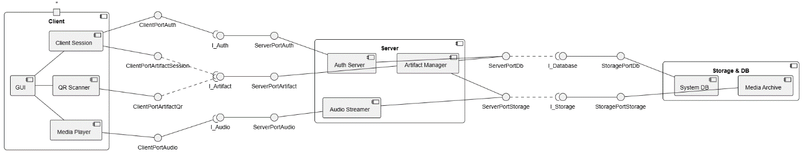

***Hình 2.1: Sơ đồ thành phần của hệ thống (Component diagram v2)***

## 2.2. Sơ đồ triển khai (Deployment diagram)

Sơ đồ triển khai mô hình hóa cấu trúc triển khai vật lý thực tế của hệ thống, tuân thủ chặt chẽ quy chuẩn phân cấp UML 2.5: Thiết bị phần cứng (`<<device>>`) ➔ Môi trường thực thi phần mềm (`<<execution environment>>`) ➔ Tệp tạo tác phần mềm (`<<artifact>>`) và Cơ sở dữ liệu (`<<database system>>`), cùng các đường truyền vật lý ghi rõ giao thức và cổng mạng:

1. **Nút thiết bị khách tham quan (Visitor Phone / Tablet):**
   - Nút phần cứng `<<device>>` là điện thoại thông minh của du khách.
   - Môi trường thực thi `<<execution environment>>`: Trình duyệt di động `Mobile Web Browser Runtime` (Safari trên iOS, Chrome trên Android).
   - Tệp tạo tác `<<artifact>>`: Gói phân phối ứng dụng web `VisitorApp.spa` (HTML5, JS, CSS) tích hợp các Web APIs tiêu chuẩn (Geolocation API, Camera Scanner API, Web Audio API).
   - Vùng lưu trữ `<<database system>>`: `LocalStorage & SessionStorage` lưu điểm mốc xuất phát và hiện vật yêu thích.

2. **Nút máy tính quản trị viên (Admin PC / Workstation):**
   - Nút phần cứng `<<device>>` là máy tính để bàn hoặc laptop của nhân viên quản trị.
   - Môi trường thực thi `<<execution environment>>`: Trình duyệt máy tính `Desktop Web Browser` (Google Chrome, Microsoft Edge, Mozilla Firefox).
   - Tệp tạo tác `<<artifact>>`: Gói giao diện quản trị `AdminCMS.spa` và `SessionStorage` lưu JWT token.

3. **Nút máy chủ ứng dụng (Application Server - Docker Host):**
   - Nút máy chủ vật lý/máy chủ ảo `<<device>>` (Linux hoặc Windows Server).
   - Môi trường thực thi `<<execution environment>>`: `Docker Engine Runtime`, vận hành theo cấu hình `docker-compose.yml` gồm 2 container:
     - **Frontend Container (`<<Nginx Web Server>>`):** Lắng nghe tại cổng `80/8080`, phân phối các tệp tĩnh đóng gói (`Static Web Assets`) và đóng vai trò Reverse Proxy chuyển tiếp các yêu cầu API đến Backend.
     - **Backend Container (`<<Node.js 20 Runtime>>`):** Lắng nghe tại cổng `4000`, thực thi tệp máy chủ `backend.dist.js` (Express + TypeScript REST API) cùng middleware xử lý tệp tải lên `Multer`.

4. **Nút máy chủ cơ sở dữ liệu (Database Server):**
   - Nút phần cứng `<<device>>` độc lập hoặc cài đặt trên máy chủ nội bộ bảo tàng.
   - Môi trường thực thi `<<execution environment>>`: `Microsoft SQL Server 2019/2022 Engine` (lắng nghe tại cổng chuẩn `1433`).
   - Lưu trữ `<<database system>>`: Cơ sở dữ liệu quan hệ `MuseumGuide DB` gồm 12 bảng chuẩn hóa 3NF.

5. **Nút lưu trữ tệp đa phương tiện (Media Storage Volume):**
   - Nút phần cứng `<<device>>` hoặc phân vùng lưu trữ đĩa gắn kết (Mounted Volume `/app/uploads`).
   - Môi trường thực thi `<<execution environment>>`: `Persistent File System` lưu trữ kho tệp âm thanh `/uploads/audio/*.mp3` và kho ảnh sơ đồ/hiện vật.

6. **Hạ tầng tự động hóa CI/CD & Phân phối tĩnh toàn cầu:**
   - `GitHub Actions Cloud Runner` (`<<device>>` máy ảo Ubuntu 22.04 LTS): Vận hành môi trường `Node.js 20 CI Runtime` để tự động hóa linting (ESLint), chạy 22 unit tests (Vitest) và đóng gói bản dựng.
   - `GitHub Pages Edge CDN` (`<<device>>`): Mạng lưới máy chủ biên phục vụ phân phối tĩnh bản demo PWA toàn cầu qua giao thức HTTPS.

7. **Các tuyến truyền thông vật lý (Communication Paths):**
   - `VisitorPhone` & `AdminPC` ➔ `Nginx Container`: Giao thức an toàn `HTTPS / TLS` (Cổng 443 / 8080).
   - `Nginx Container` ➔ `Backend Container`: Giao thức nội bộ `Reverse Proxy / HTTP` (Cổng 4000).
   - `Backend Container` ➔ `Database Server`: Giao thức cơ sở dữ liệu `TDS Protocol / TCP` (Cổng 1433).
   - `Backend Container` ➔ `Media Storage Volume`: Giao tiếp nhập xuất đĩa `Local Disk I/O` qua cơ chế Volume Mount.

## 2.3. Mô hình dữ liệu quan hệ (ERD)

Mô hình dữ liệu của hệ thống được chuẩn hóa theo dạng chuẩn 3 (3NF), phản ánh trọn vẹn các mối quan hệ nghiệp vụ giữa người dùng, hiện vật, bản dịch đa ngôn ngữ, tệp âm thanh và thống kê tương tác. Mô hình bao gồm **11 thực thể trọng tâm**:

1. **`NGUOI_DUNG` (Người dùng / Tài khoản quản trị):** Quản lý thông tin đăng nhập và quyền hạn.
   - `user_id` [PK, int]: Mã định danh người dùng.
   - `email` [string]: Địa chỉ email đăng nhập (duy nhất).
   - `mat_khau_hash` [string]: Chuỗi băm mật khẩu bảo mật (bcrypt/argon2).
   - `ho_ten` [string]: Họ tên người dùng.
   - `vai_tro` [string]: Phân quyền (`ADMIN`, `STAFF`, `USER`).
   - `ngon_ngu_mac_dinh` [string]: Ngôn ngữ ưa thích (`vi`, `en`, `zh`, `ko`, `ja`).
   - `trang_thai_khoa` [boolean]: Cờ đánh dấu tài khoản có đang bị khóa hay không.
2. **`NGON_NGU` (Danh mục Ngôn ngữ hỗ trợ):**
   - `ma_ngon_ngu` [PK, string]: Mã chuẩn ISO 639-1 (`vi`, `en`, `zh`, `ko`, `ja`).
   - `ten_ngon_ngu` [string]: Tên hiển thị bản địa (Tiếng Việt, English, 中文, 한국어, 日本語).
   - `kich_hoat` [boolean]: Trạng thái bật/tắt ngôn ngữ trong hệ thống.
3. **`SO_DO_KHU_VUC` (Sơ đồ Mặt bằng Tầng / Khu vực):**
   - `khu_vuc_id` [PK, int]: Mã định danh tầng hoặc khu trưng bày.
   - `ten_khu_vuc` [string]: Tên khu vực (Khu ngoài trời, Tầng trệt, Lầu 1, Lầu 2).
   - `so_tang` [int]: Thứ tự tầng phục vụ hiển thị.
   - `anh_so_do_url` [string]: Đường dẫn tệp ảnh bản đồ mặt bằng.
4. **`HIEN_VAT` (Hiện vật Trưng bày):**
   - `hien_vat_id` [PK, int]: Mã định danh hiện vật trong cơ sở dữ liệu.
   - `ma_dinh_danh` [string]: Mã hiện vật chuẩn hóa phục vụ tra cứu (ví dụ: `ART-001`, `ART-002`).
   - `ten_hien_vat` [string]: Tên gọi chính thức của hiện vật.
   - `khu_vuc_id` [FK, int]: Khóa ngoại liên kết tới `SO_DO_KHU_VUC`.
   - `toa_do_x` [float]: Tọa độ tương đối trục hoành trên ảnh sơ đồ (0.0 – 1.0).
   - `toa_do_y` [float]: Tọa độ tương đối trục tung trên ảnh sơ đồ (0.0 – 1.0).
   - *Thuộc tính mở rộng trong thực tế:* `vi_do` (latitude), `kinh_do` (longitude), `ban_kinh_kich_hoat` (trigger_radius - mặc định 12 mét).
5. **`MA_QR` (Mã QR Định danh Hiện vật):**
   - `qr_id` [PK, int]: Mã định danh bản ghi QR.
   - `hien_vat_id` [FK, int]: Khóa ngoại liên kết 1-1 với hiện vật.
   - `duong_dan_qr` [string]: Chuỗi liên kết định tuyến deep link (ví dụ: `?artifact=ART-001`).
   - `anh_qr_url` [string]: Đường dẫn tệp ảnh mã QR động để in ấn/xuất bản.
6. **`NOI_DUNG_DA_NGON_NGU` (Bản dịch Thông tin Hiện vật):**
   - `noi_dung_id` [PK, int]: Mã định danh bản dịch.
   - `hien_vat_id` [FK, int]: Khóa ngoại liên kết tới hiện vật.
   - `ma_ngon_ngu` [FK, string]: Khóa ngoại liên kết tới `NGON_NGU`.
   - `tieu_de` [string]: Tiêu đề hiện vật theo ngôn ngữ tương ứng.
   - `van_ban_thuyet_minh` [text]: Toàn văn bài giới thiệu và thuyết minh chi tiết.
7. **`HINH_ANH` (Kho Ảnh Tư liệu Hiện vật):**
   - `hinh_anh_id` [PK, int]: Mã định danh ảnh.
   - `hien_vat_id` [FK, int]: Khóa ngoại liên kết tới hiện vật.
   - `duong_dan_anh` [string]: Đường dẫn tệp ảnh chất lượng cao.
   - `thu_tu_hien_thi` [int]: Thứ tự trình diễn trong thư viện ảnh (gallery).
8. **`TEP_AM_THANH` (Tệp Thuyết minh Âm thanh):**
   - `tep_am_thanh_id` [PK, int]: Mã định danh tệp audio.
   - `hien_vat_id` [FK, int]: Khóa ngoại liên kết tới hiện vật.
   - `ma_ngon_ngu` [FK, string]: Khóa ngoại liên kết tới ngôn ngữ phát âm thanh.
   - `duong_dan_tep` [string]: Đường dẫn tệp âm thanh (MP3, WAV, AAC).
   - `thoi_luong_giay` [int]: Tổng thời lượng phát thanh tính bằng giây.
9. **`PHU_DE` (Tệp Phụ đề Đồng bộ Âm thanh):**
   - `phu_de_id` [PK, int]: Mã định danh phụ đề.
   - `tep_am_thanh_id` [FK, int]: Khóa ngoại liên kết tới tệp âm thanh.
   - `duong_dan_vtt` [string]: Đường dẫn tệp phụ đề định dạng WebVTT hoặc cấu trúc JSON các đoạn mốc thời gian (cues) để chạy chữ karaoke.
10. **`LUU_YEU_THICH` (Hiện vật Yêu thích):**
    - `user_id` [PK, FK, int]: Mã người dùng (đối với người dùng có tài khoản hoặc mã định danh phiên).
    - `hien_vat_id` [PK, FK, int]: Mã hiện vật được lưu.
    - `ngay_luu` [datetime]: Thời điểm lưu hiện vật.
    *(Trên môi trường khách vãng lai, bảng này được ánh xạ bền vững trực tiếp vào LocalStorage `museum_fav_ids`)*.
11. **`THONG_KE_LUOT_NGHE` (Nhật ký Sự kiện Nghe thuyết minh):**
    - `thong_ke_id` [PK, int]: Mã định danh bản ghi thống kê.
    - `hien_vat_id` [FK, int]: Mã hiện vật được nghe.
    - `tep_am_thanh_id` [FK, int]: Mã tệp âm thanh được phát.
    - `user_id` [FK, int, nullable]: Mã người dùng (cho phép để trống `NULL` đối với khách tham quan vãng lai).
    - `thoi_gian_nghe` [datetime]: Thời điểm bắt đầu nghe thuyết minh.
    - `thoi_luong_da_nghe_giay` [int]: Số giây thực tế khách đã nghe trước khi tạm dừng hoặc chuyển bài.

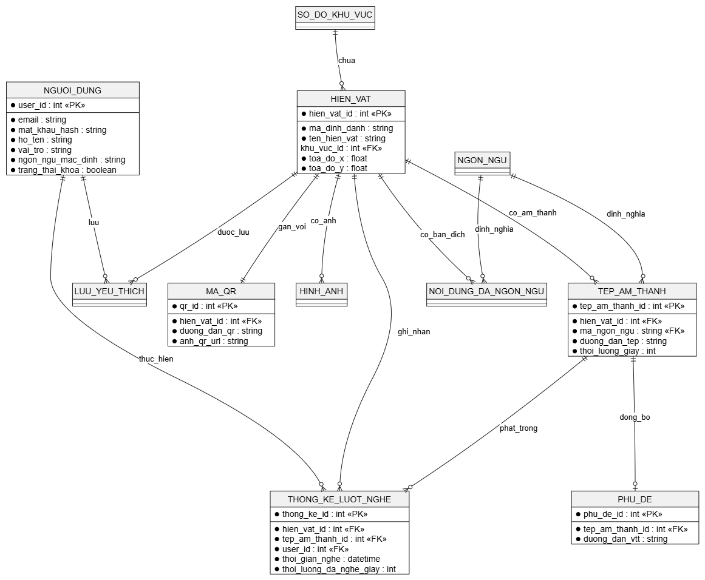

***Hình 2.3: Mô hình quan hệ thực thể cơ sở dữ liệu (ERD)***

---

# CHƯƠNG 3: ĐẶC TẢ CHI TIẾT 14 USE CASE CỦA HỆ THỐNG

## 3.1. Sơ đồ Use Case tổng quát và phân loại tác nhân

Hệ thống Thuyết minh Tự động Đa ngôn ngữ được thiết kế xoay quanh 4 tác nhân chính tham gia vào quy trình nghiệp vụ:

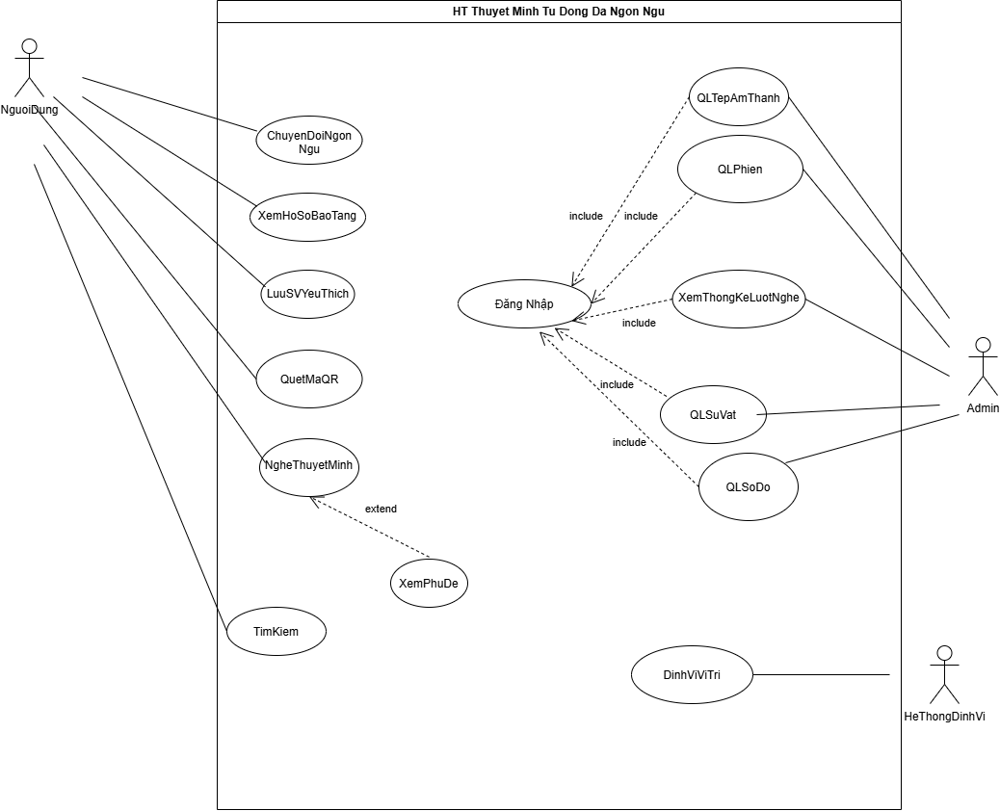

***Hình 3.1: Sơ đồ Use Case tổng quát (14 ca sử dụng)***

| **Tác nhân (Actor)** | **Phân loại** | **Mô tả vai trò & quyền hạn** |
|:---|:---|:---|
| **Người (Khách tham quan / Khách vãng lai)** | Tác nhân con người (Human Actor) | Người dùng phổ thông truy cập ứng dụng bằng liên kết web hoặc quét mã QR. Được quyền tra cứu, quét mã, nghe thuyết minh, xem phụ đề, chuyển đổi ngôn ngữ, xem hồ sơ bảo tàng và lưu hiện vật yêu thích mà **không bắt buộc đăng ký tài khoản**. |
| **Admin (Quản trị viên)** | Tác nhân con người (Human Actor) | Nhân sự phụ trách quản trị bảo tàng. Sau khi đăng nhập xác thực, có toàn quyền quản lý kho hiện vật, bản dịch, sơ đồ khu vực, phiên tham quan, tệp âm thanh và theo dõi thống kê lượt nghe. |
| **Thiết bị / Dịch vụ lưu âm thanh (Audio Storage Server)** | Tác nhân hệ thống / Phần cứng (System / Device Actor) | Máy chủ hoặc dịch vụ CDN lưu trữ các tệp âm thanh nhị phân (MP3) và cung cấp luồng phát dữ liệu âm thanh (Streaming) phản hồi cho trình duyệt. |
| **Hệ thống định vị (Positioning System / Device Sensor)** | Tác nhân phần cứng / Cảm biến (Sensor Actor) | Cảm biến GPS tích hợp trên thiết bị di động của khách tham quan và API Geolocation của trình duyệt, cung cấp dữ liệu tọa độ định kỳ phục vụ tính toán khoảng cách tự động. |

***Bảng 3.1: Danh mục tác nhân trong hệ thống***

---

## 3.2. Đặc tả chi tiết từng Use Case

### 3.2.1. UC01 — Đăng nhập

***Sơ đồ Use Case — UC01***


***Bảng đặc tả Use Case — UC01:***

| **Mục đặc tả** | **Nội dung chi tiết** |
|:---|:---|
| **Tác nhân (Actor)** | Admin (Quản trị viên) |
| **Mức độ hoàn thiện** | Focused Use Case |
| **Mô tả tóm tắt** | Xác thực danh tính của Quản trị viên bằng tài khoản và mật khẩu được cấp trước để phân quyền truy cập vào phân hệ Dashboard quản trị. Tích hợp cơ chế bảo mật tự động khóa tạm thời nếu nhập sai nhiều lần liên tiếp. |
| **Điều kiện tiên quyết** | Quản trị viên chưa đăng nhập hoặc phiên làm việc trước đó đã hết hạn. |
| **Sự kiện kích hoạt (Trigger)** | Quản trị viên chọn chức năng "Đăng Nhập" tại đường dẫn `/admin`. |
| **Điều kiện kết thúc** | - **Thành công:** Phiên làm việc (Session Token) được khởi tạo thành công, hệ thống chuyển hướng vào giao diện Admin Dashboard.<br>- **Thất bại:** Hệ thống từ chối truy cập, hiển thị thông báo lỗi và không tạo phiên làm việc. |

***Dòng sự kiện chính (Main success scenario) — UC01:***

| Bước | Hành động của tác nhân | Phản hồi của hệ thống |
|:---:|:---|:---|
| 1 | Admin truy cập đường dẫn quản trị và chọn "Đăng Nhập". | |
| 2 | | Hệ thống hiển thị biểu mẫu đăng nhập (Email và Mật khẩu). |
| 3 | Admin nhập thông tin xác thực và nhấn "Đăng nhập". | |
| 4 | | Hệ thống kiểm tra thông tin đăng nhập trong cơ sở dữ liệu (E1, E2). |
| 5 | | Hệ thống khởi tạo phiên làm việc (Session/JWT Token) và lưu vào bộ nhớ an toàn. |
| 6 | | Hệ thống chuyển hướng Admin vào màn hình Dashboard quản trị. Use Case kết thúc thành công. |

***Luồng thay thế (Alternative flows):*** Không có.

***Luồng ngoại lệ (Exception flows):***
- **E1 – Sai thông tin đăng nhập:** Nếu email hoặc mật khẩu không chính xác, hệ thống hiển thị thông báo "Email hoặc mật khẩu không chính xác", ghi nhận số lần thử sai và cho phép nhập lại.
- **E2 – Kích hoạt cơ chế khóa bảo vệ (Lockout Brute-Force):** Nếu Admin nhập sai mật khẩu quá 5 lần liên tiếp, hệ thống tự động khóa tạm thời tính năng đăng nhập trong vòng 5 phút, hiển thị đồng hồ đếm ngược và từ chối mọi yêu cầu đăng nhập trong khoảng thời gian này.

***Sơ đồ hoạt động (Activity diagram) — UC01:***

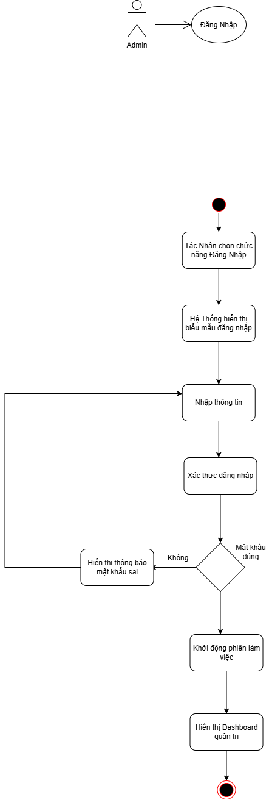

---

### 3.2.2. UC02 — Quét mã QR

***Sơ đồ Use Case — UC02***

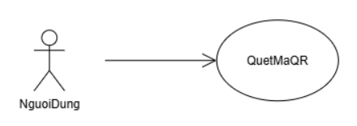

***Bảng đặc tả Use Case — UC02:***

| **Mục đặc tả** | **Nội dung chi tiết** |
|:---|:---|
| **Tác nhân (Actor)** | Người (Khách tham quan) |
| **Mức độ hoàn thiện** | Focused Use Case |
| **Mô tả tóm tắt** | Khách tham quan sử dụng camera thiết bị di động quét mã QR gắn tại cổng đón tiếp hoặc trên bảng thông tin hiện vật để hệ thống nhận diện tức thì, mở nội dung hiện vật tương ứng và ghi nhận điểm mốc neo xuất phát (anchor point) phục vụ tự động tracking sau đó. |
| **Điều kiện tiên quyết** | - Thiết bị di động của khách có camera hoạt động bình thường.<br>- Khách tham quan đã cấp quyền truy cập Camera cho trình duyệt web. |
| **Sự kiện kích hoạt (Trigger)** | Khách tham quan bấm vào biểu tượng "Quét QR" trên thanh điều hướng hoặc màn hình chính. |
| **Điều kiện kết thúc** | - **Thành công:** Hệ thống giải mã thành công mã QR, hiển thị màn hình chi tiết hiện vật và kích hoạt chế độ tracking nền.<br>- **Thất bại:** Hiển thị thông báo lỗi (camera hỏng, mã mờ, từ chối quyền) và gợi ý chuyển sang tìm kiếm thủ công. |

***Dòng sự kiện chính (Main success scenario) — UC02:***

| Bước | Hành động của tác nhân | Phản hồi của hệ thống |
|:---:|:---|:---|
| 1 | Khách tham quan chọn tính năng "Quét Mã QR". | |
| 2 | | Hệ thống kích hoạt camera và hiển thị khung quét nhận diện mã QR (E2). |
| 3 | Khách hướng camera về phía mã QR gắn trên hiện vật hoặc cổng bảo tàng. | |
| 4 | | Hệ thống quét khung hình, nhận diện và giải mã chuỗi định danh QR (E1). |
| 5 | | Hệ thống truy vấn thông tin hiện vật theo mã ID vừa giải mã từ cơ sở dữ liệu. |
| 6 | | Hệ thống lưu vị trí hiện vật làm điểm neo xuất phát (`anchorArtifactId`) và bật chế độ theo dõi vị trí tự động. |
| 7 | | Hệ thống mở màn hình chi tiết hiện vật (tiêu đề, hình ảnh, văn bản giới thiệu) và sẵn sàng kích hoạt {Nghe thuyết minh}. Use Case kết thúc thành công. |

***Luồng thay thế (Alternative flows):***
- **A1 – Quét thủ công hiện vật khác:** Trong quá trình tham quan, khách có thể chủ động bấm quét mã QR của hiện vật bất kỳ để chuyển thẳng tới hiện vật đó mà không cần chờ định vị tự động. Hệ thống thực hiện lại từ bước 3 đến bước 7 và cập nhật lại điểm neo xuất phát.

***Luồng ngoại lệ (Exception flows):***
- **E1 – Không thể nhận dạng / Mã QR bị hỏng:** Khung quét không đọc được chuỗi dữ liệu. Hệ thống thông báo "Không nhận dạng được mã QR, vui lòng điều chỉnh khoảng cách hoặc ánh sáng" và cung cấp nút chuyển nhanh sang chức năng {Tìm kiếm} để khách nhập trực tiếp mã số hiện vật (ví dụ: `ART-001`).
- **E2 – Chưa cấp quyền Camera hoặc thiết bị không có camera:** Trình duyệt thông báo lỗi quyền truy cập. Hệ thống hướng dẫn khách bật quyền trong phần cài đặt hoặc sử dụng chức năng {Tìm kiếm}.

***Sơ đồ hoạt động (Activity diagram) — UC02:***

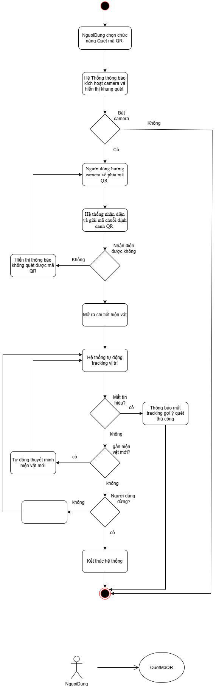

---

### 3.2.3. UC03 — Nghe thuyết minh

***Sơ đồ Use Case — UC03***

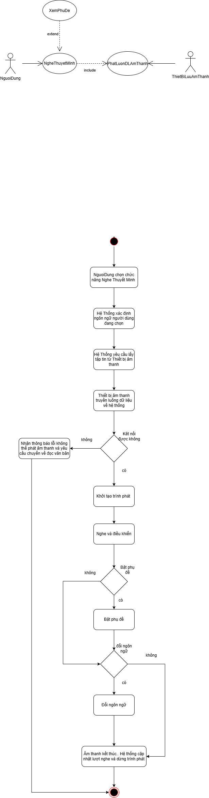

***Bảng đặc tả Use Case — UC03:***

| **Mục đặc tả** | **Nội dung chi tiết** |
|:---|:---|
| **Tác nhân (Actor)** | Người (Khách tham quan), Thiết bị / Dịch vụ lưu âm thanh |
| **Mức độ hoàn thiện** | Focused Use Case |
| **Mô tả tóm tắt** | Phát bản thu âm thuyết minh về hiện vật theo ngôn ngữ hiện tại mà khách đang lựa chọn. Trình phát hỗ trợ các tính năng điều khiển phát thanh (Play, Pause, Seek tua tiến độ, Tốc độ phát) và hỗ trợ mở rộng hiển thị phụ đề chạy chữ đồng bộ qua {Xem phụ đề}. |
| **Điều kiện tiên quyết** | Đã xác định được hiện vật cần nghe (thông qua Quét mã QR, Tìm kiếm, danh mục Khám phá hoặc Định vị tự động tới gần). |
| **Sự kiện kích hoạt (Trigger)** | Khách tham quan bấm nút "Phát" (Play) trên giao diện hoặc hệ thống tự động kích hoạt sau khi nhận diện hiện vật qua định vị. |
| **Điều kiện kết thúc** | - **Thành công:** Âm thanh thuyết minh được truyền phát mượt mà, ghi nhận nhật ký số lượt nghe vào thống kê.<br>- **Thất bại:** Hệ thống thông báo lỗi tải luồng âm thanh và cung cấp văn bản thuyết minh thay thế. |

***Dòng sự kiện chính (Main success scenario) — UC03:***

| Bước | Hành động của tác nhân | Phản hồi của hệ thống |
|:---:|:---|:---|
| 1 | Khách tham quan chọn nghe thuyết minh của hiện vật (hoặc tự động kích hoạt). | |
| 2 | | Hệ thống xác định ngôn ngữ khách đang chọn (`vi`, `en`, `zh`, `ko`, `ja`) và tìm kiếm đường dẫn tệp âm thanh tương ứng. |
| 3 | | Hệ thống gửi yêu cầu lấy luồng dữ liệu âm thanh đến Thiết bị lưu âm thanh. |
| 4 | Thiết bị lưu âm thanh phản hồi và truyền luồng dữ liệu (Audio Stream). | |
| 5 | | Hệ thống khởi tạo trình phát âm thanh nổi (Audio Player Bar), bắt đầu phát và hiển thị thanh điều khiển: Play/Pause, Seek bar, Tốc độ phát (0.75x, 1.0x, 1.25x, 1.5x) (E1). |
| 6 | Khách tham quan lắng nghe thuyết minh và tương tác thanh điều khiển khi cần (A1, A2). | |
| 7 | | Khi âm thanh phát hết hoặc khách dừng nghe, hệ thống gửi sự kiện ghi nhận nhật ký lượt nghe (thời gian nghe, thời lượng) về hệ thống thống kê. Use Case kết thúc thành công. |

***Luồng thay thế (Alternative flows):***
- **A1 – Bật phụ đề đồng bộ (Extension Point: Xem Phụ Đề):** Khách bấm nút "Bật Phụ Đề" trên trình phát. Hệ thống kích hoạt use case {Xem phụ đề} (UC07), tải dữ liệu bản dịch và hiển thị chữ trôi đồng bộ theo từng giây âm thanh.
- **A2 – Đổi ngôn ngữ giữa chừng:** Khách bấm chọn ngôn ngữ khác thông qua use case {Chuyển đổi ngôn ngữ} (UC04). Hệ thống lưu vị trí phát hiện tại, nạp tệp âm thanh của ngôn ngữ mới từ máy chủ và tiếp tục phát từ mốc thời gian đó.

***Luồng ngoại lệ (Exception flows):***
- **E1 – Lỗi tải luồng âm thanh / Mất kết nối mạng:** Hệ thống không nhận được luồng dữ liệu âm thanh từ máy chủ lưu trữ. Hệ thống hiển thị thông báo "Không tải được âm thanh thuyết minh, vui lòng kiểm tra kết nối mạng" và tự động hiển thị toàn văn bản thuyết minh chữ để khách đọc thay thế.

***Sơ đồ hoạt động (Activity diagram) — UC03:***


---

### 3.2.4. UC04 — Chuyển đổi ngôn ngữ

***Sơ đồ Use Case — UC04***

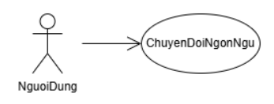

***Bảng đặc tả Use Case — UC04:***

| **Mục đặc tả** | **Nội dung chi tiết** |
|:---|:---|
| **Tác nhân (Actor)** | Người (Khách tham quan) |
| **Mức độ hoàn thiện** | Focused Use Case |
| **Mô tả tóm tắt** | Cho phép khách tham quan chuyển đổi tức thì ngôn ngữ giao diện người dùng và nội dung thuyết minh giữa 5 ngôn ngữ: Tiếng Việt, Tiếng Anh, Tiếng Trung, Tiếng Hàn và Tiếng Nhật mà không cần tải lại toàn bộ trang web. |
| **Điều kiện tiên quyết** | Không có (có thể thực hiện tại bất kỳ màn hình nào). |
| **Sự kiện kích hoạt (Trigger)** | Khách tham quan bấm vào biểu tượng chuyển đổi ngôn ngữ (quốc kỳ / mã ngôn ngữ) trên thanh điều hướng. |
| **Điều kiện kết thúc** | Toàn bộ các nhãn giao diện, nội dung văn bản hiện vật và luồng âm thanh chuyển sang ngôn ngữ mới được chọn. |

***Dòng sự kiện chính (Main success scenario) — UC04:***

| Bước | Hành động của tác nhân | Phản hồi của hệ thống |
|:---:|:---|:---|
| 1 | Khách tham quan bấm chọn biểu tượng "Chuyển Đổi Ngôn Ngữ". | |
| 2 | | Hệ thống hiển thị danh sách 5 ngôn ngữ hỗ trợ: Tiếng Việt (vi), English (en), 中文 (zh), 한국어 (ko), 日本語 (ja). |
| 3 | Khách chọn ngôn ngữ mong muốn (ví dụ: English). | |
| 4 | | Hệ thống cập nhật cấu hình ngôn ngữ vào bộ nhớ trạng thái (`langStore`) và LocalStorage. |
| 5 | | Hệ thống kích hoạt cơ chế phản ứng (Reactive Re-rendering), tải lại các tài nguyên từ điển giao diện, chuyển đổi nội dung bài viết và liên kết âm thanh sang ngôn ngữ mới. |
| 6 | | Giao diện hiển thị hoàn chỉnh bằng ngôn ngữ mới. Use Case kết thúc thành công. |

***Luồng thay thế (Alternative flows):*** Không có.  
***Luồng ngoại lệ (Exception flows):*** Không có.

***Sơ đồ hoạt động (Activity diagram) — UC04:***

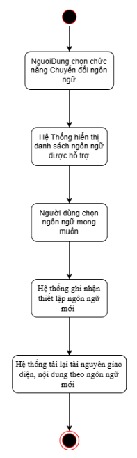

---

### 3.2.5. UC05 — Lưu hiện vật yêu thích

***Sơ đồ Use Case — UC05***


***Bảng đặc tả Use Case — UC05:***

| **Mục đặc tả** | **Nội dung chi tiết** |
|:---|:---|
| **Tác nhân (Actor)** | Người (Khách tham quan) |
| **Mức độ hoàn thiện** | Focused Use Case |
| **Mô tả tóm tắt** | Cho phép khách tham quan đánh dấu lưu lại các hiện vật ấn tượng vào danh mục "Yêu thích" cá nhân để dễ dàng tra cứu lại trong suốt chuyến tham quan. Dữ liệu được lưu trữ trực tiếp vào LocalStorage của trình duyệt, không bắt buộc đăng nhập tài khoản. |
| **Điều kiện tiên quyết** | Khách tham quan đang ở màn hình chi tiết hiện vật hoặc danh sách khám phá. |
| **Sự kiện kích hoạt (Trigger)** | Khách tham quan nhấn vào biểu tượng Trái tim (Yêu thích) của hiện vật. |
| **Điều kiện kết thúc** | Hiện vật được thêm vào (hoặc xóa khỏi) danh mục yêu thích và biểu tượng trạng thái được cập nhật. |

***Dòng sự kiện chính (Main success scenario) — UC05:***

| Bước | Hành động của tác nhân | Phản hồi của hệ thống |
|:---:|:---|:---|
| 1 | Khách tham quan bấm nút "Lưu Yêu Thích" (biểu tượng trái tim) tại hiện vật. | |
| 2 | | Hệ thống kiểm tra trạng thái: nếu hiện vật chưa có trong danh sách thì thêm mã hiện vật vào kho lưu trữ `favStore` và LocalStorage; nếu đã có thì chuyển sang luồng hủy lưu (A1). |
| 3 | | Hệ thống đổi màu biểu tượng trạng thái (đã lưu) và hiển thị thông báo nhanh "Đã lưu vào danh sách yêu thích". Use Case kết thúc thành công. |

***Luồng thay thế (Alternative flows):***
- **A1 – Hủy lưu yêu thích:** Nếu hiện vật đã có trong danh sách yêu thích, khi khách bấm vào biểu tượng trái tim lần nữa, hệ thống xóa hiện vật khỏi danh sách, cập nhật lại trạng thái biểu tượng (chưa lưu) và thông báo "Đã xóa khỏi danh sách yêu thích".

***Luồng ngoại lệ (Exception flows):*** Không có.

***Sơ đồ hoạt động (Activity diagram) — UC05:***

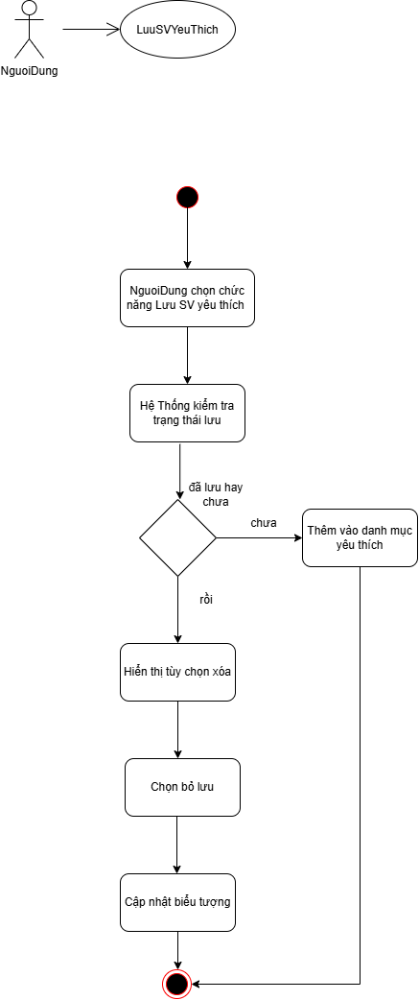

---

### 3.2.6. UC06 — Xem hồ sơ bảo tàng

***Sơ đồ Use Case — UC06***

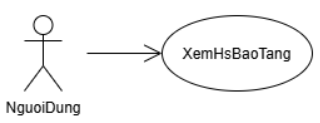

***Bảng đặc tả Use Case — UC06:***

| **Mục đặc tả** | **Nội dung chi tiết** |
|:---|:---|
| **Tác nhân (Actor)** | Người (Khách tham quan) |
| **Mức độ hoàn thiện** | Focused Use Case |
| **Mô tả tóm tắt** | Cung cấp cho khách tham quan các thông tin tổng quan về bảo tàng: lịch sử hình thành, giờ mở cửa các ngày trong tuần, giá vé, quy định tham quan, địa chỉ định vị, số điện thoại hotline và sơ đồ tổng thể các khu vực trưng bày theo đúng ngôn ngữ đang chọn. |
| **Điều kiện tiên quyết** | Khách tham quan đã truy cập vào ứng dụng. |
| **Sự kiện kích hoạt (Trigger)** | Khách tham quan chọn mục "Hồ sơ bảo tàng" (hoặc "Thông tin bảo tàng") trên thanh điều hướng. |
| **Điều kiện kết thúc** | Thông tin giới thiệu và thông số hoạt động của bảo tàng được hiển thị đầy đủ, chính xác. |

***Dòng sự kiện chính (Main success scenario) — UC06:***

| Bước | Hành động của tác nhân | Phản hồi của hệ thống |
|:---:|:---|:---|
| 1 | Khách tham quan chọn mục "Hồ sơ bảo tàng" trên giao diện. | |
| 2 | | Hệ thống xác định ngôn ngữ hiện tại và truy vấn dữ liệu hồ sơ bảo tàng từ kho dữ liệu (E1). |
| 3 | | Hệ thống hiển thị thông tin giới thiệu, lịch sử, giờ mở cửa, số hotline và địa chỉ bảo tàng. |
| 4 | Khách tham quan xem thông tin và có thể bấm chọn liên kết xem "Sơ đồ khu trưng bày" (A1). | |
| 5 | Khách đóng màn hình hồ sơ hoặc chuyển sang tính năng khác. Use Case kết thúc. | |

***Luồng thay thế (Alternative flows):***
- **A1 – Chuyển nhanh sang xem Sơ đồ khu trưng bày:** Tại màn hình hồ sơ, khách bấm vào nút "Xem sơ đồ mặt bằng". Hệ thống chuyển hướng khách sang màn hình {Quản lý sơ đồ} ở chế độ hiển thị bản đồ tầng tương tác.

***Luồng ngoại lệ (Exception flows):***
- **E1 – Lỗi tải dữ liệu hồ sơ:** Không thể truy xuất dữ liệu từ máy chủ. Hệ thống hiển thị thông báo "Không tải được thông tin bảo tàng, vui lòng thử lại" kèm nút tải lại trang.

***Sơ đồ hoạt động (Activity diagram) — UC06:***

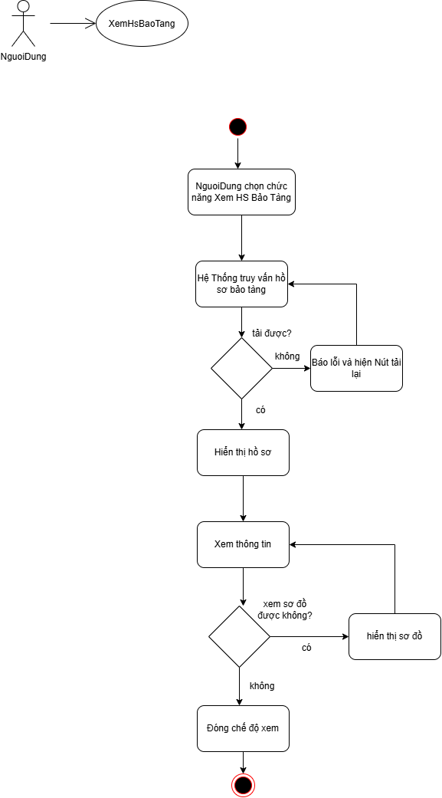

---

### 3.2.7. UC07 — Xem phụ đề

***Sơ đồ Use Case — UC07***

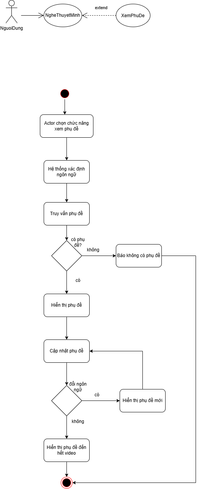

***Bảng đặc tả Use Case — UC07:***

| **Mục đặc tả** | **Nội dung chi tiết** |
|:---|:---|
| **Tác nhân (Actor)** | Người (Khách tham quan) |
| **Mức độ hoàn thiện** | Focused Use Case |
| **Mô tả tóm tắt** | Hiển thị phụ đề dạng văn bản đồng bộ theo mốc thời gian bài thuyết minh đang phát. Là use case mở rộng («extend») của {Nghe thuyết minh} (UC03) tại điểm mở rộng "Xem Phụ Đề", hỗ trợ đắc lực cho khách tham quan khiếm thính hoặc trong môi trường ồn ào. |
| **Điều kiện tiên quyết** | Khách tham quan đang phát âm thanh thuyết minh của một hiện vật ({Nghe thuyết minh} đang chạy). |
| **Sự kiện kích hoạt (Trigger)** | Khách tham quan bấm nút "Bật Phụ Đề" trên thanh trình phát âm thanh. |
| **Điều kiện kết thúc** | Phụ đề được hiển thị trôi chữ mượt mà đồng bộ với âm thanh cho đến khi khách tắt phụ đề hoặc bài nói kết thúc. |

***Dòng sự kiện chính (Main success scenario) — UC07:***

| Bước | Hành động của tác nhân | Phản hồi của hệ thống |
|:---:|:---|:---|
| 1 | Khách tham quan nhấn nút "Bật phụ đề" trên trình phát âm thanh. | |
| 2 | | Hệ thống xác định ngôn ngữ đang chọn và nạp danh sách các đoạn phụ đề (`cues`) đồng bộ với tệp âm thanh đang phát (E1). |
| 3 | | Hệ thống mở khung hiển thị phụ đề nổi và bắt đầu làm nổi bật các câu chữ khớp chính xác theo mốc thời gian thực tế của bài nói. |
| 4 | | Khi bài thuyết minh phát, tạm dừng hoặc tua đến vị trí mới, hệ thống tự động nhảy đến đúng đoạn phụ đề tương ứng (A1). |
| 5 | Khách tham quan nhấn "Tắt phụ đề" hoặc bài thuyết minh kết thúc. | |
| 6 | | Hệ thống đóng khung phụ đề và trả quyền điều khiển về use case {Nghe thuyết minh}. Use Case kết thúc. |

***Luồng thay thế (Alternative flows):***
- **A1 – Đổi ngôn ngữ giữa chừng:** Trong khi đang phát phụ đề, nếu khách đổi ngôn ngữ thông qua {Chuyển đổi ngôn ngữ}, hệ thống tự động nạp tệp phụ đề của ngôn ngữ mới và tiếp tục đồng bộ theo mốc thời gian hiện tại.

***Luồng ngoại lệ (Exception flows):***
- **E1 – Hiện vật chưa có phụ đề cho ngôn ngữ đã chọn:** Hệ thống thông báo "Chưa có dữ liệu phụ đề cho ngôn ngữ này" và tiếp tục phát âm thanh thuyết minh bình thường mà không hiển thị khung phụ đề.

***Sơ đồ hoạt động (Activity diagram) — UC07:***

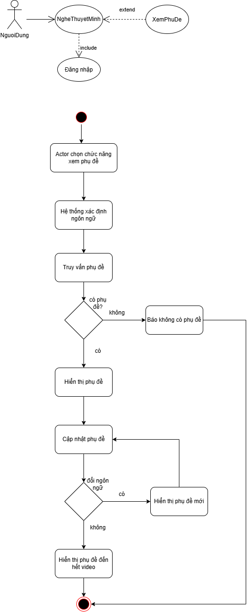

---

### 3.2.8. UC08 — Tìm kiếm

***Sơ đồ Use Case — UC08***


***Bảng đặc tả Use Case — UC08:***

| **Mục đặc tả** | **Nội dung chi tiết** |
|:---|:---|
| **Tác nhân (Actor)** | Người (Khách tham quan) |
| **Mức độ hoàn thiện** | Focused Use Case |
| **Mô tả tóm tắt** | Cho phép khách tham quan tìm kiếm hiện vật nhanh chóng bằng cách nhập tên, mã số định danh (ví dụ: `ART-001`) hoặc từ khóa có trong bài giới thiệu. Đóng vai trò là phương án thay thế tối ưu khi khách không thể quét mã QR ({Quét mã QR} - E1, E2). |
| **Điều kiện tiên quyết** | Khách tham quan đã truy cập ứng dụng. |
| **Sự kiện kích hoạt (Trigger)** | Khách tham quan chọn biểu tượng ô "Tìm kiếm" trên thanh tiêu đề hoặc thanh điều hướng. |
| **Điều kiện kết thúc** | Hiển thị danh sách các hiện vật thỏa mãn điều kiện tìm kiếm và cho phép khách bấm chọn để mở màn hình chi tiết hiện vật. |

***Dòng sự kiện chính (Main success scenario) — UC08:***

| Bước | Hành động của tác nhân | Phản hồi của hệ thống |
|:---:|:---|:---|
| 1 | Khách tham quan bấm chọn chức năng "Tìm kiếm". | |
| 2 | | Hệ thống hiển thị thanh nhập liệu tìm kiếm cùng các gợi ý từ khóa phổ biến. |
| 3 | Khách nhập từ khóa hoặc mã định danh hiện vật (ví dụ: "Trống đồng", "ART-002") và bấm Tìm (E1). | |
| 4 | | Hệ thống thực hiện tìm kiếm đa tiêu chí (theo tên, mã số và mô tả) trong cơ sở dữ liệu theo ngôn ngữ hiện tại (E2). |
| 5 | | Hệ thống hiển thị danh sách kết quả gồm ảnh đại diện, tên hiện vật, mã số và vị trí tầng. |
| 6 | Khách bấm chọn một hiện vật trong danh sách kết quả. | |
| 7 | | Hệ thống chuyển hướng khách đến màn hình chi tiết hiện vật (sẵn sàng đọc nội dung, xem ảnh hoặc nghe thuyết minh). Use Case kết thúc thành công. |

***Luồng thay thế (Alternative flows):*** Không có.

***Luồng ngoại lệ (Exception flows):***
- **E1 – Từ khóa rỗng:** Khách bấm tìm kiếm khi chưa nhập ký tự nào. Hệ thống giữ nguyên giao diện và nhắc nhở "Vui lòng nhập tên hoặc mã số hiện vật".
- **E2 – Không tìm thấy kết quả phù hợp:** Không có hiện vật nào khớp với từ khóa. Hệ thống thông báo "Không tìm thấy hiện vật phù hợp, vui lòng kiểm tra lại từ khóa hoặc sử dụng chức năng Quét mã QR".

***Sơ đồ hoạt động (Activity diagram) — UC08:***

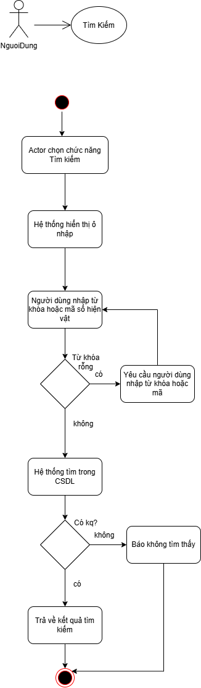

---

### 3.2.9. UC09 — Quản lý hiện vật

***Sơ đồ Use Case — UC09***

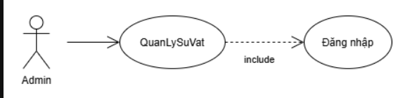

***Bảng đặc tả Use Case — UC09:***

| **Mục đặc tả** | **Nội dung chi tiết** |
|:---|:---|
| **Tác nhân (Actor)** | Admin (Quản trị viên) |
| **Mức độ hoàn thiện** | Focused Use Case |
| **Mô tả tóm tắt** | Cho phép Quản trị viên quản lý danh mục toàn bộ hiện vật trưng bày trong bảo tàng: thêm mới, chỉnh sửa thông tin, cập nhật bản dịch 5 ngôn ngữ, cấu hình tọa độ GPS địa lý, bán kính kích hoạt (`triggerRadius`), và xóa hiện vật khi ngừng trưng bày. |
| **Điều kiện tiên quyết** | Quản trị viên đã đăng nhập thành công vào hệ thống (nếu chưa đăng nhập, bao gồm «include» {Đăng nhập}). |
| **Sự kiện kích hoạt (Trigger)** | Admin chọn menu "Quản Lý Hiện Vật" trên thanh điều hướng Dashboard quản trị. |
| **Điều kiện kết thúc** | Dữ liệu hiện vật trong cơ sở dữ liệu được thêm mới, cập nhật hoặc xóa thành công, danh sách hiển thị dữ liệu mới nhất. |

***Dòng sự kiện chính (Main success scenario) — UC09:***

| Bước | Hành động của tác nhân | Phản hồi của hệ thống |
|:---:|:---|:---|
| 1 | Admin chọn menu "Quản Lý Hiện Vật". | |
| 2 | | Hệ thống hiển thị danh sách hiện vật dạng bảng kèm bộ lọc theo tầng, ô tìm kiếm và các nút "Thêm hiện vật", "Sửa", "Xóa". |
| 3 | Admin bấm chọn một thao tác quản lý cần thực hiện (A1, A2, A3). | |
| 4 | Admin thực hiện các bước nhập liệu trên biểu mẫu và nhấn "Lưu" (A4). | |
| 5 | | Hệ thống kiểm tra tính hợp lệ của dữ liệu (E1, E2). |
| 6 | | Hệ thống lưu thông tin vào cơ sở dữ liệu (E3), cập nhật danh sách và thông báo "Lưu thông tin hiện vật thành công". Use Case kết thúc thành công. |

***Luồng thay thế (Alternative flows):***
- **A1 – Thêm mới hiện vật:** Tại bước 3, Admin bấm "Thêm hiện vật". Hệ thống mở biểu mẫu gồm: Mã hiện vật (`ART-xxx`), Tên gọi, Khu vực/Tầng, Tọa độ GPS (Vĩ độ, Kinh độ), Bán kính kích hoạt (mặc định 15m), Nội dung mô tả 5 ngôn ngữ và ảnh đính kèm. Admin nhập dữ liệu và tiếp tục bước 4.
- **A2 – Chỉnh sửa hiện vật:** Tại bước 3, Admin chọn một hiện vật và bấm "Sửa". Hệ thống hiển thị biểu mẫu đã điền sẵn dữ liệu hiện tại. Admin chỉnh sửa thông tin cần thiết và tiếp tục bước 4.
- **A3 – Xóa hiện vật:** Tại bước 3, Admin bấm "Xóa" một hiện vật. Hệ thống hiển thị hộp thoại xác nhận kèm cảnh báo liên quan đến mã QR và tệp âm thanh đính kèm. Khi Admin xác nhận đồng ý, hệ thống xóa hiện vật khỏi cơ sở dữ liệu, thông báo thành công và làm mới danh sách.
- **A4 – Hủy thao tác:** Khi đang ở biểu mẫu thêm/sửa hoặc hộp thoại xóa, Admin bấm "Hủy". Hệ thống đóng biểu mẫu, giữ nguyên dữ liệu cũ và quay về danh sách hiện vật.

***Luồng ngoại lệ (Exception flows):***
- **E1 – Thiếu thông tin bắt buộc:** Admin để trống tên hiện vật, mã hiện vật hoặc chưa chọn tầng trưng bày. Hệ thống đánh dấu đỏ các trường lỗi và yêu cầu bổ sung trước khi lưu.
- **E2 – Trùng mã định danh hiện vật:** Mã hiện vật nhập vào đã tồn tại trong hệ thống. Hệ thống cảnh báo "Mã hiện vật đã tồn tại, vui lòng chọn mã khác".
- **E3 – Lỗi lưu dữ liệu cơ sở dữ liệu:** Cơ sở dữ liệu bị ngắt kết nối hoặc tệp ảnh sai định dạng. Hệ thống hiển thị thông báo lỗi và giữ nguyên các trường dữ liệu vừa nhập để Admin thử lại.

***Sơ đồ hoạt động (Activity diagram) — UC09:***

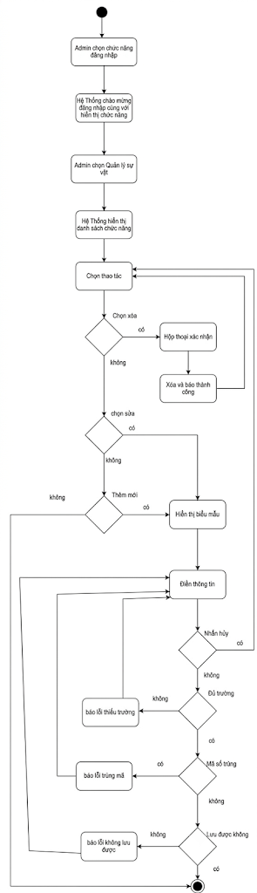

---

### 3.2.10. UC10 — Quản lý phiên tham quan và mã QR

***Sơ đồ Use Case — UC10***

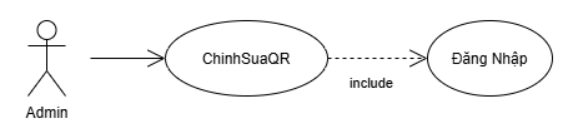

***Bảng đặc tả Use Case — UC10:***

| **Mục đặc tả** | **Nội dung chi tiết** |
|:---|:---|
| **Tác nhân (Actor)** | Admin (Quản trị viên) |
| **Mức độ hoàn thiện** | Focused Use Case |
| **Mô tả tóm tắt** | Cho phép Quản trị viên thiết lập, chỉnh sửa, theo dõi và đóng các phiên tham quan (ca mở cửa, đoàn khách tham quan theo lịch hẹn), tự động sinh mã định danh phiên (`SES-xx`), đồng thời cấu hình và xuất mã QR đón tiếp tại cổng và mã QR cho từng hiện vật phục vụ in ấn. |
| **Điều kiện tiên quyết** | Admin đã đăng nhập thành công vào hệ thống (nếu chưa đăng nhập, bao gồm «include» {Đăng nhập}). |
| **Sự kiện kích hoạt (Trigger)** | Admin chọn menu "Quản Lý Phiên" trong khu vực quản trị (`/admin/sessions`). |
| **Điều kiện kết thúc** | Phiên tham quan được tạo mới, cập nhật hoặc xóa thành công; mã QR tương ứng được kết xuất chính xác. |

***Dòng sự kiện chính (Main success scenario) — UC10:***

| Bước | Hành động của tác nhân | Phản hồi của hệ thống |
|:---:|:---|:---|
| 1 | Admin chọn menu "Quản Lý Phiên". | |
| 2 | | Hệ thống hiển thị danh sách các phiên tham quan dạng thẻ, mỗi thẻ gồm: Mã phiên (`SES-xx`), Tên ca, Khung giờ bắt đầu - kết thúc, Trạng thái (Đang mở / Sắp diễn ra / Đã kết thúc), Số lượng khách và Số lượt nghe (E3). |
| 3 | Admin bấm chọn một thao tác quản lý phiên (A1, A2, A3, A4). | |
| 4 | Admin nhập thông tin phiên và nhấn "Lưu" (A5). | |
| 5 | | Hệ thống kiểm tra tính hợp lệ của dữ liệu thời gian (E1). |
| 6 | | Hệ thống tự sinh mã phiên (`SES-xx`), cập nhật trạng thái theo thời gian thực, lưu vào cơ sở dữ liệu (E2) và tạo mã QR đón tiếp. |
| 7 | | Hệ thống làm mới danh sách và hiển thị thẻ phiên mới. Use Case kết thúc thành công. |

***Luồng thay thế (Alternative flows):***
- **A1 – Tạo phiên mới:** Admin bấm "Tạo Phiên Mới". Hệ thống mở biểu mẫu nhập: Tên ca tham quan, Ngày diễn ra, Giờ bắt đầu, Giờ kết thúc, Ghi chú đón tiếp. Admin nhập thông tin và tiếp tục bước 4.
- **A2 – Chỉnh sửa phiên:** Admin bấm biểu tượng sửa trên thẻ phiên. Hệ thống mở biểu mẫu điền sẵn dữ liệu. Admin điều chỉnh khung giờ hoặc ghi chú rồi nhấn Lưu.
- **A3 – Xóa phiên:** Admin bấm biểu tượng xóa trên thẻ phiên. Hệ thống hiển thị cảnh báo nếu phiên đã có lượt nghe phát sinh. Admin xác nhận đồng ý, hệ thống xóa phiên khỏi cơ sở dữ liệu.
- **A4 – Xuất mã QR đón tiếp & mã QR hiện vật:** Admin chọn phiên hoặc hiện vật và bấm nút "Xuất Mã QR". Hệ thống tạo tệp ảnh QR độ phân giải cao kèm logo bảo tàng và cho phép tải về dưới định dạng PNG/PDF để in ấn phục vụ dán tại cổng hoặc quầy lễ tân.
- **A5 – Hủy thao tác:** Admin bấm "Hủy" trên biểu mẫu. Hệ thống đóng biểu mẫu và giữ nguyên hiện trạng.

***Luồng ngoại lệ (Exception flows):***
- **E1 – Khung giờ không hợp lệ:** Giờ kết thúc sớm hơn hoặc bằng giờ bắt đầu, hoặc ngày diễn ra trong quá khứ. Hệ thống đánh dấu đỏ trường giờ và yêu cầu chỉnh sửa lại.
- **E2 – Lỗi lưu dữ liệu:** Hệ thống thông báo "Không thể lưu thông tin phiên, vui lòng thử lại".
- **E3 – Không tải được danh sách phiên:** Mất kết nối cơ sở dữ liệu. Hệ thống hiển thị thông báo lỗi và cung cấp nút tải lại.

***Sơ đồ hoạt động (Activity diagram) — UC10:***

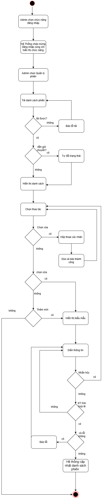

---

### 3.2.11. UC11 — Quản lý tệp âm thanh

***Sơ đồ Use Case — UC11***

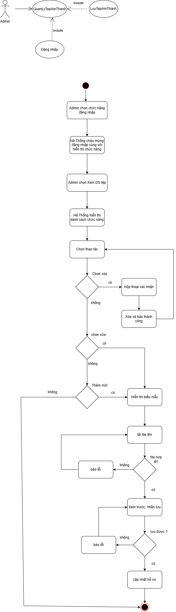

***Bảng đặc tả Use Case — UC11:***

| **Mục đặc tả** | **Nội dung chi tiết** |
|:---|:---|
| **Tác nhân (Actor)** | Admin (Quản trị viên), Thiết bị / Dịch vụ lưu âm thanh |
| **Mức độ hoàn thiện** | Focused Use Case |
| **Mô tả tóm tắt** | Cho phép Quản trị viên tải lên (upload), nghe thử, thay thế hoặc xóa các tệp âm thanh thuyết minh (MP3, WAV, AAC) gắn với từng hiện vật theo từng ngôn ngữ cụ thể, đảm bảo dữ liệu audio trên máy chủ lưu trữ luôn đồng bộ với cơ sở dữ liệu. |
| **Điều kiện tiên quyết** | - Admin đã đăng nhập thành công (nếu chưa đăng nhập, bao gồm «include» {Đăng nhập}).<br>- Hiện vật cần gắn tệp âm thanh đã tồn tại trong hệ thống. |
| **Sự kiện kích hoạt (Trigger)** | Admin chọn chức năng "Quản Lý Tệp Âm Thanh" trên thanh điều hướng hoặc tại dòng hiện vật tương ứng. |
| **Điều kiện kết thúc** | Tệp âm thanh được tải lên và lưu trữ an toàn trên máy chủ lưu trữ âm thanh, đồng thời liên kết chính xác với hiện vật và ngôn ngữ tương ứng. |

***Dòng sự kiện chính (Main success scenario) — UC11:***

| Bước | Hành động của tác nhân | Phản hồi của hệ thống |
|:---:|:---|:---|
| 1 | Admin chọn mục "Quản Lý Tệp Âm Thanh". | |
| 2 | | Hệ thống hiển thị danh sách các tệp âm thanh hiện có theo từng hiện vật và ngôn ngữ, kèm trình nghe thử trực tiếp. |
| 3 | Admin chọn một thao tác quản lý tệp âm thanh (A1, A2, A3). | |
| 4 | | Hệ thống tiếp nhận tệp tin, kiểm tra định dạng và dung lượng tệp (E1). |
| 5 | | Hệ thống chuyển tiếp tệp tin tới Thiết bị lưu âm thanh để lưu trữ nhị phân. |
| 6 | Thiết bị lưu âm thanh tiếp nhận tệp, lưu vào bộ nhớ lưu trữ và trả về đường dẫn URL an toàn (E2). | |
| 7 | | Hệ thống cập nhật URL tệp âm thanh vào bản ghi hiện vật trong cơ sở dữ liệu và thông báo "Cập nhật tệp âm thanh thành công". Use Case kết thúc thành công. |

***Luồng thay thế (Alternative flows):***
- **A1 – Tải lên tệp âm thanh mới:** Admin chọn hiện vật, chọn ngôn ngữ đích (ví dụ: `zh`), chọn tệp MP3 từ máy tính và bấm "Tải lên". Hệ thống thực hiện bước 4 đến 7.
- **A2 – Thay thế tệp âm thanh cũ:** Admin chọn tệp đã có và bấm "Thay thế". Admin chọn tệp mới tải lên, hệ thống ghi đè tệp mới trên máy chủ lưu trữ và xóa tệp cũ để tiết kiệm dung lượng.
- **A3 – Xóa tệp âm thanh:** Admin bấm "Xóa" tệp âm thanh của một ngôn ngữ. Khi Admin xác nhận, hệ thống gửi lệnh xóa tệp trên Thiết bị lưu âm thanh, gỡ bỏ liên kết URL trong cơ sở dữ liệu và cập nhật danh sách.

***Luồng ngoại lệ (Exception flows):***
- **E1 – Định dạng tệp không hợp lệ hoặc vượt quá dung lượng:** Tệp tải lên không phải là định dạng âm thanh chuẩn (`.mp3`, `.wav`, `.aac`) hoặc dung lượng vượt quá giới hạn 30MB. Hệ thống từ chối nhận tệp và hiển thị cảnh báo chi tiết.
- **E2 – Lỗi kết nối thiết bị lưu trữ:** Máy chủ lưu trữ âm thanh không phản hồi hoặc báo lỗi không đủ dung lượng đĩa. Hệ thống hiển thị thông báo "Không thể kết nối máy chủ lưu trữ âm thanh, thao tác thất bại" và giữ nguyên liên kết cũ.

***Sơ đồ hoạt động (Activity diagram) — UC11:***

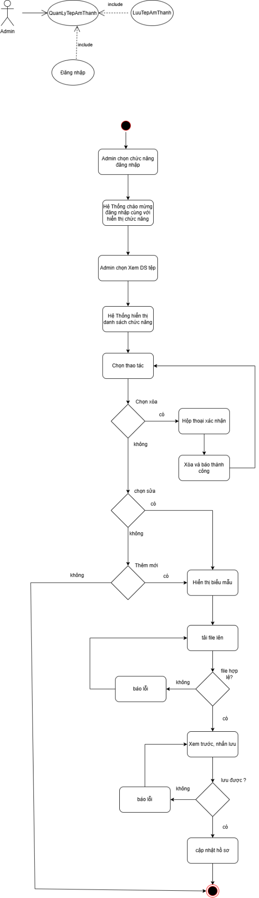

---

### 3.2.12. UC12 — Xem thống kê lượt nghe

***Sơ đồ Use Case — UC12***

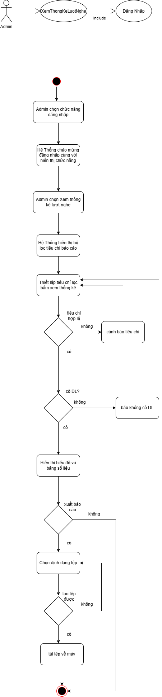

***Bảng đặc tả Use Case — UC12:***

| **Mục đặc tả** | **Nội dung chi tiết** |
|:---|:---|
| **Tác nhân (Actor)** | Admin (Quản trị viên) |
| **Mức độ hoàn thiện** | Focused Use Case |
| **Mô tả tóm tắt** | Cung cấp các báo cáo trực quan và biểu đồ số liệu về tần suất khách nghe thuyết minh theo từng hiện vật, theo ngôn ngữ, theo phiên tham quan hoặc theo mốc thời gian (giờ, ngày, tuần, tháng), đồng thời hỗ trợ xuất dữ liệu báo cáo sang định dạng Excel/PDF. |
| **Điều kiện tiên quyết** | Admin đã đăng nhập hệ thống (nếu chưa đăng nhập, bao gồm «include» {Đăng nhập}). |
| **Sự kiện kích hoạt (Trigger)** | Admin chọn menu "Thống Kê Lượt Nghe" trên Dashboard quản trị. |
| **Điều kiện kết thúc** | Biểu đồ và bảng dữ liệu thống kê được hiển thị trực quan theo tiêu chí đã lọc; báo cáo được xuất thành công nếu có yêu cầu. |

***Dòng sự kiện chính (Main success scenario) — UC12:***

| Bước | Hành động của tác nhân | Phản hồi của hệ thống |
|:---:|:---|:---|
| 1 | Admin chọn menu "Thống Kê Lượt Nghe". | |
| 2 | | Hệ thống hiển thị giao diện báo cáo tổng quan và bộ lọc tiêu chí: Khoảng thời gian, Phiên tham quan (`SES-xx`), Tầng/Khu vực, Hiện vật cụ thể, Ngôn ngữ. |
| 3 | Admin thiết lập các tiêu chí lọc cần xem và nhấn "Xem Thống Kê". | |
| 4 | | Hệ thống kiểm tra tiêu chí lọc (E1), truy vấn cơ sở dữ liệu và tổng hợp các chỉ số (E2). |
| 5 | | Hệ thống kết xuất biểu đồ trực quan (biểu đồ cột phân bố lượt nghe theo hiện vật, biểu đồ tròn tỷ lệ ngôn ngữ, biểu đồ đường biến thiên theo thời gian) kèm bảng tổng hợp số liệu chi tiết. |
| 6 | Admin xem số liệu và có thể chọn chức năng "Xuất Báo Cáo" (A1). Use Case kết thúc thành công. | |

***Luồng thay thế (Alternative flows):***
- **A1 – Xuất báo cáo dữ liệu:** Tại bước 6, Admin bấm nút "Xuất Báo Cáo" và chọn định dạng Excel (XLSX) hoặc PDF. Hệ thống đóng gói dữ liệu và tự động kích hoạt tải tệp về máy tính (E3).

***Luồng ngoại lệ (Exception flows):***
- **E1 – Khoảng thời gian lọc không hợp lệ:** Ngày bắt đầu lớn hơn ngày kết thúc. Hệ thống cảnh báo đỏ và yêu cầu chọn lại khoảng thời gian.
- **E2 – Không có dữ liệu thống kê:** Trong khoảng thời gian và tiêu chí đã chọn không phát sinh lượt nghe nào. Hệ thống hiển thị thông báo "Không có dữ liệu trong khoảng thời gian đã chọn" và giữ nguyên khung lọc.
- **E3 – Lỗi xuất tệp báo cáo:** Trình kết xuất tệp gặp lỗi. Hệ thống hiển thị thông báo lỗi và đề nghị thử lại hoặc đổi sang định dạng khác.

***Sơ đồ hoạt động (Activity diagram) — UC12:***

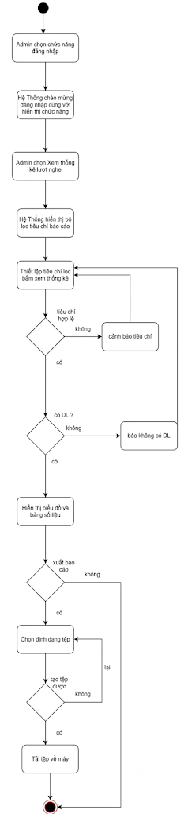

---

### 3.2.13. UC13 — Quản lý sơ đồ

***Sơ đồ Use Case — UC13***

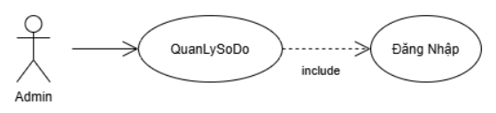

***Bảng đặc tả Use Case — UC13:***

| **Mục đặc tả** | **Nội dung chi tiết** |
|:---|:---|
| **Tác nhân (Actor)** | Admin (Quản trị viên) |
| **Mức độ hoàn thiện** | Focused Use Case |
| **Mô tả tóm tắt** | Cho phép Quản trị viên quản lý bản đồ mặt bằng các tầng và khu vực trưng bày của bảo tàng: tải lên ảnh sơ đồ mới, chỉnh sửa thông số tầng, và sử dụng giao diện trực quan kéo-thả để gán tọa độ (X, Y) của các hiện vật lên mặt bằng phục vụ hiển thị định vị cho khách tham quan. |
| **Điều kiện tiên quyết** | - Admin đã đăng nhập hệ thống (nếu chưa đăng nhập, bao gồm «include» {Đăng nhập}).<br>- Các hiện vật cần gán vị trí đã được khởi tạo trong hệ thống. |
| **Sự kiện kích hoạt (Trigger)** | Admin chọn menu "Quản Lý Sơ Đồ" trên Dashboard quản trị. |
| **Điều kiện kết thúc** | Sơ đồ tầng và tọa độ gán vị trí của các hiện vật được lưu chính xác vào cơ sở dữ liệu. |

***Dòng sự kiện chính (Main success scenario) — UC13:***

| Bước | Hành động của tác nhân | Phản hồi của hệ thống |
|:---:|:---|:---|
| 1 | Admin chọn menu "Quản Lý Sơ Đồ". | |
| 2 | | Hệ thống hiển thị danh sách các tầng/khu vực trưng bày hiện có kèm hình ảnh mặt bằng tương ứng. |
| 3 | Admin chọn một thao tác quản lý sơ đồ (A1, A2, A3). | |
| 4 | Admin thực hiện các thao tác biên tập trên giao diện tương tác và nhấn "Lưu Sơ Đồ" (A4). | |
| 5 | | Hệ thống kiểm tra tính hợp lệ của dữ liệu tọa độ (E1). |
| 6 | | Hệ thống lưu cấu hình sơ đồ và tọa độ các hiện vật vào cơ sở dữ liệu (E2), làm mới danh sách và thông báo thành công. Use Case kết thúc thành công. |

***Luồng thay thế (Alternative flows):***
- **A1 – Thêm sơ đồ tầng mới:** Admin bấm "Thêm Sơ Đồ Mới", nhập tên tầng, số tầng và tải lên tệp ảnh sơ đồ mặt bằng (PNG/JPG). Hệ thống kiểm tra dung lượng ảnh (E1) và mở màn hình biên tập gán vị trí. Admin tiếp tục bước 4.
- **A2 – Chỉnh sửa sơ đồ & gán vị trí kéo thả:** Admin chọn một tầng và bấm "Biên tập Sơ đồ". Hệ thống hiển thị bản đồ mặt bằng tương tác và danh sách các hiện vật thuộc tầng đó. Admin dùng chuột kéo thả các điểm ghim hiện vật vào đúng vị trí thực tế trên sơ đồ. Hệ thống tự động ghi nhận tỷ lệ tọa độ tương đối (X, Y từ 0.0 đến 1.0). Admin tiếp tục bước 4.
- **A3 – Xóa sơ đồ tầng:** Admin chọn sơ đồ và bấm "Xóa". Khi Admin xác nhận, hệ thống xóa sơ đồ mặt bằng và giải phóng tọa độ đã gán của các hiện vật liên quan.
- **A4 – Hủy thao tác:** Admin bấm "Hủy". Hệ thống đóng giao diện biên tập và không lưu các thay đổi vị trí vừa kéo thả.

***Luồng ngoại lệ (Exception flows):***
- **E1 – Ảnh mặt bằng sai định dạng hoặc quá lớn:** Tệp tải lên không phải ảnh hoặc vượt quá 20MB. Hệ thống từ chối và yêu cầu chọn lại.
- **E2 – Lỗi lưu dữ liệu cơ sở dữ liệu:** Hệ thống thông báo "Không thể lưu tọa độ sơ đồ, vui lòng thử lại".

***Sơ đồ hoạt động (Activity diagram) — UC13:***

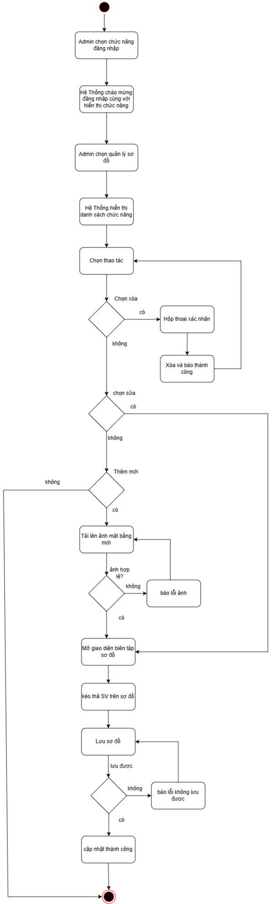

---

### 3.2.14. UC14 — Định vị vị trí và tự động thuyết minh

***Sơ đồ Use Case — UC14***

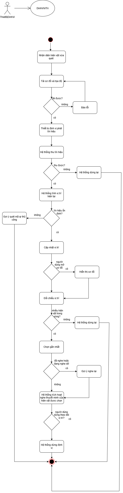

***Bảng đặc tả Use Case — UC14:***

| **Mục đặc tả** | **Nội dung chi tiết** |
|:---|:---|
| **Tác nhân (Actor)** | Người (Khách tham quan), Hệ thống định vị (Positioning Sensor) |
| **Mức độ hoàn thiện** | Focused Use Case |
| **Mô tả tóm tắt** | Tự động xác định và cập nhật liên tục vị trí của khách tham quan trong không gian bảo tàng thông qua cơ chế định vị lai (Hybrid Geofencing): Sử dụng mã QR đã quét làm điểm neo xuất phát (`anchorArtifactId`) và kết hợp dữ liệu cảm biến GPS độ chính xác cao (`enableHighAccuracy`). Hệ thống tính toán khoảng cách Haversine tới các hiện vật lân cận, hiển thị chấm halo "Bạn đang ở đây" trên sơ đồ tầng và tự động kích hoạt thuyết minh khi khách bước vào bán kính kích hoạt (mặc định 12 mét) mà không cần quét lại mã QR. |
| **Điều kiện tiên quyết** | - Khách tham quan đã quét thành công ít nhất một mã QR (làm điểm mốc neo xuất phát).<br>- Trình duyệt được cấp quyền truy cập vị trí địa lý (Geolocation API).<br>- Cơ sở dữ liệu đã có tọa độ của sơ đồ và các hiện vật. |
| **Sự kiện kích hoạt (Trigger)** | Hệ thống tự động kích hoạt chế độ tracking sau khi khách quét mã QR thành công ({Quét mã QR} - Bước 6). |
| **Điều kiện kết thúc** | - **Thành công:** Vị trí của khách được cập nhật liên tục trên bản đồ và hệ thống tự động phát hiện, kích hoạt đúng bài thuyết minh khi khách đến gần hiện vật mới.<br>- **Thất bại:** Mất tín hiệu định vị hoặc khách chủ động dừng theo dõi; hệ thống dừng tracking và hướng dẫn khách quét mã QR thủ công. |

***Dòng sự kiện chính (Main success scenario) — UC14:***

| Bước | Hành động của tác nhân | Phản hồi của hệ thống |
|:---:|:---|:---|
| 1 | | Hệ thống tiếp nhận vị trí hiện vật vừa quét QR làm điểm neo xuất phát (`anchorArtifactId`) và khởi tạo phiên định vị. |
| 2 | | Hệ thống tải sơ đồ khu vực trưng bày, tọa độ địa lý và bán kính kích hoạt (`triggerRadius` - 15m) của các hiện vật thuộc tầng từ cơ sở dữ liệu (E3). |
| 3 | Cảm biến thiết bị phát tín hiệu định vị định kỳ. | |
| 4 | | Hệ thống tiếp nhận tọa độ GPS định kỳ từ cảm biến thiết bị qua Web Geolocation API (E1). |
| 5 | | Hệ thống tính toán khoảng cách Haversine giữa vị trí khách và các hiện vật, hiệu chỉnh độ trôi tín hiệu theo điểm neo xuất phát (E2). |
| 6 | | Hệ thống cập nhật biểu tượng halo "Bạn đang ở đây" trên bản đồ tầng (A1). |
| 7 | | Hệ thống đối chiếu vị trí khách với bán kính kích hoạt của các hiện vật và xác định hiện vật gần nhất trong vùng (A2). |
| 8 | | Nếu hiện vật gần nhất khác với hiện vật đang phát và chưa được nghe trong phiên này (A3), hệ thống tự động chuyển sang hiện vật mới và kích hoạt {Nghe thuyết minh}. |
| 9 | Cảm biến thiết bị tiếp tục phát tín hiệu ở chu kỳ tiếp theo. | |
| 10 | | Hệ thống lặp lại bước 4 đến bước 9 cho đến khi khách dừng theo dõi hoặc rời khỏi ứng dụng (A4). Use Case kết thúc. |

***Luồng thay thế (Alternative flows):***
- **A1 – Xem vị trí trực tiếp trên sơ đồ:** Khách mở tab Sơ đồ tầng. Hệ thống hiển thị bản đồ trực quan cùng vị trí hiện tại của khách và các điểm ghim hiện vật xung quanh; khách có thể bấm chọn một ghim bất kỳ để nghe thuyết minh thủ công.
- **A2 – Nhiều hiện vật cùng nằm trong bán kính kích hoạt:** Khi khách đứng tại khu vực có từ 2 hiện vật trở lên cùng thỏa mãn bán kính kích hoạt, hệ thống ưu tiên kích hoạt hiện vật có khoảng cách gần nhất, đồng thời hiển thị danh sách các hiện vật còn lại trong bảng "Hiện vật lân cận" để khách tùy chọn.
- **A3 – Hiện vật đã nghe hoặc đang nghe dở bài thuyết minh khác:** Nếu hiện vật trong vùng đã được nghe trọn vẹn trong phiên tham quan này, hệ thống không tự động phát đè mà chỉ hiển thị thông báo gợi ý "Bấm để nghe lại". Nếu khách đang nghe dở một bài thuyết minh khác, hệ thống không tự động ngắt âm thanh mà hiển thị thông báo hỏi khách có muốn chuyển sang hiện vật mới hay không.
- **A4 – Dừng theo dõi:** Khách bấm nút "Dừng theo dõi" trên bảng điều khiển vị trí hoặc đóng trình duyệt. Hệ thống tắt dịch vụ theo dõi định vị và kết thúc use case.

***Luồng ngoại lệ (Exception flows):***
- **E1 – Mất tín hiệu GPS hoặc bị từ chối quyền định vị:** Hệ thống không nhận được dữ liệu tọa độ từ trình duyệt. Hệ thống hiển thị thông báo "Không thể theo dõi vị trí tự động", tạm dừng tracking và đề xuất khách tiếp tục tham quan bằng cách quét mã QR thủ công tại từng hiện vật hoặc dùng chức năng {Tìm kiếm}.
- **E2 – Sai số định vị lớn hoặc tín hiệu không ổn định:** Độ chính xác vị trí vượt quá bán kính tin cậy (> 25 mét). Hệ thống tạm hoãn tự động phát thuyết minh để tránh phát nhầm hiện vật, đồng thời hiển thị gợi ý "Vị trí chưa ổn định, vui lòng quét mã QR gần nhất để định vị lại mốc xuất phát".
- **E3 – Không tải được dữ liệu tọa độ hiện vật:** Lỗi kết nối mạng. Hệ thống thông báo lỗi và chuyển sang chế độ tham quan tĩnh.

***Sơ đồ hoạt động (Activity diagram) — UC14:***


---

# CHƯƠNG 4: HIỆN THỰC GIAO DIỆN & KỸ THUẬT FRONT-END

## 4.1. Cấu trúc tổ chức mã nguồn (Source tree)

Mã nguồn của hệ thống được tổ chức theo kiến trúc phân tầng sạch (Clean Architecture / Service-Oriented Architecture for Client), phân tách rõ ràng giữa tầng giao diện hiển thị (Views & Components), tầng quản lý trạng thái (Zustand Stores), tầng dịch vụ kết nối dữ liệu (Services) và tầng tiện ích kỹ thuật (Utilities):

```text
Do_an_CNPM/
├── index.html                   # Điểm khởi nhập HTML Single-Page Application (SPA)
├── package.json                 # Cấu hình dự án React 18, TypeScript, Tailwind CSS, Vite
├── vite.config.ts               # Thiết lập pipeline build tối ưu hóa và alias đường dẫn
├── docker-compose.yml           # Cấu hình triển khai container Frontend và Backend
│
├── public/                      # Thư mục tài nguyên tĩnh phân phối qua Web CDN
│   ├── audio/                   # Kho tệp âm thanh thuyết minh MP3 thực tế
│   ├── images/                  # Kho ảnh hiện vật tư liệu độ phân giải cao
│   └── maps/                    # Kho ảnh sơ đồ mặt bằng 4 khu vực (Trệt, Lầu 1, Lầu 2, Ngoài trời)
│
├── frontend/src/                # Toàn bộ mã nguồn ứng dụng Client SPA
│   ├── App.tsx                  # Điều hướng router chính (Visitor & Admin layout)
│   ├── main.tsx                 # Khởi tạo React Root và gán CSS toàn cục
│   │
│   ├── visitor/                 # Phân hệ giao diện khách tham quan
│   │   ├── VisitorLayout.tsx    # Khung điều hướng, tích hợp router QR deep link & GPS
│   │   ├── components/
│   │   │   ├── TrackingPanel.tsx       # Bảng theo dõi vị trí & đề xuất chuyển bài
│   │   │   ├── AudioPlayerBar.tsx      # Trình phát âm thanh ghim đáy màn hình
│   │   │   ├── LiveTranscriptCard.tsx  # Khung phụ đề chạy chữ karaoke đồng bộ
│   │   │   └── LanguageSwitcher.tsx    # Bộ chọn nhanh 5 ngôn ngữ quốc tế
│   │   └── views/
│   │       ├── ExploreView.tsx         # Khám phá, lọc danh mục và tìm kiếm hiện vật
│   │       ├── FloorMapView.tsx        # Sơ đồ tầng tương tác, halo "Bạn đang ở đây"
│   │       ├── FavoritesView.tsx       # Danh mục hiện vật yêu thích cá nhân
│   │       ├── MuseumInfoView.tsx      # Xem hồ sơ giới thiệu, giờ mở cửa bảo tàng
│   │       └── QRScannerModal.tsx      # Quét mã QR trực tiếp qua Camera HTML5
│   │
│   ├── admin/                   # Phân hệ giao diện quản trị viên
│   │   ├── AdminLayout.tsx      # Khung điều hướng Dashboard quản trị
│   │   └── views/
│   │       ├── AdminLoginView.tsx      # Màn hình đăng nhập quản trị (khóa 5 lần/5 phút)
│   │       ├── AdminDashboardView.tsx  # Trang tổng quan số liệu và chỉ số chính
│   │       ├── ArtifactsManageView.tsx # Quản lý CRUD hiện vật, tọa độ GPS & triggerRadius
│   │       ├── SessionManageView.tsx   # Quản lý phiên tham quan & xuất mã QR đón tiếp
│   │       ├── AudioManageView.tsx     # Quản lý tệp âm thanh đa ngôn ngữ
│   │       ├── FloorMapEditorView.tsx  # Biên tập sơ đồ tầng và kéo thả tọa độ hiện vật
│   │       └── AnalyticsView.tsx       # Báo cáo thống kê lượt nghe và ca tham quan
│   │
│   ├── shared/                  # Lớp dịch vụ, tiện ích và kho trạng thái dùng chung
│   │   ├── stores/              # Các kho quản lý trạng thái phản ứng (Zustand)
│   │   │   ├── playerStore.ts          # Điều khiển luồng phát thanh và mốc thời gian
│   │   │   ├── geofenceStore.ts        # Trạng thái vị trí, khoảng cách và đề xuất lân cận
│   │   │   ├── langStore.ts            # Quản lý ngôn ngữ đang chọn (vi, en, zh, ko, ja)
│   │   │   ├── favStore.ts             # Quản lý danh mục yêu thích lưu LocalStorage
│   │   │   └── adminAuthStore.ts       # Quản lý token phiên làm việc quản trị
│   │   ├── services/            # Tầng giao tiếp dữ liệu & API
│   │   │   ├── api.ts                  # Adapter dữ liệu (hỗ trợ cả Mock DB và REST API)
│   │   │   ├── tts.ts                  # Dịch vụ truyền phát âm thanh và Web Speech API
│   │   │   └── analytics.ts            # Thu thập sự kiện thống kê lượt nghe (ntfy.sh)
│   │   ├── utils/               # Thư viện thuật toán và bộ xử lý tiện ích
│   │   │   ├── geofence.ts             # Thuật toán tính khoảng cách Haversine & vùng kích hoạt
│   │   │   ├── qrHelper.ts             # Trình bóc tách URL QR deep link & mã hiện vật
│   │   │   ├── loginLock.ts            # Động cơ đếm số lần đăng nhập sai & khóa bảo vệ
│   │   │   └── floorHelper.ts          # Tiện ích tính toán tọa độ bản đồ tầng
│   │   └── types/               # Định nghĩa kiểu dữ liệu TypeScript nghiêm ngặt
│   │       └── index.ts                # Khai báo interfaces: Artifact, Floor, Session, Log
│   │
│   └── locales/i18n.ts          # Từ điển đa ngữ phản ứng 5 ngôn ngữ (vi, en, zh, ko, ja)
│
└── backend/src/                 # Phân hệ máy chủ dịch vụ (Dành cho phiên bản Full-stack)
    ├── app.ts & index.ts        # Điểm khởi chạy máy chủ Express TypeScript
    ├── config/env.ts            # Cấu hình biến môi trường kết nối
    ├── db/schema.sql            # Lược đồ cơ sở dữ liệu Microsoft SQL Server (12 bảng)
    ├── middleware/auth.ts       # Middleware kiểm tra và giải mã JWT token
    └── routes/                  # Các tuyến API: auth, museum, analytics, translate, uploads
```

## 4.2. Bảng ánh xạ giữa sơ đồ thiết kế và mã nguồn thực tế

Mỗi Use Case và thành phần kiến trúc trong tài liệu thiết kế đều được hiện thực chính xác bởi các tệp mã nguồn tương ứng trong hệ thống:

| **STT** | **Mã Use Case** | **Tên Use Case** | **Tệp mã nguồn front-end** | **Thành phần / logic kỹ thuật đảm nhiệm** |
|:---:|:---|:---|:---|:---|
| 1 | **UC01** | Đăng Nhập | `AdminLoginView.tsx`<br>`loginLock.ts`<br>`adminAuthStore.ts` | Xác thực tài khoản quản trị, thuật toán đếm số lần thử sai liên tiếp, khóa bảo mật 5 phút chống dò mật khẩu Brute-Force và lưu trữ JWT token |
| 2 | **UC02** | Quét Mã QR | `QRScannerModal.tsx`<br>`qrHelper.ts`<br>`VisitorLayout.tsx` | Khởi tạo camera qua Web API, quét giải mã QR deep link (`?artifact=ART-xxx`), ghi nhận điểm neo xuất phát (`anchorArtifactId`) |
| 3 | **UC03** | Nghe Thuyết Minh | `AudioPlayerBar.tsx`<br>`playerStore.ts`<br>`tts.ts` | Trình phát Web Audio ghim đáy màn hình, điều khiển Play/Pause/Seek, điều chỉnh tốc độ đọc (0.75x – 1.5x), ghi nhận log nghe |
| 4 | **UC04** | Chuyển Đổi Ngôn Ngữ | `LanguageSwitcher.tsx`<br>`langStore.ts`<br>`i18n.ts` | Chuyển đổi trạng thái phản ứng tức thì giữa 5 thứ tiếng (vi, en, zh, ko, ja), tải lại từ điển giao diện và hoán đổi tệp âm thanh |
| 5 | **UC05** | Lưu Hiện Vật Yêu Thích | `FavoritesView.tsx`<br>`favStore.ts` | Lưu và xóa hiện vật yêu thích trực tiếp trong LocalStorage (`museum_fav_ids`) mà không yêu cầu người dùng phải đăng nhập |
| 6 | **UC06** | Xem Hồ Sơ Bảo Tàng | `MuseumInfoView.tsx`<br>`api.ts` | Hiển thị thông tin giới thiệu, lịch sử, giờ mở cửa, đường dây nóng hotline và liên kết nhanh sang sơ đồ mặt bằng |
| 7 | **UC07** | Xem Phụ Đề | `LiveTranscriptCard.tsx`<br>`playerStore.ts` | Đồng bộ hóa phụ đề chạy chữ karaoke từng giây (`cues`), hỗ trợ tua theo mốc thời gian và hiển thị bản dịch song ngữ |
| 8 | **UC08** | Tìm Kiếm | `ExploreView.tsx`<br>`api.ts` | Tìm kiếm đa tiêu chí theo tên hiện vật, mã số định danh (`ART-xxx`) hoặc trích dẫn nội dung mô tả |
| 9 | **UC09** | Quản Lý Hiện Vật | `ArtifactsManageView.tsx`<br>`api.ts` | CRUD thông tin hiện vật, cập nhật nội dung đa ngôn ngữ, thiết lập tọa độ địa lý GPS (vĩ độ, kinh độ) và bán kính kích hoạt |
| 10 | **UC10** | Quản Lý Phiên & Mã QR | `SessionManageView.tsx`<br>`api.ts` | Quản lý ca mở cửa (`SES-xx`), khung thời gian, thống kê số khách/lượt nghe theo ca, tạo và xuất mã QR đón tiếp |
| 11 | **UC11** | Quản Lý Tệp Âm Thanh | `AudioManageView.tsx`<br>`api.ts` | Tải lên (upload), nghe thử, thay thế và xóa các tệp âm thanh MP3 gắn với từng hiện vật và ngôn ngữ tương ứng |
| 12 | **UC12** | Xem Thống Kê Lượt Nghe | `AnalyticsView.tsx`<br>`analytics.ts` | Biểu đồ cột/đường trực quan hóa tần suất nghe theo hiện vật, phiên tham quan, ngôn ngữ và hỗ trợ xuất báo cáo |
| 13 | **UC13** | Quản Lý Sơ Đồ | `FloorMapEditorView.tsx`<br>`floorHelper.ts` | Tải lên sơ đồ mặt bằng các tầng, giao diện kéo thả trực quan để gán tọa độ tỷ lệ (X, Y) của các hiện vật lên bản đồ |
| 14 | **UC14** | Định Vị & Tự Động Thuyết Minh | `TrackingPanel.tsx`<br>`FloorMapView.tsx`<br>`geofence.ts` | Cơ chế lai: QR neo xuất phát + GPS Geolocation độ chính xác cao, tính khoảng cách Haversine, kích hoạt vùng 15m, hiển thị halo "Bạn đang ở đây" |

***Bảng 4.1: Đối chiếu sơ đồ thiết kế và mã nguồn thực tế***

## 4.3. Các tính năng kỹ thuật nổi bật đã hoàn thiện

1. **Cơ chế định vị kết hợp (Hybrid Geofencing Tracking):**
   - Hạn chế tối đa hiện tượng trôi dạt tín hiệu GPS trong không gian kín của bảo tàng: Khi du khách quét mã QR tại cổng hoặc tại một hiện vật, hệ thống lập tức ghi nhận vị trí đó làm mốc ban đầu (`anchorArtifactId`).
   - Cảm biến GPS hoạt động ngầm ở chế độ độ chính xác cao (`enableHighAccuracy: true`). Thuật toán Haversine liên tục tính toán khoảng cách đường chim bay giữa vị trí khách và tọa độ của các hiện vật trên sơ đồ tầng hiện tại.
   - Khi khoảng cách $\le 12\text{ m}$ (ngưỡng kích hoạt định sẵn tại `triggerRadius`), hệ thống tự động xác định hiện vật gần nhất, hiển thị điểm halo xanh "Bạn đang ở đây" trên sơ đồ tầng và chủ động phát thuyết minh nếu khách chưa nghe trong phiên tham quan.
2. **Trình phát âm thanh nổi & phụ đề karaoke đồng bộ:**
   - Trình phát `AudioPlayerBar` luôn ghim cố định ở đáy màn hình di động, giúp du khách vừa nghe thuyết minh vừa tiện theo dõi sơ đồ tầng hoặc danh mục các hiện vật khác mà không bị ngắt quãng âm thanh.
   - Trang bị các nút điều khiển tiện lợi: Phát/Tạm dừng (Play/Pause), thanh tua tiến độ mượt mà cùng 4 mức tốc độ phát linh hoạt (0.75x, 1.0x, 1.25x, 1.5x).
   - Khung phụ đề (`LiveTranscriptCard`) bám sát từng mốc giây của bài thuyết minh dựa trên dữ liệu `SubtitleCue`, tự động trôi chữ và làm nổi bật câu đang phát.
3. **Cơ chế chuyển đổi đa ngôn ngữ tức thời (Reactive i18n):**
   - Hỗ trợ đầy đủ 5 ngôn ngữ: tiếng Việt (`vi`), tiếng Anh (`en`), tiếng Trung (`zh`), tiếng Hàn (`ko`), tiếng Nhật (`ja`).
   - Vận dụng mô hình phản ứng qua Zustand Store: Khi đổi ngôn ngữ, toàn bộ giao diện tự động cập nhật ngay tức thì, đồng thời hoán đổi tệp âm thanh tương ứng mà không phải tải lại toàn bộ trang web (Zero Page Reload).
4. **Cơ chế bảo mật xác thực và chống dò mật khẩu (Brute-force lockout):**
   - Phân tách rõ ràng quyền hạn: Khách tham quan không cần tài khoản, được bảo đảm quyền riêng tư khi dữ liệu cá nhân chỉ lưu cục bộ trong LocalStorage của thiết bị.
   - Phân hệ quản trị được bảo vệ bởi module `loginLock.ts`: Tự động đếm số lần nhập sai mật khẩu liên tiếp. Nếu vượt quá 5 lần, hệ thống sẽ tạm khóa quyền đăng nhập trong 5 phút, lưu mốc thời gian khóa an toàn và hiển thị đồng hồ đếm ngược trên màn hình.

---

# CHƯƠNG 5: QUY TRÌNH CI/CD & KIỂM THỬ PHẦN MỀM

## 5.1. Thiết lập quy trình CI/CD với GitHub Actions

Quy trình Tích hợp Liên tục và Triển khai Liên tục (CI/CD) được thiết lập tự động hóa hoàn toàn thông qua công cụ GitHub Actions nhằm bảo đảm tính toàn vẹn của mã nguồn, kiểm soát lỗi trước khi hợp nhất và tự động hóa phát hành phần mềm:

1. **Giai đoạn Tích hợp Liên tục (Continuous Integration - CI):**
   - Kích hoạt tự động mỗi khi có thao tác tạo Pull Request hoặc đẩy mã nguồn lên nhánh chính (`main`).
   - Khởi tạo môi trường ảo hóa sạch `ubuntu-latest` với `Node.js 20`.
   - Chạy lệnh kiểm tra cú pháp và định dạng mã nguồn: `npm run lint` (ESLint).
   - Chạy kiểm tra kiểu tĩnh TypeScript: `tsc --noEmit` để phát hiện sớm các lỗi xung đột kiểu dữ liệu.
2. **Giai đoạn Tự động Kiểm thử (Automated Unit Testing):**
   - Hệ thống tự động kích hoạt bộ chạy kiểm thử Vitest: `npm test -- --run`.
   - Toàn bộ 21 kịch bản kiểm thử đơn vị được thực thi độc lập, bao quát các thuật toán lõi: giải thuật khoảng cách Haversine (`geofence.test.ts`), logic khóa bảo mật brute-force (`login_lock.test.ts`), bộ giải mã QR deep link (`qr_helper.test.ts`), trình phát âm thanh (`player.test.ts`), đồng bộ phụ đề (`subtitles.test.ts`) và tương tác người dùng (`visitor_click.test.ts`).
3. **Giai đoạn Triển khai Liên tục (Continuous Deployment - CD):**
   - Khi toàn bộ các bước kiểm tra cú pháp và kiểm thử đều đạt kết quả 100% thành công, quy trình chuyển sang bước đóng gói: `npm run build` (Vite Bundler).
   - Bản phân phối tĩnh `dist/` được tự động đóng gói thành GitHub Pages Artifact và đẩy lên hệ thống phân phối nội dung toàn cầu (GitHub Pages CDN) với chứng chỉ bảo mật SSL/TLS.

## 5.2. Kế hoạch kiểm thử và kết quả thực nghiệm

Toàn bộ 14 Use Cases của hệ thống đã được kiểm thử chức năng (Functional Testing) và kiểm thử thực nghiệm trên các thiết bị di động thực tế với kết quả đạt 100% tiêu chí đề ra:

| **Mã kịch bản** | **Ca sử dụng kiểm tra** | **Nội dung kịch bản thực hiện** | **Kết quả kỳ vọng** | **Kết quả thực nghiệm** |
|:---:|:---|:---|:---|:---:|
| **TC_01** | **UC01** — Đăng nhập | Nhập sai mật khẩu liên tiếp 5 lần vào form đăng nhập quản trị | Hệ thống hiển thị cảnh báo đỏ, khóa đăng nhập trong 5 phút kèm đồng hồ đếm ngược | **ĐẠT (PASS)**<br>*(4 tests)* |
| **TC_02** | **UC02 & UC14** — Quét mã QR & Điểm mốc neo | Quét mã QR chứa tham số deep link: `?entry=gate`, `?artifact=ART-001` | Giải mã đúng mã hiện vật, nạp thông tin và lưu làm điểm neo xuất phát | **ĐẠT (PASS)**<br>*(5 tests)* |
| **TC_03** | **UC14** — Định vị Geofencing | Kiểm tra thuật toán Haversine với tọa độ GPS, kiểm tra bán kính 15m và chọn hiện vật gần nhất | Tính sai số khoảng cách dưới 0.1m, phát hiện chính xác vùng kích hoạt | **ĐẠT (PASS)**<br>*(7 tests)* |
| **TC_04** | **UC03 & UC07** — Âm thanh & Phụ đề | Phát âm thanh MP3, tua tiến độ, thay đổi tốc độ đọc (0.75x – 1.5x) và bật phụ đề karaoke | Âm thanh phát mượt mà, phụ đề chữ trôi đồng bộ chính xác theo từng giây | **ĐẠT (PASS)**<br>*(4 tests)* |
| **TC_05** | **UC04** — Đổi ngôn ngữ | Chuyển đổi qua lại giữa 5 ngôn ngữ (vi, en, zh, ko, ja) | Toàn bộ giao diện và luồng âm thanh đổi ngay lập tức, không reload trang | **ĐẠT (PASS)** |
| **TC_06** | **UC05** — Lưu yêu thích | Bấm biểu tượng trái tim để lưu hiện vật, làm mới trang web | Hiện vật vẫn lưu trong danh mục Yêu thích (lưu bền vững qua LocalStorage) | **ĐẠT (PASS)**<br>*(1 test)* |
| **TC_07** | **UC06 & UC08** — Hồ sơ & Tìm kiếm | Tìm kiếm theo tên "Trống đồng", mã "ART-001" và xem trang giới thiệu bảo tàng | Lọc kết quả tức thời, chuyển sang màn hình chi tiết hiện vật chuẩn xác | **ĐẠT (PASS)** |
| **TC_08** | **UC09 & UC13** — Hiện vật & Sơ đồ | Thêm hiện vật mới, kéo thả gán tọa độ (X, Y) trên bản đồ mặt bằng | Tọa độ tỷ lệ được lưu chuẩn, hiển thị chính xác điểm ghim trên sơ đồ | **ĐẠT (PASS)** |
| **TC_09** | **UC10** — Quản lý phiên & Xuất mã QR | Tạo ca tham quan mới (`SES-01`), xuất tệp ảnh mã QR đón tiếp tại cổng | Mã phiên tự sinh, tạo ảnh QR độ phân giải cao kèm logo bảo tàng | **ĐẠT (PASS)** |
| **TC_10** | **UC11 & UC12** — Quản lý âm thanh & Thống kê | Tải lên tệp âm thanh thuyết minh mới và mở màn hình biểu đồ thống kê lượt nghe | Tệp MP3 liên kết đúng hiện vật, biểu đồ thống kê trực quan theo ca | **ĐẠT (PASS)** |

***Bảng 5.1: Tổng hợp kế hoạch và kết quả kiểm thử thực nghiệm 14 Use Case***

---

# CHƯƠNG 6: KẾT LUẬN & HƯỚNG PHÁT TRIỂN

## 6.1. Những kết quả đạt được của đồ án

Trải qua quá trình tìm hiểu lý thuyết kỹ nghệ phần mềm, phân tích hệ thống hướng đối tượng và lập trình thực nghiệm, đồ án đã đạt được các mục tiêu đặt ra ban đầu:

1. **Về mặt học thuật và thiết kế kiến trúc:**
   - Xây dựng đầy đủ bộ hồ sơ đặc tả thiết kế phần mềm bám sát đặc tả UML 2.5.1 của OMG.
   - Xác định rõ và tinh gọn phạm vi nghiệp vụ thành **14 Use Case trọng tâm**, gạt bỏ rào cản đăng ký tài khoản đối với khách tham quan.
   - Mô hình hóa chi tiết sơ đồ thành phần (Component diagram), sơ đồ triển khai (Deployment diagram), mô hình dữ liệu quan hệ (ERD 12 bảng) và 14 sơ đồ hoạt động (Activity diagram) bằng cú pháp ActScript có công cụ kiểm tra cú pháp (linter) tự động.
2. **Về mặt sản phẩm phần mềm:**
   - Xây dựng thành công ứng dụng Single-Page Application (SPA) hoàn chỉnh, vận hành êm thuận trên thiết bị di động với tốc độ tải trang nhanh.
   - Giao diện Dark Luxury trang nhã, tạo cảm giác lắng đọng, phù hợp với không gian trưng bày tại các bảo tàng lịch sử.
3. **Về mặt tính năng nghiệp vụ:**
   - Hiện thực hiệu quả cơ chế định vị kết hợp (Hybrid Geofencing): dùng mã QR làm mốc ban đầu, theo dõi khoảng cách trong phạm vi 12 mét và tự động phát thuyết minh khi khách di chuyển tới gần hiện vật tiếp theo.
   - Trình phát âm thanh nổi tích hợp phụ đề đồng bộ chạy chữ nhịp nhàng từng giây và hỗ trợ chuyển đổi linh hoạt giữa 5 ngôn ngữ.
   - Bảng điều khiển quản trị tiện ích: quản lý hiện vật, sơ đồ mặt bằng trực quan hỗ trợ kéo thả tọa độ, tạo lập phiên tham quan và xuất mã QR.
4. **Về mặt quy trình kỹ nghệ:**
   - Tuân thủ các nguyên tắc phát triển phần mềm hiện đại: TypeScript định kiểu tường minh, quản lý phiên bản Git phân nhánh, thiết lập đường ống kiểm thử tự động và triển khai liên tục qua GitHub Actions CI/CD.

## 6.2. Hạn chế và khó khăn tồn tại

Bên cạnh những kết quả đạt được, đồ án vẫn còn một số điểm cần tiếp tục hoàn thiện:
- **Hiện tượng suy hao sóng GPS trong không gian kín:** Tại các phòng trưng bày tầng hầm hoặc tường bê tông dày, sóng GPS có thể bị suy giảm hoặc sai lệch tọa độ. Dù hệ thống đã khắc phục phần nào nhờ mốc neo QR ban đầu, việc tích hợp thêm các giải pháp phần cứng hỗ trợ trong nhà vẫn là hướng đi cần thiết.
- **Khả năng lưu trữ đệm ngoại tuyến (Offline caching):** Phiên bản hiện tại cần kết nối mạng để tải các tệp âm thanh chất lượng cao. Việc bổ sung cơ chế tải trước (pre-caching) toàn bộ dữ liệu triển lãm sẽ giúp khách tham quan có trải nghiệm liền mạch hơn ngay cả khi mạng chập chờn.

## 6.3. Hướng phát triển trong tương lai

Trong các giai đoạn nghiên cứu và nâng cấp tiếp theo, hệ thống có thể mở rộng theo các hướng đi sau:
1. **Tích hợp công nghệ định vị trong nhà bằng Bluetooth Beacons (BLE) / UWB:** Trang bị các thiết bị phát sóng Bluetooth năng lượng thấp (iBeacon/Eddystone) tại từng tủ trưng bày nhằm tăng độ chính xác định vị trong nhà đến từng centimet, tự động kích hoạt bài nói mà hoàn toàn không phụ thuộc vào GPS.
2. **Ứng dụng trí tuệ nhân tạo chuyển văn bản thành giọng nói (AI Text-to-Speech):** Tích hợp các mô hình AI TTS thế hệ mới để tự động chuyển đổi văn bản thuyết minh sang giọng đọc truyền cảm đa ngữ điệu, giúp bảo tàng cập nhật nội dung nhanh chóng mà không cần tốn chi phí phòng thu âm.
3. **Trải nghiệm thực tế tăng cường (Augmented Reality - AR 3D):** Ứng dụng WebXR/AR để khi du khách hướng camera vào hiện vật, mô hình 3D cổ vật phục dựng trong không gian lịch sử sẽ hiện ra sinh động ngay trên màn hình điện thoại.

---

# TÀI LIỆU THAM KHẢO

- **\[1\]** Trường Đại học Sài Gòn, *Giáo trình môn học Công nghệ phần mềm*, Khoa Công nghệ thông tin, 2024.
- **\[2\]** Trường Đại học Sài Gòn, *Đề cương chi tiết học phần và quy định thực hiện Đồ án môn học Công nghệ phần mềm*, 2025.
- **\[3\]** Object Management Group (OMG), *OMG Unified Modeling Language (OMG UML) Specification, Version 2.5.1*, formal/2017-12-05, 2017.
- **\[4\]** Ian Sommerville, *Software Engineering* (10th Edition), Pearson Education, 2016.
- **\[5\]** Roger S. Pressman, Bruce R. Maxim, *Software Engineering: A Practitioner's Approach* (9th Edition), McGraw-Hill Education, 2020.
- **\[6\]** Martin Fowler, *UML Distilled: A Brief Guide to the Standard Object Modeling Language* (3rd Edition), Addison-Wesley Professional, 2003.
- **\[7\]** Mozilla Developer Network (MDN), *Web APIs Documentation: Web Audio API, Geolocation API, MediaDevices*, https://developer.mozilla.org/, 2026.
- **\[8\]** React Documentation, *The Library for Web and Native User Interfaces*, https://react.dev/, 2026.
- **\[9\]** Tailwind CSS Documentation, *A Utility-First CSS Framework for Rapid UI Development*, https://tailwindcss.com/docs, 2026.
- **\[10\]** HTML5-QRCode Library, *Cross-platform HTML5 QR Code reader*, https://github.com/mebjas/html5-qrcode, 2025.


---

# PHỤ LỤC BỔ SUNG (PHIÊN BẢN V3 — MOBILE APP, DFD & ĐỐI CHIẾU MÃ NGUỒN)

## 1. Mở rộng Phân hệ Khách Tham Quan sang Mobile App (Expo React Native)
Để đáp ứng đầy đủ định hướng chuyên đề **React Native + React.js** và tối ưu trải nghiệm tham quan không phụ thuộc Wi-Fi bảo tàng, đồ án đã phát triển thêm ứng dụng di động **`mobile/`** (Android APK):
- **Kiến trúc Offline-First:** Toàn bộ 100 tệp tài nguyên (âm thanh 5 ngôn ngữ `.mp3/.wav`, ảnh hiện vật, bản đồ 4 tầng) cùng `museum_data.json` được đóng gói trực tiếp vào APK thông qua ánh xạ tĩnh `mobile/src/shared/assetMap.ts`.
- **Các module Native tích hợp:**
  - `expo-camera`: Quét mã QR hiện vật/cổng (có ô nhập mã thủ công dự phòng).
  - `expo-location`: Theo dõi GPS độ chính xác cao (`Location.Accuracy.High`), sử dụng chung thuật toán Haversine (`geofence.ts`, bán kính mặc định **15m**, ngưỡng sai số tối đa **150m**).
  - `expo-audio`: Phát thuyết minh âm thanh đóng gói sẵn, hỗ trợ phát nền khi tắt màn hình, tua thời gian và tốc độ `1x–2x`.
  - `@react-native-async-storage/async-storage`: Lưu ngôn ngữ ưu tiên và danh sách hiện vật yêu thích cục bộ.
- **Đồng bộ tùy chọn khi có mạng:** Khi cấu hình `EXPO_PUBLIC_API_URL`, ứng dụng gọi `GET /api/museum` để cập nhật dữ liệu mới nhất và gửi telemetry (`POST /api/sessions/heartbeat`, `POST /api/analytics/listen`) về cùng hệ thống Backend Express + MSSQL.

## 2. Hoàn thiện Chuỗi CI/CD 3 Đích Triển Khai
- **Web Demo:** `.github/workflows/deploy.yml` chạy ESLint, Vitest (22 tests), Vite build và deploy lên **GitHub Pages**.
- **Container (Frontend + Backend):** `.github/workflows/docker.yml` đóng gói đồng thời image `frontend` (Nginx) và `backend` (Node.js Express) đẩy lên **GHCR**.
- **Android APK:** `.github/workflows/mobile.yml` chạy ESLint, `tsc --noEmit`, Jest (10 tests), `expo prebuild --platform android` và `./gradlew assembleRelease` để xuất file `museum-audio-guide.apk` lên Artifacts / **GitHub Releases**.

## 3. Bộ Sơ Đồ V3 & DFD Chuẩn Hóa Theo Mã Nguồn Thực Tế
Toàn bộ sai lệch giữa tài liệu V0–V2 và mã nguồn đã được rà soát tại `docs/design/audit/AUDIT_V3.md` và cập nhật sang bộ sơ đồ V3 (giữ nguyên quy chuẩn trình bày V0):
- **Component Diagram V3:** `docs/design/components/ComponentDiagramV3.puml`
- **Deployment Diagram V3:** `docs/design/deployment/DeployDiagramV3.puml`
- **ERD V3 (đúng 12 bảng trong `schema.sql`):** `docs/design/erd/ErdV3.puml`
- **Use Case V3 (14 UC) & ActScript:** `docs/design/use-cases/v3/OverviewUCv3.puml`, `UCv3.md`, `activity/`
- **Sơ đồ Luồng Dữ Liệu (DFD Mức 0, Mức 1, Mức 2):** `docs/design/dfd/DFD_Level0.puml`, `DFD_Level1.puml`, `DFD_Level2_Geofence.puml`, `DFD.md`
