**PEOPLE'S COMMITTEE OF HO CHI MINH CITY  
SAIGON UNIVERSITY  
FACULTY OF INFORMATION TECHNOLOGY  
---------------------------------**

**COURSE PROJECT REPORT  
SOFTWARE ENGINEERING**

*TOPIC:*  
**MULTILINGUAL SMART AUDIO GUIDE SYSTEM  
(MUSEUM MULTILINGUAL SMART AUDIO GUIDE)**  
*Topic Specialization: UML 2.5 & DFD Architectural Design, Specification of 14 Use Cases, Web SPA (React.js) & Offline-First Mobile App (Expo React Native) Implementation, Audio Streaming, QR Code Scanning, Geofencing Positioning, and CI/CD Automation*

> **Supervisor:** Dr. Nguyen Quoc Huy  
> **Department:** Software Engineering  
> **Students:**
> - Nguyen Tri Cuong
> - Nguyen Hoai Quan
> - Dang Phu Thanh
>
> **Major:** High-Quality Information Technology (IT-CLC)  
> **Academic Cohort:** 2022 – 2026  

**HO CHI MINH CITY, 2026**

---

# ACKNOWLEDGMENTS

Throughout the process of studying, researching, and completing this Software Engineering capstone project at Saigon University, we have received invaluable guidance, encouragement, and thoughtful instruction from the faculty members and senior alumni of the Faculty of Information Technology.

We would like to express our deepest gratitude to Dr. Nguyen Quoc Huy, our direct project supervisor. His rigorous academic critiques, experienced technical leadership, and detailed feedback sessions—which helped streamline the system scope from an initial 20 Use Cases down to 14 core, focused Use Cases—enabled us to execute this project methodically, from requirements analysis and architectural modeling to concrete source code implementation.

Despite our dedicated efforts in literature review, system design, and software implementation, limitations in time and field experience inevitably leave room for further refinement. We sincerely welcome any constructive remarks and guidance from our supervisor to further enhance this project, with the ultimate aspiration of seeing its practical deployment at local museums and historical cultural sites.

**Sincerely thank you!**  
*Project Team: Nguyen Tri Cuong, Nguyen Hoai Quan, Dang Phu Thanh*

---

# EXECUTIVE SUMMARY

| **Parameter** | **Detailed Description** |
|:---|:---|
| **Project Topic:** | Multilingual Smart Audio Guide System (Museum Multilingual Smart Audio Guide) |
| **Engineering Scope:** | Software Engineering & Front-End Development (React SPA / React Native Mobile) combined with Server Services, Audio Streaming, Hybrid Geofencing (QR + GPS), and CI/CD Automation |
| **Analysis & Design Scope:** | Comprehensive architectural design adhering to OMG UML 2.5.1 and DFD standards: Component Diagram, Deployment Diagram, 12-table Relational Data Model (3NF ERD), Data Flow Diagrams (DFD Levels 0–2), and 14 detailed Use Case specifications with corresponding Activity Diagrams (ActScript) |
| **Applied Technologies:** | React 18, Expo React Native, TypeScript, Vite, Tailwind CSS, Zustand, HTML5 / Expo Audio, Geolocation & Camera APIs, Express / Node.js API, Microsoft SQL Server, Docker, GitHub Actions |
| **Academic Institution:** | Faculty of Information Technology – Saigon University (SGU) |
| **Academic Year:** | 2026 |

***Table 1.1: Core Technical Specifications Summary***

---

# CHAPTER 1: PROJECT INTRODUCTION & DOMAIN SURVEY

## 1.1. Background and Project Rationale

In the era of accelerating digital transformation and the expansion of smart tourism, museums, historical monuments, and cultural exhibition centers across Vietnam face an urgent need to modernize their interpretive services, aiming to elevate the visiting experience for both domestic and international audiences.

Traditionally, museums have relied on two primary visitor interpretation approaches:
1. **On-Site Human Tour Guides:** Prone to severe operational overcapacity during peak tourist seasons, while facing acute shortages of qualified personnel proficient in diverse foreign languages such as English, Chinese, Korean, or Japanese.
2. **Dedicated Handheld Audio Guide Rental Hardware:** Entails substantial initial capital investment and ongoing maintenance expenses; carries constant operational risks of hardware breakage, component degradation, or accidental loss; and imposes logistical overhead on museum staff for recharging and sanitizing devices after each tour turn.

To resolve these practical challenges, the **"Museum Multilingual Smart Audio Guide System"** was designed and implemented as an integrated technological solution bridging a modern Web Single-Page Application (SPA) and an offline-first mobile application:
- **Instant, Frictionless Accessibility:** Visitors do not need to register accounts or navigate cumbersome authentication steps. By simply scanning a QR code located at the museum entrance or adjacent to an artifact using their personal mobile devices, visitors can launch the guide immediately.
- **Hybrid Geofencing Tracking:** Visitors scan an initial QR code once upon arrival to establish an origin anchor (`anchorArtifactId`). Thereafter, the system continuously tracks user movement via GPS coordinates and proactively triggers contextual narration upon entering the geofenced perimeter of subsequent exhibits.
- **Synchronized Multimedia Experience:** Delivers high-fidelity audio narration across 5 languages (Vietnamese, English, Chinese, Korean, and Japanese), coupled with time-synchronized karaoke-style subtitles aligned with the spoken audio timeline and rich visual artifact galleries.

## 1.2. Research Objectives and Project Scope

### 1.2.1. Research Objectives
- **Software Engineering Rigor:** Adhere strictly to Object-Oriented Analysis and Design (OOAD) principles under the OMG UML 2.5.1 specification. Deliver complete, validated models for system components, physical deployment, relational data (ERD), and 14 core Use Cases refined through expert academic review.
- **System Implementation:** Develop a responsive Web Single-Page Application (SPA) achieving sub-second load times alongside an independent, **fully offline** Android APK embedded with pre-packaged media assets; integrate an audio playback engine, camera-based QR code decoding, and Haversine distance geofencing algorithms.
- **Administration and Operations:** Provide an intuitive Admin CMS Dashboard enabling museum personnel to manage artifact inventories, interactive floor maps, multilingual audio tracks, visitor tour sessions, and granular listening telemetry.
- **Engineering Process Automation:** Implement an automated CI/CD pipeline using GitHub Actions to perform code linting, static type verification, automated unit testing, and simultaneous artifact deployment across three release targets: GitHub Pages, GHCR (Docker), and GitHub Releases (Android APK).

### 1.2.2. Project Scope (14 Core Use Cases)
Following guidance and feedback from the faculty supervisor, the initial system scope of 20 Use Cases was streamlined into **14 core Use Cases**, eliminating redundant overhead for transient visitors (no mandatory account creation or credential storage) and prioritizing audio-visual immersion and automated location awareness:
- **Visitor Subsystem (7 functional use cases + 1 sensor-driven positioning use case):** UC02 (Scan QR Code), UC03 (Listen to Audio Guide), UC04 (Switch Language), UC05 (Save Favorite Artifacts), UC06 (View Museum Information), UC07 (View Synchronized Subtitles), UC08 (Search Artifacts), and UC14 (Geofencing and Auto Guide).
- **Admin CMS Subsystem (6 management use cases + 1 authentication use case):** UC01 (Admin Authentication with Two-tier Lockout), UC09 (Manage Artifacts), UC10 (Manage Sessions and QR Codes), UC11 (Manage Audio Files), UC12 (View Listening Analytics), and UC13 (Manage Floor Maps).

## 1.3. Research Methodology and Technology Stack

The project adopts an Iterative and Incremental software development lifecycle, combining UML 2.5.1 architectural modeling with modern web and mobile technologies:
- **Architectural Modeling:** Follows OMG UML 2.5.1 standards. Utilizes PlantUML and ActScript (an activity diagram pseudocode syntax) backed by an automated linter achieving 100% compliance (0 errors, 0 warnings).
- **Front-End SPA & Mobile Architecture:** Built on React 18, Expo React Native, TypeScript, and the Vite bundler, ensuring strict compile-time type safety and high-velocity bundling.
- **State Management & Service Layer:** Leverages Zustand for dedicated, decoupled state stores (`playerStore`, `geofenceStore`, `langStore`, `favStore`, `adminAuthStore`). Integrates `html5-qrcode` / `expo-camera` alongside Web Audio API and `expo-audio`.
- **UI Styling:** Styled with Tailwind CSS utilizing a refined "Dark Luxury" design system, creating an elegant visual aesthetic well-suited for ambient museum lighting while preserving device battery life.
- **Backend Services & Persistence:** Offers two deployment configurations: (1) Static Web distribution on GitHub Pages (Demo Mode) paired with an **offline-first** Android APK bundle containing pre-packaged assets; (2) Full Client-Server architecture with Node.js/Express, TypeScript, and Microsoft SQL Server (MSSQL) running via Docker Compose.
- **Automated CI/CD:** GitHub Actions automatically runs automated test suites (ESLint, TypeScript typechecks, Vitest for Web/Backend, and Jest for Mobile) prior to containerization and tri-target distribution across GitHub Pages, GHCR, and GitHub Releases.

---

# CHAPTER 2: SYSTEM ARCHITECTURE & DATA MODELING

## 2.1. Component Diagram

The Component Diagram illustrates the system decomposition across three architectural tiers (Client Applications, Application Server Tier, Storage & Persistence Tier). The components exhibit high cohesion and loose coupling, communicating via standardized Ports and explicit Provided Interfaces (circle `()`) and Required Interfaces (socket `..(`) adhering to UML 2.5:

1. **Client Applications Tier (Frontend SPA & Mobile App):**
   - **Visitor Subsystem:** Comprises `UI Shell & Router` (view routing), `QR Scanner` (camera module decoding artifact and entrance gate QR codes), `Audio Player & Subtitle Sync` (docked audio player supporting karaoke subtitle scrolling), `Geofence Engine` (high-accuracy GPS tracking and Haversine distance computations), `Interactive Floor Map` (interactive SVG floor plans featuring a "You are here" halo indicator), and `Artifact Explorer & Localizer` (catalog exploration, keyword searching, and 5-language localization).
   - **Admin CMS Subsystem:** Comprises `Admin Auth Guard` (authentication gateway equipped with two-tier brute-force lockout protection), `Artifact & Coordinate Editor` (CRUD artifact management with visual drag-and-drop coordinate assignment and GPS calibration), `Audio & Subtitle Manager` (MP3 audio upload and multilingual subtitle cue editor), `Session & QR Generator` (visitor tour session scheduling and dynamic QR code generation), and `Analytics Dashboard` (interactive Recharts telemetry and CSV data export).
   - **Internal Client Interaction:** Upon decoding a QR code, `QR Scanner` immediately dispatches the artifact identifier to `Artifact Explorer` to hydrate state, triggers `Audio Player` to begin playback, and registers the initial anchor position with `Geofence Engine`. `Geofence Engine` retrieves exhibit coordinates from `Artifact Explorer` and computes real-time Haversine distances; upon crossing the trigger radius (default 15m), the engine coordinates with `Audio Player` to play or prompt track transitions, updates the "You are here" halo on `Interactive Floor Map`, and updates the anchor point.
   - **Client Ports:** Exposes `ClientPortAuth`, `ClientPortMuseum`, `ClientPortAudio`, `ClientPortAnalytics`, and `ClientPortStorage`, interfacing via sockets `..(`.

2. **Application Server Tier (Node.js Express API):**
   - Serves as the primary service provider through inbound ports `ServerPortAuth`, `ServerPortMuseum`, `ServerPortAudio`, `ServerPortAnalytics`, exposing Provided Interfaces: `I_Auth` (JWT issuance and verification), `I_Museum_Catalog` (REST/JSON museum catalog endpoints), `I_Audio_Stream` (HTTP Range audio streaming), `I_Analytics` (heartbeat telemetry and listen event aggregation), and `I_Translate` (automated translation via Google Translate and MyMemory fallback).
   - Core backend services:
     - `Auth & Security Service`: Manages administrative sessions, bcrypt password hashing, and `AdminUser.LockedUntil` account lockout logic.
     - `Museum & Artifact Service`: Administers museum catalog, floor layout metadata, and Multer file upload pipelines.
     - `Audio Streamer & Subtitle Service`: Serves audio range streams and time-aligned WebVTT/JSON subtitle cues.
     - `Analytics & Session Tracker`: Monitors device heartbeats, active visitor sessions, and historical listening event logs.
     - `Auto-Translation Service`: Interfaces with external multilingual translation APIs.

3. **Storage & Persistence Tier:**
   - Encapsulates all persistence mechanisms, receiving connections via `StoragePortDb`, `StoragePortStorage`, and `StoragePortClientStore`, offering interfaces `I_Database` (Microsoft SQL Server connection pooling via TDS protocol), `I_File_Storage` (mounted filesystem volumes), and `I_Client_Storage` (browser Web Storage / mobile AsyncStorage):
     - `System Database Server`: Microsoft SQL Server relational database comprising 12 tables normalized to 3NF.
     - `Media Storage Server`: Persistent disk volume (`/uploads`) hosting multilingual MP3 audio recordings (limit: 30MB) and artifact/map imagery (limit: 10MB).
     - `Browser LocalStorage / Mobile AsyncStorage`: Client-side persistence managing GPS anchor markers, lockout cooldown states, and visitor favorite lists locally.

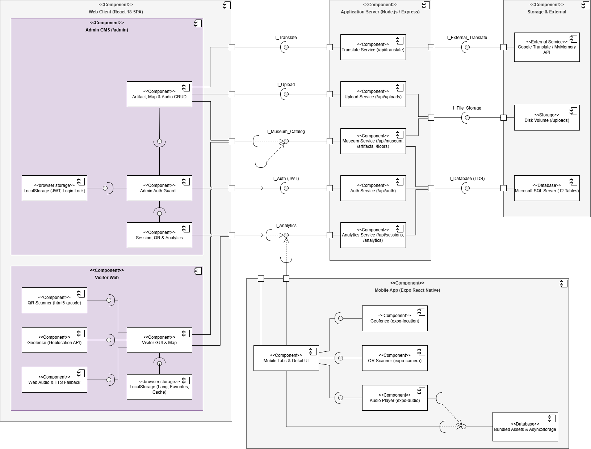

***Figure 2.1: Component Diagram***

## 2.2. Deployment Diagram

The Deployment Diagram models the physical deployment architecture in conformance with UML 2.5: Hardware Devices (`<<device>>`) ➔ Software Execution Environments (`<<execution environment>>`) ➔ Software Artifacts (`<<artifact>>`) and Database Systems (`<<database system>>`), annotated with network protocols and listening ports:

1. **Visitor Client Node (Visitor Phone / Tablet):**
   - Hardware device `<<device>>`: Visitor's personal smartphone or tablet.
   - Execution environment `<<execution environment>>`:
     - `Mobile Web Browser Runtime` (Safari, Chrome) running `VisitorApp.spa`.
     - Or native `Android OS Runtime` executing the standalone `museum-audio-guide.apk` package (operating 100% offline with assets bundled via `assetMap.ts`).
   - Storage `<<database system>>`: `LocalStorage` (Web) or `AsyncStorage` (Android).

2. **Administrator Workstation Node (Admin PC / Workstation):**
   - Hardware device `<<device>>`: Administrator desktop or laptop workstation.
   - Execution environment `<<execution environment>>`: `Desktop Web Browser` executing the `AdminCMS.spa` bundle.

3. **Application Server Node (Application Server - Docker Host):**
   - Execution environment `<<execution environment>>`: `Docker Engine Runtime` orchestrating two service containers defined in `docker-compose.yml`:
     - **Frontend Container (`<<Nginx Web Server>>`):** Listening on port `80/8080`, serving compiled static web assets, configured with `client_max_body_size 35m`, and acting as a reverse proxy for backend API routes.
     - **Backend Container (`<<Node.js 20 Runtime>>`):** Listening on port `4000`, running the Express + TypeScript REST API alongside `Multer` upload handling.

4. **Database Server Node (Database Server):**
   - Execution environment `<<execution environment>>`: `Microsoft SQL Server 2019/2022 Engine` (listening on standard port `1433`).
   - Storage `<<database system>>`: `MuseumGuide DB` relational database schema with 12 tables in 3NF.

5. **Media Storage Volume Node (Media Storage Volume):**
   - Execution environment `<<execution environment>>`: `Persistent File System` storing audio assets `/uploads/audio/*.mp3` (≤ 30MB) and graphic assets (≤ 10MB).

6. **CI/CD Automation & Global Distribution Infrastructure:**
   - `GitHub Actions Cloud Runner`: Orchestrates automated testing and concurrent deployment to three target channels: GitHub Pages (Web Demo), GHCR (Docker Images), and GitHub Releases (Android APK).

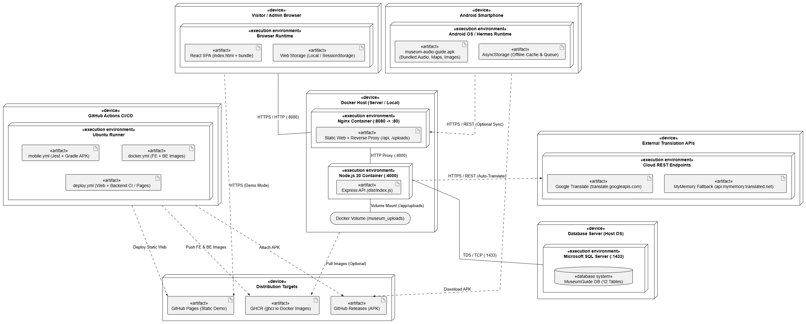

***Figure 2.2: Deployment Diagram***

## 2.3. Relational Data Model (ERD)

The database schema is normalized to Third Normal Form (3NF), modeling business relations among administrators, artifacts, multilingual translations, audio assets, karaoke subtitles, and visitor session telemetry. It strictly mirrors `backend/src/db/schema.sql` across 12 core entities:

1. **`AdminUser` (Administrator Account):** Manages authentication credentials and privilege levels for museum administrative personnel.
   - `Id` [PK, int, IDENTITY]: Auto-incrementing primary key for the admin account.
   - `Email` [string, UNIQUE]: Administrative login email address.
   - `PasswordHash` [string]: Cryptographic password hash generated via bcryptjs.
   - `DisplayName` [string]: Public display name of the administrator.
   - `Role` [string]: Administrative authorization role (default `'ADMIN'`).
   - `FailedAttempts` [int]: Counter tracking consecutive failed login attempts for brute-force mitigation (triggered at threshold $N = 5$).
   - `LockedUntil` [datetime2, nullable]: Timestamp indicating when the account lock expires in the backend (1 minute, `LOCK_MS = 60_000` in `auth.ts`; coupled with a 5-minute UI lock in `localStorage` via `loginLock.ts`).
2. **`Floor` (Exhibition Floor / Area):**
   - `Id` [PK, int]: Identifier for each exhibition floor or area (e.g., `1` - Outdoor Courtyard, `2` - Ground Floor).
   - `MapImage` [string]: File path to the floor plan graphic used for visual navigation.
   - `Width` [float]: Display canvas width (in pixels or normalized coordinate units).
   - `Height` [float]: Display canvas height.
3. **`FloorTranslation` (Multilingual Floor Name Translation):**
   - `FloorId` [PK, FK, int]: Foreign key referencing `Floor`, configured with `ON DELETE CASCADE`.
   - `Lang` [PK, char(2)]: ISO 639-1 language code (`vi`, `en`, `zh`, `ko`, `ja`).
   - `Name` [string]: Localized display name of the floor (e.g., "Tầng trệt", "Ground Floor", "一楼").
4. **`Artifact` (Exhibited Artifact & Positioning Parameters):**
   - `Id` [PK, string]: Unique primary key of the artifact in the system (e.g., `WRM001`, `AIR-F5A`).
   - `Code` [string]: Standardized artifact code used for rapid indexing and QR link generation (`ART-001`, `ART-002`).
   - `FloorId` [FK, int]: Foreign key referencing `Floor`.
   - `MapX` [float]: Normalized horizontal coordinate on the floor plan graphic (ratio 0.0 – 1.0).
   - `MapY` [float]: Normalized vertical coordinate on the floor plan graphic (ratio 0.0 – 1.0).
   - `Latitude` [float, nullable]: Physical GPS latitude coordinate used in Haversine distance computations.
   - `Longitude` [float, nullable]: Physical GPS longitude coordinate used in Haversine distance computations.
   - `TriggerRadius` [float, nullable]: Configurable geofencing activation radius per artifact (defaults to 15 meters via `DEFAULT_TRIGGER_RADIUS` in `geofence.ts`).
   - `CreatedAt` [bigint, nullable]: Record creation timestamp (Unix timestamp).
   - `SortOrder` [int]: Display priority order within the artifact catalog.
5. **`ArtifactTranslation` (Multilingual Artifact Content Translation):**
   - `ArtifactId` [PK, FK, string]: Foreign key referencing `Artifact`, configured with `ON DELETE CASCADE`.
   - `Lang` [PK, char(2)]: ISO 639-1 language code (`vi`, `en`, `zh`, `ko`, `ja`).
   - `Title` [string]: Localized title and designation of the artifact.
   - `Description` [text]: Full descriptive text and detailed interpretive narration for the artifact.
6. **`ArtifactImage` (Artifact Media Gallery):**
   - `ArtifactId` [PK, FK, string]: Foreign key referencing `Artifact`, configured with `ON DELETE CASCADE`.
   - `SortOrder` [PK, int]: Display sequence index within the image carousel.
   - `Url` [string]: File path to the high-resolution image hosted on the CDN.
7. **`ArtifactAudio` (Multilingual Audio Narration Track):**
   - `ArtifactId` [PK, FK, string]: Foreign key referencing `Artifact`, configured with `ON DELETE CASCADE`.
   - `Lang` [PK, char(2)]: Target language code for the audio recording.
   - `Url` [string]: File path to the high-quality audio file (MP3/WAV/AAC) hosted on the CDN (≤ 30MB).
8. **`SubtitleCue` (Time-Synchronized Karaoke Subtitle Cue):**
   - `ArtifactId` [PK, FK, string]: Foreign key referencing `Artifact`, configured with `ON DELETE CASCADE`.
   - `Lang` [PK, char(2)]: Language code of the subtitle stream.
   - `SortOrder` [PK, int]: Sequence index of the subtitle cue.
   - `StartSec` [float]: Playback offset timestamp where the dialogue cue begins (in seconds).
   - `EndSec` [float]: Playback offset timestamp where the dialogue cue ends (in seconds).
   - `Text` [text]: Subtitle text content displayed in synchronization with the spoken narration.
9. **`VisitorSession` (Active Visitor Browsing Session):**
   - `SessionId` [PK, string]: Anonymous visitor session identifier (UUID v4 generated upon application entry).
   - `DeviceType` [string]: Client device classification (`Mobile`, `Tablet`, `Desktop`—matching the backend Zod schema and mobile telemetry).
   - `Browser` [string]: Client browser runtime (`Safari`, `Chrome`, `Firefox`, `Expo Android App`).
   - `Lang` [string]: Currently active language selected during the session.
   - `CurrentArtifactId` [string, nullable]: Identifier of the artifact currently being viewed or listened to.
   - `CurrentArtifactTitle` [string, nullable]: Title of the active artifact for real-time monitoring on the Admin Dashboard.
   - `StartedAt` [bigint]: Session commencement timestamp (Unix timestamp).
   - `LastActive` [bigint]: Most recent client heartbeat interaction timestamp.
10. **`ListenEvent` (Audio Narration Listening Event Log):**
    - `Id` [PK, string]: Unique identifier for the listening event record.
    - `SessionId` [string]: Logical session identifier referencing `VisitorSession` (unconstrained by rigid foreign key to support historical retention and offline sync).
    - `ArtifactId` [string]: Logical artifact identifier referencing `Artifact`.
    - `ArtifactCode` [string]: Artifact code captured at the moment of playback (`ART-xxx`).
    - `ArtifactTitle` [string]: Artifact title captured at the moment of playback.
    - `Lang` [string]: Language code of the audio track that was played.
    - `Timestamp` [bigint]: Exact Unix timestamp when the playback event transpired.
11. **`Museum` (Singleton Museum Configuration & Contact Info):**
    - `Id` [PK, int, CHECK(Id=1)]: Unique configuration primary key enforcing singleton table integrity.
    - `Hotline` [string]: Visitor customer support phone hotline.
    - `Banner` [string]: File path to the primary promotional banner image shown on the home view.
12. **`MuseumTranslation` (Multilingual Museum Profile Translation):**
    - `Lang` [PK, char(2)]: ISO 639-1 language code (`vi`, `en`, `zh`, `ko`, `ja`).
    - `Name` [string]: Official localized name of the museum institution.
    - `Address` [string]: Physical street address of the museum.
    - `OpenHours` [string]: Visiting hours and operational schedule.
    - `Description` [text]: Localized institutional overview and historical background narrative (UC06).  
    *(Note: The favorite artifacts list for casual visitors is persisted directly within client-side `LocalStorage` / `AsyncStorage` under the key `user_favorites`, guaranteeing an instantaneous and frictionless experience without requiring account creation)*.

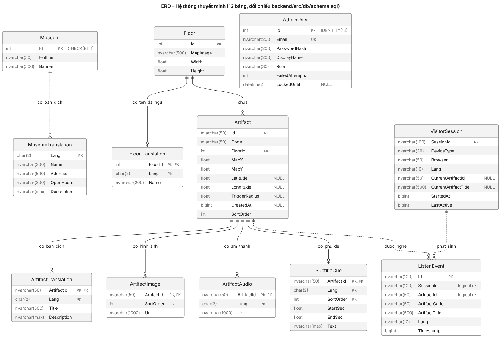

***Figure 2.3: Entity-Relationship Diagram (12 Tables in 3NF)***

## 2.4. Data Flow Diagrams (DFD)

To articulate data movement across the Web SPA, Android App, and Backend MSSQL in accordance with software engineering guidelines, the project defines a three-tier DFD model (`docs/design/dfd/en/DFD_en.md`):

- **DFD Level 0 (`DFD_Level0_en.puml`):** Models system boundaries across 4 external entities: **Visitor** (Web & Android App), **Administrator** (Web CMS), **GPS Positioning System**, and **External Translation Services** (Google Translate API & MyMemory API).

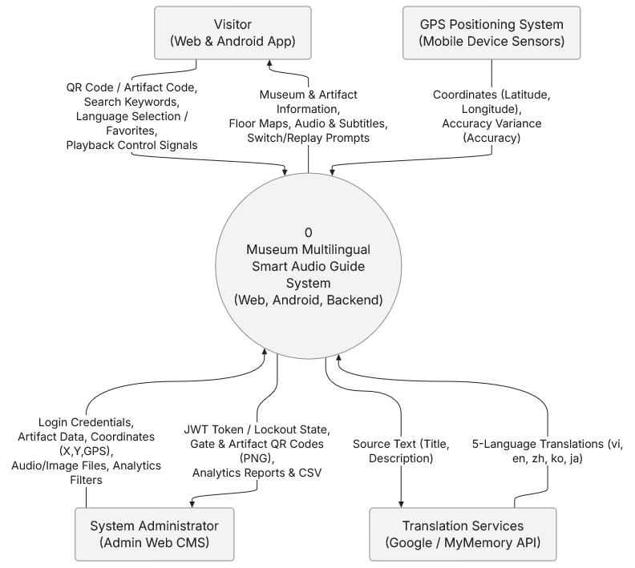

***Figure 2.4: Data Flow Diagram Level 0 (System Context Diagram)***

- **DFD Level 1 (`DFD_Level1_en.puml`):** Decomposes system operations into 6 principal processes (`1.0` Admin Authentication, `2.0` Exploration/QR/Geofence, `3.0` Audio Playback/Subtitles/Multilingual, `4.0` Local Favorites, `5.0` Catalog/Map/Audio/Translation Management, `6.0` Sessions/QR/Analytics) interacting with 5 data stores (`D1` AdminUser, `D2` Museum/Floor/Artifact/Translation, `D3` Audio/Image/SubtitleCue, `D4` Local/AsyncStorage, `D5` VisitorSession/ListenEvent).

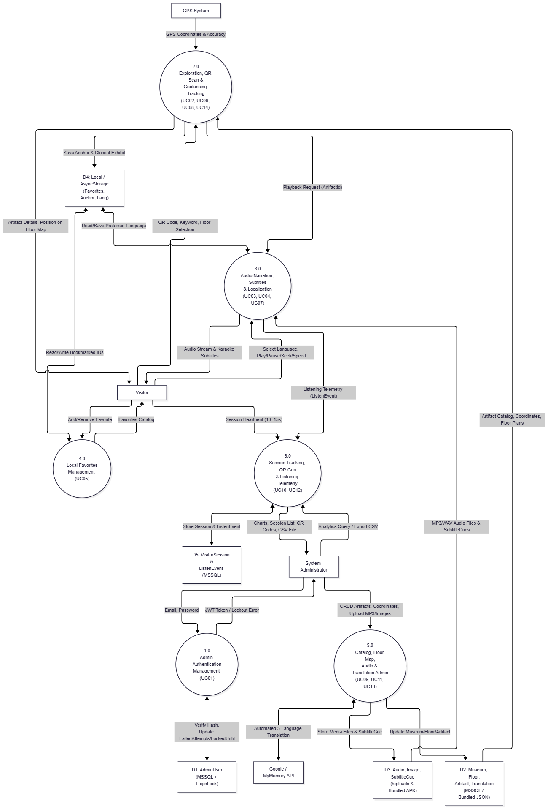

***Figure 2.5: Data Flow Diagram Level 1 (Functional Decomposition)***

- **DFD Level 2 (`DFD_Level2_Geofence_en.puml`):** Provides detailed specification of the core positioning pipeline: `2.1` (Decode QR & set `anchorArtifactId`) → `2.2` (Filter GPS `accuracy <= 150m` & compute Haversine distance) → `2.3` (Evaluate `distance <= 15m` to auto-play or prompt `switch`/`replay`) → `3.1` (Load audio/subtitles & dispatch `ListenEvent`).

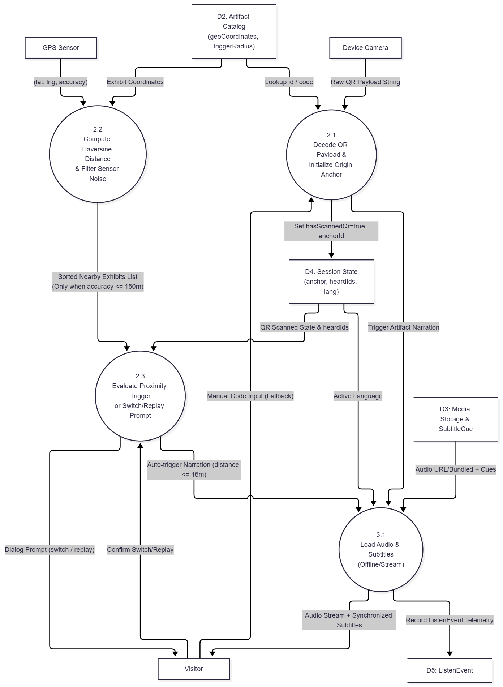

***Figure 2.6: Data Flow Diagram Level 2 (Process 3.0 Geofencing Positioning Pipeline)***


---

# CHAPTER 3: DETAILED SPECIFICATIONS OF THE 14 USE CASES

## 3.1. Overall Use Case Diagram and Actor Classification

The Museum Multilingual Smart Audio Guide System is structured around four primary actors participating in operational business workflows:

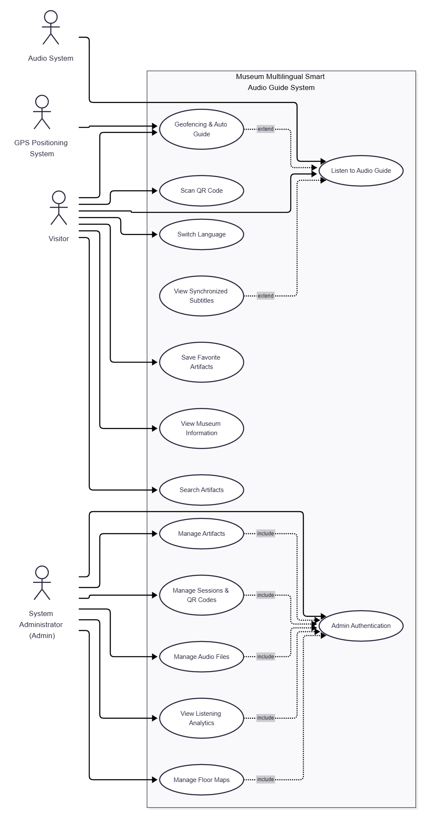

***Figure 3.1: Overall System Use Case Diagram (14 Core Use Cases)***

| **Actor** | **Classification** | **Role & Permissions Description** |
|:---|:---|:---|
| **Visitor (`Visitor`)** | Human Actor | General audience accessing the service via the Web SPA or Android App (`museum-audio-guide.apk`). Permitted to browse catalogs, scan QR codes, stream audio guides, view synchronized subtitles, switch languages, view museum information, and manage personal favorites without mandatory account registration or login. |
| **Administrator (`Admin`)** | Human Actor | Museum administrative and curatorial personnel. Upon successful authentication at `/admin/login`, granted full permissions to manage the artifact catalog, 5-language translations, interactive floor maps, tour sessions, audio assets, and monitor listening analytics. |
| **Audio System (`AudioSystem`)** | External System Actor | The underlying audio delivery and streaming infrastructure: On Android, utilizes the operating system's native Audio Engine to play pre-packaged MP3 assets embedded within the APK (`assetMap.ts`); on the Web, uses the HTML5 Web Audio API / static HTTP server streams with Web Speech API fallback. Directly interfaces with UC03 (Listen to Audio Guide). |
| **GPS Positioning System (`GpsSystem`)** | Sensor Actor | Device-embedded GPS hardware and the browser/runtime Geolocation API (`navigator.geolocation` / `expo-location`), providing periodic coordinate feeds `(lat, lng, accuracy)` for automated Haversine distance computations. |

***Table 3.1: System Actor Catalog (Final Release)***

---

## 3.2. Detailed Use Case Specifications

### 3.2.1. UC01 — Administrator Authentication (Login)

***Use Case Diagram — UC01***

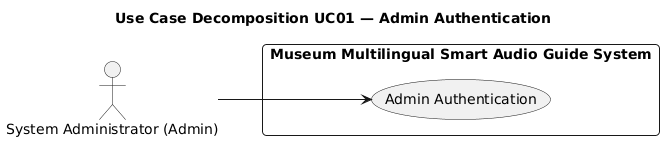

***Use Case Specification — UC01:***

| **Specification Item** | **Detailed Content** |
|:---|:---|
| **Actor** | Administrator (`Admin`) |
| **Completion Level** | Focused Use Case |
| **Brief Description** | Authenticates administrative identity using pre-provisioned credentials to authorize access to the Admin CMS Dashboard. Features automated two-tier brute-force lockout protection upon repeated consecutive authentication failures. |
| **Preconditions** | The administrator is not currently logged in, or the prior session token has expired. |
| **Trigger** | The administrator initiates login at `/admin/login`. |
| **Postconditions** | - **Success:** An authenticated administrative session (JWT Token) is issued, and the user is redirected to the Admin Dashboard.<br>- **Failure:** Access is denied, an error prompt is presented, and no administrative session is established. |

***Main Success Scenario — UC01:***

| Step | Actor Action | System Response |
|:---:|:---|:---|
| 1 | Admin navigates to the administrative URL `/admin/login`. | |
| 2 | | The system verifies the lockout state in client `localStorage` (`loginLock.ts`). If currently within a 5-minute cooldown, it displays a countdown timer and halts input (E2). |
| 3 | Admin inputs administrative Email (`admin@museum.vn`) and Password, then clicks "Sign In". | |
| 4 | | Frontend dispatches authentication request `POST /api/auth/login`. |
| 5 | | Backend inspects `AdminUser.LockedUntil` and verifies the cryptographic hash via `bcryptjs` (E1). |
| 6 | | Backend resets `FailedAttempts = 0` and issues a signed JWT Token encapsulating user privileges. |
| 7 | | Frontend persists the JWT Token and redirects the Admin to the Admin Dashboard view. The Use Case terminates successfully. |

***Alternative Flows:*** None.

***Exception Flows:***
- **E1 – Invalid Credentials:** If the email address or password does not match system records, the system displays "Invalid email or password" and increments the consecutive failure counter.
- **E2 – Two-Tier Brute-Force Lockout Triggered:** If 5 consecutive failed attempts occur:
  - Frontend automatically locks the login form for 5 minutes (`300,000 ms` in `localStorage`), presenting a visible real-time countdown timer.
  - Concurrently, Backend locks the account record for 1 minute (`LOCK_MS = 60_000` in `AdminUser.LockedUntil`, returning HTTP `429 Too Many Requests`) and rejects subsequent authentication attempts during this cooldown window.

***Activity Diagram — UC01:***

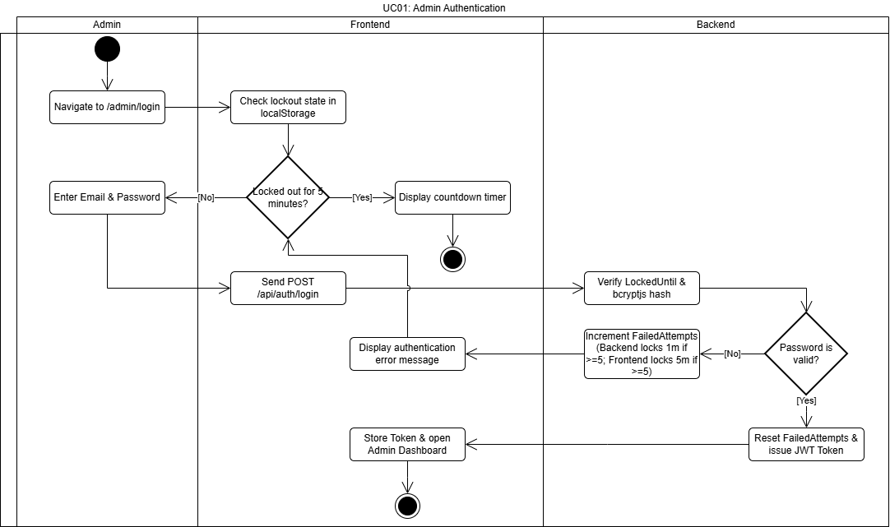

---

### 3.2.2. UC02 — Scan QR Code

***Use Case Diagram — UC02***

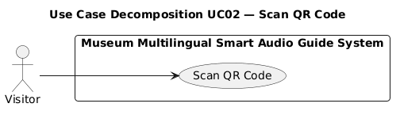

***Use Case Specification — UC02:***

| **Specification Item** | **Detailed Content** |
|:---|:---|
| **Actor** | Visitor (`Visitor`) |
| **Completion Level** | Focused Use Case |
| **Brief Description** | The visitor uses their mobile device camera to scan a QR code situated at the entrance gate or on an artifact display placard. The system instantaneously decodes the payload, presents the matching exhibit details, and establishes an origin anchor point (`anchorArtifactId`) for subsequent automated location tracking. |
| **Preconditions** | - Visitor's mobile device possesses an operational camera.<br>- Camera permissions are granted to the browser/app (or the manual input fallback A1 is used). |
| **Trigger** | Visitor taps the "Scan QR" button on the navigation bar or home screen. |
| **Postconditions** | - **Success:** The system decodes the QR code payload, renders the artifact detail screen, and initiates background location tracking.<br>- **Failure:** An error prompt is displayed with an option to enter the artifact code manually. |

***Main Success Scenario — UC02:***

| Step | Actor Action | System Response |
|:---:|:---|:---|
| 1 | Visitor selects the "Scan QR" feature. | |
| 2 | | System verifies camera permissions (`html5-qrcode` on Web / `expo-camera` on Android) and initializes the scanning viewfinder (E2). |
| 3 | Visitor aligns the device camera with the physical QR code on an artifact or gate placard. | |
| 4 | | System scans video frames, detecting and decoding the QR payload string via `parseQrPayload()` (E1). |
| 5 | | **If an artifact payload is detected** (`?artifact=<id|code>` or raw code string): System sets the origin anchor (`anchorArtifactId`), marks `hasScannedQr = true`, transitions to the artifact detail view, and triggers audio playback (UC03). |
| 6 | | **If an entrance gate payload is detected** (`?entry=gate`): System marks `hasScannedQr = true` and initializes GPS-driven background tracking (`startTracking(null)`). The Use Case terminates successfully. |

***Alternative Flows:***
- **A1 – Manual Artifact Code Entry:** If camera hardware is unavailable or permissions are denied, the system displays a text entry field for manual code submission (e.g., `WRM001`, `AIR-F5A`). The visitor inputs the code and taps "Search" to navigate directly to the artifact details.

***Exception Flows:***
- **E1 – Unreadable / Damaged QR Code:** The viewfinder cannot resolve a valid payload. The system prompts "Unable to recognize QR code, please adjust distance or lighting" and presents the manual code input fallback (A1).
- **E2 – Camera Permission Denied / Hardware Missing:** The browser or operating system denies camera access. The system seamlessly redirects the visitor to the manual code entry interface (A1).

***Activity Diagram — UC02:***

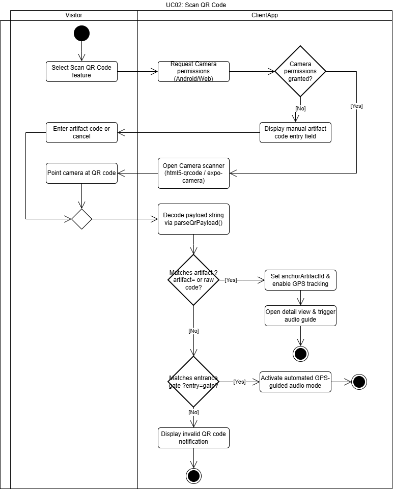

---

### 3.2.3. UC03 — Listen to Audio Guide

***Use Case Diagram — UC03***

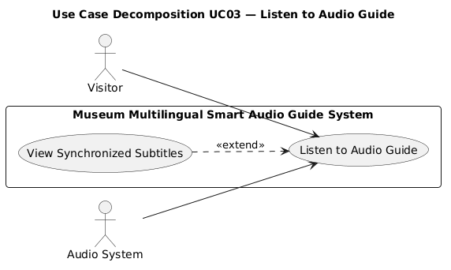

***Use Case Specification — UC03:***

| **Specification Item** | **Detailed Content** |
|:---|:---|
| **Actor** | Visitor (`Visitor`), Audio System (`AudioSystem`) |
| **Completion Level** | Focused Use Case |
| **Brief Description** | Streams the high-quality recorded interpretive narration for an artifact in the visitor's currently selected language. The player supports full playback controls (Play, Pause, Progress Seek, Variable Speed `1x–2x`), background playback with screen turned off (Android App), and extensible synchronized karaoke subtitles via {View Synchronized Subtitles}. |
| **Preconditions** | An target artifact has been identified (via QR code scan, search query, catalog selection, or automated geofencing proximity). |
| **Trigger** | Visitor clicks the "Play" button, or playback is triggered automatically upon approaching an exhibit. |
| **Postconditions** | - **Success:** Audio narration streams smoothly, and the listening event is logged to analytics.<br>- **Failure:** An error message is displayed, and the full transcript text is presented as an accessible reading fallback. |

***Main Success Scenario — UC03:***

| Step | Actor Action | System Response |
|:---:|:---|:---|
| 1 | Visitor selects audio guide playback for an artifact (or auto-triggered). | |
| 2 | | System halts any active audio playback to prevent acoustic overlap. |
| 3 | | System identifies the active language (`vi`, `en`, `zh`, `ko`, `ja`):<br>- **On Android App:** Loads pre-packaged MP3 assets directly from APK storage (`assetMap.ts`) and plays via `expo-audio`.<br>- **On Web SPA:** Streams static audio from `/uploads/audio/` over HTTP Range requests (falling back to Web Speech TTS if audio assets are missing). |
| 4 | Audio System initializes and executes the audio stream. | |
| 5 | | System initializes the docked Audio Player Bar, begins audio streaming, and exposes playback controls: Play/Pause, Seek bar, and Speed toggle (`1x`, `1.25x`, `1.5x`, `2x`) (E1). |
| 6 | Visitor listens to narration and adjusts playback settings as needed (A1, A2). | |
| 7 | | Upon playback commencement, system dispatches telemetry `POST /api/analytics/listen` to record the listening event in the database (when online). The Use Case terminates successfully. |

***Alternative Flows:***
- **A1 – Enable Synchronized Subtitles (Extension Point: View Subtitles):** Visitor taps "Subtitles" on the player. The system triggers {View Synchronized Subtitles} (UC07), loading subtitle cue data and highlighting phrases in real time matching audio timestamps.
- **A2 – Switch Language Mid-Playback:** Visitor selects another language via {Switch Language} (UC04). The system captures the current playback timestamp offset, loads the new language audio stream, and resumes playback from that position.

***Exception Flows:***
- **E1 – Audio Stream Failure / Offline Connectivity Lost (Web):** The web application cannot retrieve audio data from the server. The system alerts "Unable to load audio narration, please verify network connection" and displays the full narration text transcript on screen.

***Activity Diagram — UC03:***

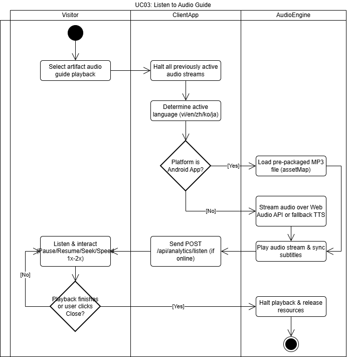

---

### 3.2.4. UC04 — Switch Language

***Use Case Diagram — UC04***

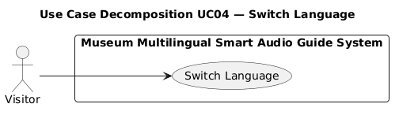

***Use Case Specification — UC04:***

| **Specification Item** | **Detailed Content** |
|:---|:---|
| **Actor** | Visitor (`Visitor`) |
| **Completion Level** | Focused Use Case |
| **Brief Description** | Enables visitors to instantaneously toggle the interface localization and interpretive narration across 5 supported languages: Vietnamese, English, Chinese, Korean, and Japanese without reloading the webpage (Zero Page Reload). |
| **Preconditions** | None. |
| **Trigger** | Visitor clicks the language selector icon on the top header navigation bar. |
| **Postconditions** | Application-wide language state is updated immediately to the selected target language. |

***Main Success Scenario — UC04:***

| Step | Actor Action | System Response |
|:---:|:---|:---|
| 1 | Visitor taps the language selector icon in the navigation bar. | |
| 2 | | System presents a quick-selection modal showcasing 5 language options alongside their national flags (`vi`, `en`, `zh`, `ko`, `ja`). |
| 3 | Visitor selects a target language (e.g., `en`). | |
| 4 | | System updates the global language state store (`langStore`). |
| 5 | | System persists preference to `localStorage` (Web) or `AsyncStorage` (Android). |
| 6 | | System reactively hot-swaps UI text strings, narrative descriptions, audio file references, and subtitle cues without refreshing the page. The Use Case terminates successfully. |

***Activity Diagram — UC04:***

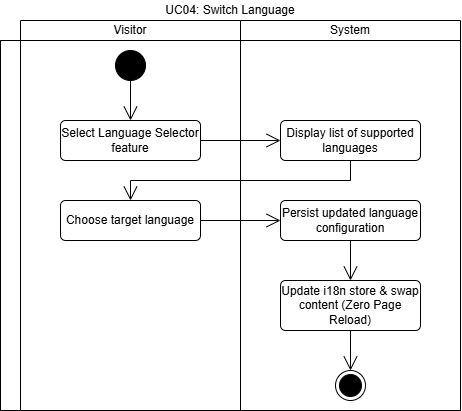

---

### 3.2.5. UC05 — Save Favorite Artifacts

***Use Case Diagram — UC05***

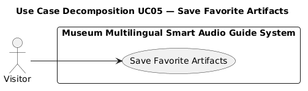

***Use Case Specification — UC05:***

| **Specification Item** | **Detailed Content** |
|:---|:---|
| **Actor** | Visitor (`Visitor`) |
| **Completion Level** | Focused Use Case |
| **Brief Description** | Allows visitors to bookmark remarkable artifacts into a personal "Favorites" list for convenient review or re-listening later. Bookmarked items are stored strictly on the visitor's local device storage (`localStorage` / `AsyncStorage`), preserving privacy without account registration requirements. |
| **Preconditions** | Visitor is browsing an artifact catalog or viewing an artifact's detail screen. |
| **Trigger** | Visitor clicks the heart icon on an artifact card or detail header. |
| **Postconditions** | The artifact's favorite state is updated and persisted on local device storage. |

***Main Success Scenario — UC05:***

| Step | Actor Action | System Response |
|:---:|:---|:---|
| 1 | Visitor taps the heart icon of an artifact. | |
| 2 | | System evaluates the bookmark status in `favStore`. |
| 3 | | **If not bookmarked:** System appends the artifact ID to the favorites list, updates the heart icon to solid red, and saves to `localStorage` / `AsyncStorage`. |
| 4 | | **If already bookmarked:** System removes the artifact ID from the list, reverts the heart icon to an outlined state, and updates storage. |
| 5 | Visitor navigates to the "Favorites" tab. | |
| 6 | | System renders the saved artifacts list. Concurrently, it purges orphaned IDs that no longer exist in the system catalog (`cleanInvalidFavorites`). The Use Case terminates successfully. |

***Activity Diagram — UC05:***

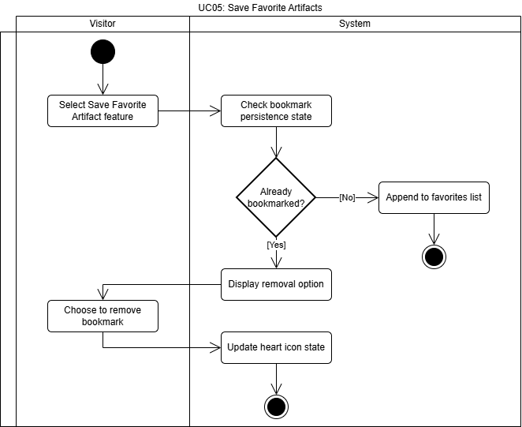

---

### 3.2.6. UC06 — View Museum Information

***Use Case Diagram — UC06***

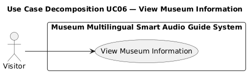

***Use Case Specification — UC06:***

| **Specification Item** | **Detailed Content** |
|:---|:---|
| **Actor** | Visitor (`Visitor`) |
| **Completion Level** | Focused Use Case |
| **Brief Description** | Displays an institutional profile of the museum, including official name, address, telephone hotline, operational visiting hours, and historical background narrative rendered in the active language. |
| **Preconditions** | None. |
| **Trigger** | Visitor taps the "Info" tab on the primary bottom navigation bar. |
| **Postconditions** | Institutional profile information is fully and legibly rendered on screen. |

***Main Success Scenario — UC06:***

| Step | Actor Action | System Response |
|:---:|:---|:---|
| 1 | Visitor taps the "Info" navigation tab. | |
| 2 | | System retrieves museum profile metadata from the database (`GET /api/museum`) or local cache (E1). |
| 3 | | System displays the header banner graphic, museum title, address, visiting hours, historical narrative, and customer service telephone hotline. |
| 4 | Visitor reviews information and can tap the hotline number to initiate a direct telephone call (launches native phone dialer on Android). The Use Case terminates successfully. | |

***Exception Flows:***
- **E1 – Profile Data Loading Error:** Network disconnection occurs. The system displays an error prompt and provides a "Retry" button.

***Activity Diagram — UC06:***

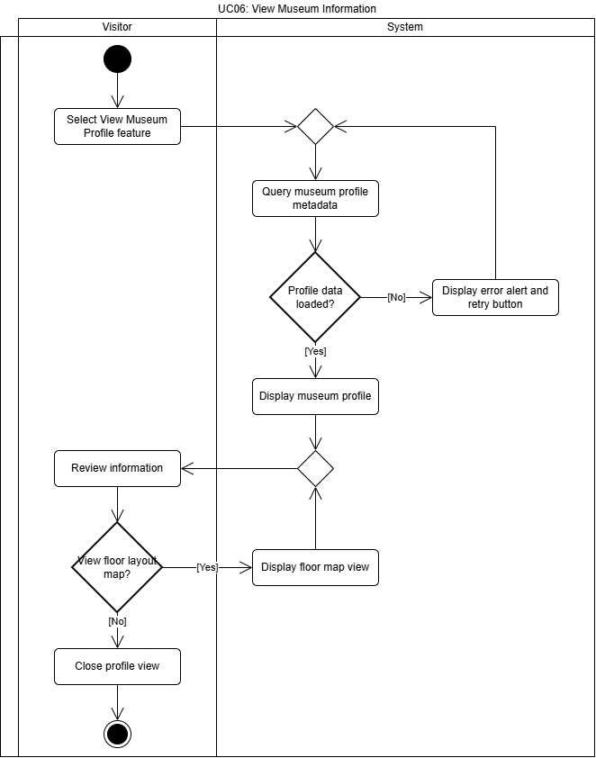

---

### 3.2.7. UC07 — View Synchronized Subtitles

***Use Case Diagram — UC07***

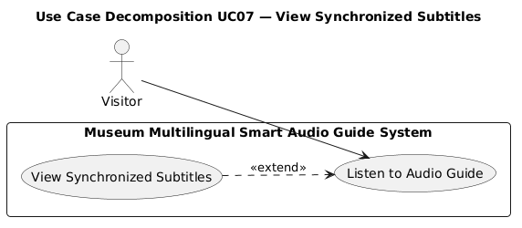

***Use Case Specification — UC07:***

| **Specification Item** | **Detailed Content** |
|:---|:---|
| **Actor** | Visitor (`Visitor`) |
| **Completion Level** | Focused Use Case (Extends UC03) |
| **Brief Description** | Renders time-synchronized karaoke-style subtitles tracking spoken narration timestamps. Assists hearing-impaired visitors and those in noisy environments in absorbing interpretive content. Supports tapping any individual subtitle cue to seek audio playback directly to that timestamp. |
| **Preconditions** | Audio guide playback {Listen to Audio Guide} (UC03) is active, and subtitle cue data (`SubtitleCue`) exists for the current artifact. |
| **Trigger** | Visitor enables the subtitle option (`showSubtitle = true`). |
| **Postconditions** | Subtitles appear in high contrast, advancing smoothly in sync with audio progression. |

***Main Success Scenario — UC07:***

| Step | Actor Action | System Response |
|:---:|:---|:---|
| 1 | Visitor toggles "Subtitles" on the audio player bar. | |
| 2 | | System matches the active playback timestamp (`currentTime`) against the subtitle cue list (`start <= currentTime <= end`). |
| 3 | | System visually emphasizes the active dialogue cue (karaoke highlighting effect) within the mini player and on the expanded transcript list. |
| 4 | Visitor taps an arbitrary dialogue cue in the transcript list. | |
| 5 | | System seeks audio playback (`seekToTime`) to the exact starting offset (`cue.start`) of that phrase and continues playing. The Use Case terminates successfully. |

***Activity Diagram — UC07:***

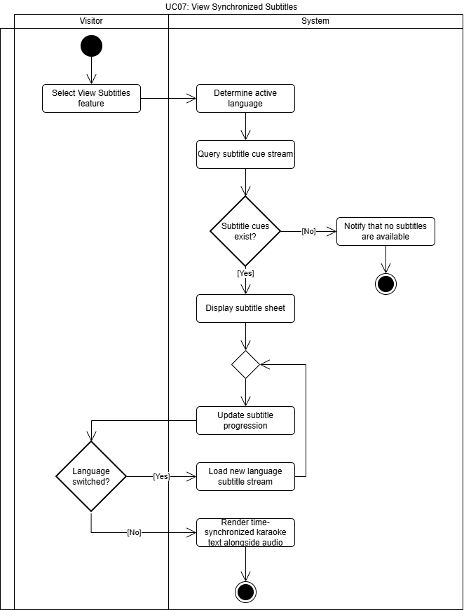


---

### 3.2.8. UC08 — Search Artifacts

***Use Case Diagram — UC08***

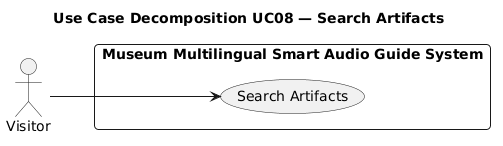

***Use Case Specification — UC08:***

| **Specification Item** | **Detailed Content** |
|:---|:---|
| **Actor** | Visitor (`Visitor`) |
| **Completion Level** | Focused Use Case |
| **Brief Description** | Provides an instantaneous lookup utility across the museum's exhibition catalog: keyword searches against artifact titles, multilingual descriptions, or standardized artifact codes (e.g., `WRM001`, `AIR-F5A`), combined with floor/zone facet filtering. |
| **Preconditions** | None. |
| **Trigger** | Visitor clicks the search input bar within the "Explore" tab and begins typing. |
| **Postconditions** | A filtered list of matching exhibits is dynamically presented on screen. |

***Main Success Scenario — UC08:***

| Step | Actor Action | System Response |
|:---:|:---|:---|
| 1 | Visitor navigates to the "Explore" tab and inputs search terms into the search bar. | |
| 2 | | System executes real-time filtering: performing diacritics-insensitive string matching against title, description (in the active language), or artifact code. |
| 3 | Visitor may optionally select a Floor filter (e.g., Floor 1, Floor 2). | |
| 4 | | System intersects the keyword and floor criteria to narrow the result set. |
| 5 | Visitor selects an artifact card from the filtered results. | |
| 6 | | System navigates to the corresponding artifact detail screen. The Use Case terminates successfully. |

***Activity Diagram — UC08:***

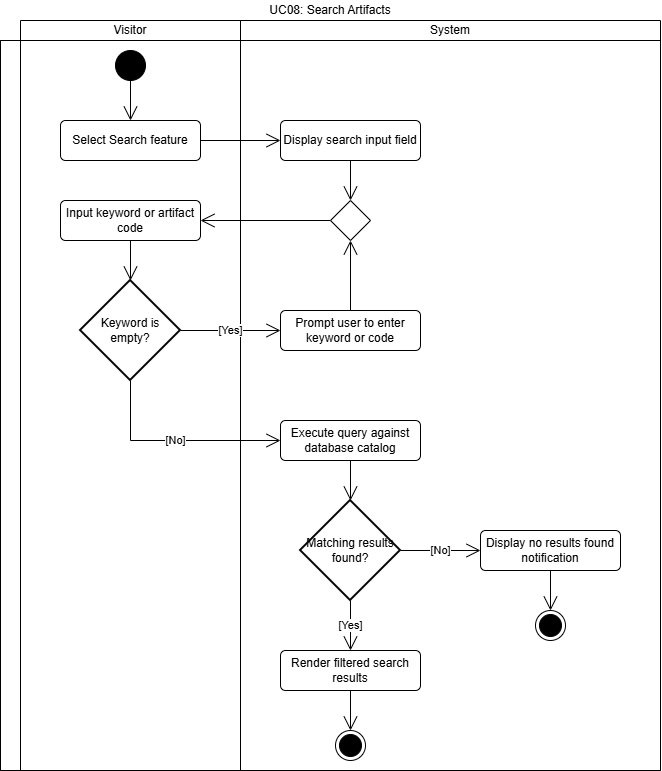

---

### 3.2.9. UC09 — Manage Artifacts

***Use Case Diagram — UC09***


***Use Case Specification — UC09:***

| **Specification Item** | **Detailed Content** |
|:---|:---|
| **Actor** | Administrator (`Admin`) |
| **Completion Level** | Focused Use Case |
| **Brief Description** | Enables Administrators to manage the catalog of all museum exhibits: create new records, edit details, update translations across 5 languages (with automated machine translation via Google Translate API / MyMemory fallback), configure geographic GPS coordinates and activation trigger radius (`triggerRadius`), upload artifact photography (≤ 10MB), and archive/delete de-accessioned exhibits. |
| **Preconditions** | Administrator is successfully authenticated (if not, «include» {Login}). |
| **Trigger** | Admin selects the "Artifacts" navigation menu item on the Admin CMS Dashboard. |
| **Postconditions** | Artifact records within the database are successfully created, updated, or removed, and the management table reflects the latest state. |

***Main Success Scenario — UC09:***

| Step | Actor Action | System Response |
|:---:|:---|:---|
| 1 | Admin navigates to the "Artifacts" view (`/admin/artifacts`). | |
| 2 | | System renders the artifact inventory table equipped with floor filters, a keyword search bar, and action buttons ("Add Artifact", "Edit", "Delete"). |
| 3 | Admin selects a management action to perform (A1, A2, A3). | |
| 4 | Admin populates the form fields and clicks "Save" (A4). | |
| 5 | | System validates input constraints and data integrity (E1, E2). |
| 6 | | System persists record changes to the database (E3), refreshes the table view, and presents a success notification. The Use Case terminates successfully. |

***Alternative Flows:***
- **A1 – Add New Artifact:** At step 3, Admin clicks "Add Artifact". System opens an entry modal: Artifact Code (`ART-xxx`), Title, Exhibition Floor, GPS Coordinates (Latitude, Longitude), Trigger Radius (default 15m), 5-language descriptive text (with an auto-translate trigger button), and image upload (≤ 10MB). Admin submits data and continues to step 4.
- **A2 – Edit Existing Artifact:** At step 3, Admin selects an artifact and clicks "Edit". System populates the modal with existing entity data. Admin modifies parameters and continues to step 4.
- **A3 – Delete Artifact:** At step 3, Admin clicks "Delete" on an artifact. System displays a confirmation dialog. Upon confirmation, system deletes the artifact and associated media relations from the database and refreshes the table.
- **A4 – Cancel Operation:** Inside an add/edit modal or delete confirmation dialog, Admin clicks "Cancel". System dismisses the modal, discards transient changes, and preserves existing data.

***Exception Flows:***
- **E1 – Missing Mandatory Fields:** Required parameters (artifact title, code, or floor assignment) are blank. System highlights defective fields in red and prevents submission.
- **E2 – Duplicate Artifact Identifier:** The submitted artifact code already exists in the catalog. System alerts "Artifact code already exists, please designate a unique code".
- **E3 – Image Upload Exceeds Size Limit:** Selected image file exceeds 10MB. System rejects the payload with an explanatory error notice.

***Activity Diagram — UC09:***

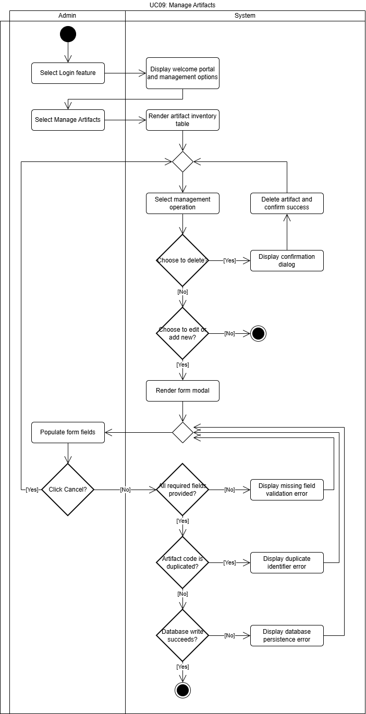

---

### 3.2.10. UC10 — Manage Sessions and QR Codes

***Use Case Diagram — UC10***

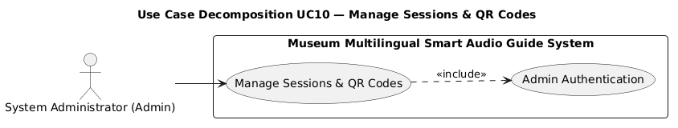

***Use Case Specification — UC10:***

| **Specification Item** | **Detailed Content** |
|:---|:---|
| **Actor** | Administrator (`Admin`) |
| **Completion Level** | Focused Use Case |
| **Brief Description** | Enables Administrators to schedule, configure, monitor, and conclude visitor tour sessions (visiting shifts, registered tour groups), automatically assign session identifiers (`SES-xx`), monitor active connected devices in real time (Heartbeat 10–15s, timeout 35s), and generate/export high-resolution QR codes for entrance gates and individual exhibits for decal printing. |
| **Preconditions** | Administrator is successfully authenticated (if not, «include» {Login}). |
| **Trigger** | Admin selects "Visitor Sessions" or "QR Management" from the navigation menu. |
| **Postconditions** | Visitor sessions are created, updated, or archived; corresponding high-resolution PNG QR graphics are exported correctly. |

***Main Success Scenario — UC10:***

| Step | Actor Action | System Response |
|:---:|:---|:---|
| 1 | Admin navigates to the "Visitor Sessions" view. | |
| 2 | | System renders active and historical tour sessions as card tiles, each displaying: Session Code (`SES-xx`), Shift Title, Time Window, Status (Active / Upcoming / Concluded), Connected Visitor Count, and Aggregate Listen Count (E3). |
| 3 | Admin selects a session management action (A1, A2, A3, A4). | |
| 4 | Admin inputs session parameters and clicks "Save" (A5). | |
| 5 | | System validates operational schedule time constraints (E1). |
| 6 | | System assigns a unique session code (`SES-xx`), updates real-time operational status, persists to database (E2), and generates the entrance QR code. |
| 7 | | System refreshes the session card list. The Use Case terminates successfully. |

***Alternative Flows:***
- **A1 – Create New Session:** Admin clicks "Create New Session". System displays input modal: Shift Name, Scheduled Date, Start Time, End Time, and Reception Notes. Admin submits data and continues to step 4.
- **A2 – Edit Session:** Admin clicks the edit icon on a session card. System loads pre-populated parameters for schedule or note adjustments.
- **A3 – Delete Session:** Admin clicks the delete icon on a session card. System prompts with an audit warning if listening telemetry has already been recorded. Upon Admin confirmation, the session record is purged.
- **A4 – Export Gate & Artifact QR Codes:** Admin selects a session or artifact and clicks "Export QR Code". System generates a high-resolution PNG file containing the branded QR graphic, museum logo, and standardized label, facilitating printing for physical signage and reception counters.
- **A5 – Cancel Operation:** Admin clicks "Cancel" on a modal. System dismisses the dialog without modifying records.

***Exception Flows:***
- **E1 – Invalid Operational Schedule:** End time is earlier than or equal to start time. System flags time fields in red and requests correction.
- **E2 – Database Write Failure:** System alerts "Unable to save session information, please retry".
- **E3 – Failed to Load Session Catalog:** Network or database connection loss. System presents an error message and a retry button.

***Activity Diagram — UC10:***

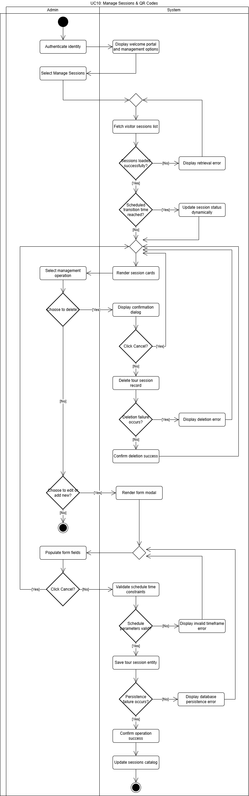

---

### 3.2.11. UC11 — Manage Audio Files

***Use Case Diagram — UC11***


***Use Case Specification — UC11:***

| **Specification Item** | **Detailed Content** |
|:---|:---|
| **Actor** | Administrator (`Admin`) |
| **Completion Level** | Focused Use Case |
| **Brief Description** | Enables Administrators to upload, audition, replace, or delete recorded narration audio files (MP3, WAV formats) with file sizes **≤ 30MB** mapped to specific artifacts across designated languages, while providing an authoring interface for time-aligned karaoke subtitle cues (`SubtitleCue`). |
| **Preconditions** | - Admin is successfully authenticated (if not, «include» {Login}).<br>- The target artifact entity exists in the database catalog. |
| **Trigger** | Admin selects "Audio Files" on the navigation bar (`/admin/audio`). |
| **Postconditions** | The audio asset is securely uploaded, linked to the appropriate artifact and language in the MSSQL database, and corresponding subtitle cues are stored. |

***Main Success Scenario — UC11:***

| Step | Actor Action | System Response |
|:---:|:---|:---|
| 1 | Admin navigates to the "Audio Files" section. | |
| 2 | | System renders an inventory of audio tracks mapped by artifact and language, equipped with an embedded preview audio player. |
| 3 | Admin selects the target artifact and language for audio management. | |
| 4 | Admin chooses an audio file from local storage (MP3/WAV ≤ 30MB) and clicks "Upload". | |
| 5 | | System dispatches `POST /api/uploads/audio`, verifies MIME type and file size (E1). Backend saves the file to `/uploads/audio/` and returns the accessible asset URL. |
| 6 | Admin auditions the uploaded audio and enters/edits the time-coded subtitle cues (`start`, `end`, `text`). | |
| 7 | | System persists `SubtitleCue` entries and updates the audio resource URL in the database (`PUT /api/artifacts/:id`). The Use Case terminates successfully. |

***Alternative Flows:***
- **A1 – Replace Existing Audio Track:** Admin selects an existing audio entry and uploads a replacement file. System overwrites the storage asset and updates the catalog URL pointer.
- **A2 – Remove Audio Track:** Admin clicks "Delete" on an audio asset. Upon confirmation, system detaches the URL reference and deletes associated subtitle cues.

***Exception Flows:***
- **E1 – Audio File Size Exceeded:** Uploaded file exceeds the 30MB threshold. System rejects the upload and displays an error alert.

***Activity Diagram — UC11:***

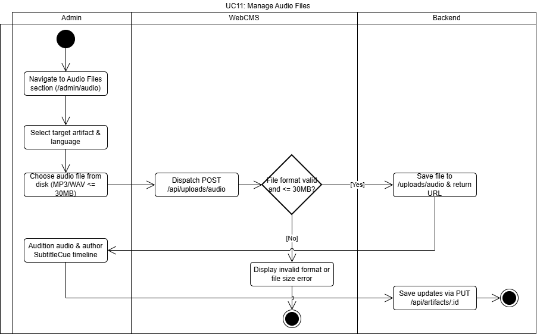

---

### 3.2.12. UC12 — View Listening Analytics

***Use Case Diagram — UC12***


***Use Case Specification — UC12:***

| **Specification Item** | **Detailed Content** |
|:---|:---|
| **Actor** | Administrator (`Admin`) |
| **Completion Level** | Focused Use Case |
| **Brief Description** | Delivers visual telemetry reports and analytical charts detailing visitor listening engagement segmented by artifact, language distribution, tour session, or temporal granularity (hourly, daily, weekly, monthly), with full data export to CSV format. |
| **Preconditions** | Admin is successfully authenticated (if not, «include» {Login}). |
| **Trigger** | Admin selects "Listening Analytics" on the Admin CMS Dashboard (`/admin/analytics`). |
| **Postconditions** | Analytical charts and aggregate data tables are rendered based on selected filters; reports are exported upon request. |

***Main Success Scenario — UC12:***

| Step | Actor Action | System Response |
|:---:|:---|:---|
| 1 | Admin navigates to the "Listening Analytics" section. | |
| 2 | | System renders the analytics overview view equipped with filter facets: Date Range, Visitor Session, Exhibition Floor, Artifact, and Language. |
| 3 | Admin configures desired analytical filters and clicks "Apply Filters". | |
| 4 | | System validates filter parameters (E1), queries backend telemetry APIs (`GET /api/analytics/events` & `/summary`), and aggregates metrics (E2). |
| 5 | | System renders interactive Recharts visualizations (bar chart of top exhibits, pie chart of language distribution, trend line of listening events over time) alongside detailed tabular summaries. |
| 6 | Admin inspects metrics and can click "Export CSV" (A1). The Use Case terminates successfully. | |

***Alternative Flows:***
- **A1 – Export Analytics Report to CSV:** At step 6, Admin clicks "Export CSV Report". System compiles telemetry data into a downloadable `.csv` file (encoded with UTF-8 BOM for spreadsheet compatibility) and downloads it to the client machine.

***Exception Flows:***
- **E1 – Invalid Temporal Filter Range:** Start date is set later than end date. System flags the range in red and requests adjustment.
- **E2 – Empty Telemetry Dataset:** No listening events match the filtered criteria. System prompts "No data recorded for the selected timeframe" while preserving filter selections.

***Activity Diagram — UC12:***

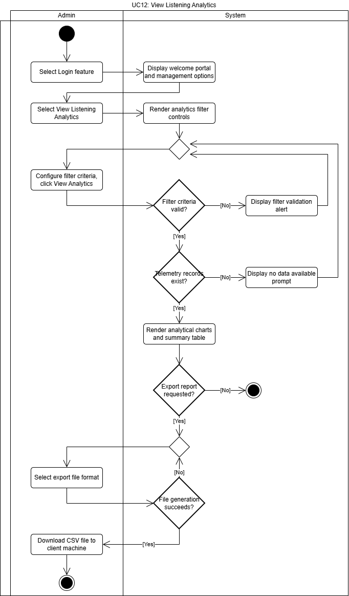

---

### 3.2.13. UC13 — Manage Floor Maps

***Use Case Diagram — UC13***

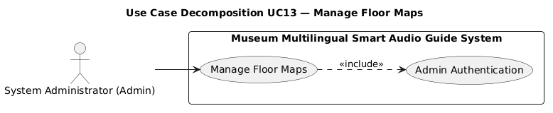

***Use Case Specification — UC13:***

| **Specification Item** | **Detailed Content** |
|:---|:---|
| **Actor** | Administrator (`Admin`) |
| **Completion Level** | Focused Use Case |
| **Brief Description** | Enables Administrators to manage floor plans and exhibition zones: upload floor plan graphics, configure layout dimensions, and utilize an interactive drag-and-drop canvas to calibrate artifact spatial coordinates (X, Y) on the floor plan for visitor wayfinding. |
| **Preconditions** | - Admin is successfully authenticated (if not, «include» {Login}).<br>- Target artifacts have been registered within the catalog. |
| **Trigger** | Admin selects "Floor Maps" on the Admin CMS Dashboard (`/admin/maps`). |
| **Postconditions** | Floor plan configurations and calibrated artifact coordinates are persisted accurately in the database. |

***Main Success Scenario — UC13:***

| Step | Actor Action | System Response |
|:---:|:---|:---|
| 1 | Admin navigates to the "Floor Maps" section. | |
| 2 | | System displays the catalog of exhibition floors alongside their respective floor plan layout graphics. |
| 3 | Admin selects a map management operation (A1, A2, A3). | |
| 4 | Admin performs spatial calibration on the interactive canvas and clicks "Save Map" (A4). | |
| 5 | | System validates spatial coordinate ranges (E1). |
| 6 | | System saves floor layout metadata and calibrated artifact coordinates into the database (`PUT /api/floors/:id`, `PUT /api/artifacts/:id`), refreshes the view, and alerts success. The Use Case terminates successfully. |

***Alternative Flows:***
- **A1 – Add New Floor Map:** Admin clicks "Add New Floor", inputs floor name, sequence number, and uploads a layout image (PNG/JPG). System verifies image payload (E1) and opens the spatial coordinate assignment editor. Admin continues to step 4.
- **A2 – Edit Floor & Drag-and-Drop Coordinate Calibration:** Admin selects a floor and clicks "Edit Map Layout". System renders an interactive floor plan canvas alongside a drawer of unassigned floor artifacts. Admin drags artifact pin icons onto the layout. System automatically computes normalized coordinates (X, Y ranging from 0.0 to 1.0). Admin continues to step 4.
- **A3 – Delete Floor Map:** Admin selects a floor layout and clicks "Delete". Upon confirmation, system removes the floor plan and clears coordinate assignments from associated artifacts.
- **A4 – Cancel Operation:** Admin clicks "Cancel". System dismisses the canvas editor without saving recent coordinate movements.

***Exception Flows:***
- **E1 – Invalid Floor Plan Image / File Exceeds Limit:** Selected file is not an image or exceeds 20MB. System rejects the upload and prompts for a valid file.
- **E2 – Database Update Failure:** System alerts "Unable to save floor coordinates, please retry".

***Activity Diagram — UC13:***

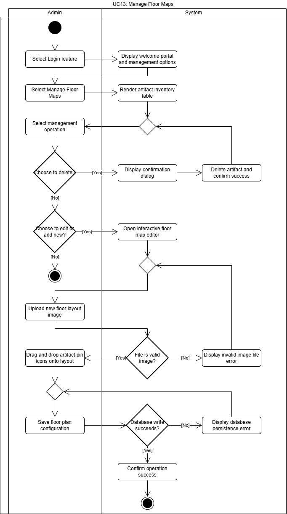

---

### 3.2.14. UC14 — Geofencing and Auto Guide

***Use Case Diagram — UC14***

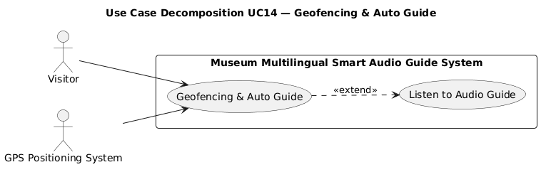

***Use Case Specification — UC14:***

| **Specification Item** | **Detailed Content** |
|:---|:---|
| **Actor** | Visitor (`Visitor`), GPS Positioning System (`GpsSystem`) |
| **Completion Level** | Focused Use Case (Extends UC03) |
| **Brief Description** | Continuously tracks visitor location within the museum through Hybrid Geofencing: Utilizing an initial scanned QR code as an origin anchor point (`anchorArtifactId`) paired with high-accuracy GPS sensor data (`enableHighAccuracy` on Web / `Location.Accuracy.High` on Android). The system computes Haversine distances to surrounding exhibits, projects a "You are here" halo marker on the floor plan, and automatically triggers audio narration upon entering an exhibit's trigger radius (default **15 meters**) **without requiring repeated QR scans**. |
| **Preconditions** | - Visitor has scanned at least one physical QR code (establishing the origin anchor).<br>- Geolocation permissions are granted to the browser/application.<br>- Spatial coordinates for floors and exhibits are configured in the database. |
| **Trigger** | The system automatically initiates background tracking following a successful QR code scan (UC02). |
| **Postconditions** | - **Success:** Visitor location updates dynamically on the interactive map, and the system autonomously detects and triggers or prompts appropriate narration upon approaching exhibits.<br>- **Failure:** Positioning signal is degraded or tracking is manually stopped; system halts background tracking and falls back to manual QR scanning. |

***Main Success Scenario — UC14:***

| Step | Actor Action | System Response |
|:---:|:---|:---|
| 1 | | System captures the scanned QR artifact as the origin anchor point (`anchorArtifactId`) and initializes the tracking session. |
| 2 | | System loads the active floor plan, geographic coordinates, and activation radii (`triggerRadius` - default 15m) for floor exhibits from the database (E3). |
| 3 | Device GPS sensor emits periodic positioning signals. | |
| 4 | | System receives periodic GPS coordinates `(lat, lng, accuracy)` from device sensors (E1). |
| 5 | | System validates sensor precision: If `accuracy > 150m`, system sets state to `low-accuracy` and pauses auto-triggering to prevent erroneous activations (E2). |
| 6 | | If `accuracy <= 150m`, system computes Haversine distances between visitor position and floor exhibits. |
| 7 | | System updates the "You are here" halo marker on the interactive floor plan (A1). |
| 8 | | System matches visitor proximity against trigger radii and identifies the closest exhibit within $\le 15\text{ m}$ (A2). |
| 9 | | If the closest exhibit differs from the current audio and has not been fully listened to in this session (A3), system transitions to the new exhibit and triggers {Listen to Audio Guide}. |
| 10 | Device sensors emit coordinates during the subsequent tracking cycle. | |
| 11 | | System repeats steps 4 through 10 until the visitor halts tracking or exits the application (A4). The Use Case terminates. |

***Alternative Flows:***
- **A1 – View Live Position on Interactive Floor Plan:** Visitor navigates to the "Floor Map" tab. System displays an interactive map canvas with the visitor's live position halo and surrounding exhibit pin markers; visitor may tap any pin to initiate manual playback.
- **A2 – Multiple Exhibits Within Trigger Radius:** When standing in an area where 2 or more exhibits satisfy the 15m activation radius, system prioritizes auto-triggering the closest exhibit while listing the others in a "Nearby Exhibits" drawer for visitor discretion.
- **A3 – Exhibit Already Played or Currently Playing:** If an exhibit in range has already been listened to in the current session, system suppresses unsolicited auto-play and instead shows a subtle "Tap to Replay" (`replay`) prompt. If another track is currently playing, system presents a dialog asking whether the visitor wishes to switch tracks (`switch`).
- **A4 – Halt Tracking:** Visitor taps "Stop Tracking" on the tracking control widget or closes the application. System shuts down location polling and terminates tracking.

***Exception Flows:***
- **E1 – GPS Signal Lost or Location Permission Revoked:** System receives no coordinate updates from the device. System displays "Unable to track location automatically", suspends GPS polling, and falls back to pixel-based map distance calculations (`MAP_METERS_PER_PIXEL = 0.15` m/px) relative to the last QR anchor to offer "Nearby Exhibits" suggestions.
- **E2 – Inaccurate GPS Signal / High Variance:** Position accuracy exceeds the allowable threshold (`accuracy > 150 meters`). System transitions to a `low-accuracy` state and temporarily pauses automated playback to preserve listening continuity.
- **E3 – Failed to Retrieve Exhibit Coordinates:** Network communication failure. System presents an error prompt and transitions to static browsing mode.

***Activity Diagram — UC14:***

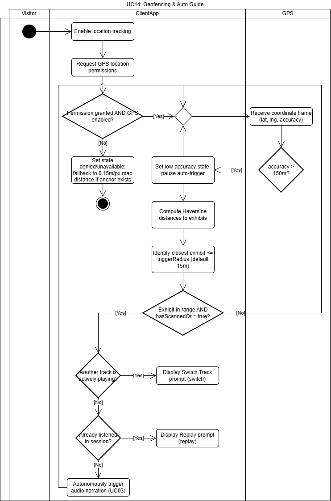


---

# CHAPTER 4: INTERFACE IMPLEMENTATION & FRONT-END ENGINEERING

## 4.1. Source Tree Architecture

The software codebase is organized following Clean Architecture principles, establishing clear boundaries between the Web SPA (`frontend/`), the Mobile App (`mobile/`), and the backend service subsystem (`backend/`):

```text
Do_an_CNPM/
├── frontend/src/                # Complete Web SPA source codebase (React 18 + Vite)
│   ├── App.tsx                  # Root application router (Visitor & Admin layout distribution)
│   ├── visitor/                 # Visitor-facing interface subsystem
│   │   ├── VisitorLayout.tsx    # Shell navigation layout integrating QR deep-linking & GPS routing
│   │   ├── components/          # AudioPlayerBar, LanguageSwitcher, TrackingPanel
│   │   └── views/               # ExploreView, FloorMapView, FavoritesView, InfoView, QRScannerModal
│   ├── admin/                   # Administrator CMS interface subsystem
│   │   ├── AdminLayout.tsx      # Admin Dashboard shell layout
│   │   └── views/               # AdminLoginView, ArtifactManageView, SessionManageView, AudioManageView, MapManageView, AnalyticsView
│   └── shared/                  # Shared services, utility modules, and state stores
│       ├── stores/              # playerStore, geofenceStore, langStore, favStore, adminAuthStore
│       └── utils/               # geofence.ts (15m, 150m), qrHelper.ts, loginLock.ts (5min), floorHelper.ts
│
├── mobile/                      # Standalone Android application (Expo SDK 58 React Native, Offline-First)
│   ├── app/                     # Expo Router: (tabs)/index, favorites, info, map, scanner, artifact/[id]
│   ├── assets/museum/           # Pre-packaged 5-language audio files (.mp3) and bundled artifact graphics
│   └── src/shared/              # assetMap.ts (static mapping of 100 media files), stores (player, geofence), utils
│
└── backend/src/                 # Express + MSSQL API server subsystem
    ├── db/schema.sql            # Microsoft SQL Server relational database schema (12 tables in 3NF)
    ├── routes/                  # auth.ts (1min lock), museum.ts, analytics.ts, translate.ts, uploads.ts (audio 30MB)
    └── repositories/            # adminRepo.ts, museumRepo.ts, analyticsRepo.ts
```

## 4.2. Mapping Between Design Diagrams and Implementation Source Code

Each Use Case and architectural component defined in the design specifications is concretely realized by dedicated source code files and technical logic within the repository:

| **No.** | **Use Case Code** | **Use Case Title** | **Web & Mobile Implementation Source Files** | **Responsible Technical Component / Logic** |
|:---:|:---|:---|:---|:---|
| 1 | **UC01** | Admin Authentication | `AdminLoginView.tsx`<br>`loginLock.ts`<br>`auth.ts` | Authenticates admin credentials, tracks consecutive failures, enforces two-tier security lockout (5 minutes in Frontend `localStorage`, 1 minute in Backend `AdminUser.LockedUntil`), and issues JWT tokens. |
| 2 | **UC02** | Scan QR Code | `QRScannerModal.tsx`<br>`qrHelper.ts`<br>`mobile/app/scanner.tsx` | Initializes device camera via Web MediaDevices API / `expo-camera`, decodes URL payloads (`?artifact=` or `?entry=gate`), supports manual code entry fallback A1, and records origin anchor points. |
| 3 | **UC03** | Listen to Audio Guide | `AudioPlayerBar.tsx`<br>`playerStore.ts`<br>`mobile/src/shared/assetMap.ts` | Bottom-docked Web/Native Audio player, plays pre-packaged MP3 assets directly from APK storage (Android), manages Play/Pause/Seek controls, variable playback speed (`1x–2x`), and dispatches listening telemetry. |
| 4 | **UC04** | Switch Language | `LanguageSwitcher.tsx`<br>`langStore.ts` | Executes instant reactive state updates across 5 languages (`vi`, `en`, `zh`, `ko`, `ja`), persists selection to `localStorage`/`AsyncStorage`, zero page reload. |
| 5 | **UC05** | Save Favorite Artifacts | `FavoritesView.tsx`<br>`mobile/app/(tabs)/favorites.tsx` | Persists and removes bookmarked exhibits directly within local storage (`localStorage` / `AsyncStorage` under `user_favorites`), with automatic purging of orphaned IDs. |
| 6 | **UC06** | View Museum Information | `InfoView.tsx`<br>`mobile/app/(tabs)/info.tsx` | Displays institutional overview, history, visiting hours, and telephone hotline (tap-to-call direct dialing on mobile). |
| 7 | **UC07** | View Synchronized Subtitles | `AudioPlayerBar.tsx`<br>`mobile/app/artifact/[id].tsx` | Synchronizes karaoke-style subtitles second-by-second (`SubtitleCue`), supporting interactive phrase tapping to seek playback position. |
| 8 | **UC08** | Search Artifacts | `ExploreView.tsx`<br>`mobile/app/(tabs)/index.tsx` | Multi-criteria search matching artifact titles, multilingual descriptions, standardized codes (`WRM001`), and floor facet filtering. |
| 9 | **UC09** | Manage Artifacts | `ArtifactManageView.tsx`<br>`translate.ts`<br>`uploads.ts` | Full CRUD operations on exhibits, automated 5-language translation via Google Translate API / MyMemory fallback, image upload validation (≤ 10MB). |
| 10 | **UC10** | Manage Sessions & QR Codes | `SessionManageView.tsx`<br>`QRManageView.tsx`<br>`analytics.ts` | Manages visiting shifts (`SES-xx`), heartbeat monitoring (10–15s, timeout 35s), and generates high-resolution printable PNG QR graphics. |
| 11 | **UC11** | Manage Audio Files | `AudioManageView.tsx`<br>`uploads.ts` | Audio file upload handler (MP3/WAV ≤ 30MB, Nginx 35m client body limit), inline preview player, and interactive `SubtitleCue` timeline editor. |
| 12 | **UC12** | View Listening Analytics | `AnalyticsView.tsx`<br>`analytics.ts` | Recharts data visualizations depicting listening engagement trends over time, language proportions, top exhibits, and CSV data export. |
| 13 | **UC13** | Manage Floor Maps | `MapManageView.tsx`<br>`floorHelper.ts` | Floor plan image upload, interactive drag-and-drop canvas for calibrating normalized pixel coordinates (X, Y) and GPS coordinates/radii. |
| 14 | **UC14** | Geofencing & Auto Guide | `geofence.ts`<br>`geofenceStore.ts`<br>`FloorMapView.tsx` | Hybrid positioning: QR origin anchor + high-accuracy GPS, Haversine distance algorithm, 15m trigger radius, GPS variance filter (> 150m), smart switch/replay dialogs. |

***Table 4.1: Cross-Reference Between Architectural Design and Implementation Source Code***

## 4.3. Key Completed Technical Features

1. **Hybrid Geofencing Tracking:**
   - Mitigates GPS multipath drift in enclosed spaces: When a visitor scans a QR code at an entrance gate or artifact placard, the system immediately registers that location as the origin anchor (`anchorArtifactId`).
   - The device GPS sensor runs continuously in high-accuracy mode (`enableHighAccuracy: true` / `Location.Accuracy.High`). The Haversine algorithm calculates real-time spherical distance between the visitor's coordinates and exhibits on the active floor.
   - When distance falls within $\le 15\text{ m}$ (governed by `DEFAULT_TRIGGER_RADIUS`), the system automatically identifies the closest exhibit, projects a pulsing green halo ("You are here") on the floor plan, and either triggers playback or presents an intelligent switch/replay prompt.

2. **Docked Audio Player & Synchronized Karaoke Subtitles:**
   - The audio player remains docked at the bottom of the screen, allowing visitors to navigate floor plans and catalog lists without interrupting audio playback.
   - Comprehensive playback controls include Play/Pause toggling, smooth progress scrubbing, and multiple playback speed presets (`1x`, `1.25x`, `1.5x`, `2x`).
   - The subtitle container aligns with audio playback offset timestamps using `SubtitleCue` metadata, smoothly scrolling text and highlighting active phrases.

3. **Reactive Multilingual Architecture (Zero Page Reload):**
   - Supports 5 full localizations: Vietnamese (`vi`), English (`en`), Chinese (`zh`), Korean (`ko`), and Japanese (`ja`).
   - Powered by a reactive Zustand store: Switching languages instantaneously updates all UI labels, descriptive passages, and audio track references across the entire application without requiring a page reload.

4. **Robust Authentication Security & Brute-Force Lockout:**
   - Strict privilege segregation: Visitors require no account credentials, preserving user privacy by storing preferences exclusively in local device storage.
   - Administrative portals are protected by a two-tier brute-force mitigation mechanism: Consecutive failed attempts are tracked. Upon 5 failures, the Frontend locks the form for 5 minutes in `localStorage`, while the Backend concurrently locks the account for 1 minute in `AdminUser.LockedUntil`.

---

# CHAPTER 5: CI/CD PIPELINE & SOFTWARE TESTING

## 5.1. CI/CD Pipeline Setup with GitHub Actions

Continuous Integration and Continuous Deployment (CI/CD) pipelines are established using GitHub Actions to guarantee source code integrity, enforce quality gates, and automate release distribution:

1. **Continuous Integration (CI) Phase:**
   - Automatically triggered on every Pull Request or direct push to the `main` branch.
   - Executes syntax validation and code styling checks: `npm run lint` (ESLint) across both Web and Mobile repositories.
   - Performs static TypeScript compilation checks: `tsc --noEmit` to intercept data typing discrepancies early.

2. **Automated Unit Testing Phase:**
   - Automatically executes the Vitest test runner for Web/Backend (`npm test -- --run`) and Jest for Mobile (`npm test`).
   - Comprehensive unit test suites run independently, covering core algorithmic logic: Haversine distance computations (`geofence.test.ts`), brute-force lockout logic (`login_lock.test.ts`), QR deep-link decoding (`qr_helper.test.ts`), audio player state (`player.test.ts`), subtitle synchronization (`subtitles.test.ts`), and visitor UI interactions (`visitor_click.test.ts`).

3. **Tri-Target Continuous Deployment (CD) Phase:**
   - **Web Demo (GitHub Pages):** `.github/workflows/deploy.yml` builds the production Vite bundle and deploys static assets to GitHub Pages CDN.
   - **Docker Images (GHCR):** `.github/workflows/docker.yml` builds and packages container images for `frontend` (Nginx) and `backend` (Node.js Express), publishing them to GitHub Container Registry.
   - **Android APK (GitHub Releases):** `.github/workflows/mobile.yml` executes `expo prebuild --platform android` and `./gradlew assembleRelease` to compile and publish the standalone release file `museum-audio-guide.apk` to GitHub Releases.

## 5.2. Testing Plan and Empirical Results

All 14 Use Cases were subjected to functional validation and empirical testing on real physical mobile devices, satisfying all evaluation criteria:

| **Scenario ID** | **Evaluated Use Case** | **Test Execution Scenario** | **Expected Result** | **Empirical Outcome** |
|:---:|:---|:---|:---|:---:|
| **TC_01** | **UC01** — Login | Submit 5 consecutive invalid passwords into admin login form | Frontend locks form for 5 minutes with countdown timer; Backend locks `AdminUser.LockedUntil` for 1 minute (HTTP 429) | **PASS**<br>*(4 tests)* |
| **TC_02** | **UC02 & UC14** — QR Scan & Anchor | Scan QR codes with deep-link query parameters: `?entry=gate`, `?artifact=WRM001` | Correctly decodes code, populates metadata, and establishes origin tracking anchor | **PASS**<br>*(5 tests)* |
| **TC_03** | **UC14** — Geofencing | Evaluate Haversine algorithm with GPS coordinates, verify 15m radius and closest-exhibit selection | Distance error variance < 0.1m, accurately detects triggering perimeter | **PASS**<br>*(7 tests)* |
| **TC_04** | **UC03 & UC07** — Audio & Subtitles | Play MP3 audio, seek progress, adjust playback speed (`1x–2x`), and toggle karaoke subtitles | Smooth audio playback, subtitle text scrolls in sync second-by-second | **PASS**<br>*(4 tests)* |
| **TC_05** | **UC04** — Language Switch | Toggle between 5 languages (`vi`, `en`, `zh`, `ko`, `ja`) | Entire UI text and audio stream swap instantaneously without page reload | **PASS** |
| **TC_06** | **UC05** — Favorites | Click heart icon to save artifact, refresh web browser | Artifact persists in Favorites catalog (stored reliably in LocalStorage / AsyncStorage) | **PASS**<br>*(1 test)* |
| **TC_07** | **UC06 & UC08** — Info & Search | Search keyword "Dong Son drum", code "WRM001", and inspect museum profile | Real-time filtering, accurately routes to artifact detail view | **PASS** |
| **TC_08** | **UC09 & UC13** — Artifacts & Maps | Add new artifact, drag and drop to assign (X, Y) coordinates on floor plan | Normalized ratio coordinates saved, pin renders accurately on floor map | **PASS** |
| **TC_09** | **UC10** — Sessions & QR Export | Create new visiting session (`SES-01`), export gate entrance QR image | Session code generated, high-resolution QR graphic rendered with museum logo | **PASS** |
| **TC_10** | **UC11 & UC12** — Audio & Analytics | Upload new audio track (≤ 30MB) and inspect listening telemetry analytics | MP3 linked correctly to artifact, charts render engagement metrics by shift | **PASS** |

***Table 5.1: Consolidated Test Plan and Empirical Evaluation Results Across 14 Use Cases***

---

# CHAPTER 6: CONCLUSION & FUTURE WORK

## 6.1. Key Project Achievements

Through the methodical application of software engineering principles, object-oriented systems analysis, and empirical development, the project has achieved all original academic and engineering goals:

1. **Academic Rigor and Architectural Modeling:**
   - Established a software architecture design portfolio adhering strictly to the OMG UML 2.5.1 specification.
   - Streamlined business operational scope into **14 focused Use Cases**, eliminating registration friction for museum visitors.
   - Modeled Component Diagrams, Deployment Diagrams, Relational Data Models (12-table 3NF ERD), Data Flow Diagrams (DFD Levels 0, 1, 2), and 14 Activity Diagrams formulated in ActScript syntax achieving 100% automated linter validation (0 errors, 0 warnings).

2. **Software Product Quality:**
   - Delivered a high-performance Web Single-Page Application (SPA) alongside an Offline-First Android mobile application, providing smooth mobile responsiveness and sub-second initial load speeds.
   - Implemented a refined "Dark Luxury" design aesthetic, cultivating a respectful, immersive atmosphere suited for museum exhibition environments.

3. **Core Functional Capabilities:**
   - Implemented Hybrid Geofencing: establishing an initial QR anchor, tracking proximity within a 15-meter activation radius (filtering GPS inaccuracy > 150m), and automatically triggering or prompting interpretive narration upon approaching exhibits.
   - Built a docked audio player paired with second-by-second karaoke subtitle synchronization and instant 5-language localization.
   - Provided an intuitive Admin CMS Dashboard: artifact management, interactive drag-and-drop floor map calibration, tour session scheduling, and high-resolution QR graphic exportation.

4. **Software Engineering Process:**
   - Adhered to modern software engineering practices: strict TypeScript typing, Git branch-based version control, automated unit test suites, and GitHub Actions CI/CD pipelines deploying concurrently across three target channels.

## 6.2. Limitations and Existing Challenges

Alongside the achieved milestones, several areas remain open for further enhancement:
- **Indoor GPS Signal Attenuation:** In basement exhibition galleries or structures with thick concrete walls, satellite GPS signals can attenuate or drift. While partially mitigated through QR origin anchors and pixel map fallback algorithms (`MAP_METERS_PER_PIXEL = 0.15` m/px), dedicated indoor hardware integration remains desirable.
- **Delta Asset Updates for Offline Mobile:** The current Android release embeds all media assets statically within the APK bundle. Incorporating dynamic delta synchronization from the server for new exhibits without requiring a full APK re-installation would offer greater operational flexibility.

## 6.3. Future Research and Development Directions

In future research and upgrade phases, the system architecture can be expanded along the following trajectories:
1. **Indoor Positioning via Bluetooth Beacons (BLE) / UWB:** Deploying low-energy Bluetooth beacon transmitters (iBeacon/Eddystone) or Ultra-Wideband (UWB) modules at individual exhibition display cases to achieve centimeter-level indoor positioning accuracy, triggering narration independently of GPS reception.
2. **AI-Powered Text-to-Speech (AI TTS):** Integrating neural text-to-speech models to generate natural, expressive voice narrations dynamically from written interpretive copy across multiple accents, reducing studio recording overhead.
3. **Augmented Reality (AR 3D) Visualization:** Incorporating WebXR/AR frameworks so that when visitors aim their camera at an exhibit, reconstructed 3D models and historical contextual scenes render interactively over the physical object.

---

# REFERENCES

- **\[1\]** Saigon University, *Software Engineering Course Curriculum*, Faculty of Information Technology, 2024.
- **\[2\]** Saigon University, *Detailed Syllabus and Capstone Project Implementation Regulations for Software Engineering*, 2025.
- **\[3\]** Object Management Group (OMG), *OMG Unified Modeling Language (OMG UML) Specification, Version 2.5.1*, formal/2017-12-05, 2017.
- **\[4\]** Ian Sommerville, *Software Engineering* (10th Edition), Pearson Education, 2016.
- **\[5\]** Roger S. Pressman, Bruce R. Maxim, *Software Engineering: A Practitioner's Approach* (9th Edition), McGraw-Hill Education, 2020.
- **\[6\]** Martin Fowler, *UML Distilled: A Brief Guide to the Standard Object Modeling Language* (3rd Edition), Addison-Wesley Professional, 2003.
- **\[7\]** Mozilla Developer Network (MDN), *Web APIs Documentation: Web Audio API, Geolocation API, MediaDevices*, https://developer.mozilla.org/, 2026.
- **\[8\]** React Documentation, *The Library for Web and Native User Interfaces*, https://react.dev/, 2026.
- **\[9\]** Tailwind CSS Documentation, *A Utility-First CSS Framework for Rapid UI Development*, https://tailwindcss.com/docs, 2026.
- **\[10\]** HTML5-QRCode Library, *Cross-platform HTML5 QR Code reader*, https://github.com/mebjas/html5-qrcode, 2025.

---

# APPENDIX: DESIGN PORTFOLIO AND IMPLEMENTATION CROSS-REFERENCE

## 1. Visitor Subsystem Mobile Extension (Expo React Native)
To satisfy the capstone track requirements bridging **React Native and React.js** while ensuring an optimal visitor experience independent of museum Wi-Fi infrastructure, the project developed the standalone **`mobile/`** Android application:
- **Offline-First Architecture:** All 100 media files (multilingual audio tracks `.mp3/.wav`, exhibit photography, 4-floor map graphics) alongside `museum_data.json` are bundled directly into the compiled APK via static mapping in `mobile/src/shared/assetMap.ts`.
- **Integrated Native Modules:**
  - `expo-camera`: Decodes artifact and entrance gate QR codes (with manual code entry fallback).
  - `expo-location`: Tracks high-accuracy GPS coordinates (`Location.Accuracy.High`), utilizing the shared Haversine algorithm (`geofence.ts`, default **15m** activation radius, **150m** maximum acceptable accuracy threshold).
  - `expo-audio`: Handles pre-packaged audio narration playback, supporting background audio when the device screen is off, scrubbing, and speed adjustments (`1x–2x`).
  - `@react-native-async-storage/async-storage`: Persists visitor language preferences and personal bookmarked favorites locally.
- **Optional Online Synchronization:** When configured with an active `EXPO_PUBLIC_API_URL`, the application queries `GET /api/museum` for live catalog updates and transmits telemetry (`POST /api/sessions/heartbeat`, `POST /api/analytics/listen`) to the shared Express + MSSQL backend.

## 2. Tri-Target CI/CD Automation Pipeline
- **Web Demo:** `.github/workflows/deploy.yml` runs ESLint, Vitest (22 tests), builds the Vite web distribution, and deploys to **GitHub Pages**.
- **Containers (Frontend + Backend):** `.github/workflows/docker.yml` builds production container images for `frontend` (Nginx) and `backend` (Node.js Express), publishing them to **GHCR**.
- **Android APK:** `.github/workflows/mobile.yml` executes ESLint, `tsc --noEmit`, Jest (10 tests), `expo prebuild --platform android`, and `./gradlew assembleRelease` to compile and publish `museum-audio-guide.apk` to Artifacts and **GitHub Releases**.
